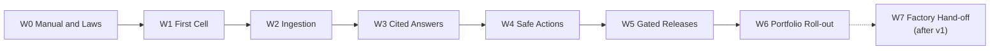

# Second Brain

**One reusable platform that makes every acquired company AI-first, fast, without giving up who-may-see-what.**

Second Brain (codename **SB**) indexes a company's docs, chat, tickets and CRM. It answers questions with citations to exact document versions the asker can open, and it runs a small set of agent actions that a human always sends or approves. Every company gets its own isolated cell, stamped from one template and configured by one file.

```yaml
tenant: acme-logistics
channel: stable
idp: oidc://login.acme.example
region: eu
connectors: { docs: sharepoint, chat: slack }
agents: [ask, draft-reply]
```

```sh
sb tenant check  acme.yaml     # is the manifest valid?
sb tenant apply  acme.yaml     # build or update the cell
sb tenant verify acme.yaml     # do the laws hold on real data?
```

Those three commands are the whole onboarding story for a company's IT team.

## The rules it will not break

If the platform says it, it holds. These are the **laws**. Each one is tested, model-checked or both, and a breach in production is a Sev-1.

| Law | In one line |
|---|---|
| LAW-01 | No answer cites or uses a document the asker can't open at answer time |
| LAW-02 | No retrieval crosses a tenant boundary |
| LAW-03 | An unknown permission result means refusal (`EPERM`), never a pass |
| LAW-04 | Every tool call has an audit row before it runs |
| LAW-05 | An action "ran" only if the target system returned a receipt |
| LAW-15 | An approval approves exactly one payload, and nobody approves their own action |

All 18 are in [`sb-laws(7)`](manual/sb-laws.7.md).

## A factory, with hand-off

The control plane, cell template and release train are the **factory**. It produces and runs every company's Second Brain as an isolated cell. After v1, a company can be **handed custody** of its own Second Brain, in its own cloud account under its own keys, or can detach entirely. v1 doesn't build hand-off, but it builds the seams so hand-off won't need a rebuild ([`sb-factory(7)`](manual/sb-factory.7.md), [ADR-0015](docs/adr/ADR-0015-factory-and-handoff.md)).

## What's in this repo

This repo is **manual first**. The design, the plan and the man pages come before the code, and the code follows the manual.

| Path | What it is |
|---|---|
| `docs/` | Problem statement, principles, domain model, PRD, testing strategy, standards, threat model |
| `docs/architecture/` | One document per subsystem, each with Mermaid diagrams |
| `docs/adr/` | Architecture decision records |
| `manual/` | Man pages: commands (1), API (3), file formats (5), concepts (7). **The manual is the spec.** |
| `epics/` | 9 epics, 96 tickets with subtasks, in 8 waves (v1 is W0 to W6; W7 is hand-off) |
| `living/` | Devlog, bugs and mitigations, assurance ledger, changelog, glossary, open questions, risks |
| `proofs/` | TLA+ and Alloy models of approvals, rollout and permissions |
| `examples/` | Example manifests, policies, eval suites and a connector |
| `tools/` | Site generator, link checker, CI helpers |
| `site/` | The generated docs site. Open `site/index.html` |

## Read in this order

1. [Problem statement](docs/00-problem-statement.md)
2. [Principles](docs/01-principles.md)
3. [Architecture overview](docs/architecture/00-overview.md)
4. [PRD](docs/03-prd.md)
5. [`sb-tour(7)`](manual/sb-tour.7.md)
6. [Plan](epics/README.md): start with SB-001

## Build and check

```sh
pip install pyyaml markdown cedarpy    # Python tools used by the checks
make check                              # the gate: must be green before any PR
bin/sb version
```

`make check` needs Go 1.24, Python 3.12+ and `golangci-lint` v2. `make diagrams` (Playwright plus `npm install --prefix tools/check`) and `make proofs` (Java 21) run as separate CI jobs.

## Build the docs site

```sh
pip install markdown
python3 tools/site/build.py          # writes site/
python3 tools/check/links.py site    # every link and anchor resolves
open site/index.html                 # or xdg-open
```

## The plan in one picture



The formal models arrive in **Wave 0**, before the first line of product code.

## Contributing

See [CONTRIBUTING.md](CONTRIBUTING.md). In short: pick the lowest-wave open ticket, write the man page first, write the laws as tests, implement, update the living docs, then open a PR.

## Name

"Second Brain" and `sb` are working names. To rename, search and replace `Second Brain`, `SB-` and the `sb` command.
