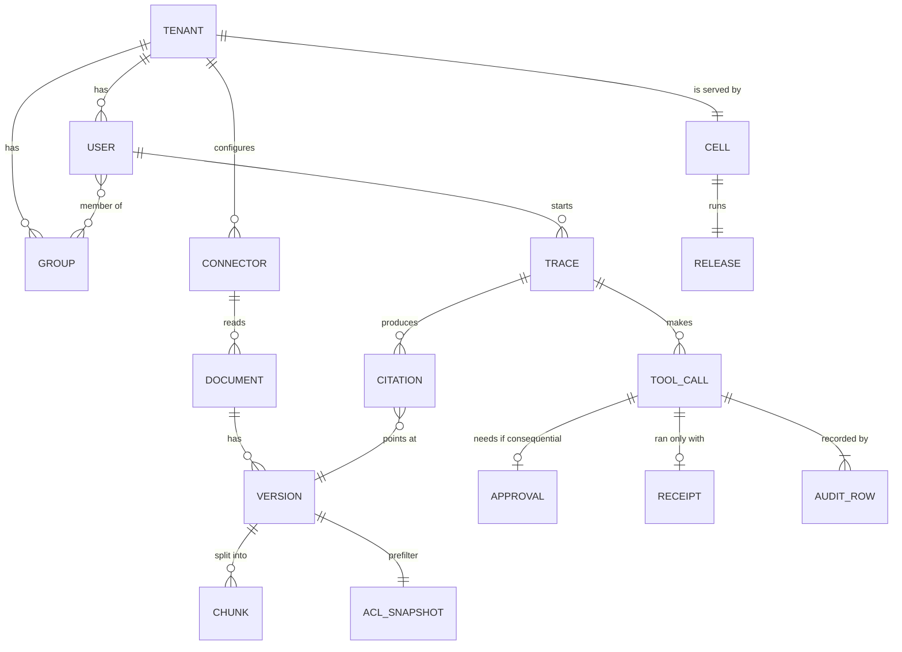
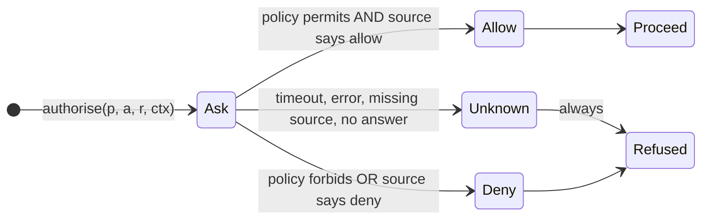
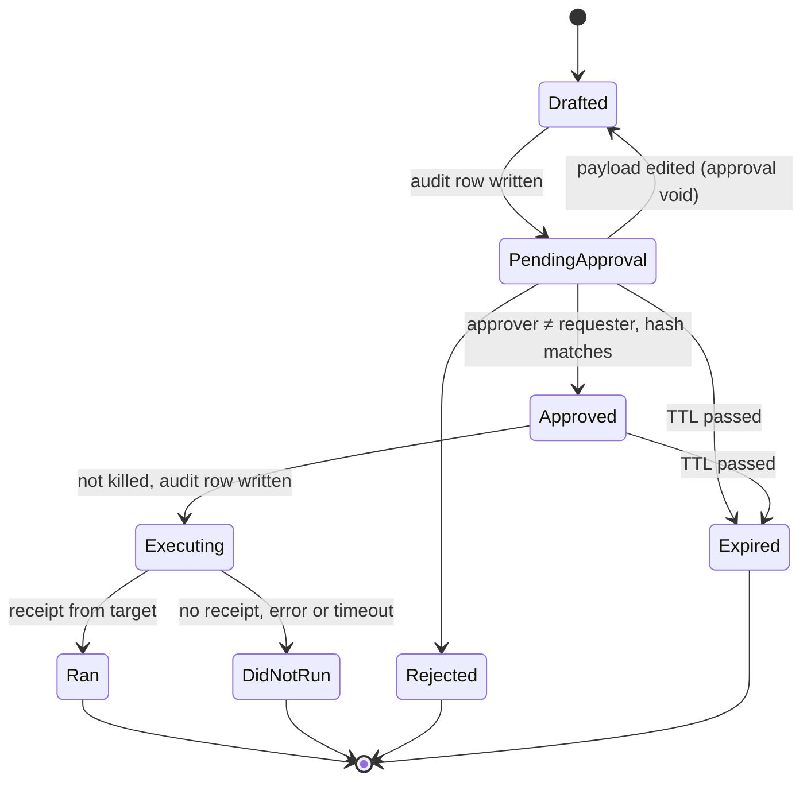

# Domain model

One vocabulary is used everywhere: code, man pages, APIs, logs and the UI. If a word isn't in this page or the [glossary](../living/GLOSSARY.md), don't use it in an interface.

## Identifiers

Every identifier is a lowercase, prefixed, greppable string. Prefixes make logs readable by humans and parseable by scripts.

| Entity | Format | Example |
|---|---|---|
| Tenant | DNS label, immutable | `acme-logistics` |
| User | `usr_` + ULID | `usr_01JD3Q8Z5X9K2T4M6N8P0R2S4V` |
| Group | `grp_` + IdP group id hash | `grp_7f3a91c2` |
| Source document | `<connector>:<source-id>` | `docs:4f2a9c11` |
| Citation | `<connector>:<source-id>@<version>` | `docs:4f2a9c11@17` |
| Chunk | `chk_` + ULID | `chk_01JD3QA1…` |
| Trace (one ask or one agent run) | `tr_` + ULID | `tr_01JD3QB4…` |
| Tool call | `tc_` + ULID | `tc_01JD3QC7…` |
| Approval | `apr_` + ULID | `apr_01JD3QD9…` |
| Audit row | `aud_` + sequence number per cell | `aud_000000001234` |
| Release | `rel_` + date + short digest | `rel_2027-03-02_9b1c4e` |

ULIDs sort by time, so `ls`, `sort` and `grep` behave the way people expect.

## Core entities

| Entity | Lives in | System of record? | Notes |
|---|---|---|---|
| Tenant, cell, release | Control plane | Yes | The manifest is the source of truth for tenant config |
| User, group | Cell DB (from SCIM) | No: the IdP is | Deactivation propagates in 5 minutes or less (LAW-12) |
| Document, version | Source system | No: the source is | We store metadata and chunks only |
| Chunk, embedding | Cell index | No: derived | Rebuildable from sources at any time (LAW-13) |
| ACL snapshot | Cell index | No: a prefilter | The live `acl` call is the authority (ADR-0002) |
| Trace, citation | Cell DB | Yes | Kept for `retention_days` |
| Tool call, approval, receipt | Cell DB | Yes | Approvals bind to a payload hash (LAW-15) |
| Audit row | Cell audit store | Yes, forever per policy | Append-only, hash-chained (LAW-11) |

## The permission triple

Every read and every action asks one question:

> may **principal** do **action** on **resource**, given **context**?

The answer is one of three values. Callers have exactly one safe way to treat `Unknown`, and that is as `Deny`.

## Action lifecycle

An action is anything that changes state outside the platform. It moves through a fixed set of states, identical in code, in [`sb-approvals(7)`](../manual/sb-approvals.7.md) and in [`proofs/tla/Approvals.tla`](../proofs/tla/Approvals.tla).

## See also

[Glossary](../living/GLOSSARY.md) · [`sb-permissions(7)`](../manual/sb-permissions.7.md) · [`sb-citations(7)`](../manual/sb-citations.7.md) · [Architecture overview](architecture/00-overview.md)
