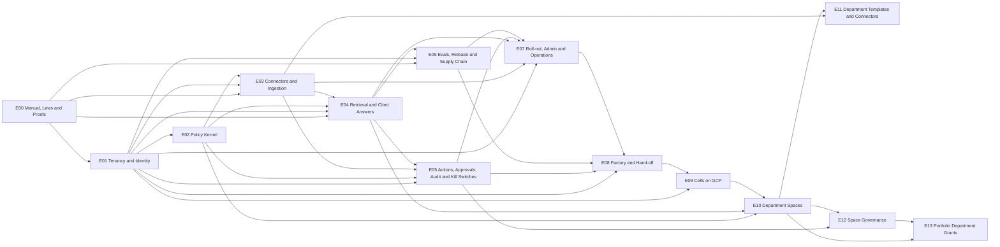
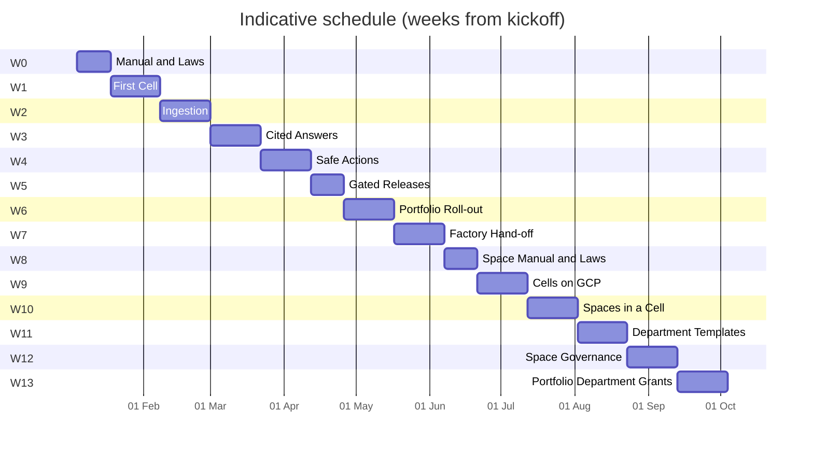

# Second Brain: Product Requirements Document

| Version | Date | Owner | Status | Related |
|---|---|---|---|---|
| 1.0-draft | 2026-11-18 | Platform lead | For review | [Problem](00-problem-statement.md) · [Principles](01-principles.md) · [Architecture](architecture/00-overview.md) · [Plan](../epics/README.md) |

## Summary

Second Brain is one reusable platform that a parent organisation rolls out to every company it acquires. Each company gets an isolated cell, configured by one manifest. Staff get **cited answers** built only from sources they can open right now. Teams get a small set of **agent actions** that humans send or approve. Operators get **kill switches** and a tamper-evident **audit log**. The parent gets **one template and one release train** instead of a different stack per company.

v1 ships in seven waves (W0 to W6), roughly 19 weeks. The formal models and law tests come first (W0). Cited answers reach a pilot in W3. Gated actions arrive in W4, and self-serve roll-out in W6.

The control plane is a **factory**: it produces and runs every tenant's Second Brain. After v1, wave **W7** (3 weeks) adds **hand-off**: transferring custody of one tenant's Second Brain into that company's own cloud account under its own keys, or detaching it entirely. v1 doesn't build hand-off, but it does build the seams that make hand-off a workflow rather than a migration (ADR-0015, SB-114).

After W7, waves **W8 to W12** (14 weeks) add **department brains**: each company's cell holds all its knowledge, split into department spaces (Engineering, People, Finance and so on) whose access can only narrow what each source allows (ADR-0020). W9 first runs cells for real on GCP (ADR-0021). The research and concept are in [08-department-brains.md](08-department-brains.md). The portfolio department grants first planned as W13 are parked while Q-01 stays no (2026-11-20).

Then **W13 Hardening** reviews, fuzzes and tidies the code and matches it to the manual, and **W14 Cell Runtime** runs every part of a cell together as real services, ending with a whole cell end to end. **W15 Self-hosted Cell** (built) puts a whole cell on one machine the company owns (ADR-0022). **W16 Team Knowledge** (built) adds ten small features for passing knowledge between people ([09-team-knowledge.md](09-team-knowledge.md)). **W17 Easy to Run**, **W18 Protect the Data** and **W19 Close the Loops** (all built) add twenty small features for operators, data protection and W16's gaps ([10-run-protect-close.md](10-run-protect-close.md)). **W20 Keep People in the Loop**, **W21 Keep Knowledge Owned** and **W22 Fit the Site** (all built) add twenty more: notifications, owned and right documents, and the site's languages, logs and storage ([11-loop-own-fit.md](11-loop-own-fit.md)). **W23 Easier to Ask**, **W24 Easier to Steward** and **W25 Easier to Operate** (all built) add twenty small quality-of-life features on what is built ([12-ask-steward-operate.md](12-ask-steward-operate.md)). **W26 Fresh Answers**, **W27 A Tidy Corpus** and **W28 A Focused Context** (all built) add twenty small features against stale data, document rot and context creep ([13-fresh-tidy-focused.md](13-fresh-tidy-focused.md)). **W29 Show the Evidence**, **W30 Fill the Gaps** and **W31 Run Without Surprises** (all built) add twenty small features: the evidence beside each answer, the gaps stewards can fill, and early warnings for operators ([14-evidence-gaps-surprises.md](14-evidence-gaps-surprises.md)). **W32 Ask Better** (built), **W33 Capture Knowledge** (built) and **W34 Trust and Control** (built) add twenty more: more from each answer, good replies kept for the next person, and people's control of their own data ([15-ask-capture-trust.md](15-ask-capture-trust.md)). **W35 Trust Each Answer** (built), **W36 Capture Conversations** (built) and **W37 Work Where People Are** (built) add twenty more, drawn from what other company knowledge tools do well: answers people can rely on, what's decided in meetings and chat, and the brain within reach of other tools ([16-trust-capture-reach.md](16-trust-capture-reach.md)). **W38 One Org, Many Levels**, **W39 An Agent for Every Department** and **W40 Run the Company** turn the brain into a company OS: spaces arranged as company, department and team, a read-only agent for every department, and goals, updates, policies and requests beside the knowledge ([17-org-agents-os.md](17-org-agents-os.md)). **W41 Agents That Do the Legwork**, **W42 Work That Comes to You** and **W43 Govern Every Agent** (built) add read-only agents that research, prepare and follow up, one inbox, routines and memory for each person, and owners, evals and a lint for every agent ([18-legwork-inbox-govern.md](18-legwork-inbox-govern.md)). **W44 Departments Work Together**, **W45 Agents You Can Shape** and **W46 Every Agent Accountable** (built) let department agents consult and hand off to each other as the asker, let stewards shape agents with skills and redrafts, and measure, cap, pause and record every agent ([19-departments-shape-account.md](19-departments-shape-account.md)). **W47 Ways of Working**, **W48 Agents That Check With You** and **W49 Run AI Like a Business** (built) add rhythms for the company's recurring moments (a new joiner, a project, a quarter, a reorg, a 1:1), agents that ask, take comments and run longer with checkpoints, and the usage, routing, limits, goals and outcome checks that make AI spend answer for itself ([20-rhythms-check-run.md](20-rhythms-check-run.md)). **W50 Guard What Goes In**, **W51 Write It Down Together** and **W52 Agents That Act Carefully** (built) check what agents read and send, roll features out to a pilot first and show how agents changed, send suggested edits back to sources and cite the page or slide, and start agents on work events, lend access for one run and draft the next action for a person to send ([21-guard-write-act.md](21-guard-write-act.md)). **W53 Know Who Can See**, **W54 See and Steer the Context** and **W55 Keep Answering, Spend Less** (built) find and hold back documents shared too widely and carry labels with every answer (LAW-32), let a person see and steer what each answer used and ask why a document wasn't, and keep answering when a provider fails while reuse, batching and prompt caching cut the cost ([22-see-steer-spend.md](22-see-steer-spend.md)). **W56 Right Model, Right Place** (built), **W57 Carry the Conversation** (built) and **W58 Reach Microsoft 365** (planned) batch on every provider without holding a run open, put people first when a provider is busy, use a deeper tier only where it helps and keep model calls in the company's region (LAW-33), carry a conversation from a chat thread to the web, other devices and colleagues, and connect SharePoint, OneDrive, Purview labels, Entra, Teams, Outlook calendars and shared mailboxes ([23-place-carry-reach.md](23-place-carry-reach.md)).

## Problem

Acquired companies have no single index of what they know, no reliable record of who may see what, and no record of who did what. AI use is ad hoc and unsafe, and every company starts from zero. The full statement is in [00-problem-statement.md](00-problem-statement.md).

## Goals and non-goals

**Goals (v1)**

| ID | Goal | Measure | Target |
|---|---|---|---|
| G1 | Fast time to value | Days from contract to first cited answer | 14 or fewer |
| G2 | Real adoption | Weekly active users ÷ seats at day 90 | 40% or more |
| G3 | Trust | Approve-to-reject ratio on drafts | Tracked; reviewed at day 45 |
| G4 | Soundness | Law violations in production | 0 |
| G5 | Self-serve | Onboarding steps needing the platform team | 0 |

**Non-goals (v1):** on-prem installs, self-hosted models, fine-tuning, Kubernetes, autonomous or multi-step write agents, ERP or CRM writes, per-company custom agents or forks, anything cross-company, and executing a custody hand-off (planned for W7; v1 builds only the seams).

## Personas

| Persona | Primary jobs | Most important features |
|---|---|---|
| **Asker** (company staff) | Find answers, draft replies | Cited answers, `uncited` label, chat-app entry point, `draft-reply` |
| **Operator** (company IT) | Onboard, configure, operate, stop | Manifest, `sb tenant check/apply/verify`, console, kill switches |
| **Approver** (company leadership) | Approve consequential actions, track adoption | Approver view with exact payload, weekly report |
| **Maintainer** (parent-org platform team) | Release, support, improve | Release controller, eval gate, attestation, observability |
| **Auditor / security** | Prove who saw and did what | Audit log, `sb audit verify`, threat model, laws |
| **Factory operator** (parent-org platform team) | Produce, run and hand off tenants | Cell template, custody records, `sb factory` (W7) |
| **Tenant owner** (company leadership or IT owner) | Accept custody of their Second Brain | Dual approval of the hand-off plan, LAW-17 proof, export package (W7) |
| **Steward** (a department lead, such as the HR or Finance lead) | Run their department's space, re-certify its members | Space changes as approved diffs, access reviews, legal hold (W12) |

## Functional requirements

| ID | Requirement | Wave | Epic |
|---|---|---|---|
| FR-01 | A tenant is fully described by one manifest; `sb tenant check` validates it with line-precise errors | W1 | E01 |
| FR-02 | `sb tenant apply` creates or updates an isolated cell idempotently in under 30 minutes | W1 | E01 |
| FR-03 | Users sign in with their company's OIDC IdP; users and groups are provisioned by SCIM | W1 | E01 |
| FR-04 | Every read and tool call is authorised by one policy engine returning allow, deny or unknown; unknown is refused | W1 | E02 |
| FR-05 | Connectors implement `fetch`, `acl`, `changes`, `act` and pass the contract kit | W2 | E03 |
| FR-06 | Docs and chat are ingested read-only with provenance; tickets follow; CRM read-only in W6 | W2, W6 | E03 |
| FR-07 | Ingested content is sanitised, flagged and treated as data; it can't trigger a tool call | W2 | E03 |
| FR-08 | Retrieval is tenant-scoped and uses the ACL prefilter; every chunk is live-authorised before entering context | W3 | E04 |
| FR-09 | Answers cite `doc@version` for each claim or label it `uncited` in code | W3 | E04 |
| FR-10 | Users can ask from a web UI and from the company chat app | W3 | E04 |
| FR-11 | `draft-reply` drafts with citations; a human always sends | W4 | E05 |
| FR-12 | Each tenant may enable one approval-gated write workflow; approvals bind to the exact payload hash | W4 | E05 |
| FR-13 | An action is `Ran` only with a target receipt; otherwise `DidNotRun` is shown plainly | W4 | E05 |
| FR-14 | Every tool call has an audit row before it executes; the log is append-only and hash-chained | W4 | E05 |
| FR-15 | Operators can kill any agent, connector or tenant in 10 seconds or less | W4 | E05 |
| FR-16 | No prompt, tool, policy or model change reaches a tenant without passing the eval gate | W5 | E06 |
| FR-17 | Builds are reproducible, signed and carry an SBOM; cells refuse unverified images | W5 | E06 |
| FR-18 | Releases roll out by ring and channel; rollback is one step | W5 | E06 |
| FR-19 | `sb tenant verify` reports pass or fail per law on the tenant's real data | W6 | E07 |
| FR-20 | Every console action is also a manifest diff | W6 | E07 |
| FR-21 | Leadership receives a weekly report on usage, citations and approvals | W6 | E07 |
| FR-22 | Retention and deletion follow `retention_days` | W6 | E07 |
| FR-23 | Every cell has a custody record and a placement; no code assumes the factory account or factory-held keys | W1 | E08 |
| FR-24 | A tenant's cell can be handed to tenant custody (own account, own root key) with dual approval, keeping audit continuity | W7 | E08 |
| FR-25 | After hand-off the cell still pulls signed releases; a tenant can instead detach with a complete export package | W7 | E08 |

## Non-functional requirements

| ID | Requirement | Target | Verified by |
|---|---|---|---|
| NFR-01 | Ask latency | p95 6 s or less | Staging load test, dashboard |
| NFR-02 | Freshness | p95 change-to-answerable 15 min or less | Ingest lag metric |
| NFR-03 | Kill-switch effect | 10 s or less | Drill every release (SB-404) |
| NFR-04 | Deprovisioning | 5 min or less | LAW-12 timed test |
| NFR-05 | Cell creation | under 30 min | SB-104 timing in CI |
| NFR-06 | Rollback | under 10 min, all cells | Drill every release (SB-508) |
| NFR-07 | Availability (ask) | 99.5% monthly per cell | SLO dashboard |
| NFR-08 | DR | RTO 4 h, RPO 15 min, in region | Game day (SB-613) |
| NFR-09 | Accessibility | WCAG 2.2 AA for web UI and console | Automated checks plus manual audit |
| NFR-10 | Security | No open critical/high pen-test findings at GA | SB-612 |
| NFR-11 | Content in telemetry | None | Redaction test (SB-607), scanner (LAW-07) |
| NFR-12 | Release lag | No tenant more than one behind stable | LAW-08 check |
| NFR-13 | Hand-off downtime | 30 min or less at cutover; zero data loss | Game day (SB-710) |

## Delivery model

- **Manual first.** Every ticket's first subtask is the man page (ADR-0009).
- **Laws first.** Law tests exist and fail red in W0; features turn them green. TLA+ and Alloy models are checked in CI from W0 (ADR-0010).
- **Thin slices.** Each slice is end-to-end and demoable. A wave ends only when its exit gate is met.
- **Living documents.** Every PR adds a devlog entry and updates the ledger, changelog and bugs log as needed ([05-living-documents.md](05-living-documents.md)).
- **Testing stack.** Unit, regression and smoke tests from day one, kept forever. From W3, laws, models and evals are the main gate ([04-testing-and-assurance.md](04-testing-and-assurance.md)).

## Epics

| Epic | Goal | Stories | Tickets |
|---|---|---|---|
| [E00 Manual, Laws and Proofs](../epics/E00-foundations/README.md) | The spec, the laws and the first formal models exist before features, and CI enforces the process. | 7 | 22 |
| [E01 Tenancy and Identity](../epics/E01-tenancy-identity/README.md) | One manifest and one command make an isolated cell; users sign in with their own SSO and see only their tenant. | 3 | 8 |
| [E02 Policy Kernel](../epics/E02-policy/README.md) | Every decision about who may see or do what goes through one small, analysable policy engine that treats unknown as deny. | 3 | 4 |
| [E03 Connectors and Ingestion](../epics/E03-connectors-ingestion/README.md) | Sources flow in read-only through a four-call contract, with ACLs, provenance and freshness, and ingested text is treated as untrusted data. | 5 | 12 |
| [E04 Retrieval and Cited Answers](../epics/E04-retrieval-answers/README.md) | Users ask in plain language and get answers citing document versions they can open, or a clear `uncited` label. | 5 | 10 |
| [E05 Actions, Approvals, Audit and Kill Switches](../epics/E05-actions-approvals-audit/README.md) | Agents draft and propose; humans send and approve; every tool call is audited before it runs; anything can be switched off in seconds. | 6 | 12 |
| [E06 Evals, Release and Supply Chain](../epics/E06-evals-release/README.md) | No agent, prompt, policy or model change reaches a tenant without passing evals, and every running build is a signed build that passed the gate. | 4 | 12 |
| [E07 Roll-out, Admin and Operations](../epics/E07-rollout-ops/README.md) | A company onboards itself with one file and three commands, and operators can see and control every tenant. | 6 | 12 |
| [E08 Factory and Hand-off](../epics/E08-factory-handoff/README.md) | One factory produces and runs every tenant's Second Brain, and can hand custody of one to its company without a rebuild. | 5 | 11 |
| [E09 Cells on GCP](../epics/E09-gcp-runtime/README.md) | A real cell runs on Google Cloud in its own project, with its schedules, metrics and verifier, and nothing in the core knows it's GCP. | 4 | 8 |
| [E10 Department Spaces](../epics/E10-department-spaces/README.md) | A company's brain holds all its knowledge, split into department spaces that can only narrow what each source allows. | 4 | 8 |
| [E11 Department Templates and Connectors](../epics/E11-department-templates/README.md) | Every common department starts from a template with its sources, labels, agents and evals, including code, HR and accounting systems. | 4 | 7 |
| [E12 Space Governance](../epics/E12-space-governance/README.md) | Department leads run their own spaces; barriers, segregation of duties, access reviews and reorgs work the way a real organisation needs. | 5 | 8 |
| [E13 Portfolio Department Grants](../epics/E13-portfolio-grants/README.md) | If the parent reads company data at all, it gets consented, aggregate-only, revocable grants on named spaces, never a superuser. | 2 | 4 |

## User stories

Each story is delivered by the listed tickets. Stories are written from the persona's point of view; acceptance lives on the tickets.

### E00 Manual, Laws and Proofs

- **US-00.1**: As a *maintainer*, I want to read the man page for any feature before code exists, so that I know exactly what to build. Delivered by [SB-004](../epics/E00-foundations/SB-004-first-drafts-sb-1-sb-tenant-1-sb-tenant-5.md), [SB-005](../epics/E00-foundations/SB-005-first-drafts-sb-connector-3-sb-permissions-7.md), [SB-006](../epics/E00-foundations/SB-006-api-conventions-and-the-error-registry.md).
- **US-00.2**: As a *reviewer*, I want CI to reject behaviour changes that do not change the manual, so that the manual never drifts from the code. Delivered by [SB-007](../epics/E00-foundations/SB-007-ci-rule-behaviour-change-needs-a-manual-diff.md).
- **US-00.3**: As a *maintainer*, I want the law tests to exist and fail red before features land, so that every feature is born against its laws. Delivered by [SB-010](../epics/E00-foundations/SB-010-law-harness-and-law-01-to-law-05-as-failing.md).
- **US-00.4**: As a *security reviewer*, I want the approval, rollout and permission designs model-checked, so that design flaws are found before code. Delivered by [SB-011](../epics/E00-foundations/SB-011-approvals-model-in-tla-checked-in-ci.md), [SB-012](../epics/E00-foundations/SB-012-rollout-model-in-tla-checked-in-ci.md), [SB-013](../epics/E00-foundations/SB-013-permissions-model-in-alloy-checked-in-ci.md).
- **US-00.5**: As a *new contributor*, I want one command that builds, tests and renders the docs, so that I am productive on day one. Delivered by [SB-001](../epics/E00-foundations/SB-001-repo-skeleton-and-toolchain.md), [SB-002](../epics/E00-foundations/SB-002-manual-layout-man-page-template-and-docs.md), [SB-009](../epics/E00-foundations/SB-009-link-check-diagram-check-and-manual-example.md), [SB-016](../epics/E00-foundations/SB-016-smoke-and-regression-test-conventions.md).
- **US-00.6**: As a *maintainer*, I want read the space, policy and department pages before any space code exists, so that spaces are built to a spec, not invented in a pull request. Delivered by [SB-801](../epics/E00-foundations/SB-801-sb-spaces-7-and-sb-space-5-first-drafts.md), [SB-802](../epics/E00-foundations/SB-802-permissions-and-policy-pages-for-spaces.md), [SB-803](../epics/E00-foundations/SB-803-department-catalogue-sb-departments-7.md).
- **US-00.7**: As a *security reviewer*, I want the space laws red and the spaces model checked before spaces exist, so that every space feature is born against its laws. Delivered by [SB-804](../epics/E00-foundations/SB-804-law-19-to-law-23-as-failing-tests.md), [SB-805](../epics/E00-foundations/SB-805-spaces-model-in-alloy-checked-in-ci.md), [SB-806](../epics/E00-foundations/SB-806-threat-model-v1-for-spaces-and-adr-sign-off.md), [SB-807](../epics/E00-foundations/SB-807-space-leak-eval-scaffold.md).

### E01 Tenancy and Identity

- **US-01.1**: As a *parent-org platform engineer*, I want to add a company with one manifest and one pipeline run, so that onboarding is repeatable and boring. Delivered by [SB-101](../epics/E01-tenancy-identity/SB-101-manifest-schema-parser-and-sb-tenant-check.md), [SB-102](../epics/E01-tenancy-identity/SB-102-sb-tenant-apply-plan-dry-run.md), [SB-103](../epics/E01-tenancy-identity/SB-103-cell-template-infrastructure-as-code.md), [SB-104](../epics/E01-tenancy-identity/SB-104-sb-tenant-apply-idempotent-cell-creation.md), [SB-105](../epics/E01-tenancy-identity/SB-105-control-plane-tenant-registry-and-cell.md).
- **US-01.2**: As a *company staff member*, I want to sign in with my company's SSO and see only my company, so that I trust what I see. Delivered by [SB-106](../epics/E01-tenancy-identity/SB-106-oidc-sign-in-per-tenant.md), [SB-108](../epics/E01-tenancy-identity/SB-108-tenant-scoped-request-context.md).
- **US-01.3**: As a *company IT operator*, I want deprovisioning in our IdP to remove access within minutes, so that leavers lose access without a ticket to anyone. Delivered by [SB-107](../epics/E01-tenancy-identity/SB-107-scim-provisioning-and-fast-deprovisioning.md).

### E02 Policy Kernel

- **US-02.1**: As a *security reviewer*, I want one `authorise` call that every path goes through, so that there is one place to audit and prove. Delivered by [SB-109](../epics/E02-policy/SB-109-policy-engine-v0-authorise-returns-allow.md).
- **US-02.2**: As a *company IT operator*, I want policies written in a small, readable language with a schema, so that I can review rules without reading code. Delivered by [SB-110](../epics/E02-policy/SB-110-cedar-schema-and-base-policies.md), [SB-112](../epics/E02-policy/SB-112-policy-analysis-in-ci.md).
- **US-02.3**: As an *auditor*, I want every policy decision recorded with its reason, so that I can explain any allow or deny later. Delivered by [SB-111](../epics/E02-policy/SB-111-policy-decisions-are-audited.md).

### E03 Connectors and Ingestion

- **US-03.1**: As a *company IT operator*, I want to connect docs and chat read-only from the manifest, so that setup is one line per source. Delivered by [SB-201](../epics/E03-connectors-ingestion/SB-201-connector-contract-sdk-and-contract-kit.md), [SB-203](../epics/E03-connectors-ingestion/SB-203-docs-connector-first-vendor-read-only.md), [SB-204](../epics/E03-connectors-ingestion/SB-204-chat-connector-read-only.md), [SB-205](../epics/E03-connectors-ingestion/SB-205-connector-credentials-via-vault-references.md).
- **US-03.2**: As a *company staff member*, I want new and changed documents to show up within the freshness SLA, so that answers reflect today's truth. Delivered by [SB-206](../epics/E03-connectors-ingestion/SB-206-ingest-pipeline-chunk-embed-tag-provenance.md), [SB-208](../epics/E03-connectors-ingestion/SB-208-incremental-sync-via-changes-with-freshness.md), [SB-209](../epics/E03-connectors-ingestion/SB-209-deletion-and-acl-change-propagation.md).
- **US-03.3**: As a *security reviewer*, I want ingested text treated as data, never as instructions, so that a poisoned document cannot drive an agent. Delivered by [SB-207](../epics/E03-connectors-ingestion/SB-207-ingest-sanitiser-and-injection-flags.md).
- **US-03.4**: As a *platform engineer*, I want the index to be rebuildable from sources at any time, so that the index is never a system of record. Delivered by [SB-210](../epics/E03-connectors-ingestion/SB-210-index-rebuild-from-sources.md).
- **US-03.5**: As a *connector author*, I want a contract kit and a fault-injecting mock, so that a new connector is correct by test, not by review. Delivered by [SB-201](../epics/E03-connectors-ingestion/SB-201-connector-contract-sdk-and-contract-kit.md), [SB-202](../epics/E03-connectors-ingestion/SB-202-fault-injecting-mock-connector.md), [SB-211](../epics/E03-connectors-ingestion/SB-211-tickets-connector-read-only.md), [SB-610](../epics/E03-connectors-ingestion/SB-610-crm-connector-read-only.md).

### E04 Retrieval and Cited Answers

- **US-04.1**: As a *company staff member*, I want an answer with citations to specific document versions I can open, so that I can check the answer myself. Delivered by [SB-301](../epics/E04-retrieval-answers/SB-301-tenant-scoped-hybrid-retrieval-with-acl.md), [SB-304](../epics/E04-retrieval-answers/SB-304-answer-composer-with-doc-version-citations.md), [SB-306](../epics/E04-retrieval-answers/SB-306-ask-agent-and-post-v1-ask.md).
- **US-04.2**: As a *company staff member*, I want answers with nothing to cite clearly labelled `uncited`, so that I know when to be sceptical. Delivered by [SB-304](../epics/E04-retrieval-answers/SB-304-answer-composer-with-doc-version-citations.md).
- **US-04.3**: As a *security reviewer*, I want nothing the asker cannot open to ever reach the model's context, so that permissions hold even if the model misbehaves. Delivered by [SB-302](../epics/E04-retrieval-answers/SB-302-live-authorisation-of-every-chunk-before.md), [SB-303](../epics/E04-retrieval-answers/SB-303-batched-acl-checks-and-latency-budget.md).
- **US-04.4**: As a *company staff member*, I want to ask from the web or from our chat app, so that I don't change tools to get help. Delivered by [SB-307](../epics/E04-retrieval-answers/SB-307-web-chat-ui.md), [SB-308](../epics/E04-retrieval-answers/SB-308-chat-app-entry-point.md).
- **US-04.5**: As a *product owner*, I want pilot feedback captured against each answer, so that we improve on evidence. Delivered by [SB-305](../epics/E04-retrieval-answers/SB-305-model-gateway-adapter.md), [SB-310](../epics/E04-retrieval-answers/SB-310-feedback-capture.md), [SB-311](../epics/E04-retrieval-answers/SB-311-pilot-with-20-users-in-the-internal-tenant.md).

### E05 Actions, Approvals, Audit and Kill Switches

- **US-05.1**: As a *company staff member*, I want the agent to draft a reply or a ticket update that I send, so that I save time without losing control. Delivered by [SB-409](../epics/E05-actions-approvals-audit/SB-409-draft-reply-agent-where-a-human-always-sends.md).
- **US-05.2**: As an *approver*, I want to see exactly what will run, against which system, before I approve, so that approval means something. Delivered by [SB-405](../epics/E05-actions-approvals-audit/SB-405-tool-bus-policy-audit-then-execute.md), [SB-406](../epics/E05-actions-approvals-audit/SB-406-approval-flow-with-ids-bound-to-content.md), [SB-407](../epics/E05-actions-approvals-audit/SB-407-approver-view.md), [SB-410](../epics/E05-actions-approvals-audit/SB-410-first-approval-gated-workflow-template.md).
- **US-05.3**: As a *company IT operator*, I want to switch off any agent, connector or tenant instantly, so that I can stop harm first and investigate second. Delivered by [SB-403](../epics/E05-actions-approvals-audit/SB-403-kill-switches-per-agent-connector-and-tenant.md), [SB-404](../epics/E05-actions-approvals-audit/SB-404-kill-drill-every-release.md).
- **US-05.4**: As an *auditor*, I want an append-only, tamper-evident record of every tool call, so that I can prove who did what. Delivered by [SB-401](../epics/E05-actions-approvals-audit/SB-401-append-only-hash-chained-audit-log-written.md), [SB-402](../epics/E05-actions-approvals-audit/SB-402-sb-audit-verify-tail-and-export.md), [SB-412](../epics/E05-actions-approvals-audit/SB-412-audit-and-approval-backups-3-2-1-and-restore.md).
- **US-05.5**: As a *company staff member*, I want to be told plainly when an action did not run, so that I never act on a false 'done'. Delivered by [SB-408](../epics/E05-actions-approvals-audit/SB-408-action-executor-with-receipts.md).
- **US-05.6**: As a *security reviewer*, I want secrets never to appear in prompts, logs or audit payloads, so that a log leak is not a credential leak. Delivered by [SB-411](../epics/E05-actions-approvals-audit/SB-411-secret-hygiene-canaries-and-scanner.md).

### E06 Evals, Release and Supply Chain

- **US-06.1**: As a *parent-org platform lead*, I want no agent, prompt or model change to reach a tenant without passing evals, so that quality never regresses silently. Delivered by [SB-015](../epics/E06-evals-release/SB-015-eval-harness-scaffold.md), [SB-309](../epics/E06-evals-release/SB-309-citation-faithfulness-eval-set-per-tenant.md), [SB-501](../epics/E06-evals-release/SB-501-eval-runner-and-suites.md), [SB-502](../epics/E06-evals-release/SB-502-eval-gate-blocks-regressions.md).
- **US-06.2**: As a *security reviewer*, I want to prove which build, prompts and model ran for any action, so that every incident is reconstructable. Delivered by [SB-503](../epics/E06-evals-release/SB-503-release-bundle-pins-prompts-tools-policies.md), [SB-504](../epics/E06-evals-release/SB-504-reproducible-builds-sbom-and-signing.md), [SB-506](../epics/E06-evals-release/SB-506-deploy-time-signature-verification.md), [SB-509](../epics/E06-evals-release/SB-509-running-build-attestation-per-cell.md).
- **US-06.3**: As a *company IT operator*, I want a bad release to roll back in one step, so that a bad day stays short. Delivered by [SB-507](../epics/E06-evals-release/SB-507-release-controller-with-channels-and-rings.md), [SB-508](../epics/E06-evals-release/SB-508-one-step-rollback.md).
- **US-06.4**: As a *security reviewer*, I want a CVE fix to be a rebuild that every tenant takes, so that no tenant is left on a vulnerable build. Delivered by [SB-505](../epics/E06-evals-release/SB-505-lockfile-regeneration-and-cve-rebuild-path.md), [SB-507](../epics/E06-evals-release/SB-507-release-controller-with-channels-and-rings.md), [SB-510](../epics/E06-evals-release/SB-510-manifest-drift-detection.md).

### E07 Roll-out, Admin and Operations

- **US-07.1**: As a *company IT operator*, I want to onboard my company with one file and three commands, without calling the platform team, so that we go live in days. Delivered by [SB-601](../epics/E07-rollout-ops/SB-601-sb-tenant-verify-on-real-data.md), [SB-604](../epics/E07-rollout-ops/SB-604-sb-onboarding-7-day-0-to-90-runbook.md), [SB-605](../epics/E07-rollout-ops/SB-605-friendly-tenant-onboarding-unaided.md).
- **US-07.2**: As a *company IT operator*, I want a console for connectors, agents, approval rules and kill switches, so that I don't need to learn YAML to operate. Delivered by [SB-602](../epics/E07-rollout-ops/SB-602-admin-console-where-every-action-is-a.md), [SB-603](../epics/E07-rollout-ops/SB-603-roles-in-the-console.md).
- **US-07.3**: As a *company leader*, I want a weekly report on usage, citations and approvals, so that I know if this is working. Delivered by [SB-606](../epics/E07-rollout-ops/SB-606-weekly-leadership-report.md).
- **US-07.4**: As an *on-call operator*, I want health, cost, freshness and law violations per tenant, so that I see problems before users do. Delivered by [SB-607](../epics/E07-rollout-ops/SB-607-per-tenant-observability.md), [SB-608](../epics/E07-rollout-ops/SB-608-sev-1-alert-for-every-law-violation.md), [SB-609](../epics/E07-rollout-ops/SB-609-cost-controls.md).
- **US-07.5**: As a *data protection officer*, I want retention and deletion to follow the manifest, so that we meet our obligations by configuration. Delivered by [SB-611](../epics/E07-rollout-ops/SB-611-retention-and-deletion.md).
- **US-07.6**: As a *parent-org security lead*, I want independent testing and a disaster-recovery game day, so that we trust the platform before scaling it. Delivered by [SB-612](../epics/E07-rollout-ops/SB-612-external-penetration-test-and-threat-model.md), [SB-613](../epics/E07-rollout-ops/SB-613-disaster-recovery-game-day.md).

### E08 Factory and Hand-off

- **US-08.1**: As a *parent-org platform lead*, I want every cell to carry a custody record and a placement from day one, so that hand-off later is a workflow, not a migration. Delivered by [SB-114](../epics/E08-factory-handoff/SB-114-factory-seams-custody-record-placement-port.md), [SB-701](../epics/E08-factory-handoff/SB-701-final-sb-factory-7-and-the-hand-off-runbook.md), [SB-702](../epics/E08-factory-handoff/SB-702-factory-roles-and-policies.md).
- **US-08.2**: As a *company owner*, I want our Second Brain moved into our own cloud account under our own key, so that we hold custody of our data. Delivered by [SB-703](../epics/E08-factory-handoff/SB-703-placement-adapter-for-tenant-owned-cloud.md), [SB-704](../epics/E08-factory-handoff/SB-704-root-key-re-wrap-and-key-custody-transfer.md), [SB-705](../epics/E08-factory-handoff/SB-705-hand-off-workflow-with-dual-approval.md).
- **US-08.3**: As a *company security lead*, I want proof that the factory keeps no access we didn't agree to, so that custody means what it says. Delivered by [SB-706](../epics/E08-factory-handoff/SB-706-access-path-enumeration-and-law-17-check.md).
- **US-08.4**: As a *company IT operator*, I want to keep receiving signed releases after hand-off, so that we stay patched without a support contract per release. Delivered by [SB-707](../epics/E08-factory-handoff/SB-707-releases-after-hand-off.md).
- **US-08.5**: As a *company owner after divestiture*, I want a complete export so we can leave the factory, so that a sale doesn't strand our knowledge. Delivered by [SB-708](../epics/E08-factory-handoff/SB-708-detach-and-export-package.md), [SB-709](../epics/E08-factory-handoff/SB-709-billing-and-model-provider-hand-off.md), [SB-710](../epics/E08-factory-handoff/SB-710-hand-off-game-day-with-a-friendly-tenant.md).

### E09 Cells on GCP

- **US-09.1**: As a *factory operator*, I want a cell to run on Cloud Run and Cloud SQL in its own project, so that companies get a real Second Brain, not a local one. Delivered by [SB-901](../epics/E09-gcp-runtime/SB-901-cloud-run-services-per-cell.md), [SB-902](../epics/E09-gcp-runtime/SB-902-private-cloud-sql-with-cmek-and-a-perimeter.md), [SB-903](../epics/E09-gcp-runtime/SB-903-sb-tenant-apply-in-a-real-gcp-project.md).
- **US-09.2**: As a *company IT operator*, I want every schedule, metric and check to run inside the cell, so that sync, retention, reports and checks happen without anyone remembering. Delivered by [SB-904](../epics/E09-gcp-runtime/SB-904-schedules-in-the-cell.md), [SB-905](../epics/E09-gcp-runtime/SB-905-metrics-and-the-verifier-endpoint.md).
- **US-09.3**: As a *asker*, I want to reach my company's brain at its own address and sign in even if we have no corporate IdP, so that every acquired company can use it from day one. Delivered by [SB-906](../epics/E09-gcp-runtime/SB-906-firebase-hosting-for-the-web-ui.md), [SB-907](../epics/E09-gcp-runtime/SB-907-identity-platform-adapter-for-companies-without-an-idp.md).
- **US-09.4**: As a *maintainer*, I want the W1 to W7 items that waited for a real cloud closed on a staging cell, so that v1 is finished, not just built. Delivered by [SB-908](../epics/E09-gcp-runtime/SB-908-staging-cell-closes-the-real-cloud-items.md).

### E10 Department Spaces

- **US-10.1**: As a *company IT operator*, I want to declare our departments as spaces in the manifest, so that our brain mirrors how we're organised. Delivered by [SB-1001](../epics/E10-department-spaces/SB-1001-spaces-in-the-manifest-and-sb-tenant-check.md), [SB-1002](../epics/E10-department-spaces/SB-1002-space-registry-and-space-scoped-request-context.md), [SB-1003](../epics/E10-department-spaces/SB-1003-per-space-data-keys.md).
- **US-10.2**: As a *company security lead*, I want space policy that can only narrow what each source allows, so that adding a space can never leak anything. Delivered by [SB-1004](../epics/E10-department-spaces/SB-1004-cedar-schema-v2-spaces-labels-narrowing.md), [SB-1005](../epics/E10-department-spaces/SB-1005-ingest-routes-and-labels-every-document.md).
- **US-10.3**: As a *asker*, I want to ask my department's brain or the whole company and see where each citation came from, so that I get the right answer from the right place. Delivered by [SB-1006](../epics/E10-department-spaces/SB-1006-ask-in-a-space-or-company-wide.md), [SB-1007](../epics/E10-department-spaces/SB-1007-spaces-in-the-web-ui-and-chat-app.md).
- **US-10.4**: As a *company IT operator*, I want to audit and stop one space on its own, so that a problem in one department doesn't stop the company. Delivered by [SB-1008](../epics/E10-department-spaces/SB-1008-audit-and-kill-switch-per-space.md).

### E11 Department Templates and Connectors

- **US-11.1**: As a *company IT operator*, I want ready templates for common departments, so that we pick departments instead of designing them. Delivered by [SB-1101](../epics/E11-department-templates/SB-1101-template-catalogue-as-data-and-sb-space-init.md), [SB-1102](../epics/E11-department-templates/SB-1102-department-agents.md).
- **US-11.2**: As a *engineer*, I want our repositories, issues and pull requests in the Engineering brain, so that I can ask how our systems work. Delivered by [SB-1103](../epics/E11-department-templates/SB-1103-code-connector-read-only.md).
- **US-11.3**: As a *people or finance lead*, I want our HR and accounting systems in our spaces with sensitive fields never ingested, so that we get answers without exposing pay, cases or bank details. Delivered by [SB-1104](../epics/E11-department-templates/SB-1104-hris-connector-read-only.md), [SB-1105](../epics/E11-department-templates/SB-1105-accounting-connector-read-only.md), [SB-1106](../epics/E11-department-templates/SB-1106-field-level-allow-lists-for-restricted-sources.md).
- **US-11.4**: As a *maintainer*, I want every template to pass its own suites, leak suites included, before it reaches a tenant, so that a template change can't quietly open a department. Delivered by [SB-1107](../epics/E11-department-templates/SB-1107-per-template-eval-suites-in-the-gate.md).

### E12 Space Governance

- **US-12.1**: As a *department steward*, I want to run my space and re-certify its members without IT doing every change, so that my department's brain stays right and stays ours. Delivered by [SB-1201](../epics/E12-space-governance/SB-1201-stewards-and-delegated-space-changes.md), [SB-1202](../epics/E12-space-governance/SB-1202-quarterly-access-reviews.md).
- **US-12.2**: As a *compliance officer*, I want information barriers and segregation of duties, so that deal teams, investigations and finance controls work as our policies say. Delivered by [SB-1203](../epics/E12-space-governance/SB-1203-information-barriers.md), [SB-1204](../epics/E12-space-governance/SB-1204-segregation-of-duties.md).
- **US-12.3**: As a *people operations lead*, I want reorgs to change access within 5 minutes, and to preview them first, so that a move never leaves someone with yesterday's access. Delivered by [SB-1205](../epics/E12-space-governance/SB-1205-scim-attributes-and-five-minute-moves.md), [SB-1206](../epics/E12-space-governance/SB-1206-reorg-preview.md).
- **US-12.4**: As a *legal lead*, I want to put a space or scope on legal hold, so that nothing under a matter is deleted. Delivered by [SB-1207](../epics/E12-space-governance/SB-1207-legal-hold-per-space.md).
- **US-12.5**: As a *company security lead*, I want the spaces red-teamed before we rely on them, so that we trust the People and Finance brains. Delivered by [SB-1208](../epics/E12-space-governance/SB-1208-cross-space-red-team-and-game-day.md).

### E13 Portfolio Department Grants

- **US-13.1**: As a *parent-org finance lead*, I want consented, aggregate-only roll-ups from each company's Finance space, so that I see the portfolio without a superuser or raw documents. Delivered by [SB-1301](../epics/E13-portfolio-grants/SB-1301-space-grant-model-and-consent.md), [SB-1302](../epics/E13-portfolio-grants/SB-1302-aggregate-only-grant-delivery.md), [SB-1304](../epics/E13-portfolio-grants/SB-1304-finance-roll-up-pilot.md).
- **US-13.2**: As a *company owner*, I want to revoke a grant and see every delivery it made, so that consent stays ours. Delivered by [SB-1303](../epics/E13-portfolio-grants/SB-1303-grant-revocation-and-expiry.md).

## Waves

A **wave** is a release-sized group of work with an exit gate. A **slice** is a thin, end-to-end, demoable increment inside a wave. Tickets belong to one epic and one slice, so slices cut across epics.

| Wave | Name | Indicative length | Goal |
|---|---|---|---|
| W0 | Manual and Laws | 2 weeks | The spec exists before the code: man pages, laws as red tests, first formal models, CI rules. |
| W1 | First Cell | 3 weeks | One manifest makes one isolated cell; a user signs in with SSO and sees only their tenant; the policy kernel answers allow, deny or unknown. |
| W2 | Ingestion | 3 weeks | Docs and chat flow in read-only, with ACLs, provenance and freshness; ingested text is data, never instructions. |
| W3 | Cited Answers | 3 weeks | A pilot group asks questions and gets answers citing `doc@version` that they can open, or a clear `uncited` label. |
| W4 | Safe Actions | 3 weeks | Agents draft; humans send or approve; every tool call is audited first; any agent, connector or tenant can be killed in seconds. |
| W5 | Gated Releases | 2 weeks | Nothing reaches a tenant without passing evals; builds are reproducible and signed; rollout is ringed and rollback is one step. |
| W6 | Portfolio Roll-out | 3 weeks | A company's own IT onboards with one file and three commands, unaided; leadership gets a weekly report; operators see every law violation as Sev-1. |
| W7 | Factory Hand-off | 3 weeks | After v1: the factory can hand custody of a tenant's Second Brain to that company, in its own cloud account, without losing data, audit continuity or the laws. |
| W8 | Space Manual and Laws | 2 weeks | The spec for spaces exists before the code: space and department pages, LAW-19 to LAW-23 as red tests, the spaces model checked, threat model v1. |
| W9 | Cells on GCP | 3 weeks | A real cell runs on Cloud Run and Cloud SQL in its own project, with every schedule, metric and check that W1 to W7 left to the runtime. |
| W10 | Spaces in a Cell | 3 weeks | Spaces live in the manifest, the policy and the index; people ask one department's brain or the whole company; LAW-19 and LAW-20 green. |
| W11 | Department Templates | 3 weeks | Twelve department templates with agents and evals; code, HR and accounting sources read-only; restricted fields never ingested. |
| W12 | Space Governance | 3 weeks | Stewards run their spaces; barriers, segregation of duties, access reviews and 5-minute reorgs; LAW-21 and LAW-22 green. |
| W13 | Hardening | — | Before calling it feature complete: review, fuzz, tidy, reconcile the manual with the code, and close coverage gaps. |
| W14 | Cell Runtime | — | Every part of a cell runs together as real services from one configuration, ending with a whole cell end to end. |
| W15 | Self-hosted Cell | — | A whole cell on one machine the company owns, in containers that mirror GCP, plus four easy wins. |
| W16 | Team Knowledge | — | A team hands knowledge to each other through the brain and keeps it current, on one sovereign machine: ten small features. |
| W17 | Easy to Run | — | IT runs, upgrades, restores and gets help for a cell with one command each, on one machine or two VMs. |
| W18 | Protect the Data | — | Nothing readable leaves the box, the keys survive the box, and data-protection duties are met from the console. |
| W19 | Close the Loops | — | W16's features work everywhere, and the brain reads Word files and answers in Mattermost. |
| W20 | Keep People in the Loop | — | People hear when a question, a reply or a source needs them, and nothing they hear says more than they could open. |
| W21 | Keep Knowledge Owned | — | Documents keep an owner, copies cite once, the brain learns from wrong citations, and a hidden source can be asked for. |
| W22 | Fit the Site | — | The UI in English, German and French, audit to the SIEM, off-box copies to S3, fair on small boxes, tokens and email. |
| W23 | Easier to Ask | — | An answer is easy to take away, and no screen leaves the asker without a next step. |
| W24 | Easier to Steward | — | A steward clears their list in minutes and doesn't repeat work, and nobody is pinged while they are away. |
| W25 | Easier to Operate | — | Whoever runs the box sets everything from one file, checks each channel first, and is told how to fix what is wrong. |
| W26 | Fresh Answers | — | An asker can tell at a glance when an answer rests on old sources, and the brain prefers the newer of two equal ones. |
| W27 | A Tidy Corpus | — | Stewards and owners can see what has gone stale or unused, and take it out of answers without waiting on the source. |
| W28 | A Focused Context | — | What the model reads stays short and on topic, and the operator can see when the index, the scopes, the eval cases or the prompts start to creep. |
| W29 | Show the Evidence | — | An asker can check an answer without leaving it, and the answer reads in their language. |
| W30 | Fill the Gaps | — | Stewards see what people couldn't find, and the upkeep is spread across stewards and owners. |
| W31 | Run Without Surprises | — | The operator learns about trouble from the cell before users do, and can fix the small things in one command. |
| W32 | Ask Better | — | An asker gets more out of each answer and knows what to ask. |
| W33 | Capture Knowledge | — | A good answer, once given, is kept for the next person, and every document keeps someone looking after it. |
| W34 | Trust and Control | — | People can see and remove what the brain keeps about them, and admins see access and spending coming. |
| W35 | Trust Each Answer | — | An asker knows how far to trust an answer, and a steward can fix one that was wrong. |
| W36 | Capture Conversations | — | What people decide in meetings and chat reaches the brain, after a steward's click. |
| W37 | Work Where People Are | — | The brain is in reach from wherever people work, and admins see how it's used. |
| W38 | One Org, Many Levels | — | Spaces follow the company's shape (company, department, team), and access only narrows down the tree. |
| W39 | An Agent for Every Department | — | Every department template has an agent worth asking, agents can run on a schedule or when something happens, and admins see every agent in one place. |
| W40 | Run the Company | — | The work around knowledge (goals, updates, policies, requests and budgets) lives where the knowledge is, without becoming a second project tool. |
| W41 | Agents That Do the Legwork | — | Agents prepare, research and follow up for people, and every result is still a cited draft or a message to the person themselves. |
| W42 | Work That Comes to You | — | Each person sees in one place what waits on them, has recurring questions answered for them, and keeps context for their work, all checked as them. |
| W43 | Govern Every Agent | — | Every agent has an owner, real feedback improves its evals, the gate catches a bad definition, and admins see the cost and the risk. |
| W44 | Departments Work Together | — | A question or a piece of work that spans departments reaches the right ones, as the asker, and leaders see the week across their branch without assembling it. |
| W45 | Agents You Can Shape | — | Stewards and owners shape what agents produce, without building agents in the browser, and anyone can see how an answer or draft was made. |
| W46 | Every Agent Accountable | — | Every agent's use is measured, any steward can stop it where it speaks, its cost is capped, its changes are tried before they ship, and its record can be handed to an auditor. |
| W47 | Ways of Working | — | The company's recurring moments (a new joiner, a project, a quarter, a reorg, a 1:1) start the right drafts at the right time, without a steward remembering each step. |
| W48 | Agents That Check With You | — | Agents ask before they guess, take comments where they belong, show a plan before a long run, and notice when their sources change. |
| W49 | Run AI Like a Business | — | An admin sees what AI is used for and what it costs in one place, chooses how much model each task deserves, limits a person as well as an agent, gives agents targets, and learns whether a change actually helped. |
| W50 | Guard What Goes In | — | Nothing a source says can steer an agent or leak through it, a new feature reaches a pilot before everyone, and anyone can see how an agent changed. |
| W51 | Write It Down Together | — | What the brain learns flows back to the sources, drafts are written together, and every answer points to exactly where it came from. |
| W52 | Agents That Act Carefully | — | Agents start on the work events that matter, can be tried before they're turned on, can borrow access for one run with a named lender, and draft the next action for a person to send. |
| W53 | Know Who Can See | — | A document shared too widely is noticed and held back before the brain spreads it, its label goes wherever its content goes, and everyone can see how far each agent reaches. |
| W54 | See and Steer the Context | — | A person sees what each answer was built from, can change it, and can find out why something they expected wasn't used. |
| W55 | Keep Answering, Spend Less | — | A provider failing doesn't stop the brain, and the same quality costs less. |
| W56 | Right Model, Right Place | — | Every call goes to the cheapest gated model that fits it, in the region the company allows, people come first when a provider is busy, and work that can wait is batched on every provider without holding a run open. |
| W57 | Carry the Conversation | — | A conversation follows a person from a chat thread to the web, to their other devices and to a colleague, and work they left unfinished finds them again. |
| W58 | Reach Microsoft 365 | — | A company on Microsoft 365 gets the same brain as one on Google Workspace: documents with their sensitivity labels, groups behind every check, Teams as a place to ask, and calendars, transcripts and shared mailboxes feeding the same agents. |

The portfolio department grants (E13) first planned as W13 are parked while Q-01 stays no; their section is at the end of this list.

### Wave exit gates and slices

#### W0 Manual and Laws

*The spec exists before the code: man pages, laws as red tests, first formal models, CI rules.*

**Exit gate**

- [ ] Man pages `sb(1)`, `sb-tenant(5)`, `sb-tenant(1)`, `sb-connector(3)`, `sb-permissions(7)`, `sb-laws(7)` reviewed (drafts done; reviews pending, SB-004, SB-005)
- [x] A PR that changes `cmd/` or `internal/` without `manual/` fails CI
- [x] LAW-01 to LAW-05 run in CI and fail for the right reason
- [ ] `Approvals.tla`, `Rollout.tla` and `Permissions.als` model-check in CI with no counterexample (CI wired, checksums pinned; first run pending, SB-011 to SB-013)
- [ ] Threat model v0 and ADR-0001 to ADR-0016 signed off by two reviewers (sign-off tables ready, SB-014)

| Slice | Name | Delivers | Tickets |
|---|---|---|---|
| S0.1 | Skeleton | Repo, toolchain, manual layout, living documents and the docs site build | [SB-001](../epics/E00-foundations/SB-001-repo-skeleton-and-toolchain.md), [SB-002](../epics/E00-foundations/SB-002-manual-layout-man-page-template-and-docs.md), [SB-003](../epics/E00-foundations/SB-003-living-documents-bootstrap.md), [SB-016](../epics/E00-foundations/SB-016-smoke-and-regression-test-conventions.md) |
| S0.2 | First pages | The man pages every later ticket links to | [SB-004](../epics/E00-foundations/SB-004-first-drafts-sb-1-sb-tenant-1-sb-tenant-5.md), [SB-005](../epics/E00-foundations/SB-005-first-drafts-sb-connector-3-sb-permissions-7.md), [SB-006](../epics/E00-foundations/SB-006-api-conventions-and-the-error-registry.md) |
| S0.3 | Rules in CI | Manual-diff rule, dependency rule, link and diagram checks | [SB-007](../epics/E00-foundations/SB-007-ci-rule-behaviour-change-needs-a-manual-diff.md), [SB-008](../epics/E00-foundations/SB-008-dependency-rule-enforced-in-ci.md), [SB-009](../epics/E00-foundations/SB-009-link-check-diagram-check-and-manual-example.md) |
| S0.4 | Laws red, models green | Law harness failing over mocks; TLA+ and Alloy models checked; threat model; eval scaffold | [SB-010](../epics/E00-foundations/SB-010-law-harness-and-law-01-to-law-05-as-failing.md), [SB-011](../epics/E00-foundations/SB-011-approvals-model-in-tla-checked-in-ci.md), [SB-012](../epics/E00-foundations/SB-012-rollout-model-in-tla-checked-in-ci.md), [SB-013](../epics/E00-foundations/SB-013-permissions-model-in-alloy-checked-in-ci.md), [SB-014](../epics/E00-foundations/SB-014-threat-model-v0-and-adr-sign-off.md), [SB-015](../epics/E06-evals-release/SB-015-eval-harness-scaffold.md) |

#### W1 First Cell

*One manifest makes one isolated cell; a user signs in with SSO and sees only their tenant; the policy kernel answers allow, deny or unknown.*

**Exit gate**

- [ ] `sb tenant check` rejects bad manifests with line-precise errors
- [ ] `sb tenant apply` creates a cell in under 30 minutes and is idempotent
- [ ] LAW-02 green with two seeded tenants; LAW-03 green over mocks
- [ ] SCIM deactivate revokes sessions in 5 minutes or less (LAW-12)

| Slice | Name | Delivers | Tickets |
|---|---|---|---|
| S1.1 | Manifest | `sb tenant check` and the manifest schema | [SB-101](../epics/E01-tenancy-identity/SB-101-manifest-schema-parser-and-sb-tenant-check.md), [SB-102](../epics/E01-tenancy-identity/SB-102-sb-tenant-apply-plan-dry-run.md) |
| S1.2 | Cell | `sb tenant apply` stamps an isolated cell from the template | [SB-103](../epics/E01-tenancy-identity/SB-103-cell-template-infrastructure-as-code.md), [SB-104](../epics/E01-tenancy-identity/SB-104-sb-tenant-apply-idempotent-cell-creation.md), [SB-105](../epics/E01-tenancy-identity/SB-105-control-plane-tenant-registry-and-cell.md), [SB-114](../epics/E08-factory-handoff/SB-114-factory-seams-custody-record-placement-port.md) |
| S1.3 | Identity | OIDC sign-in, SCIM provisioning, tenant-scoped request context | [SB-106](../epics/E01-tenancy-identity/SB-106-oidc-sign-in-per-tenant.md), [SB-107](../epics/E01-tenancy-identity/SB-107-scim-provisioning-and-fast-deprovisioning.md), [SB-108](../epics/E01-tenancy-identity/SB-108-tenant-scoped-request-context.md) |
| S1.4 | Policy kernel | `authorise` with allow, deny and unknown; Cedar policies; decision audit | [SB-109](../epics/E02-policy/SB-109-policy-engine-v0-authorise-returns-allow.md), [SB-110](../epics/E02-policy/SB-110-cedar-schema-and-base-policies.md), [SB-111](../epics/E02-policy/SB-111-policy-decisions-are-audited.md), [SB-112](../epics/E02-policy/SB-112-policy-analysis-in-ci.md) |

#### W2 Ingestion

*Docs and chat flow in read-only, with ACLs, provenance and freshness; ingested text is data, never instructions.*

**Exit gate**

- [ ] Docs and chat connectors pass the contract kit
- [ ] p95 change-to-index time is 15 minutes or less in staging
- [ ] Injection corpus triggers zero tool calls (LAW-09)
- [ ] Index dropped and rebuilt from sources with identical (doc, version, ACL) set (LAW-13)

| Slice | Name | Delivers | Tickets |
|---|---|---|---|
| S2.1 | Contract | Connector contract, SDK, contract kit and a fault-injecting mock | [SB-201](../epics/E03-connectors-ingestion/SB-201-connector-contract-sdk-and-contract-kit.md), [SB-202](../epics/E03-connectors-ingestion/SB-202-fault-injecting-mock-connector.md) |
| S2.2 | First sources | Docs and chat connectors, read-only, with vault-held credentials | [SB-203](../epics/E03-connectors-ingestion/SB-203-docs-connector-first-vendor-read-only.md), [SB-204](../epics/E03-connectors-ingestion/SB-204-chat-connector-read-only.md), [SB-205](../epics/E03-connectors-ingestion/SB-205-connector-credentials-via-vault-references.md) |
| S2.3 | Pipeline | Chunk, sanitise, tag, embed, sync incrementally, propagate deletes, rebuild | [SB-206](../epics/E03-connectors-ingestion/SB-206-ingest-pipeline-chunk-embed-tag-provenance.md), [SB-207](../epics/E03-connectors-ingestion/SB-207-ingest-sanitiser-and-injection-flags.md), [SB-208](../epics/E03-connectors-ingestion/SB-208-incremental-sync-via-changes-with-freshness.md), [SB-209](../epics/E03-connectors-ingestion/SB-209-deletion-and-acl-change-propagation.md), [SB-210](../epics/E03-connectors-ingestion/SB-210-index-rebuild-from-sources.md) |
| S2.4 | Tickets | Tickets connector, read-only | [SB-211](../epics/E03-connectors-ingestion/SB-211-tickets-connector-read-only.md) |

#### W3 Cited Answers

*A pilot group asks questions and gets answers citing `doc@version` that they can open, or a clear `uncited` label.*

**Exit gate**

- [ ] LAW-01, LAW-03 and LAW-14 green on real indexes, asserting the live `acl` call
- [ ] Citation-faithfulness eval runs in CI
- [ ] Pilot group of 20 uses web and chat entry points; feedback captured

| Slice | Name | Delivers | Tickets |
|---|---|---|---|
| S3.1 | Retrieval | Tenant-scoped retrieval with prefilter and live per-chunk authorisation | [SB-301](../epics/E04-retrieval-answers/SB-301-tenant-scoped-hybrid-retrieval-with-acl.md), [SB-302](../epics/E04-retrieval-answers/SB-302-live-authorisation-of-every-chunk-before.md), [SB-303](../epics/E04-retrieval-answers/SB-303-batched-acl-checks-and-latency-budget.md) |
| S3.2 | Answers | Composer with citations, model gateway, ask API, web and chat entry points | [SB-304](../epics/E04-retrieval-answers/SB-304-answer-composer-with-doc-version-citations.md), [SB-305](../epics/E04-retrieval-answers/SB-305-model-gateway-adapter.md), [SB-306](../epics/E04-retrieval-answers/SB-306-ask-agent-and-post-v1-ask.md), [SB-307](../epics/E04-retrieval-answers/SB-307-web-chat-ui.md), [SB-308](../epics/E04-retrieval-answers/SB-308-chat-app-entry-point.md) |
| S3.3 | Pilot | Faithfulness evals, feedback capture, 20-person pilot | [SB-309](../epics/E06-evals-release/SB-309-citation-faithfulness-eval-set-per-tenant.md), [SB-310](../epics/E04-retrieval-answers/SB-310-feedback-capture.md), [SB-311](../epics/E04-retrieval-answers/SB-311-pilot-with-20-users-in-the-internal-tenant.md) |

#### W4 Safe Actions

*Agents draft; humans send or approve; every tool call is audited first; any agent, connector or tenant can be killed in seconds.*

**Exit gate**

- [ ] LAW-04, LAW-05, LAW-10, LAW-11 and LAW-15 green
- [ ] Kill switch fired in staging takes effect in 10 seconds or less
- [ ] `draft-reply` used end-to-end in pilot; approve and reject rates recorded
- [ ] Audit restore drill passes

| Slice | Name | Delivers | Tickets |
|---|---|---|---|
| S4.1 | Audit and kill | Hash-chained audit written first; kill switches; drills | [SB-401](../epics/E05-actions-approvals-audit/SB-401-append-only-hash-chained-audit-log-written.md), [SB-402](../epics/E05-actions-approvals-audit/SB-402-sb-audit-verify-tail-and-export.md), [SB-403](../epics/E05-actions-approvals-audit/SB-403-kill-switches-per-agent-connector-and-tenant.md), [SB-404](../epics/E05-actions-approvals-audit/SB-404-kill-drill-every-release.md) |
| S4.2 | Approvals | Tool bus, approval ids bound to content hashes, approver view | [SB-405](../epics/E05-actions-approvals-audit/SB-405-tool-bus-policy-audit-then-execute.md), [SB-406](../epics/E05-actions-approvals-audit/SB-406-approval-flow-with-ids-bound-to-content.md), [SB-407](../epics/E05-actions-approvals-audit/SB-407-approver-view.md) |
| S4.3 | Execution | Executor with receipts, `draft-reply`, first approval-gated workflow | [SB-408](../epics/E05-actions-approvals-audit/SB-408-action-executor-with-receipts.md), [SB-409](../epics/E05-actions-approvals-audit/SB-409-draft-reply-agent-where-a-human-always-sends.md), [SB-410](../epics/E05-actions-approvals-audit/SB-410-first-approval-gated-workflow-template.md) |
| S4.4 | Hygiene | Secret canaries and scanner; 3-2-1 backups with restore drill | [SB-411](../epics/E05-actions-approvals-audit/SB-411-secret-hygiene-canaries-and-scanner.md), [SB-412](../epics/E05-actions-approvals-audit/SB-412-audit-and-approval-backups-3-2-1-and-restore.md) |

#### W5 Gated Releases

*Nothing reaches a tenant without passing evals; builds are reproducible and signed; rollout is ringed and rollback is one step.*

**Exit gate**

- [ ] A seeded eval regression blocks a release
- [ ] Two builds of the same commit produce the same hash; signature verified at deploy
- [ ] Rollback drill completes in under 10 minutes
- [ ] LAW-06, LAW-08 and LAW-16 green

| Slice | Name | Delivers | Tickets |
|---|---|---|---|
| S5.1 | Eval gate | Eval runner and suites; gate blocks regressions; release bundles pin prompts and models | [SB-501](../epics/E06-evals-release/SB-501-eval-runner-and-suites.md), [SB-502](../epics/E06-evals-release/SB-502-eval-gate-blocks-regressions.md), [SB-503](../epics/E06-evals-release/SB-503-release-bundle-pins-prompts-tools-policies.md) |
| S5.2 | Supply chain | Reproducible signed builds with SBOM; lockfile regeneration; deploy-time verification | [SB-504](../epics/E06-evals-release/SB-504-reproducible-builds-sbom-and-signing.md), [SB-505](../epics/E06-evals-release/SB-505-lockfile-regeneration-and-cve-rebuild-path.md), [SB-506](../epics/E06-evals-release/SB-506-deploy-time-signature-verification.md) |
| S5.3 | Rings | Release controller, channels, rings, one-step rollback, attestation, drift detection | [SB-507](../epics/E06-evals-release/SB-507-release-controller-with-channels-and-rings.md), [SB-508](../epics/E06-evals-release/SB-508-one-step-rollback.md), [SB-509](../epics/E06-evals-release/SB-509-running-build-attestation-per-cell.md), [SB-510](../epics/E06-evals-release/SB-510-manifest-drift-detection.md) |

#### W6 Portfolio Roll-out

*A company's own IT onboards with one file and three commands, unaided; leadership gets a weekly report; operators see every law violation as Sev-1.*

**Exit gate**

- [ ] A friendly tenant completes day 0 to 14 of `sb-onboarding(7)` with zero platform-team steps
- [ ] `sb tenant verify` prints pass or fail per law on real data
- [ ] Dashboards and Sev-1 alerts exist for every law
- [ ] External penetration test has no open critical findings

| Slice | Name | Delivers | Tickets |
|---|---|---|---|
| S6.1 | Verify and console | `sb tenant verify`; admin console where every action is a manifest diff | [SB-601](../epics/E07-rollout-ops/SB-601-sb-tenant-verify-on-real-data.md), [SB-602](../epics/E07-rollout-ops/SB-602-admin-console-where-every-action-is-a.md), [SB-603](../epics/E07-rollout-ops/SB-603-roles-in-the-console.md) |
| S6.2 | Onboarding | Day 0 to 90 runbook, unaided friendly-tenant onboarding, weekly report | [SB-604](../epics/E07-rollout-ops/SB-604-sb-onboarding-7-day-0-to-90-runbook.md), [SB-605](../epics/E07-rollout-ops/SB-605-friendly-tenant-onboarding-unaided.md), [SB-606](../epics/E07-rollout-ops/SB-606-weekly-leadership-report.md) |
| S6.3 | Operate | Observability, Sev-1 law alerts, cost controls, CRM connector, retention | [SB-607](../epics/E07-rollout-ops/SB-607-per-tenant-observability.md), [SB-608](../epics/E07-rollout-ops/SB-608-sev-1-alert-for-every-law-violation.md), [SB-609](../epics/E07-rollout-ops/SB-609-cost-controls.md), [SB-610](../epics/E03-connectors-ingestion/SB-610-crm-connector-read-only.md), [SB-611](../epics/E07-rollout-ops/SB-611-retention-and-deletion.md) |
| S6.4 | Harden | Penetration test and disaster-recovery game day | [SB-612](../epics/E07-rollout-ops/SB-612-external-penetration-test-and-threat-model.md), [SB-613](../epics/E07-rollout-ops/SB-613-disaster-recovery-game-day.md) |

#### W7 Factory Hand-off

*After v1: the factory can hand custody of a tenant's Second Brain to that company, in its own cloud account, without losing data, audit continuity or the laws.*

**Exit gate**

- [ ] `Handoff.tla` model-checks in CI; LAW-17 and LAW-18 Modelled
- [ ] A friendly tenant's cell moves to its own cloud account with dual approval; zero data loss; audit chain verifies across the move
- [ ] `sb tenant verify --law LAW-17` passes after cutover
- [ ] The handed-off cell still pulls signed releases; LAW-06 and LAW-08 hold
- [ ] Detach produces a complete export package in a rehearsal

| Slice | Name | Delivers | Tickets |
|---|---|---|---|
| S7.1 | Custody model | Factory roles, custody records live, hand-off model checked, placement into a tenant account | [SB-701](../epics/E08-factory-handoff/SB-701-final-sb-factory-7-and-the-hand-off-runbook.md), [SB-702](../epics/E08-factory-handoff/SB-702-factory-roles-and-policies.md), [SB-703](../epics/E08-factory-handoff/SB-703-placement-adapter-for-tenant-owned-cloud.md) |
| S7.2 | Hand-off | Key re-wrap, dual-approved hand-off workflow, access-path proof, releases after hand-off | [SB-704](../epics/E08-factory-handoff/SB-704-root-key-re-wrap-and-key-custody-transfer.md), [SB-705](../epics/E08-factory-handoff/SB-705-hand-off-workflow-with-dual-approval.md), [SB-706](../epics/E08-factory-handoff/SB-706-access-path-enumeration-and-law-17-check.md), [SB-707](../epics/E08-factory-handoff/SB-707-releases-after-hand-off.md) |
| S7.3 | Exit paths | Detach export, billing hand-off, game day | [SB-708](../epics/E08-factory-handoff/SB-708-detach-and-export-package.md), [SB-709](../epics/E08-factory-handoff/SB-709-billing-and-model-provider-hand-off.md), [SB-710](../epics/E08-factory-handoff/SB-710-hand-off-game-day-with-a-friendly-tenant.md) |

#### W8 Space Manual and Laws

*The spec for spaces exists before the code: space and department pages, LAW-19 to LAW-23 as red tests, the spaces model checked, threat model v1.*

**Exit gate**

- [ ] Man pages `sb-spaces(7)`, `sb-space(5)` and `sb-departments(7)` drafted; `sb-permissions(7)` and `sb-policy(5)` updated
- [ ] LAW-19 to LAW-23 run in CI and fail for the right reason
- [ ] `Spaces.als` model-checks in CI with no counterexample; its mutations fail
- [ ] Threat model v1 and ADR-0020, ADR-0021 signed off by two reviewers

| Slice | Name | Delivers | Tickets |
|---|---|---|---|
| S8.1 | Space pages | The man pages and catalogue every later ticket links to | [SB-801](../epics/E00-foundations/SB-801-sb-spaces-7-and-sb-space-5-first-drafts.md), [SB-802](../epics/E00-foundations/SB-802-permissions-and-policy-pages-for-spaces.md), [SB-803](../epics/E00-foundations/SB-803-department-catalogue-sb-departments-7.md) |
| S8.2 | Laws red, model green | LAW-19 to LAW-23 failing over mocks; `Spaces.als` checked; threat model v1; leak eval scaffold | [SB-804](../epics/E00-foundations/SB-804-law-19-to-law-23-as-failing-tests.md), [SB-805](../epics/E00-foundations/SB-805-spaces-model-in-alloy-checked-in-ci.md), [SB-806](../epics/E00-foundations/SB-806-threat-model-v1-for-spaces-and-adr-sign-off.md), [SB-807](../epics/E00-foundations/SB-807-space-leak-eval-scaffold.md) |

#### W9 Cells on GCP

*A real cell runs on Cloud Run and Cloud SQL in its own project, with every schedule, metric and check that W1 to W7 left to the runtime.*

**Exit gate**

- [ ] A new cell in a real GCP project in under 30 minutes, idempotent; SB-104 and SB-703 Done
- [ ] Only verified images run (Binary Authorization); the database is private with CMEK inside a perimeter
- [ ] Every schedule runs in the cell; a missed run alerts
- [ ] A staging cell closes the W1 to W7 items that waited for a real cloud

| Slice | Name | Delivers | Tickets |
|---|---|---|---|
| S9.1 | Run a cell | Cloud Run services, private Cloud SQL with CMEK, the perimeter, and a real `sb tenant apply` | [SB-901](../epics/E09-gcp-runtime/SB-901-cloud-run-services-per-cell.md), [SB-902](../epics/E09-gcp-runtime/SB-902-private-cloud-sql-with-cmek-and-a-perimeter.md), [SB-903](../epics/E09-gcp-runtime/SB-903-sb-tenant-apply-in-a-real-gcp-project.md) |
| S9.2 | Runtime jobs | Every schedule, `/metrics` and the verifier endpoint running in the cell | [SB-904](../epics/E09-gcp-runtime/SB-904-schedules-in-the-cell.md), [SB-905](../epics/E09-gcp-runtime/SB-905-metrics-and-the-verifier-endpoint.md) |
| S9.3 | Edge and identity | Firebase Hosting for the web UI; Identity Platform for companies with no IdP | [SB-906](../epics/E09-gcp-runtime/SB-906-firebase-hosting-for-the-web-ui.md), [SB-907](../epics/E09-gcp-runtime/SB-907-identity-platform-adapter-for-companies-without-an-idp.md) |
| S9.4 | Staging | A staging cell that closes the W1 to W7 items waiting for a real cloud | [SB-908](../epics/E09-gcp-runtime/SB-908-staging-cell-closes-the-real-cloud-items.md) |

#### W10 Spaces in a Cell

*Spaces live in the manifest, the policy and the index; people ask one department's brain or the whole company; LAW-19 and LAW-20 green.*

**Exit gate**

- [ ] A manifest with spaces passes `sb tenant check` and applies
- [ ] LAW-19 and LAW-20 green; policy analysis proves narrowing for every policy
- [ ] Asks in a space and company-wide, with space and label on every citation
- [ ] A space can be killed and crypto-shredded on its own

| Slice | Name | Delivers | Tickets |
|---|---|---|---|
| S10.1 | Space model | Spaces in the manifest, the registry and the request context, each with its own key | [SB-1001](../epics/E10-department-spaces/SB-1001-spaces-in-the-manifest-and-sb-tenant-check.md), [SB-1002](../epics/E10-department-spaces/SB-1002-space-registry-and-space-scoped-request-context.md), [SB-1003](../epics/E10-department-spaces/SB-1003-per-space-data-keys.md) |
| S10.2 | Space policy | Cedar for spaces and labels; ingest routes and labels every document | [SB-1004](../epics/E10-department-spaces/SB-1004-cedar-schema-v2-spaces-labels-narrowing.md), [SB-1005](../epics/E10-department-spaces/SB-1005-ingest-routes-and-labels-every-document.md) |
| S10.3 | Ask in a space | Ask a space or the whole company; the UI and chat app know spaces; audit and kill per space | [SB-1006](../epics/E10-department-spaces/SB-1006-ask-in-a-space-or-company-wide.md), [SB-1007](../epics/E10-department-spaces/SB-1007-spaces-in-the-web-ui-and-chat-app.md), [SB-1008](../epics/E10-department-spaces/SB-1008-audit-and-kill-switch-per-space.md) |

#### W11 Department Templates

*Twelve department templates with agents and evals; code, HR and accounting sources read-only; restricted fields never ingested.*

**Exit gate**

- [ ] Thirteen templates in the bundle; `sb space init` works for each
- [ ] Code, HRIS and accounting connectors pass the contract kit on recorded fakes
- [ ] Restricted fields are dropped before chunking, logged by name only
- [ ] Every template's citation and leak suites gate releases

| Slice | Name | Delivers | Tickets |
|---|---|---|---|
| S11.1 | Catalogue | Templates as data and the department agents | [SB-1101](../epics/E11-department-templates/SB-1101-template-catalogue-as-data-and-sb-space-init.md), [SB-1102](../epics/E11-department-templates/SB-1102-department-agents.md) |
| S11.2 | Engineering sources | Code hosting read-only | [SB-1103](../epics/E11-department-templates/SB-1103-code-connector-read-only.md) |
| S11.3 | People and Finance sources | HRIS and accounting read-only, with field allow-lists | [SB-1104](../epics/E11-department-templates/SB-1104-hris-connector-read-only.md), [SB-1105](../epics/E11-department-templates/SB-1105-accounting-connector-read-only.md), [SB-1106](../epics/E11-department-templates/SB-1106-field-level-allow-lists-for-restricted-sources.md) |
| S11.4 | Department evals | A suite per template, leak suites included, in the gate | [SB-1107](../epics/E11-department-templates/SB-1107-per-template-eval-suites-in-the-gate.md) |

#### W12 Space Governance

*Stewards run their spaces; barriers, segregation of duties, access reviews and 5-minute reorgs; LAW-21 and LAW-22 green.*

**Exit gate**

- [ ] Stewards change their spaces only through approved diffs
- [ ] LAW-21 and LAW-22 green; `Approvals.tla` re-checked with segregation of duties
- [ ] A quarterly access review produces audit-ready evidence
- [ ] Cross-space red team run; no open critical or high findings

| Slice | Name | Delivers | Tickets |
|---|---|---|---|
| S12.1 | Stewards | Delegated space administration and quarterly access reviews | [SB-1201](../epics/E12-space-governance/SB-1201-stewards-and-delegated-space-changes.md), [SB-1202](../epics/E12-space-governance/SB-1202-quarterly-access-reviews.md) |
| S12.2 | Barriers and duties | Information barriers and segregation of duties | [SB-1203](../epics/E12-space-governance/SB-1203-information-barriers.md), [SB-1204](../epics/E12-space-governance/SB-1204-segregation-of-duties.md) |
| S12.3 | Reorgs | SCIM attributes in policy; joiner, mover, leaver in 5 minutes; reorg preview | [SB-1205](../epics/E12-space-governance/SB-1205-scim-attributes-and-five-minute-moves.md), [SB-1206](../epics/E12-space-governance/SB-1206-reorg-preview.md) |
| S12.4 | Harden | Legal hold and a cross-space red team | [SB-1207](../epics/E12-space-governance/SB-1207-legal-hold-per-space.md), [SB-1208](../epics/E12-space-governance/SB-1208-cross-space-red-team-and-game-day.md) |

#### W13 Hardening

*Before calling it feature complete: review, fuzz, tidy, reconcile the manual with the code, and close coverage gaps.*

**Exit gate**

- [x] A fresh-eyes review of W8 to W12 leaves no open critical or high finding
- [x] Every parser fuzzed; every test passes under the race detector
- [x] The manual and the code agree, and a check keeps them agreeing
- [x] Every core package at 75% coverage or more (`make coverage`)

| Slice | Name | Delivers | Tickets |
|---|---|---|---|
| S13.1 | Review | Fresh-eyes review of W8 to W12 | [SB-1401](../epics/E14-hardening/SB-1401-fresh-eyes-review.md) |
| S13.2 | Fuzz and races | Fuzzed parsers; every test under the race detector | [SB-1402](../epics/E14-hardening/SB-1402-fuzzing-and-races.md) |
| S13.3 | Tidy | Stricter lint and tidier big files | [SB-1403](../epics/E14-hardening/SB-1403-clean-and-concise.md) |
| S13.4 | Manual and code | The manual and the code agree | [SB-1404](../epics/E14-hardening/SB-1404-manual-matches-code.md) |
| S13.5 | Coverage | Coverage gaps in the core closed | [SB-1405](../epics/E14-hardening/SB-1405-coverage-gaps.md) |

#### W14 Cell Runtime

*Every part of a cell runs together as real services from one configuration, ending with a whole cell end to end.*

**Exit gate**

- [x] One configuration wires the `api`, `ingest`, `jobs` and `updater` services
- [x] `sb tenant apply` and every CLI command work against a running cell; nothing answers ENOTIMPL
- [x] A whole cell runs locally on Postgres, end to end
- [ ] The same cell runs on a real GCP project (SB-1508, waits for a project)

| Slice | Name | Delivers | Tickets |
|---|---|---|---|
| S14.1 | Wiring | Cell configuration and the `api` service | [SB-1501](../epics/E15-cell-runtime/SB-1501-cell-configuration-and-wiring.md), [SB-1502](../epics/E15-cell-runtime/SB-1502-api-service.md) |
| S14.2 | Services | The `ingest` and `jobs` services | [SB-1503](../epics/E15-cell-runtime/SB-1503-ingest-service.md), [SB-1504](../epics/E15-cell-runtime/SB-1504-jobs-service.md) |
| S14.3 | Updates | The `updater` job and apply against a running cell | [SB-1505](../epics/E15-cell-runtime/SB-1505-updater-service.md), [SB-1506](../epics/E15-cell-runtime/SB-1506-apply-to-a-running-cell.md) |
| S14.4 | End to end | The CLI against a running cell; a whole cell locally | [SB-1507](../epics/E15-cell-runtime/SB-1507-cli-against-running-cells.md), [SB-1508](../epics/E15-cell-runtime/SB-1508-local-cell-end-to-end.md) |
| S14.5 | Console | Console screens for stewards and access reviews | [SB-1509](../epics/E15-cell-runtime/SB-1509-console-screens.md) |

#### W15 Self-hosted Cell

*A whole cell on one machine the company owns, in containers that mirror GCP: for sovereign data, on-prem sites, demos and testing; plus four easy wins. Planned 2026-11-21 (ADR-0022, proposed); built 2026-11-22.*

**Exit gate**

- [x] Every service in its own image, in a layout that mirrors GCP, checked from outside (`make selfhost-smoke`, 36 checks)
- [x] Anchors and a backup copy write-once for seven years on the box; upgrades by digest with no Docker socket
- [x] An install for a VM from a configuration file or an offline bundle, with the company's IdP or the bundled one
- [x] The demo answers from a folder share, and operators see health and unhelpful answers in the console
- [ ] An install on a real Linux VM with the company's IdP and certificate (SB-1605, needs a machine)

| Slice | Name | Delivers | Tickets |
|---|---|---|---|
| S15.1 | Containers | Images for every service and a cell in containers that mirror GCP | [SB-1601](../epics/E16-self-hosted-cell/SB-1601-container-images.md), [SB-1602](../epics/E16-self-hosted-cell/SB-1602-compose-layout.md) |
| S15.2 | On the box | Write-once audit storage and upgrades without the Docker socket | [SB-1603](../epics/E16-self-hosted-cell/SB-1603-object-locked-worm.md), [SB-1604](../epics/E16-self-hosted-cell/SB-1604-upgrades-without-the-socket.md) |
| S15.3 | Sovereign install | An install on a VM or on-prem server, and a folder connector | [SB-1605](../epics/E16-self-hosted-cell/SB-1605-sovereign-install.md), [SB-1606](../epics/E16-self-hosted-cell/SB-1606-folder-connector.md) |
| S15.4 | Easy wins | Cell health, a budget warning and report delivery, and a queue of unhelpful answers | [SB-1607](../epics/E16-self-hosted-cell/SB-1607-health-panel.md), [SB-1608](../epics/E16-self-hosted-cell/SB-1608-budget-warning-and-report-delivery.md), [SB-1609](../epics/E16-self-hosted-cell/SB-1609-unhelpful-answer-queue.md) |

#### W16 Team Knowledge

*A team hands knowledge to each other through the brain and keeps it current, on one sovereign machine: ten small features with no new service, store or module. Planned 2026-11-22 and accepted by the user the same day ([09-team-knowledge.md](09-team-knowledge.md)); built 2026-11-22.*

**Exit gate**

- [x] A search answers with no model call, and returns only documents the asker can open now
- [x] A question nothing answered reaches a steward, and their published note answers the next ask with a cite
- [x] A new member sees their space's start list, and a successor gets a cited handover brief
- [x] Stewards see stale, relied-on documents; askers see what changed, each item checked live
- [x] The self-hosted demo answers with the `model` profile and nothing leaves the box

| Slice | Name | Delivers | Tickets |
|---|---|---|---|
| S16.1 | Find | Search without the model, owners on cites, saved and shared questions | [SB-1701](../epics/E17-team-knowledge/SB-1701-search-without-the-model.md), [SB-1702](../epics/E17-team-knowledge/SB-1702-who-to-ask.md), [SB-1703](../epics/E17-team-knowledge/SB-1703-save-and-share-a-question.md) |
| S16.2 | Ask and capture | Questions to stewards, and replies published as notes | [SB-1704](../epics/E17-team-knowledge/SB-1704-ask-the-stewards.md), [SB-1705](../epics/E17-team-knowledge/SB-1705-replies-become-notes.md) |
| S16.3 | Onboard and hand over | Start here per space, and a handover brief | [SB-1706](../epics/E17-team-knowledge/SB-1706-start-here.md), [SB-1707](../epics/E17-team-knowledge/SB-1707-handover-brief.md) |
| S16.4 | Keep it current | What changed, and documents to review | [SB-1708](../epics/E17-team-knowledge/SB-1708-what-changed.md), [SB-1709](../epics/E17-team-knowledge/SB-1709-documents-to-review.md) |
| S16.5 | On the box | A local model and embedder, pinned and gated | [SB-1710](../epics/E17-team-knowledge/SB-1710-local-model-on-the-box.md) |

#### W17 Easy to Run

*A company's IT team runs, upgrades, restores and gets help for a cell without reading the source, on one machine or two VMs. Accepted 2026-11-22 ([10-run-protect-close.md](10-run-protect-close.md)).*

**Exit gate**

- [x] `--doctor` is green on a running box, and each check has a test that makes it fail
- [x] The console shows the box's disk, certificate and backup ages, unknown when it can't read them
- [x] A restore is one command, and the monthly drill proves the newest dump restores
- [x] A tampered or unsigned offline bundle loads nothing; a rollback starts only admitted digests
- [x] A proxy, an external Postgres and a support bundle work, and the bundle carries no secret
- [x] Every law test still green; no new store, service or Go module

| Slice | Name | Delivers | Tickets |
|---|---|---|---|
| S17.1 | Know it's healthy | `--doctor` and host health in the console | [SB-1801](../epics/E18-easy-to-run/SB-1801-doctor.md), [SB-1802](../epics/E18-easy-to-run/SB-1802-host-health.md) |
| S17.2 | Upgrade and recover | One-command restore and drill, verified offline upgrades, rollback | [SB-1803](../epics/E18-easy-to-run/SB-1803-restore.md), [SB-1804](../epics/E18-easy-to-run/SB-1804-offline-upgrade.md), [SB-1805](../epics/E18-easy-to-run/SB-1805-rollback.md) |
| S17.3 | Fit the network | Outbound proxy, the company's Postgres, a support bundle | [SB-1806](../epics/E18-easy-to-run/SB-1806-proxy.md), [SB-1807](../epics/E18-easy-to-run/SB-1807-external-postgres.md), [SB-1808](../epics/E18-easy-to-run/SB-1808-support-bundle.md) |

#### W18 Protect the Data

*Nothing readable leaves the box, the keys can't be lost with the box, and the company can meet a data-protection request without a developer. Accepted 2026-11-22 ([10-run-protect-close.md](10-run-protect-close.md)).*

**Exit gate**

- [x] Nothing in `SB_OFFSITE` is readable without the recovery key
- [x] Any three of five shares rebuild the keys; two reveal nothing
- [x] Export, erase, export round-trips to empty
- [x] Retention plans match what the job deletes; a revoked session is refused
- [x] A retired box leaves a signed statement and no key
- [x] Every law test still green; no new store, service or Go module

| Slice | Name | Delivers | Tickets |
|---|---|---|---|
| S18.1 | Off the box | Sealed off-box copies and a 3-of-5 recovery kit | [SB-1901](../epics/E19-protect-the-data/SB-1901-sealed-offsite.md), [SB-1902](../epics/E19-protect-the-data/SB-1902-recovery-kit.md) |
| S18.2 | Duties to people | Subject export, personal data flags, retention preview, sign out everywhere | [SB-1903](../epics/E19-protect-the-data/SB-1903-subject-export.md), [SB-1904](../epics/E19-protect-the-data/SB-1904-pii-flags.md), [SB-1905](../epics/E19-protect-the-data/SB-1905-retention-preview.md), [SB-1906](../epics/E19-protect-the-data/SB-1906-sign-out-everywhere.md) |
| S18.3 | End of life | Retire a box with proof | [SB-1907](../epics/E19-protect-the-data/SB-1907-retire.md) |

#### W19 Close the Loops

*W16's features work everywhere, and the brain reads the documents companies actually keep. Accepted 2026-11-22 ([10-run-protect-close.md](10-run-protect-close.md)).*

**Exit gate**

- [x] A barrier cell publishes a note, and still refuses one across the barrier
- [x] A manager reads a handover brief in the UI
- [x] A share of Word files answers with cites
- [x] A narrowed space lists its notes for review
- [x] Mattermost asks answer under the asker's access
- [x] Every law test still green; no new store, service or Go module

| Slice | Name | Delivers | Tickets |
|---|---|---|---|
| S19.1 | Finish W16 | Notes with barriers, the handover brief in the UI | [SB-2001](../epics/E20-close-the-loops/SB-2001-notes-with-barriers.md), [SB-2002](../epics/E20-close-the-loops/SB-2002-handover-ui.md) |
| S19.2 | Read more, leak less | Office documents and HTML, notes that stay narrow | [SB-2003](../epics/E20-close-the-loops/SB-2003-office-documents.md), [SB-2004](../epics/E20-close-the-loops/SB-2004-notes-stay-narrow.md) |
| S19.3 | Our own chat | A Mattermost entry point | [SB-2005](../epics/E20-close-the-loops/SB-2005-mattermost.md) |

#### W20 Keep People in the Loop

*When something needs a person, they hear about it, and nothing they hear tells them more than they could open. Accepted 2026-11-23 ([11-loop-own-fit.md](11-loop-own-fit.md)).*

**Exit gate**

- [x] A steward who left the group between question and send is told nothing
- [x] No notification carries question, answer, cite or document text
- [x] A digest never names a document the person can't open now
- [x] Mattermost Share passes the Slack Share test
- [x] Every law test still green; no new store, service or Go module

| Slice | Name | Delivers | Tickets |
|---|---|---|---|
| S20.1 | Questions and replies | Stewards and askers notified | [SB-2101](../epics/E21-keep-people-in-the-loop/SB-2101-stewards-notified.md), [SB-2102](../epics/E21-keep-people-in-the-loop/SB-2102-askers-notified.md) |
| S20.2 | What changed, for you | Weekly digest, watched saved questions | [SB-2103](../epics/E21-keep-people-in-the-loop/SB-2103-weekly-digest.md), [SB-2104](../epics/E21-keep-people-in-the-loop/SB-2104-watch-saved.md) |
| S20.3 | Chat and handover parity | Share in Mattermost, handover by name | [SB-2105](../epics/E21-keep-people-in-the-loop/SB-2105-mattermost-share.md), [SB-2106](../epics/E21-keep-people-in-the-loop/SB-2106-handover-by-name.md) |

#### W21 Keep Knowledge Owned

*Documents keep an owner after people move, the brain stops repeating the same mistake, and an asker who hits a wall can ask to get through it. Accepted 2026-11-23 ([11-loop-own-fit.md](11-loop-own-fit.md)).*

**Exit gate**

- [x] A deprovisioned owner's documents reach the review list within a sync
- [x] A copied file is cited once
- [x] "PO" finds "purchase order"; an instruction-like entry isn't used
- [x] A release that regresses a tenant case is held
- [x] An access request names the document only to its owner
- [x] Every law test still green; no new store, service or Go module

| Slice | Name | Delivers | Tickets |
|---|---|---|---|
| S21.1 | Owned | Orphaned documents, duplicates | [SB-2201](../epics/E22-keep-knowledge-owned/SB-2201-orphaned-documents.md), [SB-2202](../epics/E22-keep-knowledge-owned/SB-2202-duplicates.md) |
| S21.2 | Right | Glossary, wrong citations as eval cases | [SB-2203](../epics/E22-keep-knowledge-owned/SB-2203-glossary.md), [SB-2204](../epics/E22-keep-knowledge-owned/SB-2204-citation-evals.md) |
| S21.3 | Through the wall | Ask for access | [SB-2205](../epics/E22-keep-knowledge-owned/SB-2205-ask-for-access.md) |
| S21.4 | Read more, flag more | Spreadsheets and CSV, national IDs | [SB-2206](../epics/E22-keep-knowledge-owned/SB-2206-spreadsheets.md), [SB-2207](../epics/E22-keep-knowledge-owned/SB-2207-national-ids.md) |

#### W22 Fit the Site

*The cell speaks the company's language, logs where the company logs, stores where it stores, and stays fair on small hardware. Accepted 2026-11-23 ([11-loop-own-fit.md](11-loop-own-fit.md)).*

**Exit gate**

- [x] No UI string outside the catalog; axe in each language
- [x] A fake SIEM gets every row in order across a restart
- [x] The restore drill passes from S3 (against the S3 fake in `TestBackupToAnS3Bucket`; a company bucket waits with SB-1605's real VM)
- [x] A burst of ten asks gets six answers and four ERATEs
- [x] A token can only ask and search, and dies with its person
- [x] Every law test still green; no new store, service or Go module

| Slice | Name | Delivers | Tickets |
|---|---|---|---|
| S22.1 | Language and logs | English, German and French, the SIEM stream, S3 off-box copies | [SB-2301](../epics/E23-fit-the-site/SB-2301-i18n.md), [SB-2302](../epics/E23-fit-the-site/SB-2302-siem-stream.md), [SB-2303](../epics/E23-fit-the-site/SB-2303-offsite-s3.md) |
| S22.2 | Small boxes | Sources first, asks per minute | [SB-2304](../epics/E23-fit-the-site/SB-2304-sources-first.md), [SB-2305](../epics/E23-fit-the-site/SB-2305-fair-share.md) |
| S22.3 | Integrations | Read-only API tokens, SMTP notifications | [SB-2306](../epics/E23-fit-the-site/SB-2306-api-tokens.md), [SB-2307](../epics/E23-fit-the-site/SB-2307-smtp.md) |

#### W23 Easier to Ask

*An answer is easy to take away, and no screen leaves the asker without a next step. Accepted 2026-11-23 ([12-ask-steward-operate.md](12-ask-steward-operate.md)).*

**Exit gate**

- [x] Copy and print keep every cite and the uncited mark
- [x] Ask, follow up, save and switch tabs with the keyboard alone; axe in each language
- [x] Filters only narrow; a hidden document never appears whatever the filters
- [x] Recent questions never leave the browser and are gone after sign-out
- [x] A hidden matching document changes no suggestion
- [x] Every law test still green; no new store, service or Go module

| Slice | Name | Delivers | Tickets |
|---|---|---|---|
| S23.1 | Take the answer with you | Copy with cites, print, keyboard first | [SB-2401](../epics/E24-easier-to-ask/SB-2401-copy-answer.md), [SB-2402](../epics/E24-easier-to-ask/SB-2402-print-answer.md), [SB-2403](../epics/E24-easier-to-ask/SB-2403-keyboard-first.md) |
| S23.2 | Find it faster | Search filters, recent questions, no dead ends | [SB-2404](../epics/E24-easier-to-ask/SB-2404-search-filters.md), [SB-2405](../epics/E24-easier-to-ask/SB-2405-recent-questions.md), [SB-2406](../epics/E24-easier-to-ask/SB-2406-no-dead-ends.md) |

#### W24 Easier to Steward

*A steward clears their list in minutes and doesn't repeat work, and nobody is pinged while they are away. Accepted 2026-11-23 ([12-ask-steward-operate.md](12-ask-steward-operate.md)).*

**Exit gate**

- [x] A reviewed document leaves the list until a new version, and a rebuild doesn't bring it back
- [x] A removed steward's claims disappear at once
- [x] The CSV holds exactly the rows on screen and no hidden title
- [x] A paused steward gets nothing and the other stewards are still told
- [x] Every law test still green; no new store, service or Go module

| Slice | Name | Delivers | Tickets |
|---|---|---|---|
| S24.1 | Clear the list | Reviewed marks, claims, reply templates | [SB-2501](../epics/E25-easier-to-steward/SB-2501-reviewed-mark.md), [SB-2502](../epics/E25-easier-to-steward/SB-2502-claim-question.md), [SB-2503](../epics/E25-easier-to-steward/SB-2503-reply-templates.md) |
| S24.2 | See what waits | Tab counts, CSV, pause, stewards' digest line | [SB-2504](../epics/E25-easier-to-steward/SB-2504-tab-counts.md), [SB-2505](../epics/E25-easier-to-steward/SB-2505-review-csv.md), [SB-2506](../epics/E25-easier-to-steward/SB-2506-pause-notifications.md), [SB-2507](../epics/E25-easier-to-steward/SB-2507-steward-digest.md) |

#### W25 Easier to Operate

*Whoever runs the box sets everything from one file, can check each channel before people depend on it, and is told how to fix what is wrong. Accepted 2026-11-23 ([12-ask-steward-operate.md](12-ask-steward-operate.md)).*

**Exit gate**

- [x] The email login never leaves the vault
- [x] Each channel's fake receives exactly the test text
- [x] A missing scope or permission is named
- [x] A config typo or missing secret stops an update before any restart
- [x] Every non-OK doctor verdict names a fix
- [x] Every law test still green; no new store, service or Go module

| Slice | Name | Delivers | Tickets |
|---|---|---|---|
| S25.1 | Set it up once | Email in the installer, send me a test, check the chat bot, check the config | [SB-2601](../epics/E26-easier-to-operate/SB-2601-install-email.md), [SB-2602](../epics/E26-easier-to-operate/SB-2602-test-notification.md), [SB-2603](../epics/E26-easier-to-operate/SB-2603-check-chat.md), [SB-2604](../epics/E26-easier-to-operate/SB-2604-check-config.md) |
| S25.2 | Know it's working | Fix hints, token expiry warning, notifications in health | [SB-2605](../epics/E26-easier-to-operate/SB-2605-doctor-fix.md), [SB-2606](../epics/E26-easier-to-operate/SB-2606-token-expiry.md), [SB-2607](../epics/E26-easier-to-operate/SB-2607-notify-health.md) |

#### W26 Fresh Answers

*An asker can tell at a glance when an answer rests on old sources, and the brain prefers the newer of two equal ones. Accepted 2026-11-23 ([13-fresh-tidy-focused.md](13-fresh-tidy-focused.md)).*

**Exit gate**

- [x] An answer resting mostly on stale cites warns, and a hidden stale document changes nothing
- [x] A reviewed cite isn't stale until its review lapses
- [x] An outdated report lists the document, and a mark clears it
- [x] A connector past its freshness target is named on the answer; an unknown sync time is never shown as fresh
- [x] A date in a document only makes it stale sooner
- [x] Every law test still green; no new store, service or Go module

| Slice | Name | Delivers | Tickets |
|---|---|---|---|
| S26.1 | Say when it's old | Old-source warning, reviewed on the cite, report as outdated, sync lag notice | [SB-2701](../epics/E27-fresh-answers/SB-2701-old-source-warning.md), [SB-2702](../epics/E27-fresh-answers/SB-2702-reviewed-on-cite.md), [SB-2703](../epics/E27-fresh-answers/SB-2703-report-outdated.md), [SB-2704](../epics/E27-fresh-answers/SB-2704-sync-lag-notice.md) |
| S26.2 | Trust the dates | Review-by dates in the document, newer wins a tie | [SB-2705](../epics/E27-fresh-answers/SB-2705-review-by-dates.md), [SB-2706](../epics/E27-fresh-answers/SB-2706-newer-wins-tie.md) |

#### W27 A Tidy Corpus

*Stewards and owners can see what has gone stale or unused, and take it out of answers without waiting on the source. Accepted 2026-11-23 ([13-fresh-tidy-focused.md](13-fresh-tidy-focused.md)).*

**Exit gate**

- [x] A retired document is never cited in its space, still is in another, and a rebuild keeps it out
- [x] Every list counts what the steward can't open and names nothing in it
- [x] An owner is told only of their own documents, once a month
- [x] Every law test still green; no new store, service or Go module

| Slice | Name | Delivers | Tickets |
|---|---|---|---|
| S27.1 | Take it out of answers | Retire from answers, same name different text, never cited, notes whose sources moved | [SB-2801](../epics/E28-tidy-corpus/SB-2801-retire-from-answers.md), [SB-2802](../epics/E28-tidy-corpus/SB-2802-same-name-different-text.md), [SB-2803](../epics/E28-tidy-corpus/SB-2803-never-cited.md), [SB-2804](../epics/E28-tidy-corpus/SB-2804-notes-sources-moved.md) |
| S27.2 | Keep upkeep shared | Unused glossary terms, owners' monthly note, freshness in the report | [SB-2805](../epics/E28-tidy-corpus/SB-2805-unused-terms.md), [SB-2806](../epics/E28-tidy-corpus/SB-2806-owner-nudges.md), [SB-2807](../epics/E28-tidy-corpus/SB-2807-freshness-report.md) |

#### W28 A Focused Context

*What the model reads stays short and on topic, and the operator can see when the index, the scopes, the eval cases or the prompts start to creep. Accepted 2026-11-23 ([13-fresh-tidy-focused.md](13-fresh-tidy-focused.md)).*

**Exit gate**

- [x] A conversation sends at most the last 8 earlier questions
- [x] At most 3 chunks of one document reach the model, and the eval suite doesn't regress
- [x] A scope typo and a too-wide pattern are named
- [x] Index leftovers are counted in health and pruned without touching what a source still lists
- [x] Every law test still green; no new store, service or Go module

| Slice | Name | Delivers | Tickets |
|---|---|---|---|
| S28.1 | Keep the model's context short | Conversations stay short, one document can't crowd out the rest, scope report | [SB-2901](../epics/E29-focused-context/SB-2901-short-conversations.md), [SB-2902](../epics/E29-focused-context/SB-2902-per-document-cap.md), [SB-2903](../epics/E29-focused-context/SB-2903-scope-report.md) |
| S28.2 | Watch for creep | Eval cases that went stale, index leftovers, prompt growth, start here goes stale | [SB-2904](../epics/E29-focused-context/SB-2904-stale-eval-cases.md), [SB-2905](../epics/E29-focused-context/SB-2905-index-leftovers.md), [SB-2906](../epics/E29-focused-context/SB-2906-prompt-growth.md), [SB-2907](../epics/E29-focused-context/SB-2907-start-here-stale.md) |

#### W29 Show the Evidence

*An asker can check an answer without leaving it, and the answer reads in their language. Accepted 2026-11-24 ([14-evidence-gaps-surprises.md](14-evidence-gaps-surprises.md)).*

**Exit gate**

- [x] A passage is checked live on every open and refused once access is gone
- [x] A cite names its section, and a rebuild fills it in
- [x] A German ask gets German claims with the same cites, and the eval cases pass
- [x] A document filter only narrows
- [x] Every law test still green; no new store, service or Go module

| Slice | Name | Delivers | Tickets |
|---|---|---|---|
| S29.1 | See what it rests on | Show the passage, section on the cite, answers in the asker's language | [SB-3001](../epics/E30-show-the-evidence/SB-3001-show-passage.md), [SB-3002](../epics/E30-show-the-evidence/SB-3002-section-on-cite.md), [SB-3003](../epics/E30-show-the-evidence/SB-3003-answer-language.md) |
| S29.2 | Narrow it and say how thin it is | Ask about this document, one-source warning, open at the cited lines | [SB-3004](../epics/E30-show-the-evidence/SB-3004-ask-about-document.md), [SB-3005](../epics/E30-show-the-evidence/SB-3005-one-source-warning.md), [SB-3006](../epics/E30-show-the-evidence/SB-3006-cited-lines.md) |

#### W30 Fill the Gaps

*Stewards see what people couldn't find, and the upkeep is spread across stewards and owners. Accepted 2026-11-24 ([14-evidence-gaps-surprises.md](14-evidence-gaps-surprises.md)).*

**Exit gate**

- [x] No question text appears in any count
- [x] A space with no active steward warns and its questions reroute; a directory error warns
- [x] Each document in a bulk action is checked and audited on its own
- [x] An owner can mark only their own document
- [x] Every law test still green; no new store, service or Go module

| Slice | Name | Delivers | Tickets |
|---|---|---|---|
| S30.1 | See what's missing | Questions that found nothing, spaces with no steward left, review several at once, feedback for the stewards | [SB-3101](../epics/E31-fill-the-gaps/SB-3101-found-nothing.md), [SB-3102](../epics/E31-fill-the-gaps/SB-3102-no-steward-left.md), [SB-3103](../epics/E31-fill-the-gaps/SB-3103-bulk-review.md), [SB-3104](../epics/E31-fill-the-gaps/SB-3104-steward-feedback.md) |
| S30.2 | Share the upkeep | Coming due, owners mark their own reviewed, suggest a glossary term | [SB-3105](../epics/E31-fill-the-gaps/SB-3105-coming-due.md), [SB-3106](../epics/E31-fill-the-gaps/SB-3106-owner-marks.md), [SB-3107](../epics/E31-fill-the-gaps/SB-3107-suggest-term.md) |

#### W31 Run Without Surprises

*The operator learns about trouble from the cell before users do, and can fix the small things in one command. Accepted 2026-11-24 ([14-evidence-gaps-surprises.md](14-evidence-gaps-surprises.md)).*

**Exit gate**

- [x] A sync failure is classified and its record holds no URL
- [x] An unreadable health line is never 0 on both gauges
- [x] A disk runway is never shown from too little history
- [x] A notice ends by itself within 7 days
- [x] Every law test still green; no new store, service or Go module

| Slice | Name | Delivers | Tickets |
|---|---|---|---|
| S31.1 | Know why | Why a sync fails, refresh one document, health in Prometheus, audit by person and date | [SB-3201](../epics/E32-run-without-surprises/SB-3201-sync-reason.md), [SB-3202](../epics/E32-run-without-surprises/SB-3202-refresh-document.md), [SB-3203](../epics/E32-run-without-surprises/SB-3203-health-metrics.md), [SB-3204](../epics/E32-run-without-surprises/SB-3204-audit-filters.md) |
| S31.2 | See it coming | Answer time watch, disk runway, notice to everyone | [SB-3205](../epics/E32-run-without-surprises/SB-3205-answer-time.md), [SB-3206](../epics/E32-run-without-surprises/SB-3206-disk-runway.md), [SB-3207](../epics/E32-run-without-surprises/SB-3207-notice-to-everyone.md) |

#### W32 Ask Better

*An asker gets more out of each answer and knows what to ask. Accepted 2026-11-24 ([15-ask-capture-trust.md](15-ask-capture-trust.md)).*

**Exit gate**

- [x] See also lists only documents the asker can open, never as claims
- [x] A disagreement mark needs two documents the asker can open
- [x] A short answer still has every claim cited or marked uncited
- [x] Suggested questions reach only the space's members
- [x] Every law test still green; no new store, service or Go module

| Slice | Name | Delivers | Tickets |
|---|---|---|---|
| S32.1 | More from each answer | See also, glossary where it's used, short or full answer, sources disagree | [SB-3301](../epics/E33-ask-better/SB-3301-see-also.md), [SB-3302](../epics/E33-ask-better/SB-3302-glossary-in-place.md), [SB-3303](../epics/E33-ask-better/SB-3303-short-answer.md), [SB-3304](../epics/E33-ask-better/SB-3304-sources-disagree.md) |
| S32.2 | Know where to look | Download the conversation, their other documents, suggested questions | [SB-3305](../epics/E33-ask-better/SB-3305-download-conversation.md), [SB-3306](../epics/E33-ask-better/SB-3306-owner-documents.md), [SB-3307](../epics/E33-ask-better/SB-3307-suggested-questions.md) |

#### W33 Capture Knowledge

*A good answer, once given, is kept for the next person, and every document keeps someone looking after it. Accepted 2026-11-24 ([15-ask-capture-trust.md](15-ask-capture-trust.md)).*

**Exit gate**

- [x] A published reply names no asker
- [x] No asker sees another asker's question
- [x] A deprovisioned caretaker is dropped
- [x] A suggested term is only a proposal
- [x] Every law test still green; no new store, service or Go module

| Slice | Name | Delivers | Tickets |
|---|---|---|---|
| S33.1 | Keep the good replies | Reply to note, spot a repeat, notes come due, nudge old questions | [SB-3401](../epics/E34-capture-knowledge/SB-3401-reply-to-note.md), [SB-3402](../epics/E34-capture-knowledge/SB-3402-spot-repeat.md), [SB-3403](../epics/E34-capture-knowledge/SB-3403-notes-due.md), [SB-3404](../epics/E34-capture-knowledge/SB-3404-nudge-old-questions.md) |
| S33.2 | Keep someone on every document | Take over a document, your documents helped, terms the documents define | [SB-3405](../epics/E34-capture-knowledge/SB-3405-caretaker.md), [SB-3406](../epics/E34-capture-knowledge/SB-3406-documents-helped.md), [SB-3407](../epics/E34-capture-knowledge/SB-3407-defined-terms.md) |

#### W34 Trust and Control

*People can see and remove what the brain keeps about them, and admins see access and spending coming. Accepted 2026-11-24 ([15-ask-capture-trust.md](15-ask-capture-trust.md)).*

**Exit gate**

- [x] A person's export and erasure touch only their own records, and a legal hold still wins
- [x] Nobody sees another person's sessions
- [x] Access review changes no group; Remove asks the admin
- [x] No forecast from fewer than 3 days of data; no space row under 5 asks
- [x] Every law test still green; no new store, service or Go module

| Slice | Name | Delivers | Tickets |
|---|---|---|---|
| S34.1 | Your own data | What the brain keeps about me, forget my questions, where I'm signed in | [SB-3501](../epics/E35-trust-and-control/SB-3501-my-data.md), [SB-3502](../epics/E35-trust-and-control/SB-3502-forget-my-questions.md), [SB-3503](../epics/E35-trust-and-control/SB-3503-my-sessions.md) |
| S34.2 | See it before it goes wrong | Access review, month-end forecast, usage by space | [SB-3504](../epics/E35-trust-and-control/SB-3504-access-review.md), [SB-3505](../epics/E35-trust-and-control/SB-3505-cost-forecast.md), [SB-3506](../epics/E35-trust-and-control/SB-3506-usage-by-space.md) |

#### W35 Trust Each Answer

*An asker knows how far to trust an answer, and a steward can fix one that was wrong. Accepted 2026-11-24 ([16-trust-capture-reach.md](16-trust-capture-reach.md)).*

**Exit gate**

- [x] A pinned answer shows only with every cite checked again as the asker
- [x] Verified only only narrows, and a mark at an old version never counts
- [x] A report reaches the stewards only by the asker's click
- [x] Conflicts name only documents the steward can open
- [x] Every law test still green; no new store, service or Go module

| Slice | Name | Delivers | Tickets |
|---|---|---|---|
| S35.1 | Answers people can rely on | Verified answers, verified only, review every N days, unhelpful clears the mark | [SB-3601](../epics/E36-trust-each-answer/SB-3601-verified-answers.md), [SB-3602](../epics/E36-trust-each-answer/SB-3602-verified-only.md), [SB-3603](../epics/E36-trust-each-answer/SB-3603-review-interval.md), [SB-3604](../epics/E36-trust-each-answer/SB-3604-unhelpful-clears-mark.md) |
| S35.2 | When an answer goes wrong | Conflicts, report this answer, how sure the answer is | [SB-3605](../epics/E36-trust-each-answer/SB-3605-conflicts.md), [SB-3606](../epics/E36-trust-each-answer/SB-3606-report-answer.md), [SB-3607](../epics/E36-trust-each-answer/SB-3607-verified-count.md) |

#### W36 Capture Conversations

*What people decide in meetings and chat reaches the brain, after a steward's click. Accepted 2026-11-24 ([16-trust-capture-reach.md](16-trust-capture-reach.md)).*

**Exit gate**

- [x] Nothing from chat reaches the index without a steward's click
- [x] The brain records no meeting; it reads only transcripts in the share
- [x] Trends show only terms with at least 5 asks
- [x] A deprovisioned owner can't be asked
- [x] Every law test still green; no new store, service or Go module

| Slice | Name | Delivers | Tickets |
|---|---|---|---|
| S36.1 | From meetings and chat | Meeting transcripts, decisions, save a chat thread, question trends | [SB-3701](../epics/E37-capture-conversations/SB-3701-meeting-transcripts.md), [SB-3702](../epics/E37-capture-conversations/SB-3702-decisions.md), [SB-3703](../epics/E37-capture-conversations/SB-3703-save-chat-thread.md), [SB-3704](../epics/E37-capture-conversations/SB-3704-question-trends.md) |
| S36.2 | Fill it in once | Write the missing document, ask the owner, already written? | [SB-3705](../epics/E37-capture-conversations/SB-3705-draft-missing.md), [SB-3706](../epics/E37-capture-conversations/SB-3706-ask-the-owner.md), [SB-3707](../epics/E37-capture-conversations/SB-3707-already-written.md) |

#### W37 Work Where People Are

*The brain is in reach from wherever people work, and admins see how it's used. Accepted 2026-11-24 ([16-trust-capture-reach.md](16-trust-capture-reach.md)).*

**Exit gate**

- [x] MCP tools are read-only, off by default, and stop with a revoked token
- [x] An attached file is never kept in the index or the trace
- [x] No token is ever shown after it is made
- [x] Adoption names no one; no space row under 5 people
- [x] Every law test still green; no new store, service or Go module

| Slice | Name | Delivers | Tickets |
|---|---|---|---|
| S37.1 | From other tools | Use the brain from other AI tools, ask about a file, every token in one place | [SB-3801](../epics/E38-work-where-people-are/SB-3801-mcp.md), [SB-3802](../epics/E38-work-where-people-are/SB-3802-ask-about-file.md), [SB-3803](../epics/E38-work-where-people-are/SB-3803-admin-tokens.md) |
| S37.2 | Know it's used | Adoption, daily brief, search from the address bar | [SB-3804](../epics/E38-work-where-people-are/SB-3804-adoption.md), [SB-3805](../epics/E38-work-where-people-are/SB-3805-daily-brief.md), [SB-3806](../epics/E38-work-where-people-are/SB-3806-opensearch.md) |

#### W38 One Org, Many Levels

*Spaces follow the company's shape (company, department, team), and access only narrows down the tree. Accepted 2026-11-24 ([17-org-agents-os.md](17-org-agents-os.md)).*

**Exit gate**

- [x] The tree is at most three levels, with no cycles, and a child is never looser than its parent
- [x] A branch ask returns only what each leaf space's own checks allowed
- [x] Roll-ups carry counts only, with rows under 5 hidden
- [x] LAW-24's law test is green, and red for the broken system
- [x] Every law test still green; no new store, service or Go module

| Slice | Name | Delivers | Tickets |
|---|---|---|---|
| S38.1 | The tree | Parent spaces, settings flow down, ask across a branch | [SB-3901](../epics/E39-one-org-many-levels/SB-3901-parent-spaces.md), [SB-3902](../epics/E39-one-org-many-levels/SB-3902-settings-flow-down.md), [SB-3903](../epics/E39-one-org-many-levels/SB-3903-ask-across-branch.md) |
| S38.2 | Leaders and escalation | Escalate up the tree, roll-ups, who's who, the tree never widens | [SB-3904](../epics/E39-one-org-many-levels/SB-3904-escalate-up-tree.md), [SB-3905](../epics/E39-one-org-many-levels/SB-3905-roll-ups.md), [SB-3906](../epics/E39-one-org-many-levels/SB-3906-whos-who.md), [SB-3907](../epics/E39-one-org-many-levels/SB-3907-tree-never-widens.md) |

#### W39 An Agent for Every Department

*Every department template has an agent worth asking, agents can run on a schedule or when something happens, and admins see every agent in one place. Accepted 2026-11-24 ([17-org-agents-os.md](17-org-agents-os.md)).*

**Exit gate**

- [x] Every new agent has an eval suite that passes the gate, and is refused outside its template's spaces
- [x] No new agent has a tool
- [x] A scheduled or triggered run is a draft until a steward publishes it, or a message to the person themselves
- [x] A space with no active steward runs nothing
- [x] Every law test still green; no new store, service or Go module

| Slice | Name | Delivers | Tickets |
|---|---|---|---|
| S39.1 | The catalogue | People, Legal, Sales, Support, Marketing, Operations, Design and Executive agents | [SB-4001](../epics/E40-agent-for-every-department/SB-4001-people-legal-agents.md), [SB-4002](../epics/E40-agent-for-every-department/SB-4002-sales-support-marketing-agents.md), [SB-4003](../epics/E40-agent-for-every-department/SB-4003-ops-design-exec-agents.md) |
| S39.2 | Agents that run themselves | Every agent in one place, on a schedule, when something happens, the right department | [SB-4004](../epics/E40-agent-for-every-department/SB-4004-agent-registry.md), [SB-4005](../epics/E40-agent-for-every-department/SB-4005-scheduled-agents.md), [SB-4006](../epics/E40-agent-for-every-department/SB-4006-triggered-agents.md), [SB-4007](../epics/E40-agent-for-every-department/SB-4007-right-department.md) |

#### W40 Run the Company

*The work around knowledge (goals, updates, policies, requests and budgets) lives where the knowledge is, without becoming a second project tool. Accepted 2026-11-24 ([17-org-agents-os.md](17-org-agents-os.md)).*

**Exit gate**

- [x] Goals and policies stay in the source; the brain only reads them
- [x] Nothing an agent drafts is published without a steward
- [x] A space over budget pauses scheduled runs and still answers asks
- [x] Every part of the home is checked as the reader and hidden when empty
- [x] Every law test still green; no new store, service or Go module

| Slice | Name | Delivers | Tickets |
|---|---|---|---|
| S40.1 | Goals and updates | Goals, status updates, policies to read | [SB-4101](../epics/E41-run-the-company/SB-4101-goals.md), [SB-4102](../epics/E41-run-the-company/SB-4102-status-updates.md), [SB-4103](../epics/E41-run-the-company/SB-4103-policies-to-read.md) |
| S40.2 | Requests, budgets and a home | Requests to a department, budgets, a home for each space | [SB-4104](../epics/E41-run-the-company/SB-4104-requests.md), [SB-4105](../epics/E41-run-the-company/SB-4105-department-budgets.md), [SB-4106](../epics/E41-run-the-company/SB-4106-space-home.md) |

#### W41 Agents That Do the Legwork

*Agents prepare, research and follow up for people, and every result is still a cited draft or a message to the person themselves. Planned 2026-11-24 with the user, every recommended decision ([18-legwork-inbox-govern.md](18-legwork-inbox-govern.md)).*

**Exit gate**

- [ ] A research plan runs only when the person presses Run, within its cost cap
- [ ] Every new agent has an eval suite that passes the gate and calls no tool
- [ ] Nothing an agent drafts reaches anyone before a steward, owner or the person acts on it
- [ ] Every cite in a stored result is checked again as the reader (LAW-26 green)
- [ ] Every law test still green; no new store, service or Go module

| Slice | Name | Delivers | Tickets |
|---|---|---|---|
| S41.1 | Research and prepare | Research reports, meeting prep, action items from meetings | [SB-4201](../epics/E42-agents-do-the-legwork/SB-4201-research-reports.md), [SB-4202](../epics/E42-agents-do-the-legwork/SB-4202-meeting-prep.md), [SB-4203](../epics/E42-agents-do-the-legwork/SB-4203-action-items.md) |
| S41.2 | Follow up | Incident brief, voice of the customer, draft the fix, goal check-ins | [SB-4204](../epics/E42-agents-do-the-legwork/SB-4204-incident-brief.md), [SB-4205](../epics/E42-agents-do-the-legwork/SB-4205-voice-of-customer.md), [SB-4206](../epics/E42-agents-do-the-legwork/SB-4206-draft-the-fix.md), [SB-4207](../epics/E42-agents-do-the-legwork/SB-4207-goal-check-ins.md) |

#### W42 Work That Comes to You

*Each person sees in one place what waits on them, has recurring questions answered for them, and keeps context for their work, all checked as them. Planned 2026-11-24 with the user, every recommended decision ([18-legwork-inbox-govern.md](18-legwork-inbox-govern.md)).*

**Exit gate**

- [ ] Every inbox item, routine answer and collection item is checked as the reader when shown
- [ ] A memory never holds document text or reaches another person's ask (LAW-25 green)
- [ ] Every run made as a person appears on their Agent runs
- [ ] A computed number in an answer always comes from the table tool, with its cells cited
- [ ] Every law test still green; no new store, service or Go module

| Slice | Name | Delivers | Tickets |
|---|---|---|---|
| S42.1 | One inbox | One inbox, my routines, memory I control | [SB-4301](../epics/E43-work-comes-to-you/SB-4301-one-inbox.md), [SB-4302](../epics/E43-work-comes-to-you/SB-4302-routines.md), [SB-4303](../epics/E43-work-comes-to-you/SB-4303-memory.md) |
| S42.2 | Context for the work | Collections, what agents did as me, agents over MCP, numbers from tables | [SB-4304](../epics/E43-work-comes-to-you/SB-4304-collections.md), [SB-4305](../epics/E43-work-comes-to-you/SB-4305-agent-runs.md), [SB-4306](../epics/E43-work-comes-to-you/SB-4306-agents-over-mcp.md), [SB-4307](../epics/E43-work-comes-to-you/SB-4307-numbers-from-tables.md) |

#### W43 Govern Every Agent

*Every agent has an owner, real feedback improves its evals, the gate catches a bad definition, and admins see the cost and the risk. Planned 2026-11-24 with the user, every recommended decision ([18-legwork-inbox-govern.md](18-legwork-inbox-govern.md)).*

**Exit gate**

- [ ] Every shipped agent has an owner and passes `sb agents lint`
- [ ] An accepted candidate case runs in the next gate, and the asker is never named
- [ ] An event body carries ids only
- [ ] A model tier that fails its evals takes no asks
- [ ] Every law test still green; no new store, service or Go module

| Slice | Name | Delivers | Tickets |
|---|---|---|---|
| S43.1 | Owners and evals | Feedback becomes evals, agent owners and changes, agent lint in the gate | [SB-4401](../epics/E44-govern-every-agent/SB-4401-feedback-to-evals.md), [SB-4402](../epics/E44-govern-every-agent/SB-4402-agent-owners.md), [SB-4403](../epics/E44-govern-every-agent/SB-4403-agent-lint.md) |
| S43.2 | Out, cost and risk | Signed events out, model tiers, guardrail insights | [SB-4404](../epics/E44-govern-every-agent/SB-4404-signed-events.md), [SB-4405](../epics/E44-govern-every-agent/SB-4405-model-tiers.md), [SB-4406](../epics/E44-govern-every-agent/SB-4406-guardrail-insights.md) |

#### W44 Departments Work Together

*A question or a piece of work that spans departments reaches the right ones, as the asker, and leaders see the week across their branch without assembling it. Planned 2026-11-25 with the user, every recommended decision ([19-departments-shape-account.md](19-departments-shape-account.md)).*

**Exit gate**

- [x] A consultation runs as the asker, one level deep, and never reaches a space the asker isn't in (LAW-27 green)
- [x] Nothing an agent drafts for another department is sent without the asker
- [x] Every line of the leader's week and of a catch-up is cited or counted
- [x] Every law test still green; no new store, service or Go module

| Slice | Name | Delivers | Tickets |
|---|---|---|---|
| S44.1 | Agents across the tree | Ask each department, hand off to a department, the leader's week | [SB-4501](../epics/E45-departments-work-together/SB-4501-ask-each-department.md), [SB-4502](../epics/E45-departments-work-together/SB-4502-hand-off.md), [SB-4503](../epics/E45-departments-work-together/SB-4503-leaders-week.md) |
| S44.2 | Work across departments | Waiting on another department, decisions that replace decisions, catch me up, department service levels | [SB-4504](../epics/E45-departments-work-together/SB-4504-waiting-on.md), [SB-4505](../epics/E45-departments-work-together/SB-4505-superseded-decisions.md), [SB-4506](../epics/E45-departments-work-together/SB-4506-catch-me-up.md), [SB-4507](../epics/E45-departments-work-together/SB-4507-service-levels.md) |

#### W45 Agents You Can Shape

*Stewards and owners shape what agents produce, without building agents in the browser, and anyone can see how an answer or draft was made. Planned 2026-11-25 with the user, every recommended decision ([19-departments-shape-account.md](19-departments-shape-account.md)).*

**Exit gate**

- [x] Every skill passes `sb agents lint` and its eval cases run in the gate
- [x] A redraft cites only what its first draft could
- [x] A shared routine runs as each member and its steward never sees their answers
- [x] Every new agent has an eval suite that passes the gate and calls no tool
- [x] Every law test still green; no new store, service or Go module

| Slice | Name | Delivers | Tickets |
|---|---|---|---|
| S45.1 | Shape the work | Skills, ask for changes, shared routines | [SB-4601](../epics/E46-agents-you-can-shape/SB-4601-skills.md), [SB-4602](../epics/E46-agents-you-can-shape/SB-4602-ask-for-changes.md), [SB-4603](../epics/E46-agents-you-can-shape/SB-4603-shared-routines.md) |
| S45.2 | Agents that go further | Post-incident review, account brief, how this was made | [SB-4604](../epics/E46-agents-you-can-shape/SB-4604-post-incident-review.md), [SB-4605](../epics/E46-agents-you-can-shape/SB-4605-account-brief.md), [SB-4606](../epics/E46-agents-you-can-shape/SB-4606-how-this-was-made.md) |

#### W46 Every Agent Accountable

*Every agent's use is measured, any steward can stop it where it speaks, its cost is capped, its changes are tried before they ship, and its record can be handed to an auditor. Planned 2026-11-25 with the user, every recommended decision ([19-departments-shape-account.md](19-departments-shape-account.md)).*

**Exit gate**

- [x] Every agent's value counts match the audit log
- [x] A paused agent runs nothing in that space, and a capped agent's scheduled runs stop
- [x] No shadow draft reaches anyone
- [x] Everything an agent wrote carries the AI mark (LAW-28 green)
- [x] Every law test still green; no new store, service or Go module

| Slice | Name | Delivers | Tickets |
|---|---|---|---|
| S46.1 | Value and control | Agent value, pause from the message, agent spend caps | [SB-4701](../epics/E47-every-agent-accountable/SB-4701-agent-value.md), [SB-4702](../epics/E47-every-agent-accountable/SB-4702-pause-here.md), [SB-4703](../epics/E47-every-agent-accountable/SB-4703-agent-spend-caps.md) |
| S46.2 | Prove it | Shadow runs, agent access review, marked as AI, an agent's record | [SB-4704](../epics/E47-every-agent-accountable/SB-4704-shadow-runs.md), [SB-4705](../epics/E47-every-agent-accountable/SB-4705-agent-access-review.md), [SB-4706](../epics/E47-every-agent-accountable/SB-4706-marked-as-ai.md), [SB-4707](../epics/E47-every-agent-accountable/SB-4707-agent-record.md) |

#### W47 Ways of Working

*The company's recurring moments (a new joiner, a project, a quarter, a reorg, a 1:1) start the right drafts at the right time, without a steward remembering each step. Planned 2026-11-25 with the user, every recommended decision ([20-rhythms-check-run.md](20-rhythms-check-run.md)).*

**Exit gate**

- [ ] No rhythm step publishes or sends without its named approver, and a rhythm stops when its subject leaves (LAW-29 green)
- [ ] A reorg plan matches the tree after it is applied, and a move that would widen access is refused
- [ ] A 1:1 brief draws only on published work, and the report sees the same brief (LAW-30 green)
- [ ] Every law test still green; no new store, service or Go module

| Slice | Name | Delivers | Tickets |
|---|---|---|---|
| S47.1 | Rhythms | Rhythms, a new joiner's first 90 days, project kickoff, project close-out | [SB-4801](../epics/E48-ways-of-working/SB-4801-rhythms.md), [SB-4802](../epics/E48-ways-of-working/SB-4802-first-90-days.md), [SB-4803](../epics/E48-ways-of-working/SB-4803-project-kickoff.md), [SB-4804](../epics/E48-ways-of-working/SB-4804-project-close-out.md) |
| S47.2 | Plan and reorganise | Quarterly planning, reorg dry run, 1:1 prep | [SB-4805](../epics/E48-ways-of-working/SB-4805-quarterly-planning.md), [SB-4806](../epics/E48-ways-of-working/SB-4806-reorg-dry-run.md), [SB-4807](../epics/E48-ways-of-working/SB-4807-one-on-one-prep.md) |

#### W48 Agents That Check With You

*Agents ask before they guess, take comments where they belong, show a plan before a long run, and notice when their sources change. Planned 2026-11-25 with the user, every recommended decision ([20-rhythms-check-run.md](20-rhythms-check-run.md)).*

**Exit gate**

- [ ] An agent asks at most one question in a turn, and scheduled runs never ask
- [ ] A redraft changes only commented sections and cites only what the first draft could
- [ ] Long research runs nothing before its plan is approved and stops at its cost ceiling
- [ ] Nothing redrafted after a source change republishes without its approver
- [ ] Every law test still green; no new store, service or Go module

| Slice | Name | Delivers | Tickets |
|---|---|---|---|
| S48.1 | Check before acting | Ask before guessing, comments on a section, long research with checkpoints | [SB-4901](../epics/E49-agents-check-with-you/SB-4901-ask-before-guessing.md), [SB-4902](../epics/E49-agents-check-with-you/SB-4902-section-comments.md), [SB-4903](../epics/E49-agents-check-with-you/SB-4903-long-research.md) |
| S48.2 | Agents that keep up | Scenarios before you approve, when a source changes, starter questions | [SB-4904](../epics/E49-agents-check-with-you/SB-4904-scenarios.md), [SB-4905](../epics/E49-agents-check-with-you/SB-4905-source-changed.md), [SB-4906](../epics/E49-agents-check-with-you/SB-4906-starter-questions.md) |

#### W49 Run AI Like a Business

*An admin sees what AI is used for and what it costs in one place, chooses how much model each task deserves, limits a person as well as an agent, gives agents targets, and learns whether a change actually helped. Planned 2026-11-25 with the user, every recommended decision ([20-rhythms-check-run.md](20-rhythms-check-run.md)).*

**Exit gate**

- [ ] The command centre's totals match the traces, and small rows are masked
- [ ] Each routing policy passes its space's eval suite in the gate
- [ ] At a personal limit asks still work on the economy tier, and review steps never stop
- [ ] Every check's numbers match the audit log and traces
- [ ] Every law test still green; no new store, service or Go module

| Slice | Name | Delivers | Tickets |
|---|---|---|---|
| S49.1 | Spend with purpose | AI command centre, routing policies, personal limits, agent goals | [SB-5001](../epics/E50-run-ai-like-a-business/SB-5001-ai-command-centre.md), [SB-5002](../epics/E50-run-ai-like-a-business/SB-5002-routing-policies.md), [SB-5003](../epics/E50-run-ai-like-a-business/SB-5003-personal-limits.md), [SB-5004](../epics/E50-run-ai-like-a-business/SB-5004-agent-goals.md) |
| S49.2 | Learn what works | Did it help?, the admin's week, inventory export | [SB-5005](../epics/E50-run-ai-like-a-business/SB-5005-did-it-help.md), [SB-5006](../epics/E50-run-ai-like-a-business/SB-5006-admins-week.md), [SB-5007](../epics/E50-run-ai-like-a-business/SB-5007-inventory-export.md) |

#### W50 Guard What Goes In

*Nothing a source says can steer an agent or leak through it, a new feature reaches a pilot before everyone, and anyone can see how an agent changed. Planned 2026-11-25 with the user, every recommended decision ([21-guard-write-act.md](21-guard-write-act.md)).*

**Exit gate**

- [ ] Every injection fixture is skipped on every path (ask, research, briefs, MCP), and the steward sees it
- [ ] A key planted in a source never appears on any way out, and every way out goes through the one filter
- [ ] A restore is a proposal that passes the gate again, and a pilot feature is off for non-members
- [ ] Every law test still green; no new store, service or Go module

| Slice | Name | Delivers | Tickets |
|---|---|---|---|
| S50.1 | Check what goes in and out | Suspect passages, Nothing sensitive goes out, Guardrail export | [SB-5101](../epics/E51-guard-what-goes-in/SB-5101-suspect-passages.md), [SB-5102](../epics/E51-guard-what-goes-in/SB-5102-nothing-sensitive-out.md), [SB-5103](../epics/E51-guard-what-goes-in/SB-5103-guardrail-export.md) |
| S50.2 | Roll out with care | Agent history, Branch moderators, Feature rollouts, Pause from the notice | [SB-5104](../epics/E51-guard-what-goes-in/SB-5104-agent-history.md), [SB-5105](../epics/E51-guard-what-goes-in/SB-5105-branch-moderators.md), [SB-5106](../epics/E51-guard-what-goes-in/SB-5106-feature-rollouts.md), [SB-5107](../epics/E51-guard-what-goes-in/SB-5107-pause-from-notice.md) |

#### W51 Write It Down Together

*What the brain learns flows back to the sources, drafts are written together, and every answer points to exactly where it came from. Planned 2026-11-25 with the user, every recommended decision ([21-guard-write-act.md](21-guard-write-act.md)).*

**Exit gate**

- [ ] A suggested edit cites only what the owner can open, and nothing is written to a source
- [ ] A draft with open suggestions can't publish, and the AI mark stays
- [ ] Cites to the fixture PDF and deck name the right page and slide
- [ ] Every law test still green; no new store, service or Go module

| Slice | Name | Delivers | Tickets |
|---|---|---|---|
| S51.1 | Fix the source | Suggested edits to the source, Edit a draft together, Ask an agent in a comment, Who made it | [SB-5201](../epics/E52-write-it-down-together/SB-5201-suggested-edits.md), [SB-5202](../epics/E52-write-it-down-together/SB-5202-edit-together.md), [SB-5203](../epics/E52-write-it-down-together/SB-5203-agent-in-comment.md), [SB-5204](../epics/E52-write-it-down-together/SB-5204-who-made-it.md) |
| S51.2 | Point precisely, ask freely | Cite the page or slide, Branch a conversation, `@` and `/` in the ask box | [SB-5205](../epics/E52-write-it-down-together/SB-5205-page-or-slide.md), [SB-5206](../epics/E52-write-it-down-together/SB-5206-branch-conversation.md), [SB-5207](../epics/E52-write-it-down-together/SB-5207-at-and-slash.md) |

#### W52 Agents That Act Carefully

*Agents start on the work events that matter, can be tried before they're turned on, can borrow access for one run with a named lender, and draft the next action for a person to send. Planned 2026-11-25 with the user, every recommended decision ([21-guard-write-act.md](21-guard-write-act.md)).*

**Exit gate**

- [ ] A work event starts one draft, floods batch, and nothing publishes without the approver
- [ ] Lent access lasts one run, names the lender, and its result reaches only people who can open every cite (LAW-31 green)
- [ ] Nothing is sent to Linear, Slack or Mattermost without the person's press
- [ ] Every law test still green; no new store, service or Go module

| Slice | Name | Delivers | Tickets |
|---|---|---|---|
| S52.1 | Start on work | Start on a work event, Try a trigger first, Borrow access for one run | [SB-5301](../epics/E53-agents-act-carefully/SB-5301-work-events.md), [SB-5302](../epics/E53-agents-act-carefully/SB-5302-try-a-trigger.md), [SB-5303](../epics/E53-agents-act-carefully/SB-5303-borrow-access.md) |
| S52.2 | Do the next thing | Draft the next action, Managed MCP access, Meeting transcripts from Drive | [SB-5304](../epics/E53-agents-act-carefully/SB-5304-draft-next-action.md), [SB-5305](../epics/E53-agents-act-carefully/SB-5305-managed-mcp.md), [SB-5306](../epics/E53-agents-act-carefully/SB-5306-meet-transcripts.md) |

#### W53 Know Who Can See

*A document shared too widely is noticed and held back before the brain spreads it, its label goes wherever its content goes, and everyone can see how far each agent reaches. Planned 2026-11-26 with the user, every recommended decision ([22-see-steer-spend.md](22-see-steer-spend.md)).*

**Exit gate**

- [ ] The fixture salary sheet shared with the whole domain is listed, held from everyone but its owner and stewards, and released only by the owner
- [ ] A label never drops: a confidential cite marks the answer and a channel mention goes to the person directly (LAW-32 green)
- [ ] Nothing changes a source's sharing; counts never name a group or title the reader can't see
- [ ] Every law test still green; no new store, service or Go module

| Slice | Name | Delivers | Tickets |
|---|---|---|---|
| S53.1 | Find what is shared too widely | Shared too widely, Hold until the owner confirms, Sharing widened, Who can see this | [SB-5401](../epics/E54-know-who-can-see/SB-5401-shared-too-widely.md), [SB-5402](../epics/E54-know-who-can-see/SB-5402-hold-until-confirmed.md), [SB-5403](../epics/E54-know-who-can-see/SB-5403-sharing-widened.md), [SB-5404](../epics/E54-know-who-can-see/SB-5404-who-can-see.md) |
| S53.2 | Labels and reach | Labels travel, How far each agent reaches, Sensitive map | [SB-5405](../epics/E54-know-who-can-see/SB-5405-labels-travel.md), [SB-5406](../epics/E54-know-who-can-see/SB-5406-agent-reach.md), [SB-5407](../epics/E54-know-who-can-see/SB-5407-sensitive-map.md) |

#### W54 See and Steer the Context

*A person sees what each answer was built from, can change it, and can find out why something they expected wasn't used. Planned 2026-11-26 with the user, every recommended decision ([22-see-steer-spend.md](22-see-steer-spend.md)).*

**Exit gate**

- [ ] The context panel matches the trace, and a document the person can no longer open shows as a count
- [ ] A dropped or excluded document is never cited to that person, and still is to others
- [ ] "Why not" gives the same reply for a document the person can't open as for one that doesn't exist
- [ ] Every law test still green; no new store, service or Go module

| Slice | Name | Delivers | Tickets |
|---|---|---|---|
| S54.1 | Show the context | Context panel, Keep or drop for this conversation, Not for me, Memory used, shown | [SB-5501](../epics/E55-see-and-steer-context/SB-5501-context-panel.md), [SB-5502](../epics/E55-see-and-steer-context/SB-5502-keep-or-drop.md), [SB-5503](../epics/E55-see-and-steer-context/SB-5503-not-for-me.md), [SB-5504](../epics/E55-see-and-steer-context/SB-5504-memory-used.md) |
| S54.2 | Ask why | Memory over MCP, Why not this document?, Retrieval view for stewards | [SB-5505](../epics/E55-see-and-steer-context/SB-5505-memory-over-mcp.md), [SB-5506](../epics/E55-see-and-steer-context/SB-5506-why-not.md), [SB-5507](../epics/E55-see-and-steer-context/SB-5507-retrieval-view.md) |

#### W55 Keep Answering, Spend Less

*A provider failing doesn't stop the brain, and the same quality costs less. Planned 2026-11-26 with the user, every recommended decision ([22-see-steer-spend.md](22-see-steer-spend.md)).*

**Exit gate**

- [ ] An ungated fallback is never used; with every provider down an ask returns passages and no generated text
- [ ] A reused answer is checked again as the new asker, and a changed cite forces a fresh one
- [ ] No passage, memory or question is ever in a cached prompt prefix, and the savings add up from traces
- [ ] Every law test still green; no new store, service or Go module

| Slice | Name | Delivers | Tickets |
|---|---|---|---|
| S55.1 | Keep answering | Fall back to a gated model, Passages when the model is down, Answered before, checked now | [SB-5601](../epics/E56-keep-answering-spend-less/SB-5601-gated-fallback.md), [SB-5602](../epics/E56-keep-answering-spend-less/SB-5602-passages-when-down.md), [SB-5603](../epics/E56-keep-answering-spend-less/SB-5603-answer-reuse.md) |
| S55.2 | Spend less | Batch what can wait, Cache the stable part, What it saved | [SB-5604](../epics/E56-keep-answering-spend-less/SB-5604-batch-what-can-wait.md), [SB-5605](../epics/E56-keep-answering-spend-less/SB-5605-prompt-caching.md), [SB-5606](../epics/E56-keep-answering-spend-less/SB-5606-what-it-saved.md) |

#### W56 Right Model, Right Place

*Every call goes to the cheapest gated model that fits it, in the region the company allows, people come first when a provider is busy, and work that can wait is batched on every provider without holding a run open. Planned 2026-11-27 with the user, every recommended decision ([23-place-carry-reach.md](23-place-carry-reach.md)).*

**Exit gate**

- [ ] A batch submitted on one tick is collected on a later one, a restart loses nothing, and anything not back by 06:00 runs normally
- [ ] With `model.region` set no call of any tier leaves the region, and a provider with no region is never used (LAW-33 green)
- [ ] An ungated deep tier is never used; in a rate-limit storm asks finish before scheduled work
- [ ] Every law test still green; no new store, service or Go module

| Slice | Name | Delivers | Tickets |
|---|---|---|---|
| S56.1 | Batches and busy providers | Collect batches later, OpenAI batches, People first when the provider is busy | [SB-5701](../epics/E57-right-model-right-place/SB-5701-collect-batches-later.md), [SB-5702](../epics/E57-right-model-right-place/SB-5702-openai-batches.md), [SB-5703](../epics/E57-right-model-right-place/SB-5703-people-first-when-busy.md) |
| S56.2 | The right model | Think harder only when it helps, Keep model calls in region, Cache hits you can see | [SB-5704](../epics/E57-right-model-right-place/SB-5704-think-harder.md), [SB-5705](../epics/E57-right-model-right-place/SB-5705-keep-calls-in-region.md), [SB-5706](../epics/E57-right-model-right-place/SB-5706-cache-hits.md) |

#### W57 Carry the Conversation

*A conversation follows a person from a chat thread to the web, to their other devices and to a colleague, and work they left unfinished finds them again. Planned 2026-11-27 with the user, every recommended decision ([23-place-carry-reach.md](23-place-carry-reach.md)).*

**Exit gate**

- [ ] A follow-up in a chat thread continues the conversation as the person who replied, and only theirs
- [ ] A conversation continued on the web, on another device or by a colleague is checked again as that reader, answer by answer
- [ ] Synced conversations are the person's own: off by default, gone with forget, listed by nobody else
- [ ] Every law test still green; no new store, service or Go module

| Slice | Name | Delivers | Tickets |
|---|---|---|---|
| S57.1 | Follow up anywhere | Follow up in the thread, Continue on the web, Your conversations on every device, Share a conversation | [SB-5801](../epics/E58-carry-the-conversation/SB-5801-follow-up-in-thread.md), [SB-5802](../epics/E58-carry-the-conversation/SB-5802-continue-on-the-web.md), [SB-5803](../epics/E58-carry-the-conversation/SB-5803-every-device.md), [SB-5804](../epics/E58-carry-the-conversation/SB-5804-share-a-conversation.md) |
| S57.2 | Pick it up again | Where you left off, React to save, Skills over MCP | [SB-5805](../epics/E58-carry-the-conversation/SB-5805-where-you-left-off.md), [SB-5806](../epics/E58-carry-the-conversation/SB-5806-react-to-save.md), [SB-5807](../epics/E58-carry-the-conversation/SB-5807-skills-over-mcp.md) |

#### W58 Reach Microsoft 365

*A company on Microsoft 365 gets the same brain as one on Google Workspace: documents with their sensitivity labels, groups behind every check, Teams as a place to ask, and calendars, transcripts and shared mailboxes feeding the same agents. Planned 2026-11-27 with the user, every recommended decision ([23-place-carry-reach.md](23-place-carry-reach.md)).*

**Exit gate**

- [ ] The recorded Graph fake syncs with its permissions and sharing links, and a delete removes every chunk at the next sync
- [ ] An unmapped Purview label counts as restricted; a confidential answer in Teams goes to the person directly
- [ ] Only a shared mailbox a space names is ever read, and nothing is sent without a person
- [ ] Every law test still green; no new store, service or Go module; real-tenant runs stay In review

| Slice | Name | Delivers | Tickets |
|---|---|---|---|
| S58.1 | Documents and groups | SharePoint and OneDrive, Purview labels, Entra groups and people | [SB-5901](../epics/E59-reach-microsoft-365/SB-5901-sharepoint-onedrive.md), [SB-5902](../epics/E59-reach-microsoft-365/SB-5902-purview-labels.md), [SB-5903](../epics/E59-reach-microsoft-365/SB-5903-entra.md) |
| S58.2 | Teams, calendar and mail | Ask in Teams, Outlook calendar for meeting prep, Teams meeting transcripts, Start on a new email | [SB-5904](../epics/E59-reach-microsoft-365/SB-5904-ask-in-teams.md), [SB-5905](../epics/E59-reach-microsoft-365/SB-5905-outlook-calendar.md), [SB-5906](../epics/E59-reach-microsoft-365/SB-5906-teams-transcripts.md), [SB-5907](../epics/E59-reach-microsoft-365/SB-5907-start-on-email.md) |

#### Parked: Portfolio Department Grants

*Parked while Q-01 stays no (2026-11-20). If it becomes yes: a company grants a parent space consented, aggregate-only, revocable access; LAW-23 green.*

**Exit gate**

- [ ] Q-01 answered yes and ADR-0014 Accepted (otherwise the wave doesn't start)
- [ ] LAW-23 green; LAW-02 still green
- [ ] A friendly tenant's grant delivers a roll-up and is revoked within 5 minutes

| Slice | Name | Delivers | Tickets |
|---|---|---|---|
| S13.1 | Grants | Consented, aggregate-only grants and their revocation | [SB-1301](../epics/E13-portfolio-grants/SB-1301-space-grant-model-and-consent.md), [SB-1302](../epics/E13-portfolio-grants/SB-1302-aggregate-only-grant-delivery.md), [SB-1303](../epics/E13-portfolio-grants/SB-1303-grant-revocation-and-expiry.md) |
| S13.2 | Roll-up pilot | A finance roll-up with friendly tenants | [SB-1304](../epics/E13-portfolio-grants/SB-1304-finance-roll-up-pilot.md) |

## Roll-out runbook (summary)

The full runbook is [`sb-onboarding(7)`](../manual/sb-onboarding.7.md). Each company's own IT team runs it, with no calls to the platform team.

| Days | Steps | Gate to continue |
|---|---|---|
| 0 | Fill in the manifest; `sb tenant check`; `sb tenant apply` | Cell exists; sign-in works |
| 1–14 | Connect docs and chat read-only; pilot with about 20 people; `sb tenant verify` | Every law passes on real data |
| 15–45 | Everyone gets access; enable `draft-reply`; weekly report starts | Adoption and refusal rates reviewed |
| 46–90 | Enable one approval-gated workflow, only once that tenant's evals pass | Workflow evals pass; approvers trained |

## Dependencies

| Dependency | Needed by | Owner | Risk if late |
|---|---|---|---|
| Model provider contract and data-processing terms | W3 | Parent-org procurement | Pilot slips |
| Managed Postgres with pgvector in each required region | W1 | Platform | Cell template blocked |
| First tenants' IdPs reachable for OIDC/SCIM tests | W1 | Company IT | Identity slice slips |
| Sandbox tenants for the first docs, chat and tickets vendors | W2 | Company IT + vendors | Contract kit runs on mocks only |
| Signing infrastructure (keyless signing or HSM) | W5 | Platform security | Gated releases slip |
| Pen-test vendor booked | W6 | Security | GA slips |
| Answers to open questions Q-01 to Q-06 | Before W6 | Parent org | Scope or compliance rework |
| A friendly tenant with its own cloud account for hand-off rehearsal | W7 | Company IT | Hand-off untested |
| Answers to Q-09 and Q-10 (hand-off modes, post-hand-off contracts) | Before W7 | Parent org | W7 scope unclear |
| A GCP organisation, billing account and a staging project for the factory | W9 | Parent-org platform | Real-cloud items stay In review |
| Sandboxes for GitHub, BambooHR and QuickBooks Online | W11 | Company IT + vendors | Connectors run on recorded fakes only |
| Answers to Q-11 and Q-12 (department systems, HR data and works councils) | Before W11 | Parent org + company HR | People and Finance spaces slip |
| Answer to Q-01 | Before W13 | Parent-org leadership + legal | W13 doesn't start |

## Risks

The register is [living/RISKS.md](../living/RISKS.md). The top five:

| ID | Risk | Mitigation |
|---|---|---|
| R-01 | Live ACL checks make answers too slow | Batching, parallel fan-out, deny caching; measured from W3 |
| R-02 | A source's permission model can't be mapped faithfully | `Unknown` until it can; connector defect tracked; never a relaxed rule |
| R-03 | Prompt injection via ingested content | Sanitiser, data wrapping, argument provenance, injection eval gate (LAW-09) |
| R-04 | Companies want per-company customisation | Manifest fields for everyone or nothing (P3); escalate to parent org |
| R-05 | Formal specs drift from code | Shared state names; spec review in the DoD for any change to approvals or rollout |
| R-11 | v1 shortcuts erode the hand-off seams | SB-114 lint on account ids and key custodians; seams listed in ADR-0015 with a test each |

## Success metrics

| Metric | Day 14 | Day 45 | Day 90 |
|---|---|---|---|
| First cited answer | Yes | — | — |
| Weekly active users ÷ seats | Pilot only | 20% | 40% |
| Cited-answer rate (answers with at least one citation) | 70% | 80% | 85% |
| Refusal rate due to `Unknown` | < 2% | < 1% | < 1% |
| Approve-to-reject ratio (drafts) | — | Reviewed | Tracked |
| Law violations | 0 | 0 | 0 |

## Open questions

Tracked in [living/OPEN_QUESTIONS.md](../living/OPEN_QUESTIONS.md):

1. **Q-01:** Does the parent organisation ever read company data? If yes, it gets a separate tenant with explicit grants and its own audit, never a superuser (ADR-0014). Legal should be involved.
2. **Q-02:** Does any company ship software or connected devices into the EU? If so, the Cyber Resilience Act and a vulnerability-handling process apply.
3. **Q-03:** Which IdPs and source systems do the first companies use, and how many companies are in scope for year one?
4. **Q-04:** What are the data-residency, retention and compliance baselines (SOC 2, ISO 27001, HIPAA, GDPR, others)?
5. **Q-05:** Who owns the eval suite and the approval rules inside each company?
6. **Q-06:** Will the parent sign off the proposed metric targets?
7. **Q-09:** Which hand-off modes are actually needed: own cloud account, divestiture detach, or both? How likely is a divestiture in the first two years?
8. **Q-10:** After hand-off, who holds the model-provider contract and support terms, and does the factory keep any operational responsibility?
9. **Q-11:** Which HRIS and accounting systems do the first companies use (BambooHR and QuickBooks Online are the defaults), and which departments do they actually have?
10. **Q-12:** For HR data in the EU, does any company need a works-council or DPIA sign-off before a People space ingests anything beyond policies?
