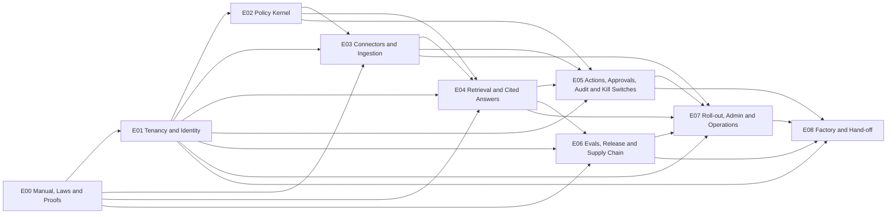
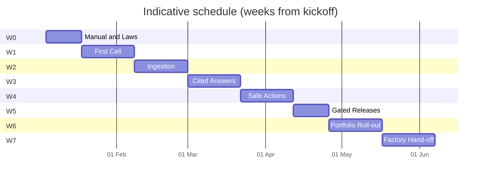

# Second Brain: Product Requirements Document

| Version | Date | Owner | Status | Related |
|---|---|---|---|---|
| 1.0-draft | 2026-11-18 | Platform lead | For review | [Problem](00-problem-statement.md) · [Principles](01-principles.md) · [Architecture](architecture/00-overview.md) · [Plan](../epics/README.md) |

## Summary

Second Brain is one reusable platform that a parent organisation rolls out to every company it acquires. Each company gets an isolated cell, configured by one manifest. Staff get **cited answers** built only from sources they can open right now. Teams get a small set of **agent actions** that humans send or approve. Operators get **kill switches** and a tamper-evident **audit log**. The parent gets **one template and one release train** instead of a different stack per company.

v1 ships in seven waves (W0 to W6), roughly 19 weeks. The formal models and law tests come first (W0). Cited answers reach a pilot in W3. Gated actions arrive in W4, and self-serve roll-out in W6.

The control plane is a **factory**: it produces and runs every tenant's Second Brain. After v1, wave **W7** (3 weeks) adds **hand-off**: transferring custody of one tenant's Second Brain into that company's own cloud account under its own keys, or detaching it entirely. v1 doesn't build hand-off, but it does build the seams that make hand-off a workflow rather than a migration (ADR-0015, SB-114).

## Problem

Acquired companies have no single index of what they know, no reliable record of who may see what, and no record of who did what. AI use is ad hoc and unsafe, and every company starts from zero. The full statement is in [00-problem-statement.md](00-problem-statement.md).

## Goals and non-goals

**Goals (v1)**

| ID | Goal | Measure | Target |
|---|---|---|---|
| G1 | Fast time to value | Days from contract to first cited answer | 14 or fewer |
| G2 | Real adoption | Weekly active users ÷ seats at day 90 | 40% or more |
| G3 | Trust | Approve-to-reject ratio on drafts | Tracked; reviewed at day 45 |
| G4 | Soundness | Law violations in production | 0 |
| G5 | Self-serve | Onboarding steps needing the platform team | 0 |

**Non-goals (v1):** on-prem installs, self-hosted models, fine-tuning, Kubernetes, autonomous or multi-step write agents, ERP or CRM writes, per-company custom agents or forks, anything cross-company, and executing a custody hand-off (planned for W7; v1 builds only the seams).

## Personas

| Persona | Primary jobs | Most important features |
|---|---|---|
| **Asker** (company staff) | Find answers, draft replies | Cited answers, `uncited` label, chat-app entry point, `draft-reply` |
| **Operator** (company IT) | Onboard, configure, operate, stop | Manifest, `sb tenant check/apply/verify`, console, kill switches |
| **Approver** (company leadership) | Approve consequential actions, track adoption | Approver view with exact payload, weekly report |
| **Maintainer** (parent-org platform team) | Release, support, improve | Release controller, eval gate, attestation, observability |
| **Auditor / security** | Prove who saw and did what | Audit log, `sb audit verify`, threat model, laws |
| **Factory operator** (parent-org platform team) | Produce, run and hand off tenants | Cell template, custody records, `sb factory` (W7) |
| **Tenant owner** (company leadership or IT owner) | Accept custody of their Second Brain | Dual approval of the hand-off plan, LAW-17 proof, export package (W7) |

## Functional requirements

| ID | Requirement | Wave | Epic |
|---|---|---|---|
| FR-01 | A tenant is fully described by one manifest; `sb tenant check` validates it with line-precise errors | W1 | E01 |
| FR-02 | `sb tenant apply` creates or updates an isolated cell idempotently in under 30 minutes | W1 | E01 |
| FR-03 | Users sign in with their company's OIDC IdP; users and groups are provisioned by SCIM | W1 | E01 |
| FR-04 | Every read and tool call is authorised by one policy engine returning allow, deny or unknown; unknown is refused | W1 | E02 |
| FR-05 | Connectors implement `fetch`, `acl`, `changes`, `act` and pass the contract kit | W2 | E03 |
| FR-06 | Docs and chat are ingested read-only with provenance; tickets follow; CRM read-only in W6 | W2, W6 | E03 |
| FR-07 | Ingested content is sanitised, flagged and treated as data; it can't trigger a tool call | W2 | E03 |
| FR-08 | Retrieval is tenant-scoped and uses the ACL prefilter; every chunk is live-authorised before entering context | W3 | E04 |
| FR-09 | Answers cite `doc@version` for each claim or label it `uncited` in code | W3 | E04 |
| FR-10 | Users can ask from a web UI and from the company chat app | W3 | E04 |
| FR-11 | `draft-reply` drafts with citations; a human always sends | W4 | E05 |
| FR-12 | Each tenant may enable one approval-gated write workflow; approvals bind to the exact payload hash | W4 | E05 |
| FR-13 | An action is `Ran` only with a target receipt; otherwise `DidNotRun` is shown plainly | W4 | E05 |
| FR-14 | Every tool call has an audit row before it executes; the log is append-only and hash-chained | W4 | E05 |
| FR-15 | Operators can kill any agent, connector or tenant in 10 seconds or less | W4 | E05 |
| FR-16 | No prompt, tool, policy or model change reaches a tenant without passing the eval gate | W5 | E06 |
| FR-17 | Builds are reproducible, signed and carry an SBOM; cells refuse unverified images | W5 | E06 |
| FR-18 | Releases roll out by ring and channel; rollback is one step | W5 | E06 |
| FR-19 | `sb tenant verify` reports pass or fail per law on the tenant's real data | W6 | E07 |
| FR-20 | Every console action is also a manifest diff | W6 | E07 |
| FR-21 | Leadership receives a weekly report on usage, citations and approvals | W6 | E07 |
| FR-22 | Retention and deletion follow `retention_days` | W6 | E07 |
| FR-23 | Every cell has a custody record and a placement; no code assumes the factory account or factory-held keys | W1 | E08 |
| FR-24 | A tenant's cell can be handed to tenant custody (own account, own root key) with dual approval, keeping audit continuity | W7 | E08 |
| FR-25 | After hand-off the cell still pulls signed releases; a tenant can instead detach with a complete export package | W7 | E08 |

## Non-functional requirements

| ID | Requirement | Target | Verified by |
|---|---|---|---|
| NFR-01 | Ask latency | p95 6 s or less | Staging load test, dashboard |
| NFR-02 | Freshness | p95 change-to-answerable 15 min or less | Ingest lag metric |
| NFR-03 | Kill-switch effect | 10 s or less | Drill every release (SB-404) |
| NFR-04 | Deprovisioning | 5 min or less | LAW-12 timed test |
| NFR-05 | Cell creation | under 30 min | SB-104 timing in CI |
| NFR-06 | Rollback | under 10 min, all cells | Drill every release (SB-508) |
| NFR-07 | Availability (ask) | 99.5% monthly per cell | SLO dashboard |
| NFR-08 | DR | RTO 4 h, RPO 15 min, in region | Game day (SB-613) |
| NFR-09 | Accessibility | WCAG 2.2 AA for web UI and console | Automated checks plus manual audit |
| NFR-10 | Security | No open critical/high pen-test findings at GA | SB-612 |
| NFR-11 | Content in telemetry | None | Redaction test (SB-607), scanner (LAW-07) |
| NFR-12 | Release lag | No tenant more than one behind stable | LAW-08 check |
| NFR-13 | Hand-off downtime | 30 min or less at cutover; zero data loss | Game day (SB-710) |

## Delivery model

- **Manual first.** Every ticket's first subtask is the man page (ADR-0009).
- **Laws first.** Law tests exist and fail red in W0; features turn them green. TLA+ and Alloy models are checked in CI from W0 (ADR-0010).
- **Thin slices.** Each slice is end-to-end and demoable. A wave ends only when its exit gate is met.
- **Living documents.** Every PR adds a devlog entry and updates the ledger, changelog and bugs log as needed ([05-living-documents.md](05-living-documents.md)).
- **Testing stack.** Unit, regression and smoke tests from day one, kept forever. From W3, laws, models and evals are the main gate ([04-testing-and-assurance.md](04-testing-and-assurance.md)).

## Epics

| Epic | Goal | Stories | Tickets |
|---|---|---|---|
| [E00 Manual, Laws and Proofs](../epics/E00-foundations/README.md) | The spec, the laws and the first formal models exist before features, and CI enforces the process. | 5 | 15 |
| [E01 Tenancy and Identity](../epics/E01-tenancy-identity/README.md) | One manifest and one command make an isolated cell; users sign in with their own SSO and see only their tenant. | 3 | 8 |
| [E02 Policy Kernel](../epics/E02-policy/README.md) | Every decision about who may see or do what goes through one small, analysable policy engine that treats unknown as deny. | 3 | 4 |
| [E03 Connectors and Ingestion](../epics/E03-connectors-ingestion/README.md) | Sources flow in read-only through a four-call contract, with ACLs, provenance and freshness, and ingested text is treated as untrusted data. | 5 | 12 |
| [E04 Retrieval and Cited Answers](../epics/E04-retrieval-answers/README.md) | Users ask in plain language and get answers citing document versions they can open, or a clear `uncited` label. | 5 | 10 |
| [E05 Actions, Approvals, Audit and Kill Switches](../epics/E05-actions-approvals-audit/README.md) | Agents draft and propose; humans send and approve; every tool call is audited before it runs; anything can be switched off in seconds. | 6 | 12 |
| [E06 Evals, Release and Supply Chain](../epics/E06-evals-release/README.md) | No agent, prompt, policy or model change reaches a tenant without passing evals, and every running build is a signed build that passed the gate. | 4 | 12 |
| [E07 Roll-out, Admin and Operations](../epics/E07-rollout-ops/README.md) | A company onboards itself with one file and three commands, and operators can see and control every tenant. | 6 | 12 |
| [E08 Factory and Hand-off](../epics/E08-factory-handoff/README.md) | One factory produces and runs every tenant's Second Brain, and can hand custody of one to its company without a rebuild. | 5 | 11 |

## User stories

Each story is delivered by the listed tickets. Stories are written from the persona's point of view; acceptance lives on the tickets.

### E00 Manual, Laws and Proofs

- **US-00.1**: As a *maintainer*, I want to read the man page for any feature before code exists, so that I know exactly what to build. Delivered by [SB-004](../epics/E00-foundations/SB-004-first-drafts-sb-1-sb-tenant-1-sb-tenant-5.md), [SB-005](../epics/E00-foundations/SB-005-first-drafts-sb-connector-3-sb-permissions-7.md), [SB-006](../epics/E00-foundations/SB-006-api-conventions-and-the-error-registry.md).
- **US-00.2**: As a *reviewer*, I want CI to reject behaviour changes that do not change the manual, so that the manual never drifts from the code. Delivered by [SB-007](../epics/E00-foundations/SB-007-ci-rule-behaviour-change-needs-a-manual-diff.md).
- **US-00.3**: As a *maintainer*, I want the law tests to exist and fail red before features land, so that every feature is born against its laws. Delivered by [SB-010](../epics/E00-foundations/SB-010-law-harness-and-law-01-to-law-05-as-failing.md).
- **US-00.4**: As a *security reviewer*, I want the approval, rollout and permission designs model-checked, so that design flaws are found before code. Delivered by [SB-011](../epics/E00-foundations/SB-011-approvals-model-in-tla-checked-in-ci.md), [SB-012](../epics/E00-foundations/SB-012-rollout-model-in-tla-checked-in-ci.md), [SB-013](../epics/E00-foundations/SB-013-permissions-model-in-alloy-checked-in-ci.md).
- **US-00.5**: As a *new contributor*, I want one command that builds, tests and renders the docs, so that I am productive on day one. Delivered by [SB-001](../epics/E00-foundations/SB-001-repo-skeleton-and-toolchain.md), [SB-002](../epics/E00-foundations/SB-002-manual-layout-man-page-template-and-docs.md), [SB-009](../epics/E00-foundations/SB-009-link-check-diagram-check-and-manual-example.md), [SB-016](../epics/E00-foundations/SB-016-smoke-and-regression-test-conventions.md).

### E01 Tenancy and Identity

- **US-01.1**: As a *parent-org platform engineer*, I want to add a company with one manifest and one pipeline run, so that onboarding is repeatable and boring. Delivered by [SB-101](../epics/E01-tenancy-identity/SB-101-manifest-schema-parser-and-sb-tenant-check.md), [SB-102](../epics/E01-tenancy-identity/SB-102-sb-tenant-apply-plan-dry-run.md), [SB-103](../epics/E01-tenancy-identity/SB-103-cell-template-infrastructure-as-code.md), [SB-104](../epics/E01-tenancy-identity/SB-104-sb-tenant-apply-idempotent-cell-creation.md), [SB-105](../epics/E01-tenancy-identity/SB-105-control-plane-tenant-registry-and-cell.md).
- **US-01.2**: As a *company staff member*, I want to sign in with my company's SSO and see only my company, so that I trust what I see. Delivered by [SB-106](../epics/E01-tenancy-identity/SB-106-oidc-sign-in-per-tenant.md), [SB-108](../epics/E01-tenancy-identity/SB-108-tenant-scoped-request-context.md).
- **US-01.3**: As a *company IT operator*, I want deprovisioning in our IdP to remove access within minutes, so that leavers lose access without a ticket to anyone. Delivered by [SB-107](../epics/E01-tenancy-identity/SB-107-scim-provisioning-and-fast-deprovisioning.md).

### E02 Policy Kernel

- **US-02.1**: As a *security reviewer*, I want one `authorise` call that every path goes through, so that there is one place to audit and prove. Delivered by [SB-109](../epics/E02-policy/SB-109-policy-engine-v0-authorise-returns-allow.md).
- **US-02.2**: As a *company IT operator*, I want policies written in a small, readable language with a schema, so that I can review rules without reading code. Delivered by [SB-110](../epics/E02-policy/SB-110-cedar-schema-and-base-policies.md), [SB-112](../epics/E02-policy/SB-112-policy-analysis-in-ci.md).
- **US-02.3**: As an *auditor*, I want every policy decision recorded with its reason, so that I can explain any allow or deny later. Delivered by [SB-111](../epics/E02-policy/SB-111-policy-decisions-are-audited.md).

### E03 Connectors and Ingestion

- **US-03.1**: As a *company IT operator*, I want to connect docs and chat read-only from the manifest, so that setup is one line per source. Delivered by [SB-201](../epics/E03-connectors-ingestion/SB-201-connector-contract-sdk-and-contract-kit.md), [SB-203](../epics/E03-connectors-ingestion/SB-203-docs-connector-first-vendor-read-only.md), [SB-204](../epics/E03-connectors-ingestion/SB-204-chat-connector-read-only.md), [SB-205](../epics/E03-connectors-ingestion/SB-205-connector-credentials-via-vault-references.md).
- **US-03.2**: As a *company staff member*, I want new and changed documents to show up within the freshness SLA, so that answers reflect today's truth. Delivered by [SB-206](../epics/E03-connectors-ingestion/SB-206-ingest-pipeline-chunk-embed-tag-provenance.md), [SB-208](../epics/E03-connectors-ingestion/SB-208-incremental-sync-via-changes-with-freshness.md), [SB-209](../epics/E03-connectors-ingestion/SB-209-deletion-and-acl-change-propagation.md).
- **US-03.3**: As a *security reviewer*, I want ingested text treated as data, never as instructions, so that a poisoned document cannot drive an agent. Delivered by [SB-207](../epics/E03-connectors-ingestion/SB-207-ingest-sanitiser-and-injection-flags.md).
- **US-03.4**: As a *platform engineer*, I want the index to be rebuildable from sources at any time, so that the index is never a system of record. Delivered by [SB-210](../epics/E03-connectors-ingestion/SB-210-index-rebuild-from-sources.md).
- **US-03.5**: As a *connector author*, I want a contract kit and a fault-injecting mock, so that a new connector is correct by test, not by review. Delivered by [SB-201](../epics/E03-connectors-ingestion/SB-201-connector-contract-sdk-and-contract-kit.md), [SB-202](../epics/E03-connectors-ingestion/SB-202-fault-injecting-mock-connector.md), [SB-211](../epics/E03-connectors-ingestion/SB-211-tickets-connector-read-only.md), [SB-610](../epics/E03-connectors-ingestion/SB-610-crm-connector-read-only.md).

### E04 Retrieval and Cited Answers

- **US-04.1**: As a *company staff member*, I want an answer with citations to specific document versions I can open, so that I can check the answer myself. Delivered by [SB-301](../epics/E04-retrieval-answers/SB-301-tenant-scoped-hybrid-retrieval-with-acl.md), [SB-304](../epics/E04-retrieval-answers/SB-304-answer-composer-with-doc-version-citations.md), [SB-306](../epics/E04-retrieval-answers/SB-306-ask-agent-and-post-v1-ask.md).
- **US-04.2**: As a *company staff member*, I want answers with nothing to cite clearly labelled `uncited`, so that I know when to be sceptical. Delivered by [SB-304](../epics/E04-retrieval-answers/SB-304-answer-composer-with-doc-version-citations.md).
- **US-04.3**: As a *security reviewer*, I want nothing the asker cannot open to ever reach the model's context, so that permissions hold even if the model misbehaves. Delivered by [SB-302](../epics/E04-retrieval-answers/SB-302-live-authorisation-of-every-chunk-before.md), [SB-303](../epics/E04-retrieval-answers/SB-303-batched-acl-checks-and-latency-budget.md).
- **US-04.4**: As a *company staff member*, I want to ask from the web or from our chat app, so that I don't change tools to get help. Delivered by [SB-307](../epics/E04-retrieval-answers/SB-307-web-chat-ui.md), [SB-308](../epics/E04-retrieval-answers/SB-308-chat-app-entry-point.md).
- **US-04.5**: As a *product owner*, I want pilot feedback captured against each answer, so that we improve on evidence. Delivered by [SB-305](../epics/E04-retrieval-answers/SB-305-model-gateway-adapter.md), [SB-310](../epics/E04-retrieval-answers/SB-310-feedback-capture.md), [SB-311](../epics/E04-retrieval-answers/SB-311-pilot-with-20-users-in-the-internal-tenant.md).

### E05 Actions, Approvals, Audit and Kill Switches

- **US-05.1**: As a *company staff member*, I want the agent to draft a reply or a ticket update that I send, so that I save time without losing control. Delivered by [SB-409](../epics/E05-actions-approvals-audit/SB-409-draft-reply-agent-where-a-human-always-sends.md).
- **US-05.2**: As an *approver*, I want to see exactly what will run, against which system, before I approve, so that approval means something. Delivered by [SB-405](../epics/E05-actions-approvals-audit/SB-405-tool-bus-policy-audit-then-execute.md), [SB-406](../epics/E05-actions-approvals-audit/SB-406-approval-flow-with-ids-bound-to-content.md), [SB-407](../epics/E05-actions-approvals-audit/SB-407-approver-view.md), [SB-410](../epics/E05-actions-approvals-audit/SB-410-first-approval-gated-workflow-template.md).
- **US-05.3**: As a *company IT operator*, I want to switch off any agent, connector or tenant instantly, so that I can stop harm first and investigate second. Delivered by [SB-403](../epics/E05-actions-approvals-audit/SB-403-kill-switches-per-agent-connector-and-tenant.md), [SB-404](../epics/E05-actions-approvals-audit/SB-404-kill-drill-every-release.md).
- **US-05.4**: As an *auditor*, I want an append-only, tamper-evident record of every tool call, so that I can prove who did what. Delivered by [SB-401](../epics/E05-actions-approvals-audit/SB-401-append-only-hash-chained-audit-log-written.md), [SB-402](../epics/E05-actions-approvals-audit/SB-402-sb-audit-verify-tail-and-export.md), [SB-412](../epics/E05-actions-approvals-audit/SB-412-audit-and-approval-backups-3-2-1-and-restore.md).
- **US-05.5**: As a *company staff member*, I want to be told plainly when an action did not run, so that I never act on a false 'done'. Delivered by [SB-408](../epics/E05-actions-approvals-audit/SB-408-action-executor-with-receipts.md).
- **US-05.6**: As a *security reviewer*, I want secrets never to appear in prompts, logs or audit payloads, so that a log leak is not a credential leak. Delivered by [SB-411](../epics/E05-actions-approvals-audit/SB-411-secret-hygiene-canaries-and-scanner.md).

### E06 Evals, Release and Supply Chain

- **US-06.1**: As a *parent-org platform lead*, I want no agent, prompt or model change to reach a tenant without passing evals, so that quality never regresses silently. Delivered by [SB-015](../epics/E06-evals-release/SB-015-eval-harness-scaffold.md), [SB-309](../epics/E06-evals-release/SB-309-citation-faithfulness-eval-set-per-tenant.md), [SB-501](../epics/E06-evals-release/SB-501-eval-runner-and-suites.md), [SB-502](../epics/E06-evals-release/SB-502-eval-gate-blocks-regressions.md).
- **US-06.2**: As a *security reviewer*, I want to prove which build, prompts and model ran for any action, so that every incident is reconstructable. Delivered by [SB-503](../epics/E06-evals-release/SB-503-release-bundle-pins-prompts-tools-policies.md), [SB-504](../epics/E06-evals-release/SB-504-reproducible-builds-sbom-and-signing.md), [SB-506](../epics/E06-evals-release/SB-506-deploy-time-signature-verification.md), [SB-509](../epics/E06-evals-release/SB-509-running-build-attestation-per-cell.md).
- **US-06.3**: As a *company IT operator*, I want a bad release to roll back in one step, so that a bad day stays short. Delivered by [SB-507](../epics/E06-evals-release/SB-507-release-controller-with-channels-and-rings.md), [SB-508](../epics/E06-evals-release/SB-508-one-step-rollback.md).
- **US-06.4**: As a *security reviewer*, I want a CVE fix to be a rebuild that every tenant takes, so that no tenant is left on a vulnerable build. Delivered by [SB-505](../epics/E06-evals-release/SB-505-lockfile-regeneration-and-cve-rebuild-path.md), [SB-507](../epics/E06-evals-release/SB-507-release-controller-with-channels-and-rings.md), [SB-510](../epics/E06-evals-release/SB-510-manifest-drift-detection.md).

### E07 Roll-out, Admin and Operations

- **US-07.1**: As a *company IT operator*, I want to onboard my company with one file and three commands, without calling the platform team, so that we go live in days. Delivered by [SB-601](../epics/E07-rollout-ops/SB-601-sb-tenant-verify-on-real-data.md), [SB-604](../epics/E07-rollout-ops/SB-604-sb-onboarding-7-day-0-to-90-runbook.md), [SB-605](../epics/E07-rollout-ops/SB-605-friendly-tenant-onboarding-unaided.md).
- **US-07.2**: As a *company IT operator*, I want a console for connectors, agents, approval rules and kill switches, so that I don't need to learn YAML to operate. Delivered by [SB-602](../epics/E07-rollout-ops/SB-602-admin-console-where-every-action-is-a.md), [SB-603](../epics/E07-rollout-ops/SB-603-roles-in-the-console.md).
- **US-07.3**: As a *company leader*, I want a weekly report on usage, citations and approvals, so that I know if this is working. Delivered by [SB-606](../epics/E07-rollout-ops/SB-606-weekly-leadership-report.md).
- **US-07.4**: As an *on-call operator*, I want health, cost, freshness and law violations per tenant, so that I see problems before users do. Delivered by [SB-607](../epics/E07-rollout-ops/SB-607-per-tenant-observability.md), [SB-608](../epics/E07-rollout-ops/SB-608-sev-1-alert-for-every-law-violation.md), [SB-609](../epics/E07-rollout-ops/SB-609-cost-controls.md).
- **US-07.5**: As a *data protection officer*, I want retention and deletion to follow the manifest, so that we meet our obligations by configuration. Delivered by [SB-611](../epics/E07-rollout-ops/SB-611-retention-and-deletion.md).
- **US-07.6**: As a *parent-org security lead*, I want independent testing and a disaster-recovery game day, so that we trust the platform before scaling it. Delivered by [SB-612](../epics/E07-rollout-ops/SB-612-external-penetration-test-and-threat-model.md), [SB-613](../epics/E07-rollout-ops/SB-613-disaster-recovery-game-day.md).

### E08 Factory and Hand-off

- **US-08.1**: As a *parent-org platform lead*, I want every cell to carry a custody record and a placement from day one, so that hand-off later is a workflow, not a migration. Delivered by [SB-114](../epics/E08-factory-handoff/SB-114-factory-seams-custody-record-placement-port.md), [SB-701](../epics/E08-factory-handoff/SB-701-final-sb-factory-7-and-the-hand-off-runbook.md), [SB-702](../epics/E08-factory-handoff/SB-702-factory-roles-and-policies.md).
- **US-08.2**: As a *company owner*, I want our Second Brain moved into our own cloud account under our own key, so that we hold custody of our data. Delivered by [SB-703](../epics/E08-factory-handoff/SB-703-placement-adapter-for-tenant-owned-cloud.md), [SB-704](../epics/E08-factory-handoff/SB-704-root-key-re-wrap-and-key-custody-transfer.md), [SB-705](../epics/E08-factory-handoff/SB-705-hand-off-workflow-with-dual-approval.md).
- **US-08.3**: As a *company security lead*, I want proof that the factory keeps no access we didn't agree to, so that custody means what it says. Delivered by [SB-706](../epics/E08-factory-handoff/SB-706-access-path-enumeration-and-law-17-check.md).
- **US-08.4**: As a *company IT operator*, I want to keep receiving signed releases after hand-off, so that we stay patched without a support contract per release. Delivered by [SB-707](../epics/E08-factory-handoff/SB-707-releases-after-hand-off.md).
- **US-08.5**: As a *company owner after divestiture*, I want a complete export so we can leave the factory, so that a sale doesn't strand our knowledge. Delivered by [SB-708](../epics/E08-factory-handoff/SB-708-detach-and-export-package.md), [SB-709](../epics/E08-factory-handoff/SB-709-billing-and-model-provider-hand-off.md), [SB-710](../epics/E08-factory-handoff/SB-710-hand-off-game-day-with-a-friendly-tenant.md).

## Waves

A **wave** is a release-sized group of work with an exit gate. A **slice** is a thin, end-to-end, demoable increment inside a wave. Tickets belong to one epic and one slice, so slices cut across epics.

| Wave | Name | Indicative length | Goal |
|---|---|---|---|
| W0 | Manual and Laws | 2 weeks | The spec exists before the code: man pages, laws as red tests, first formal models, CI rules. |
| W1 | First Cell | 3 weeks | One manifest makes one isolated cell; a user signs in with SSO and sees only their tenant; the policy kernel answers allow, deny or unknown. |
| W2 | Ingestion | 3 weeks | Docs and chat flow in read-only, with ACLs, provenance and freshness; ingested text is data, never instructions. |
| W3 | Cited Answers | 3 weeks | A pilot group asks questions and gets answers citing `doc@version` that they can open, or a clear `uncited` label. |
| W4 | Safe Actions | 3 weeks | Agents draft; humans send or approve; every tool call is audited first; any agent, connector or tenant can be killed in seconds. |
| W5 | Gated Releases | 2 weeks | Nothing reaches a tenant without passing evals; builds are reproducible and signed; rollout is ringed and rollback is one step. |
| W6 | Portfolio Roll-out | 3 weeks | A company's own IT onboards with one file and three commands, unaided; leadership gets a weekly report; operators see every law violation as Sev-1. |
| W7 | Factory Hand-off | 3 weeks | After v1: the factory can hand custody of a tenant's Second Brain to that company, in its own cloud account, without losing data, audit continuity or the laws. |

### Wave exit gates and slices

#### W0 Manual and Laws

*The spec exists before the code: man pages, laws as red tests, first formal models, CI rules.*

**Exit gate**

- [ ] Man pages `sb(1)`, `sb-tenant(5)`, `sb-tenant(1)`, `sb-connector(3)`, `sb-permissions(7)`, `sb-laws(7)` reviewed (drafts done; reviews pending, SB-004, SB-005)
- [x] A PR that changes `cmd/` or `internal/` without `manual/` fails CI
- [x] LAW-01 to LAW-05 run in CI and fail for the right reason
- [ ] `Approvals.tla`, `Rollout.tla` and `Permissions.als` model-check in CI with no counterexample (CI wired, checksums pinned; first run pending, SB-011 to SB-013)
- [ ] Threat model v0 and ADR-0001 to ADR-0016 signed off by two reviewers (sign-off tables ready, SB-014)

| Slice | Name | Delivers | Tickets |
|---|---|---|---|
| S0.1 | Skeleton | Repo, toolchain, manual layout, living documents and the docs site build | [SB-001](../epics/E00-foundations/SB-001-repo-skeleton-and-toolchain.md), [SB-002](../epics/E00-foundations/SB-002-manual-layout-man-page-template-and-docs.md), [SB-003](../epics/E00-foundations/SB-003-living-documents-bootstrap.md), [SB-016](../epics/E00-foundations/SB-016-smoke-and-regression-test-conventions.md) |
| S0.2 | First pages | The man pages every later ticket links to | [SB-004](../epics/E00-foundations/SB-004-first-drafts-sb-1-sb-tenant-1-sb-tenant-5.md), [SB-005](../epics/E00-foundations/SB-005-first-drafts-sb-connector-3-sb-permissions-7.md), [SB-006](../epics/E00-foundations/SB-006-api-conventions-and-the-error-registry.md) |
| S0.3 | Rules in CI | Manual-diff rule, dependency rule, link and diagram checks | [SB-007](../epics/E00-foundations/SB-007-ci-rule-behaviour-change-needs-a-manual-diff.md), [SB-008](../epics/E00-foundations/SB-008-dependency-rule-enforced-in-ci.md), [SB-009](../epics/E00-foundations/SB-009-link-check-diagram-check-and-manual-example.md) |
| S0.4 | Laws red, models green | Law harness failing over mocks; TLA+ and Alloy models checked; threat model; eval scaffold | [SB-010](../epics/E00-foundations/SB-010-law-harness-and-law-01-to-law-05-as-failing.md), [SB-011](../epics/E00-foundations/SB-011-approvals-model-in-tla-checked-in-ci.md), [SB-012](../epics/E00-foundations/SB-012-rollout-model-in-tla-checked-in-ci.md), [SB-013](../epics/E00-foundations/SB-013-permissions-model-in-alloy-checked-in-ci.md), [SB-014](../epics/E00-foundations/SB-014-threat-model-v0-and-adr-sign-off.md), [SB-015](../epics/E06-evals-release/SB-015-eval-harness-scaffold.md) |

#### W1 First Cell

*One manifest makes one isolated cell; a user signs in with SSO and sees only their tenant; the policy kernel answers allow, deny or unknown.*

**Exit gate**

- [ ] `sb tenant check` rejects bad manifests with line-precise errors
- [ ] `sb tenant apply` creates a cell in under 30 minutes and is idempotent
- [ ] LAW-02 green with two seeded tenants; LAW-03 green over mocks
- [ ] SCIM deactivate revokes sessions in 5 minutes or less (LAW-12)

| Slice | Name | Delivers | Tickets |
|---|---|---|---|
| S1.1 | Manifest | `sb tenant check` and the manifest schema | [SB-101](../epics/E01-tenancy-identity/SB-101-manifest-schema-parser-and-sb-tenant-check.md), [SB-102](../epics/E01-tenancy-identity/SB-102-sb-tenant-apply-plan-dry-run.md) |
| S1.2 | Cell | `sb tenant apply` stamps an isolated cell from the template | [SB-103](../epics/E01-tenancy-identity/SB-103-cell-template-infrastructure-as-code.md), [SB-104](../epics/E01-tenancy-identity/SB-104-sb-tenant-apply-idempotent-cell-creation.md), [SB-105](../epics/E01-tenancy-identity/SB-105-control-plane-tenant-registry-and-cell.md), [SB-114](../epics/E08-factory-handoff/SB-114-factory-seams-custody-record-placement-port.md) |
| S1.3 | Identity | OIDC sign-in, SCIM provisioning, tenant-scoped request context | [SB-106](../epics/E01-tenancy-identity/SB-106-oidc-sign-in-per-tenant.md), [SB-107](../epics/E01-tenancy-identity/SB-107-scim-provisioning-and-fast-deprovisioning.md), [SB-108](../epics/E01-tenancy-identity/SB-108-tenant-scoped-request-context.md) |
| S1.4 | Policy kernel | `authorise` with allow, deny and unknown; Cedar policies; decision audit | [SB-109](../epics/E02-policy/SB-109-policy-engine-v0-authorise-returns-allow.md), [SB-110](../epics/E02-policy/SB-110-cedar-schema-and-base-policies.md), [SB-111](../epics/E02-policy/SB-111-policy-decisions-are-audited.md), [SB-112](../epics/E02-policy/SB-112-policy-analysis-in-ci.md) |

#### W2 Ingestion

*Docs and chat flow in read-only, with ACLs, provenance and freshness; ingested text is data, never instructions.*

**Exit gate**

- [ ] Docs and chat connectors pass the contract kit
- [ ] p95 change-to-index time is 15 minutes or less in staging
- [ ] Injection corpus triggers zero tool calls (LAW-09)
- [ ] Index dropped and rebuilt from sources with identical (doc, version, ACL) set (LAW-13)

| Slice | Name | Delivers | Tickets |
|---|---|---|---|
| S2.1 | Contract | Connector contract, SDK, contract kit and a fault-injecting mock | [SB-201](../epics/E03-connectors-ingestion/SB-201-connector-contract-sdk-and-contract-kit.md), [SB-202](../epics/E03-connectors-ingestion/SB-202-fault-injecting-mock-connector.md) |
| S2.2 | First sources | Docs and chat connectors, read-only, with vault-held credentials | [SB-203](../epics/E03-connectors-ingestion/SB-203-docs-connector-first-vendor-read-only.md), [SB-204](../epics/E03-connectors-ingestion/SB-204-chat-connector-read-only.md), [SB-205](../epics/E03-connectors-ingestion/SB-205-connector-credentials-via-vault-references.md) |
| S2.3 | Pipeline | Chunk, sanitise, tag, embed, sync incrementally, propagate deletes, rebuild | [SB-206](../epics/E03-connectors-ingestion/SB-206-ingest-pipeline-chunk-embed-tag-provenance.md), [SB-207](../epics/E03-connectors-ingestion/SB-207-ingest-sanitiser-and-injection-flags.md), [SB-208](../epics/E03-connectors-ingestion/SB-208-incremental-sync-via-changes-with-freshness.md), [SB-209](../epics/E03-connectors-ingestion/SB-209-deletion-and-acl-change-propagation.md), [SB-210](../epics/E03-connectors-ingestion/SB-210-index-rebuild-from-sources.md) |
| S2.4 | Tickets | Tickets connector, read-only | [SB-211](../epics/E03-connectors-ingestion/SB-211-tickets-connector-read-only.md) |

#### W3 Cited Answers

*A pilot group asks questions and gets answers citing `doc@version` that they can open, or a clear `uncited` label.*

**Exit gate**

- [ ] LAW-01, LAW-03 and LAW-14 green on real indexes, asserting the live `acl` call
- [ ] Citation-faithfulness eval runs in CI
- [ ] Pilot group of 20 uses web and chat entry points; feedback captured

| Slice | Name | Delivers | Tickets |
|---|---|---|---|
| S3.1 | Retrieval | Tenant-scoped retrieval with prefilter and live per-chunk authorisation | [SB-301](../epics/E04-retrieval-answers/SB-301-tenant-scoped-hybrid-retrieval-with-acl.md), [SB-302](../epics/E04-retrieval-answers/SB-302-live-authorisation-of-every-chunk-before.md), [SB-303](../epics/E04-retrieval-answers/SB-303-batched-acl-checks-and-latency-budget.md) |
| S3.2 | Answers | Composer with citations, model gateway, ask API, web and chat entry points | [SB-304](../epics/E04-retrieval-answers/SB-304-answer-composer-with-doc-version-citations.md), [SB-305](../epics/E04-retrieval-answers/SB-305-model-gateway-adapter.md), [SB-306](../epics/E04-retrieval-answers/SB-306-ask-agent-and-post-v1-ask.md), [SB-307](../epics/E04-retrieval-answers/SB-307-web-chat-ui.md), [SB-308](../epics/E04-retrieval-answers/SB-308-chat-app-entry-point.md) |
| S3.3 | Pilot | Faithfulness evals, feedback capture, 20-person pilot | [SB-309](../epics/E06-evals-release/SB-309-citation-faithfulness-eval-set-per-tenant.md), [SB-310](../epics/E04-retrieval-answers/SB-310-feedback-capture.md), [SB-311](../epics/E04-retrieval-answers/SB-311-pilot-with-20-users-in-the-internal-tenant.md) |

#### W4 Safe Actions

*Agents draft; humans send or approve; every tool call is audited first; any agent, connector or tenant can be killed in seconds.*

**Exit gate**

- [ ] LAW-04, LAW-05, LAW-10, LAW-11 and LAW-15 green
- [ ] Kill switch fired in staging takes effect in 10 seconds or less
- [ ] `draft-reply` used end-to-end in pilot; approve and reject rates recorded
- [ ] Audit restore drill passes

| Slice | Name | Delivers | Tickets |
|---|---|---|---|
| S4.1 | Audit and kill | Hash-chained audit written first; kill switches; drills | [SB-401](../epics/E05-actions-approvals-audit/SB-401-append-only-hash-chained-audit-log-written.md), [SB-402](../epics/E05-actions-approvals-audit/SB-402-sb-audit-verify-tail-and-export.md), [SB-403](../epics/E05-actions-approvals-audit/SB-403-kill-switches-per-agent-connector-and-tenant.md), [SB-404](../epics/E05-actions-approvals-audit/SB-404-kill-drill-every-release.md) |
| S4.2 | Approvals | Tool bus, approval ids bound to content hashes, approver view | [SB-405](../epics/E05-actions-approvals-audit/SB-405-tool-bus-policy-audit-then-execute.md), [SB-406](../epics/E05-actions-approvals-audit/SB-406-approval-flow-with-ids-bound-to-content.md), [SB-407](../epics/E05-actions-approvals-audit/SB-407-approver-view.md) |
| S4.3 | Execution | Executor with receipts, `draft-reply`, first approval-gated workflow | [SB-408](../epics/E05-actions-approvals-audit/SB-408-action-executor-with-receipts.md), [SB-409](../epics/E05-actions-approvals-audit/SB-409-draft-reply-agent-where-a-human-always-sends.md), [SB-410](../epics/E05-actions-approvals-audit/SB-410-first-approval-gated-workflow-template.md) |
| S4.4 | Hygiene | Secret canaries and scanner; 3-2-1 backups with restore drill | [SB-411](../epics/E05-actions-approvals-audit/SB-411-secret-hygiene-canaries-and-scanner.md), [SB-412](../epics/E05-actions-approvals-audit/SB-412-audit-and-approval-backups-3-2-1-and-restore.md) |

#### W5 Gated Releases

*Nothing reaches a tenant without passing evals; builds are reproducible and signed; rollout is ringed and rollback is one step.*

**Exit gate**

- [ ] A seeded eval regression blocks a release
- [ ] Two builds of the same commit produce the same hash; signature verified at deploy
- [ ] Rollback drill completes in under 10 minutes
- [ ] LAW-06, LAW-08 and LAW-16 green

| Slice | Name | Delivers | Tickets |
|---|---|---|---|
| S5.1 | Eval gate | Eval runner and suites; gate blocks regressions; release bundles pin prompts and models | [SB-501](../epics/E06-evals-release/SB-501-eval-runner-and-suites.md), [SB-502](../epics/E06-evals-release/SB-502-eval-gate-blocks-regressions.md), [SB-503](../epics/E06-evals-release/SB-503-release-bundle-pins-prompts-tools-policies.md) |
| S5.2 | Supply chain | Reproducible signed builds with SBOM; lockfile regeneration; deploy-time verification | [SB-504](../epics/E06-evals-release/SB-504-reproducible-builds-sbom-and-signing.md), [SB-505](../epics/E06-evals-release/SB-505-lockfile-regeneration-and-cve-rebuild-path.md), [SB-506](../epics/E06-evals-release/SB-506-deploy-time-signature-verification.md) |
| S5.3 | Rings | Release controller, channels, rings, one-step rollback, attestation, drift detection | [SB-507](../epics/E06-evals-release/SB-507-release-controller-with-channels-and-rings.md), [SB-508](../epics/E06-evals-release/SB-508-one-step-rollback.md), [SB-509](../epics/E06-evals-release/SB-509-running-build-attestation-per-cell.md), [SB-510](../epics/E06-evals-release/SB-510-manifest-drift-detection.md) |

#### W6 Portfolio Roll-out

*A company's own IT onboards with one file and three commands, unaided; leadership gets a weekly report; operators see every law violation as Sev-1.*

**Exit gate**

- [ ] A friendly tenant completes day 0 to 14 of `sb-onboarding(7)` with zero platform-team steps
- [ ] `sb tenant verify` prints pass or fail per law on real data
- [ ] Dashboards and Sev-1 alerts exist for every law
- [ ] External penetration test has no open critical findings

| Slice | Name | Delivers | Tickets |
|---|---|---|---|
| S6.1 | Verify and console | `sb tenant verify`; admin console where every action is a manifest diff | [SB-601](../epics/E07-rollout-ops/SB-601-sb-tenant-verify-on-real-data.md), [SB-602](../epics/E07-rollout-ops/SB-602-admin-console-where-every-action-is-a.md), [SB-603](../epics/E07-rollout-ops/SB-603-roles-in-the-console.md) |
| S6.2 | Onboarding | Day 0 to 90 runbook, unaided friendly-tenant onboarding, weekly report | [SB-604](../epics/E07-rollout-ops/SB-604-sb-onboarding-7-day-0-to-90-runbook.md), [SB-605](../epics/E07-rollout-ops/SB-605-friendly-tenant-onboarding-unaided.md), [SB-606](../epics/E07-rollout-ops/SB-606-weekly-leadership-report.md) |
| S6.3 | Operate | Observability, Sev-1 law alerts, cost controls, CRM connector, retention | [SB-607](../epics/E07-rollout-ops/SB-607-per-tenant-observability.md), [SB-608](../epics/E07-rollout-ops/SB-608-sev-1-alert-for-every-law-violation.md), [SB-609](../epics/E07-rollout-ops/SB-609-cost-controls.md), [SB-610](../epics/E03-connectors-ingestion/SB-610-crm-connector-read-only.md), [SB-611](../epics/E07-rollout-ops/SB-611-retention-and-deletion.md) |
| S6.4 | Harden | Penetration test and disaster-recovery game day | [SB-612](../epics/E07-rollout-ops/SB-612-external-penetration-test-and-threat-model.md), [SB-613](../epics/E07-rollout-ops/SB-613-disaster-recovery-game-day.md) |

#### W7 Factory Hand-off

*After v1: the factory can hand custody of a tenant's Second Brain to that company, in its own cloud account, without losing data, audit continuity or the laws.*

**Exit gate**

- [ ] `Handoff.tla` model-checks in CI; LAW-17 and LAW-18 Modelled
- [ ] A friendly tenant's cell moves to its own cloud account with dual approval; zero data loss; audit chain verifies across the move
- [ ] `sb tenant verify --law LAW-17` passes after cutover
- [ ] The handed-off cell still pulls signed releases; LAW-06 and LAW-08 hold
- [ ] Detach produces a complete export package in a rehearsal

| Slice | Name | Delivers | Tickets |
|---|---|---|---|
| S7.1 | Custody model | Factory roles, custody records live, hand-off model checked, placement into a tenant account | [SB-701](../epics/E08-factory-handoff/SB-701-final-sb-factory-7-and-the-hand-off-runbook.md), [SB-702](../epics/E08-factory-handoff/SB-702-factory-roles-and-policies.md), [SB-703](../epics/E08-factory-handoff/SB-703-placement-adapter-for-tenant-owned-cloud.md) |
| S7.2 | Hand-off | Key re-wrap, dual-approved hand-off workflow, access-path proof, releases after hand-off | [SB-704](../epics/E08-factory-handoff/SB-704-root-key-re-wrap-and-key-custody-transfer.md), [SB-705](../epics/E08-factory-handoff/SB-705-hand-off-workflow-with-dual-approval.md), [SB-706](../epics/E08-factory-handoff/SB-706-access-path-enumeration-and-law-17-check.md), [SB-707](../epics/E08-factory-handoff/SB-707-releases-after-hand-off.md) |
| S7.3 | Exit paths | Detach export, billing hand-off, game day | [SB-708](../epics/E08-factory-handoff/SB-708-detach-and-export-package.md), [SB-709](../epics/E08-factory-handoff/SB-709-billing-and-model-provider-hand-off.md), [SB-710](../epics/E08-factory-handoff/SB-710-hand-off-game-day-with-a-friendly-tenant.md) |

## Roll-out runbook (summary)

The full runbook is [`sb-onboarding(7)`](../manual/sb-onboarding.7.md). Each company's own IT team runs it, with no calls to the platform team.

| Days | Steps | Gate to continue |
|---|---|---|
| 0 | Fill in the manifest; `sb tenant check`; `sb tenant apply` | Cell exists; sign-in works |
| 1–14 | Connect docs and chat read-only; pilot with about 20 people; `sb tenant verify` | Every law passes on real data |
| 15–45 | Everyone gets access; enable `draft-reply`; weekly report starts | Adoption and refusal rates reviewed |
| 46–90 | Enable one approval-gated workflow, only once that tenant's evals pass | Workflow evals pass; approvers trained |

## Dependencies

| Dependency | Needed by | Owner | Risk if late |
|---|---|---|---|
| Model provider contract and data-processing terms | W3 | Parent-org procurement | Pilot slips |
| Managed Postgres with pgvector in each required region | W1 | Platform | Cell template blocked |
| First tenants' IdPs reachable for OIDC/SCIM tests | W1 | Company IT | Identity slice slips |
| Sandbox tenants for the first docs, chat and tickets vendors | W2 | Company IT + vendors | Contract kit runs on mocks only |
| Signing infrastructure (keyless signing or HSM) | W5 | Platform security | Gated releases slip |
| Pen-test vendor booked | W6 | Security | GA slips |
| Answers to open questions Q-01 to Q-06 | Before W6 | Parent org | Scope or compliance rework |
| A friendly tenant with its own cloud account for hand-off rehearsal | W7 | Company IT | Hand-off untested |
| Answers to Q-09 and Q-10 (hand-off modes, post-hand-off contracts) | Before W7 | Parent org | W7 scope unclear |

## Risks

The register is [living/RISKS.md](../living/RISKS.md). The top five:

| ID | Risk | Mitigation |
|---|---|---|
| R-01 | Live ACL checks make answers too slow | Batching, parallel fan-out, deny caching; measured from W3 |
| R-02 | A source's permission model can't be mapped faithfully | `Unknown` until it can; connector defect tracked; never a relaxed rule |
| R-03 | Prompt injection via ingested content | Sanitiser, data wrapping, argument provenance, injection eval gate (LAW-09) |
| R-04 | Companies want per-company customisation | Manifest fields for everyone or nothing (P3); escalate to parent org |
| R-05 | Formal specs drift from code | Shared state names; spec review in the DoD for any change to approvals or rollout |
| R-11 | v1 shortcuts erode the hand-off seams | SB-114 lint on account ids and key custodians; seams listed in ADR-0015 with a test each |

## Success metrics

| Metric | Day 14 | Day 45 | Day 90 |
|---|---|---|---|
| First cited answer | Yes | — | — |
| Weekly active users ÷ seats | Pilot only | 20% | 40% |
| Cited-answer rate (answers with at least one citation) | 70% | 80% | 85% |
| Refusal rate due to `Unknown` | < 2% | < 1% | < 1% |
| Approve-to-reject ratio (drafts) | — | Reviewed | Tracked |
| Law violations | 0 | 0 | 0 |

## Open questions

Tracked in [living/OPEN_QUESTIONS.md](../living/OPEN_QUESTIONS.md):

1. **Q-01:** Does the parent organisation ever read company data? If yes, it gets a separate tenant with explicit grants and its own audit, never a superuser (ADR-0014). Legal should be involved.
2. **Q-02:** Does any company ship software or connected devices into the EU? If so, the Cyber Resilience Act and a vulnerability-handling process apply.
3. **Q-03:** Which IdPs and source systems do the first companies use, and how many companies are in scope for year one?
4. **Q-04:** What are the data-residency, retention and compliance baselines (SOC 2, ISO 27001, HIPAA, GDPR, others)?
5. **Q-05:** Who owns the eval suite and the approval rules inside each company?
6. **Q-06:** Will the parent sign off the proposed metric targets?
7. **Q-09:** Which hand-off modes are actually needed: own cloud account, divestiture detach, or both? How likely is a divestiture in the first two years?
8. **Q-10:** After hand-off, who holds the model-provider contract and support terms, and does the factory keep any operational responsibility?
