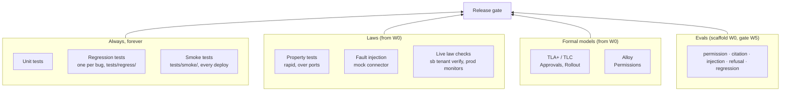
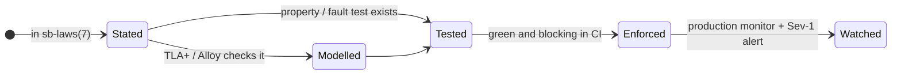

# Testing and assurance

We test to find bugs, and we prove to rule out whole classes of them. Both happen from the first week. What changes over time is which one **gates releases**.

## The stack



## What gates what, by wave

| Wave | Main gate | Also required |
|---|---|---|
| W0 | Models check in CI; law tests fail **for the right reason** | Unit, smoke, link and diagram checks |
| W1–W2 | Unit + regression + smoke; laws green as features land | Models re-checked on every change to their area |
| **W3 onward** | **Laws + models + evals** | Unit, regression and smoke stay; never deleted |

From W3, a feature is done when its laws are green and its models still check. Unit tests support that; they don't replace it.

## The assurance ledger

Each law has a status in [living/ASSURANCE_LEDGER.md](../living/ASSURANCE_LEDGER.md). Statuses only move up, and moving down is a Sev-1 bug.



## Property tests

Property tests express a law over generated worlds. They live in `laws/` and are named for their law. `laws.Check` runs seeds 1..300 deterministically; `SB_SEED=n` reproduces one failure (ADR-0016).

### Fuzzing and races (SB-1402)

Every parser of outside input has a Go fuzz target: the tenant manifest (`FuzzCheck`: an accepted manifest reads back identical after `Format`), action payloads and their hash (`FuzzCanonical`: canonical JSON is a fixed point and the hash depends on nothing else), the reorg snapshot (`FuzzParse`), chunking and the secret scanner (`FuzzChunksAndSecrets`: spans stay inside the text, and a chunk holding a secret overlaps a document span), scope patterns (`FuzzMatch`: no panic, no blow-up on hostile patterns) the SCIM user endpoints (`FuzzUsers`: no panic and no server error on any body), and the folder connector's office and web page reader (`FuzzOfficeText`: no panic, and no more text out than the bound allows, on any bytes as a `.docx`, `.pptx`, `.odt` or `.html`; SB-2003), its spreadsheet reader (`FuzzSheetText`: no panic, nothing but sheets out, and no more text or rows than the bounds allow, on any bytes as an `.xlsx`, `.ods` or `.csv`; SB-2206), and the personal-data detectors (`FuzzMaskPII`: a masked text holds no number and keeps its length; SB-1904, SB-2207). `make fuzz` runs each for `FUZZTIME` (30 seconds by default); every input that ever failed is kept in the target's `testdata/fuzz` and runs as a test in `make check`. Connector responses are decoded by `encoding/json` into fixed shapes and checked by the contract kit, so they have no target of their own.

`make test` runs every unit test, and the `tests/spaces` and `tests/groupsync` suites, under Go's race detector.

### Coverage (SB-1405)

`make coverage` runs `make test`, `make laws` and `make smoke` writing coverage profiles of `internal/core` to `build/cover`, and `tools/check/coverage.py` merges them (its own CI job, because measuring every suite roughly doubles `make check`'s time): a statement counts once, covered if any suite covered it, because most core code is tested through its laws rather than beside it. Every core package must be at or above **75%**; test helpers (`*test` packages, `connectorkit`) are reported without a floor. The floor only rises: raise it when the lowest package does.

### The red ratchet

A law test exists before its feature, so it starts red. `laws/expected_red.txt` lists each red law and the ticket that will turn it green. `make laws` (`tools/check/laws.py`) enforces three rules:

- a listed law must fail, and only with `not implemented`, which means it is failing for the right reason;
- a listed law that passes is an error: take it off the list and move it up in the ledger;
- every unlisted test must pass.

### Self-tests: testing the tests

`laws/selftest_test.go` runs every law check against a correct **reference system**, which must pass, and against six **broken systems** (prefilter only, cross-tenant, unknown as allow, execute before audit, ignore approvals, claim Ran without a receipt), each of which must be caught. It also checks that the generator produces the hard cases: stale prefilters, unknown verdicts, missing docs, timeouts, public docs and multi-tenant worlds. This is the permanent mutation check for the law harness.

```go
func TestLAW01_CiteOnlyWhatTheAskerCanOpen(t *testing.T) {
	Check(t, "LAW-01", runs, func(r *rand.Rand) error { w := Gen(r); return law01(w, NewSystem(w)) })
}
```

`law01` fails if any cited or context document isn't allowed by the source now, **or if the source wasn't asked**, so a prefilter match alone can never pass.

## Fault injection

The mock connector (SB-202) can return `allow`, `deny`, `unknown`, timeout, 404, a malformed response, or success with no receipt, on demand. Every law that mentions an external answer is tested against the full fault matrix.

## Mutation-checking the guardrails

A guardrail test that never fails proves nothing. Whenever we add a law test, CI rule or model invariant, we break the rule on purpose once and watch it fail, then record that in the devlog:

| Guardrail | Mutation | Expected |
|---|---|---|
| LAW-03 test | Map `Unknown` to `Allow` | Test fails |
| `Approvals.tla` | Drop the separation-of-duties guard | TLC counterexample |
| `Rollout.tla` | Drop the promote guard | TLC counterexample for `OneBehindMax` |
| Manual-diff CI rule | PR touching `internal/` only | CI fails |
| Dependency rule | Import an adapter from `core` | CI fails |

## Regression and smoke

- **Regression:** every bug in [BUGS_AND_MITIGATIONS](../living/BUGS_AND_MITIGATIONS.md) gets a test named `BUG-nnnn_*` in `tests/regress/`. These are never deleted.
- **Smoke:** after every deploy to every cell, sign in as a synthetic user, ask a known question, check that the expected citation comes back, and check that a refused document stays refused.

## Commands

```sh
make check      # the gate: everything that runs offline (see engineering standards)
make laws       # law tests through the red ratchet
make smoke      # black-box tests of the real sb binary
make regress    # one test per bug
make evals      # eval harness against the mock model (real targets from SB-501)
make crosscheck # Python mirror of the TLA+ models
make diagrams   # headless render of every Mermaid diagram
make proofs     # TLC + Alloy (needs Java)
```

## See also

[`sb-laws(7)`](../manual/sb-laws.7.md) · [proofs/](../proofs/README.md) · [12 Evals and the gate](architecture/12-evals-and-gate.md)
