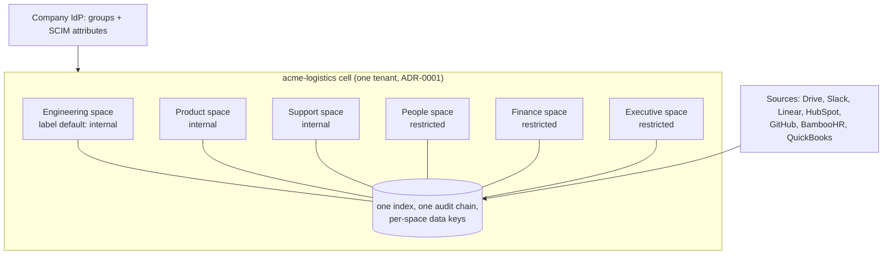
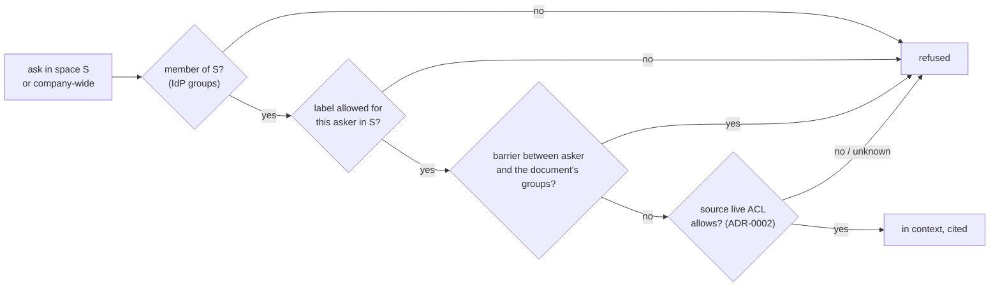

# Department brains

| Version | Date | Owner | Status | Related |
|---|---|---|---|---|
| 0.1 | 2026-11-19 | Platform lead | Plan accepted (the user, 2026-11-19) | [ADR-0020](adr/ADR-0020-department-spaces-inside-the-cell.md) · [ADR-0021](adr/ADR-0021-gcp-cell-runtime.md) · [PRD waves](03-prd.md#waves) · [Plan](../epics/README.md) |

## Summary

Today each company has one brain: one cell whose only access rule is the source's live ACL. This plan lets a company hold **all** its knowledge in that cell, split into **department spaces** (an Engineering brain, a People brain, a Finance brain and so on) with access as fine-grained as a real organisation needs. A space is a scope over the company's sources, with its own agents, stewards, labels, retention and data key. It can only **narrow** what the source allows (ADR-0020). The cell stays the tenant boundary, so nothing changes about isolation between companies.

The plan also settles the next open decision, the runtime for cells on GCP (ADR-0021): Cloud Run, Cloud SQL for PostgreSQL with `pgvector`, Cloud KMS, Secret Manager, Pub/Sub and Cloud Scheduler, with Firebase used only for hosting and, optionally, identity.

It adds six waves, W8 to W13, in the same cadence as W0 to W7: manual and laws first, then thin slices.

## How companies organise

Most companies of the size the parent acquires are organised **by function**, with a few **divisions** (product lines or regions) or a **matrix** of the two once they grow. Access follows that shape: people share widely inside their function and project, and a few functions hold need-to-know data.

| Department | Typical sources | Data sensitivity | Who else usually reads it |
|---|---|---|---|
| Engineering | Code hosting, tickets, design docs, incident notes, chat | Internal; secrets and security findings are restricted | Product, Design, Support (read), IT/Security |
| Product | Specs, roadmaps, research notes, tickets | Internal; unreleased pricing and roadmap are confidential | Engineering, Design, Sales and Marketing leads |
| Design | Design files, research, brand assets | Internal | Product, Engineering, Marketing |
| Sales | CRM, proposals, call notes, pricing | Confidential (deal terms, forecasts) | Finance, Support, Executive |
| Marketing | Docs, campaign plans, brand, analytics | Internal; embargoed launches are confidential | Sales, Product |
| Customer Support | Tickets, help-centre articles, macros | Internal; customer PII is confidential | Engineering, Product, Sales |
| People / HR | HRIS, policies, handbook, cases, comp | Restricted (PII, compensation, performance, cases); policies are internal | Managers for their own reports only; Legal for cases |
| Finance / Accounting | Ledger, reports, budgets, close checklists | Restricted (unreleased results, payroll, bank details); budgets are confidential to owners | Executive, budget owners for their own lines |
| Legal | Contracts, matters, policies | Restricted (privileged); approved policies are internal | Executive; deal teams by matter |
| IT / Security | Runbooks, asset lists, access requests, findings | Confidential; vulnerabilities and credentials are restricted | Engineering |
| Operations | SOPs, vendor docs, logistics | Internal | Finance, Sales |
| Executive | Board packs, strategy, M&A | Restricted | Board, named deal teams |

Four practices show up in almost every company with a mature access model, and the plan builds each one in.

1. **Roles from the directory, refined by attributes.** Group membership (role-based access) does the bulk; attributes from HR (department, level, location, cost centre, manager) refine it (attribute-based access). SCIM's enterprise user extension carries exactly these attributes, so the cell can read them the way it already reads groups (SB-107).
2. **Data classification.** A short label ladder, usually *public*, *internal*, *confidential*, *restricted*, applied to every document, with a default per source and per department. Labels from the source win where they exist (for example Drive labels).
3. **Need-to-know and information barriers.** HR cases, legal matters, unreleased results and M&A work are visible only to a named group, and some groups must not see each other's work at all (an ethical wall). Microsoft Purview's information barriers and sensitivity labels are the common reference for this in productivity suites.
4. **Joiner, mover, leaver and access reviews.** Access changes the moment someone joins, changes team or leaves, and owners re-certify who has access each quarter (a standard SOX and SOC 2 control). Finance adds **segregation of duties**: whoever requests can't approve.

## The concept: spaces in one cell



A **space** is declared in the manifest. It names a template, the groups that are members, its stewards, the parts of each connector it covers, a label default and retention. One document can belong to several spaces (a shared spec is in Engineering and Product). A person can belong to several spaces.

```yaml
# Sketch only; the real schema is sb-space(5), written first in W8.
spaces:
  engineering:
    template: engineering
    members: [group:eng, group:product]
    stewards: [group:eng-leads]
    scope: { docs: ["/Engineering/**"], chat: ["#eng-*"], code: ["acme/*"] }
  people:
    template: people
    members: [group:people-team]
    stewards: [group:hr-leads]
    label: restricted
    scope: { docs: ["/People/**"], hris: [policies, org-chart] }
barriers:
  - [group:deal-team-orion, group:everyone]
```

### The access decision

Every chunk passes all of these before it reaches a model's context, in this order, and any `Unknown` refuses (LAW-03):



The source's ACL stays last and stays the authority. The space checks run first because they are local and cheap, so they save ACL calls without ever replacing one.

### New laws

These are written as red tests in W8 and turn green in W10 to W13. The final wording goes into [`sb-laws(7)`](../manual/sb-laws.7.md) in W8.

| Law | Name | Statement |
|---|---|---|
| LAW-19 | Spaces only narrow | No answer, citation, draft or action uses a chunk the source's live ACL would deny, whatever any space policy says |
| LAW-20 | Restricted stays home | Content labelled `restricted` reaches only members of a space that holds it, including in company-wide asks |
| LAW-21 | Moves revoke fast | When the IdP removes someone from a space's groups, they lose that space within 5 minutes; a new membership grants nothing until the cell has confirmed it |
| LAW-22 | Barriers hold | No answer, citation, draft or action crosses a declared information barrier, in either direction |
| LAW-23 | Grants are consented and revocable | A parent-org grant on a space carries only aggregates the company approved, and stops within 5 minutes of revocation |

## Department templates

A template is data: default connectors and scopes, a label default, retention, agents and an eval suite. Companies rename, merge or drop them, and add their own spaces from the `custom` template. Following P3, every template field is a manifest field for everyone, never per-company code.

| Template | Label default | Default agents | Default sources | Notes |
|---|---|---|---|---|
| `engineering` | internal | `ask`, `incident-summary` | code, tickets, docs, chat | Secrets and security findings restricted |
| `product` | internal | `ask`, `spec-digest` | docs, tickets | |
| `design` | internal | `ask` | docs | |
| `sales` | confidential | `ask`, `draft-reply` | crm, docs | Deal terms confidential |
| `marketing` | internal | `ask`, `draft-reply` | docs, chat | |
| `support` | internal | `ask`, `draft-reply` | tickets, docs | Customer PII confidential |
| `people` | restricted | `ask` (policies only for non-members) | hris, docs | Comp, performance and cases never ingested by default |
| `finance` | restricted | `ask`, `close-checklist` | accounting, docs | Segregation of duties on every workflow |
| `legal` | restricted | `ask` | docs | Legal hold overrides retention |
| `it-security` | confidential | `ask`, `runbook-answer` | docs, tickets | |
| `operations` | internal | `ask` | docs | |
| `executive` | restricted | `ask` | docs | Board and M&A behind barriers |
| `custom` | internal | `ask` | any | For whatever a company has that isn't above |

The People space shows why narrowing matters. Everyone can ask "how many days of parental leave do we get?" and get a cited answer, because the handbook is labelled `internal` and shared company-wide. Nobody outside the People team gets an answer drawn from a case file, even if a sharing mistake in Drive made that file openable, because the case folder is `restricted` and only the People space holds it.

## Running it on GCP

ADR-0021 has the decision. The mapping from the cell template to Google Cloud:

| Cell resource | GCP | Notes |
|---|---|---|
| Account | One project per cell, in a folder per tenant | Folders group projects by owner and carry org policies; the factory has its own folder |
| Services | Cloud Run services and jobs, one service account each | No Kubernetes (ADR-0011) |
| Database and index | Cloud SQL for PostgreSQL 17 with `pgvector`, private IP, CMEK | Spaces add rows and policy, not instances |
| Root key, space keys | Cloud KMS key ring per cell; one key per space, wrapped by the root | Crypto-shred a space by destroying its key (LAW-18 holds) |
| Vault | Secret Manager under the cell's prefix | Already built (SB-703) |
| Queue and schedules | Pub/Sub, Cloud Scheduler | Sync, retention, reports, LAW-17 check, anchors |
| Audit anchors | Cloud Storage with a locked retention policy | WORM (ADR-0012) |
| Perimeter | VPC Service Controls around the cell project | Blocks data leaving the project by API |
| Admission | Binary Authorization on signed images | LAW-06 |
| Web UI | Firebase Hosting, rewriting `/v1/*` to the cell's Cloud Run `api` | Optional; any static host works |
| Sign-in without an IdP | Identity Platform, one tenant per company, SAML or OIDC federation | Optional `oidc` adapter; SCIM still required for groups |

**Why not Firestore?** It would split the cell into two stores. The audit chain, approvals and index would lose a shared transaction, and there's no `pgvector`. Firebase is good at the edge (hosting, sign-in) and stays there.

## What W8 to W13 deliver

| Wave | Name | Goal |
|---|---|---|
| W8 | Space Manual and Laws | The space pages, the department catalogue, LAW-19 to LAW-23 as red tests, `Spaces.als` checked, threat model v1 |
| W9 | Cells on GCP | A real cell runs on Cloud Run and Cloud SQL, with schedules, metrics and the verifier, in under 30 minutes |
| W10 | Spaces in a Cell | Spaces in the manifest, policy and index; ask in a space or company-wide; LAW-19 and LAW-20 green |
| W11 | Department Templates | Twelve templates, department agents and evals; GitHub, BambooHR and QuickBooks Online read-only |
| W12 | Space Governance | Stewards, access reviews, barriers, segregation of duties, reorgs in 5 minutes; LAW-21 and LAW-22 green |
| W13 | Portfolio Department Grants | If Q-01 says yes: consented, aggregate-only grants from a company space to a parent space; LAW-23 green |

The tickets are in the [plan](../epics/README.md), and the slices and exit gates are in the [PRD](03-prd.md#waves).

## Sources

- Google Cloud, [Resource hierarchy](https://docs.cloud.google.com/resource-manager/docs/cloud-platform-resource-hierarchy) and [Decide a resource hierarchy for your landing zone](https://docs.cloud.google.com/architecture/landing-zones/decide-resource-hierarchy): folders group projects by department or owner and delegate administration; there's no single best layout.
- Google Cloud, [Identity Platform multi-tenancy](https://docs.cloud.google.com/identity-platform/docs/multi-tenancy) and [Managing tenants programmatically](https://docs.cloud.google.com/identity-platform/docs/multi-tenancy-managing-tenants): per-tenant SAML and OIDC federation.
- Google Cloud, [Build generative AI applications using Cloud SQL](https://docs.cloud.google.com/sql/docs/postgres/ai-overview) (`pgvector`) and [Connect from Cloud Run](https://docs.cloud.google.com/sql/docs/postgres/connect-run).
- IETF, [RFC 7643 §4.3, the SCIM enterprise user extension](https://www.rfc-editor.org/rfc/rfc7643#section-4.3): `department`, `division`, `costCenter`, `organization`, `manager`.
- Microsoft, [Microsoft Purview security](https://learn.microsoft.com/en-us/Purview/purview-security), and Texas A&M IT's [Information Barriers guide](https://docs.it.tamu.edu/it/m365/purview/information-barriers): information barriers separate groups; sensitivity labels classify and protect content. They are two separate controls.
