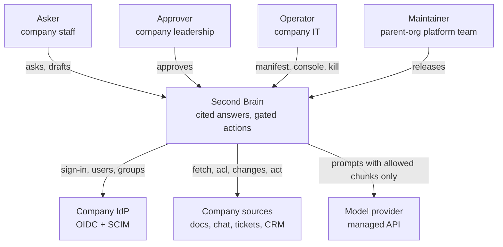
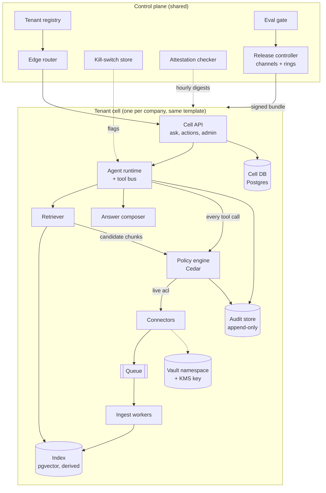
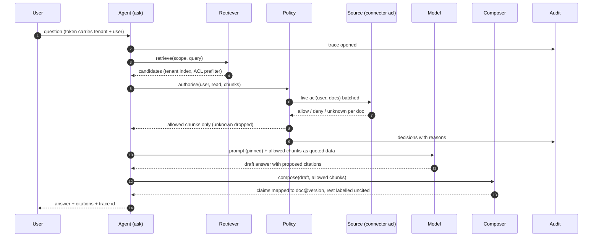
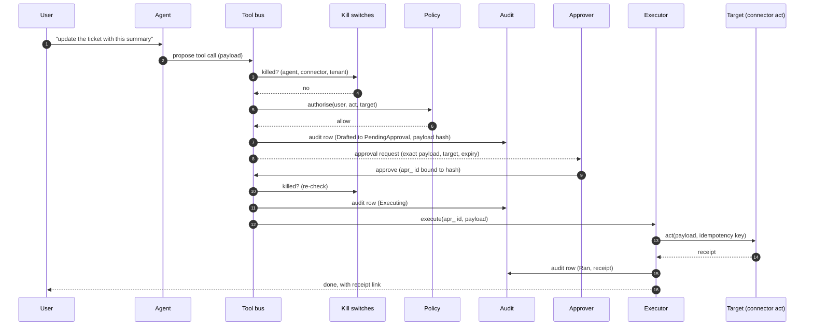
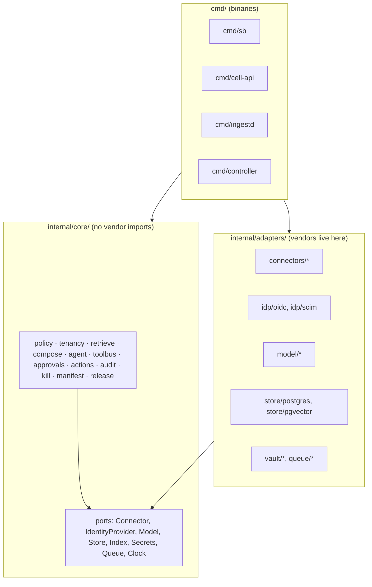

# Architecture overview

Second Brain is a **control plane** shared by all tenants, plus one **cell** per tenant stamped from a single template. The model is a replaceable userspace process; the **policy engine** is the kernel that every read and every tool call passes through.

## Context (C4 level 1)

## Containers (C4 level 2)

**Why cells.** A shared index is one bug away from a cross-company leak. Cells make isolation a property of the template, not of every query being right (ADR-0001). The control plane stores no tenant content: only routing, releases, flags and attestations.

**The factory.** The control plane plus the cell template and release train is the *factory*. Every cell carries a custody record, so a cell can later move to its company's own cloud account without being rebuilt ([16 Factory and hand-off](16-factory-and-handoff.md), ADR-0015).

## The ask path

The model never sees a chunk that failed step 6. Citations the model proposes that don't match an allowed chunk are stripped in step 11 (LAW-01, LAW-14).

## The action path

No receipt means `DidNotRun`, shown plainly to the user (LAW-05).

## Layering and the dependency rule

| Package may import | `core/ports` | `core/*` | `adapters/*` | vendor SDKs |
|---|---|---|---|---|
| `internal/core/ports` | — | only `core/tenancy` (the `Scope` type every port takes, SB-108) | no | no |
| `internal/core/*` | yes | yes (acyclic) | **no** | **no** |
| `internal/adapters/*` | yes | yes | no (siblings) | yes |
| `cmd/*` | yes | yes | yes | yes |

CI enforces this table with `depguard` (SB-008). A new vendor is a new folder in `internal/adapters/`, never an import in the core.

## Technology choices

| Concern | Choice | ADR |
|---|---|---|
| Services, CLI, policy host | Go | [ADR-0007](../adr/ADR-0007-language-and-stack.md) |
| Policy language | Cedar | [ADR-0008](../adr/ADR-0008-policy-language-cedar.md) |
| Evals and data tooling | Python | ADR-0007 |
| Web console and chat UI | TypeScript, server-rendered, minimal JS | ADR-0007 |
| Storage | Managed Postgres + pgvector per cell | [ADR-0006](../adr/ADR-0006-build-vs-buy.md) |
| Runtime | Managed containers, no Kubernetes | [ADR-0011](../adr/ADR-0011-no-kubernetes-in-v1.md) |
| Formal models | TLA+ and Alloy | [ADR-0010](../adr/ADR-0010-formal-methods-from-wave-0.md) |

## Subsystem documents

| # | Subsystem | Laws |
|---|---|---|
| 01 | [Identity and tenancy](01-identity-and-tenancy.md) | LAW-02, LAW-12 |
| 02 | [Policy engine](02-policy-engine.md) | LAW-01, LAW-03 |
| 03 | [Connectors](03-connectors.md) | LAW-01, LAW-03, LAW-05 |
| 04 | [Ingest pipeline](04-ingest-pipeline.md) | LAW-09, LAW-13 |
| 05 | [Storage and index](05-storage-and-index.md) | LAW-02, LAW-13 |
| 06 | [Retrieval and authorisation](06-retrieval-and-authorisation.md) | LAW-01, LAW-02, LAW-03 |
| 07 | [Answer composer and citations](07-answer-composer.md) | LAW-01, LAW-14 |
| 08 | [Agent runtime and tool bus](08-agent-runtime-and-tool-bus.md) | LAW-04, LAW-09, LAW-10 |
| 09 | [Approvals and actions](09-approvals-and-actions.md) | LAW-04, LAW-05, LAW-15 |
| 10 | [Audit log](10-audit-log.md) | LAW-04, LAW-07, LAW-11 |
| 11 | [Kill switches](11-kill-switches.md) | LAW-10 |
| 12 | [Evals and the gate](12-evals-and-gate.md) | LAW-06, LAW-09, LAW-14 |
| 13 | [Release and supply chain](13-release-and-supply-chain.md) | LAW-06, LAW-08 |
| 14 | [Manifest, CLI and console](14-manifest-cli-console.md) | LAW-16 |
| 15 | [Observability, backup and DR](15-observability-backup-dr.md) | LAW-11, LAW-13 |
| 16 | [Factory and hand-off](16-factory-and-handoff.md) | LAW-17, LAW-18 |
