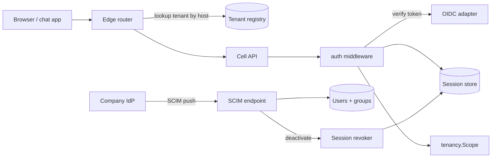

# 01 Identity and tenancy

**Job:** turn an incoming request into a `tenancy.Scope` (tenant plus user plus groups) that every later step must carry, and keep users and groups in step with the company's IdP.

## Components



## The scope is a type, not a parameter

```go
// package tenancy
type Scope struct {
    tenant TenantID   // unexported: only auth middleware can construct a Scope
    user   UserID
    groups []GroupID
}

func (s Scope) Tenant() TenantID
func (s Scope) User() UserID

// Every port method takes a Scope first. There is no unscoped overload.
type Index interface {
    Search(ctx context.Context, s Scope, q Query) ([]Candidate, error)
}
```

Because `Scope` can only be built by the auth middleware, code can't make up a tenant. Because every port takes one, code can't forget it (SB-108).

## Rules

| Rule | Enforced by |
|---|---|
| Hostname maps to exactly one tenant | Edge router + registry |
| Token's `tenant` claim must equal the cell's tenant | Auth middleware; mismatch returns `ETENANT` |
| Users and groups come only from SCIM, never created by hand | No write path except SCIM |
| SCIM deactivate revokes all sessions within 5 minutes | Revoker fan-out plus 60-second session re-validation (LAW-12) |
| Group changes reach policy within 5 minutes | Policy reads groups from the directory, not from the token |

## Failure modes

| Failure | Behaviour |
|---|---|
| IdP down | Existing sessions continue until their re-validation window; new sign-ins fail |
| SCIM push lost | Hourly full reconcile; drift is logged and alerted |
| Token for another tenant | `ETENANT`, audited, counted on the LAW-02 dashboard |
| Clock skew | Tokens validated with 60 s leeway; skew over 5 minutes alerts |

## Laws

[LAW-02](../../manual/sb-laws.7.md#law-02) no retrieval crosses a tenant boundary · [LAW-12](../../manual/sb-laws.7.md#law-12) deprovisioning revokes within 5 minutes.

## Tickets

SB-105, SB-106, SB-107, SB-108. Manual: [`sb-identity(7)`](../../manual/sb-identity.7.md), [`sb-tenancy(7)`](../../manual/sb-tenancy.7.md).
