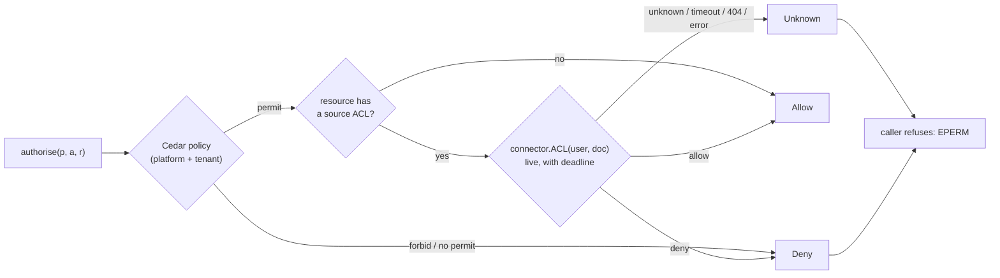

# 02 Policy engine

**Job:** answer *may principal do action on resource, given context?* for every read and every tool call, with a reason, and treat anything uncertain as no.

## One call

```go
// package policy
type Decision int
const (
    Allow Decision = iota + 1   // zero value is not Allow
    Deny
    Unknown
)

type Result struct {
    Decision  Decision
    Reason    string     // human-readable, safe to show
    PolicyIDs []string   // which Cedar policies matched
    Source    SourceVerdict // what the live acl call said, if any
}

func (e *Engine) Authorise(ctx context.Context, s tenancy.Scope, a Action, r Resource) Result

// Require is the only helper callers should use.
func Require(res Result) error // nil only for Allow; Deny and Unknown both return EPERM
```

The zero value of `Decision` is invalid, so a forgotten assignment can't read as `Allow`. A custom lint fails any `switch` on `Decision` without an explicit `Unknown` branch (SB-109).

## Two layers, both must agree



1. **Platform and tenant policy (Cedar).** Who may use which agent, which tool, which workflow; separation of duties; tenant scope on every permit.
2. **Source permission (live).** For anything that came from a source, the source decides, at read time. The index's ACL copy only narrows candidates (ADR-0002).

## Policy files

```cedar
// platform base: every permit is scoped to the principal's own tenant
permit (principal, action == Action::"read", resource)
when { principal.tenant == resource.tenant };

// separation of duties: nobody approves their own consequential action
forbid (principal, action == Action::"approve", resource)
when { resource.requester == principal };
```

Tenant policies live in the tenant's config folder and are validated against `policy/schema.cedarschema` in CI (SB-110, SB-112). See [`sb-policy(5)`](../../manual/sb-policy.5.md).

## Decision audit

Every decision on a tool call is written to the audit log with principal, action, resource, decision, reason, policy ids and release id. Read decisions are sampled, but every **refusal** is kept, because refusals are how we find broken connectors (SB-111).

## Failure modes

| Failure | Behaviour |
|---|---|
| Cedar evaluation error | `Unknown`, so the caller refuses |
| Connector `ACL` slow | Deadline (default 800 ms) then `Unknown` |
| Policy file invalid | Release blocked in CI; a running cell never loads an unvalidated policy |
| Unknown rate above 1% for a connector | Alert; fix the connector, never relax the rule |

## Laws

[LAW-01](../../manual/sb-laws.7.md#law-01) · [LAW-02](../../manual/sb-laws.7.md#law-02) · [LAW-03](../../manual/sb-laws.7.md#law-03). Modelled in [`proofs/alloy/Permissions.als`](../../proofs/alloy/Permissions.als).

## Tickets

SB-109 to SB-112, SB-302. Manual: [`sb-permissions(7)`](../../manual/sb-permissions.7.md), [`sb-policy(5)`](../../manual/sb-policy.5.md).
