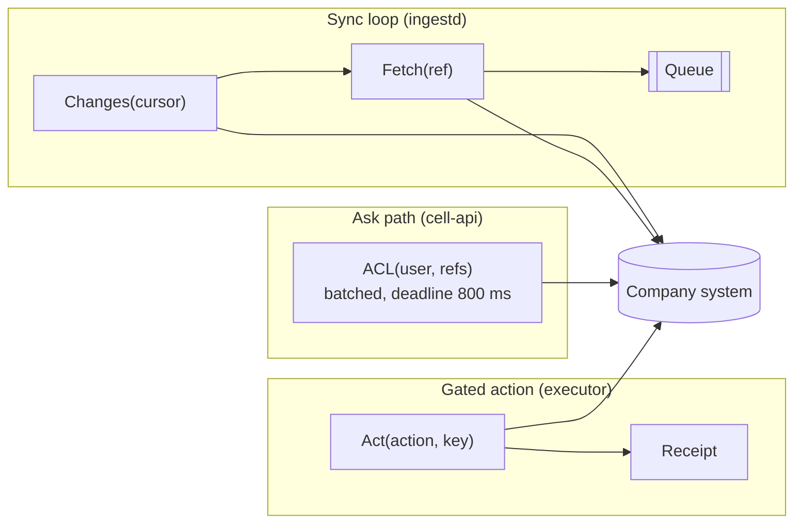

# 03 Connectors

**Job:** read from a company system, report who may see what *right now*, report what changed, and, for gated workflows only, perform one action and return a receipt.

## The contract

```go
// package ports
type Connector interface {
    Fetch(ctx context.Context, ref SourceRef) (Document, error)                 // content + version + ACL snapshot
    ACL(ctx context.Context, user UserRef, refs []SourceRef) ([]Verdict, error)  // live; batched
    Changes(ctx context.Context, cursor Cursor) (ChangeSet, Cursor, error)       // incremental sync
    Act(ctx context.Context, a Action, key IdempotencyKey) (Receipt, error)      // write; most connectors return ENOTSUP
}

type Verdict int // VerdictAllow, VerdictDeny, VerdictUnknown. Same three as policy.
```

Four calls. Nothing else. A connector is a folder in `internal/adapters/connectors/<kind>-<vendor>/` and passes the **contract kit** (SB-201). If it passes, it's substitutable (Liskov).

## Lifecycle



## Rules

| Rule | Why |
|---|---|
| Read-only OAuth scopes unless the manifest enables a workflow for this connector | Least privilege |
| Credentials resolved from `vault://tenants/<t>/connectors/<kind>` at call time | No secrets in config or memory dumps (LAW-07) |
| `ACL` must answer for a batch of up to 200 refs | Latency budget on the ask path |
| Any error, timeout or unmapped permission model returns `VerdictUnknown` | LAW-03 |
| `Act` must be idempotent per key and return a target-issued receipt id | LAW-05 |
| No connector may call another connector | One job each |

## The contract kit

The kit is a Go test suite each connector runs against a recorded or sandbox tenant:

| Kit case | Checks |
|---|---|
| `fetch/version-stable` | Same version returns same content hash |
| `acl/deny-is-deny` | A user without access gets `Deny`, not `Unknown` |
| `acl/error-is-unknown` | Injected 500, timeout and 404 all give `Unknown` |
| `acl/batch-200` | 200 refs answered within the deadline |
| `changes/resume` | Cursor restart loses nothing and duplicates are idempotent |
| `changes/acl-delta` | A permission change appears as a change |
| `act/receipt-or-error` | Never returns success without a receipt id |
| `act/idempotent` | Same key twice gives one effect and the same receipt |

## v1 connectors

| Kind | First vendor | Wave | Ticket |
|---|---|---|---|
| `docs` | One document platform (chosen with the first tenants) | W2 | SB-203 |
| `chat` | One chat platform | W2 | SB-204 |
| `tickets` | One ticketing platform | W2 | SB-211 |
| `crm` | One CRM, read-only | W6 | SB-610 |

## Failure modes

| Failure | Behaviour |
|---|---|
| Source rate-limits | Backoff with jitter; ask path returns `Unknown`, so the chunk is dropped |
| Source permission model we can't map | `Unknown`, logged as a connector defect |
| Cursor corrupted | Full resync from scratch (the index is derived) |
| Vendor API version change | Connector API-version bump; contract kit gates it |

## Laws

[LAW-01](../../manual/sb-laws.7.md#law-01) · [LAW-03](../../manual/sb-laws.7.md#law-03) · [LAW-05](../../manual/sb-laws.7.md#law-05) · [LAW-07](../../manual/sb-laws.7.md#law-07).

## Tickets

SB-201 to SB-205, SB-211, SB-610. Manual: [`sb-connector(3)`](../../manual/sb-connector.3.md).
