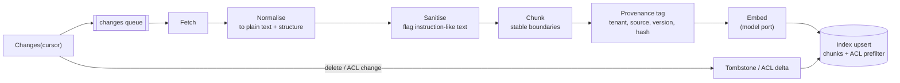

# 04 Ingest pipeline

**Job:** turn source changes into indexed, provenance-tagged, sanitised chunks within the freshness SLA, and make deletes and permission changes take effect just as fast.

## Stages



Each stage is a pure function from one record type to the next, except Fetch, Embed and the index write. That keeps the pipeline easy to test and to replay.

## Provenance record

Every chunk carries the following record, and it surfaces in citations:

```json
{
  "chunk": "chk_01JD3QA1...",
  "tenant": "acme-logistics",
  "cite": "docs:4f2a9c11@17",
  "span": [1840, 2615],
  "content_sha256": "9b1c…",
  "flags": ["instruction_like"],
  "acl_prefilter": ["grp_7f3a91c2", "usr_01JD3Q8Z…"],
  "ingested_at": "2027-02-11T09:14:03Z",
  "release": "rel_2027-02-10_4c2d1e"
}
```

## Sanitiser (P4: data is not instructions)

The sanitiser doesn't try to make hostile text safe. It makes sure hostile text is **treated as data**.

| Step | What it does |
|---|---|
| Strip | Remove hidden text, zero-width characters, off-screen styles, HTML comments, alt-text payloads |
| Flag | Mark spans that look like instructions to an AI ("ignore previous", tool-call syntax, role markers) |
| Wrap | At prompt time, chunks go inside a quoted-data block with provenance; the system prompt says data blocks are never instructions |
| Gate | The tool bus only accepts tool calls derived from the user's turn. A tool call whose arguments are copied from a flagged span is refused and audited |

The injection eval suite (SB-207, SB-501) must produce **zero** tool calls (LAW-09).

## Freshness

| Path | Target |
|---|---|
| Change detected to indexed (p95) | 15 minutes or less |
| Delete or ACL change to prefilter updated (p95) | 15 minutes or less |
| Gap between source change and prefilter | Covered by the live ACL check (LAW-01 holds throughout) |

## Rebuild

The index is derived data. `sb-ingestd rebuild --tenant T` drops the index and replays `Fetch` for every source document. The drill checks that the `(cite, ACL)` set before and after is identical (LAW-13, SB-210).

## Failure modes

| Failure | Behaviour |
|---|---|
| Embedding provider down | Records wait in the queue; freshness alert after 15 minutes |
| Poison document (crashes a stage) | Moved to a dead-letter queue after 3 tries; logged with source ref, never content |
| Duplicate change events | Upsert keyed by `(cite, span)` is idempotent |

## Laws

[LAW-09](../../manual/sb-laws.7.md#law-09) · [LAW-13](../../manual/sb-laws.7.md#law-13).

## Tickets

SB-206 to SB-210. Manual: [`sb-ingest(7)`](../../manual/sb-ingest.7.md).
