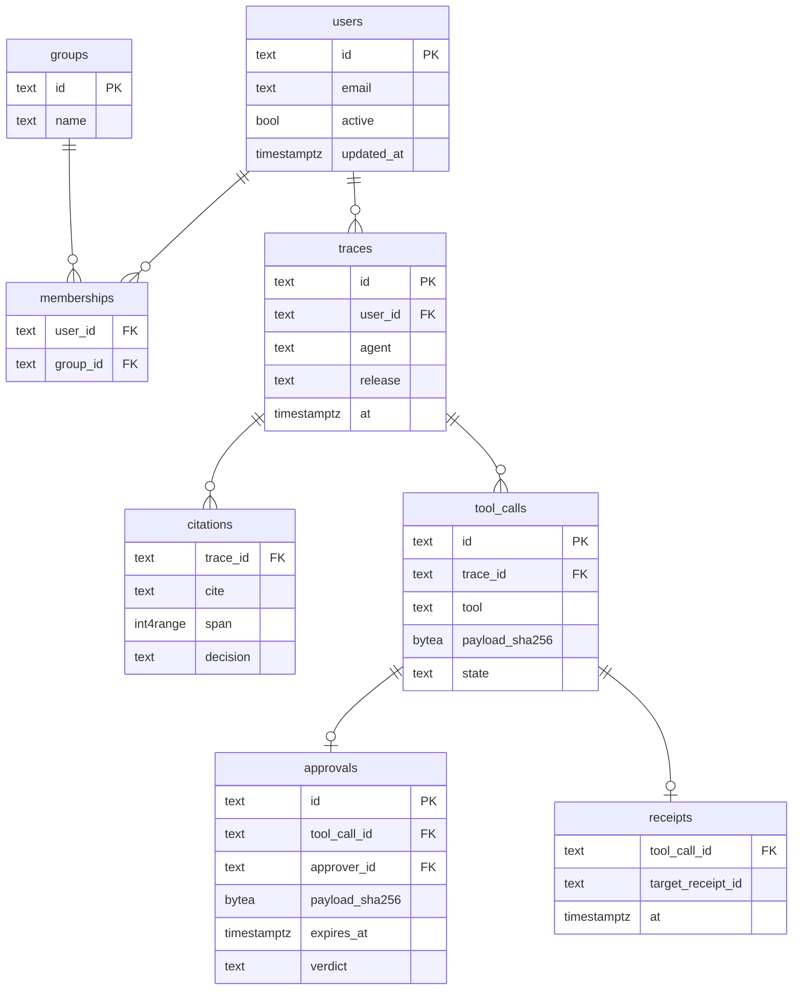
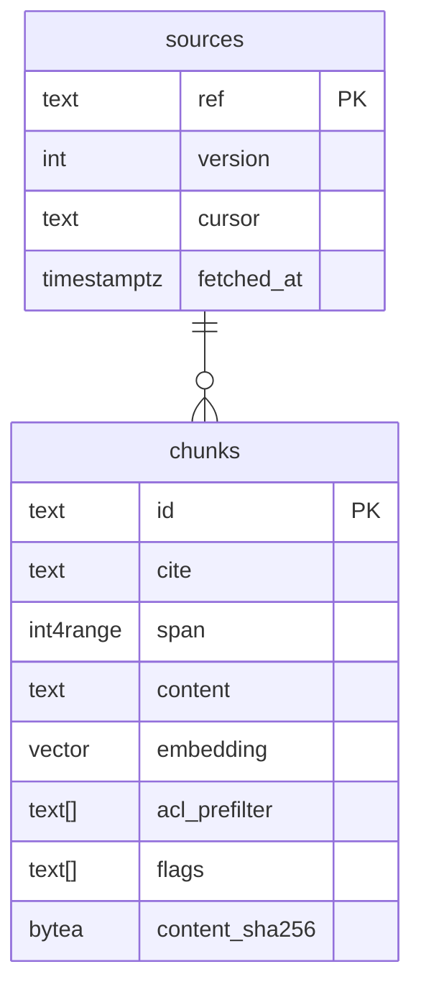

# 05 Storage and index

**Job:** keep each tenant's records in its own database and keys, and keep derived data clearly separate from records.

## Cell database (simplified)

## Index schema

The index lives in its **own schema** in the cell database, with its own role. Dropping it never touches records (LAW-13).

## Isolation per cell

| Resource | Per cell | Shared |
|---|---|---|
| Postgres instance | yes | — |
| Index schema + role | yes | — |
| Vault namespace | yes | — |
| KMS key (envelope encryption of DB, backups, audit export) | yes | — |
| Queue | yes | — |
| Region | pinned by manifest | — |
| Release images | — | signed, read-only |
| Control-plane registry and flags | — | no tenant content |

## Encryption and keys

- Data at rest is encrypted with a **key hierarchy**: a per-cell root key, held in the custodian's KMS, wraps the data keys. Hand-off re-wraps only the root key under the new custodian's KMS, so no data is re-encrypted (ADR-0015, LAW-18).
- Destroying every wrap of the root key is the last step of tenant off-boarding (crypto-shredding).
- Backups and audit exports are encrypted with the same key, then copied off-site (SB-412).
- No key material leaves the KMS; the platform team can't read a cell's data without a logged, break-glass grant.

## Retention

| Data | Default | Controlled by |
|---|---|---|
| Traces, citations, drafts | `retention_days` (365) | Manifest |
| Chunks and embeddings | While the source exists | Source deletes |
| Audit log | 7 years | Audit retention policy, not the manifest |
| Operational logs | 30 days | Platform policy; never contain content |

## Laws

[LAW-02](../../manual/sb-laws.7.md#law-02) · [LAW-13](../../manual/sb-laws.7.md#law-13).

## Tickets

SB-103, SB-206, SB-210, SB-611. Manual: [`sb-tenancy(7)`](../../manual/sb-tenancy.7.md).
