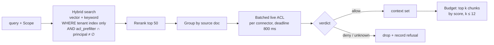
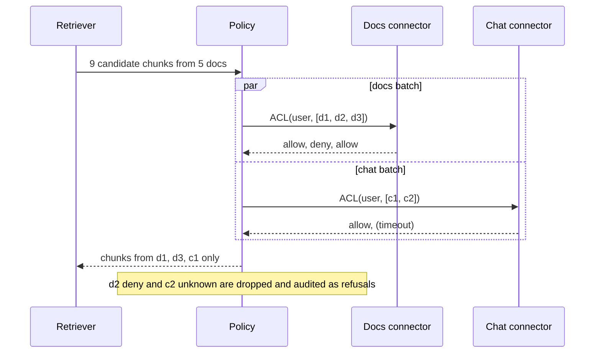

# 06 Retrieval and authorisation

**Job:** find the best candidate chunks in the asker's own tenant, then let only those the asker can open right now into the model's context.

## Pipeline

## Why the prefilter is not enough

The prefilter is a copy of the source's permissions, taken at ingest. Copies go stale: a user removed from a group at 09:00 may still match the prefilter at 09:10. So the prefilter only narrows the candidates, for speed. The **live check** at answer time is what decides (ADR-0002).

## Rules

| Rule | Detail |
|---|---|
| Tenant scope is in the query, not a post-filter | The retriever can only open the tenant's own index schema |
| Live ACL per **document**, per request | Chunks inherit their document's verdict |
| No allow is cached across requests | Per-request batching only (ADR-0002). Deny may be cached for 60 s to cut load |
| Deadline then `Unknown` | Default 800 ms per connector batch |
| Refusals are counted | `refused` count returned to the caller; per-connector unknown rate on dashboards |

## Latency budget (p95 6 s)

| Step | Budget |
|---|---|
| Retrieve + rerank | 400 ms |
| Live ACL (parallel per connector) | 800 ms |
| Model generation | 4 s |
| Compose + validate citations | 200 ms |
| Overhead | 600 ms |

## Failure modes

| Failure | Behaviour |
|---|---|
| All candidates refused | Answer says so: "I found sources but you don't have access to them" plus `refused: n`, never their titles |
| One connector down | Its chunks are `Unknown` and dropped; others proceed |
| Index unavailable | `EUNAVAIL`; no fallback to another tenant or a shared index, ever |

## Laws

[LAW-01](../../manual/sb-laws.7.md#law-01) · [LAW-02](../../manual/sb-laws.7.md#law-02) · [LAW-03](../../manual/sb-laws.7.md#law-03).

## Tickets

SB-301 to SB-303. Manual: [`sb-permissions(7)`](../../manual/sb-permissions.7.md), [`sb-ask(3)`](../../manual/sb-ask.3.md).
