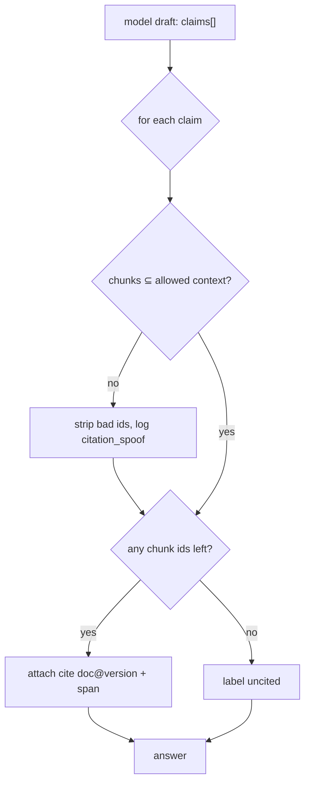

# 07 Answer composer and citations

**Job:** turn the model's draft into an answer where every claim either maps to an allowed chunk at a specific version, or is labelled `uncited` in code.

## Structured output, not prose

The model is asked to return claims, each with the chunk ids it relied on:

```json
{
  "claims": [
    { "text": "Refunds over £500 need a team lead's approval.", "chunks": ["chk_01JD3QA1"] },
    { "text": "This changed in March.", "chunks": [] }
  ]
}
```

The composer then validates every claim:



A chunk id the model invents, or one from outside the allowed context, can't become a citation. The `uncited` label is set by this code path, never by the prompt (LAW-14).

## What the user sees

```text
Refunds over £500 need a team lead's approval. [1]
This changed in March. (uncited)

[1] Refund policy, docs:4f2a9c11@17, section "Approvals"
```

- Citations open the source at the cited version where the source supports it, or show the cited span otherwise.
- `uncited` claims are styled differently in every UI and are marked as such in the API.
- If more than half the claims are uncited, the answer leads with: "I couldn't find sources for most of this."

## Faithfulness

Mapping a claim to a chunk proves the chunk was *allowed* and *offered*. It doesn't prove the chunk *supports* the claim. That's measured by the citation-faithfulness eval (SB-309), which scores support for each claim–chunk pair on golden questions, per tenant, and gates releases (SB-502).

## Failure modes

| Failure | Behaviour |
|---|---|
| Model returns invalid JSON | One repair retry with the same context; otherwise return `uncited` text with a notice |
| Model cites a refused document by title in prose | Refused titles are never in context, so it can't. If a title appears anyway, the injection eval flags the trace |
| Source version changed between retrieval and display | Citation keeps the version it used; the UI shows "newer version available" |

## Laws

[LAW-01](../../manual/sb-laws.7.md#law-01) · [LAW-14](../../manual/sb-laws.7.md#law-14).

## Tickets

SB-304, SB-306, SB-309. Manual: [`sb-citations(7)`](../../manual/sb-citations.7.md).
