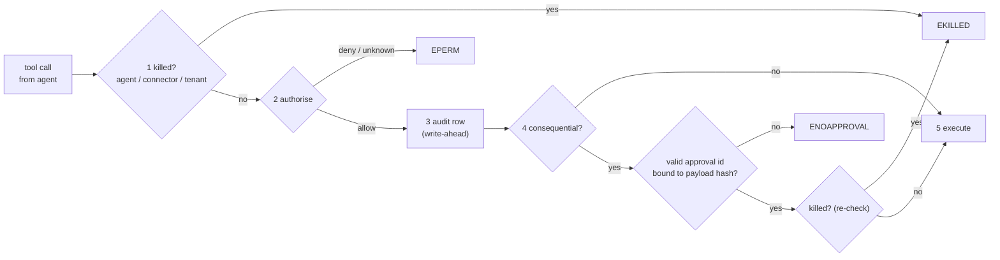
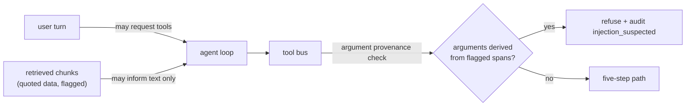

# 08 Agent runtime and tool bus

**Job:** run the v1 agents (`ask`, `draft-reply`) and the tenant's one gated workflow, and make sure every tool call passes the same checks in the same order.

## Agents are data, not code

An agent is a definition in the release bundle: a prompt, a tool list and limits. There is no per-company agent code.

```yaml
# bundle/agents/draft-reply.yaml
name: draft-reply
prompt: prompts/draft-reply.md        # hashed into the release id
tools: [search, read_chunk, propose_draft]
limits: { max_steps: 6, max_tokens: 6000, timeout_s: 45 }
consequential: false                  # a human sends; no approval needed
```

| Agent | Tools | Writes? |
|---|---|---|
| `ask` | `search`, `read_chunk` | No |
| `draft-reply` | `search`, `read_chunk`, `propose_draft` | No. A human sends from the target app or our UI |
| workflow e.g. `ticket-update` | `search`, `read_chunk`, `propose_action` | Yes, only via approval and receipt |

## The tool bus: five steps, fixed order



The bus is the **only** way to invoke a tool. Tools are registered from the release bundle; there is no other registry. A lint forbids importing tool implementations outside `toolbus` (SB-405).

## Injection boundary



Tool arguments carry provenance. Arguments copied from a flagged data span are refused (LAW-09). This is belt and braces on top of the prompt design and the eval gate.

## Limits

Every run has a hard step, token and time limit. Hitting a limit ends the run with a partial result and a clear notice. It never retries silently.

## Laws

[LAW-04](../../manual/sb-laws.7.md#law-04) · [LAW-09](../../manual/sb-laws.7.md#law-09) · [LAW-10](../../manual/sb-laws.7.md#law-10).

## Tickets

SB-305, SB-306, SB-405, SB-409, SB-410. Manual: [`sb-agents(7)`](../../manual/sb-agents.7.md).
