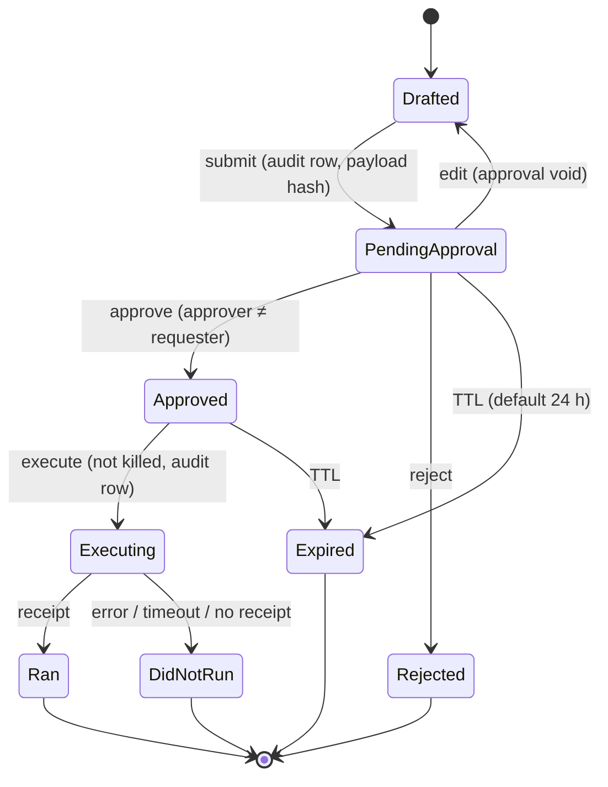
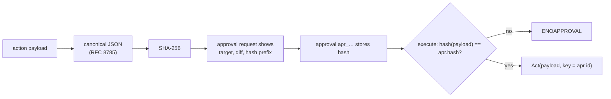

# 09 Approvals and actions

**Job:** let a human approve exactly what will run, run it at most once, and report truthfully whether it ran.

## State machine

This diagram, the code (`internal/core/approvals`), [`sb-approvals(7)`](../../manual/sb-approvals.7.md) and [`proofs/tla/Approvals.tla`](../../proofs/tla/Approvals.tla) use the same state names. A rename in one is a rename in all four.

## Binding an approval to a payload

- Any edit changes the hash, which voids the approval (LAW-15).
- The idempotency key is the approval id, so a retry can't double-execute.
- Separation of duties: the approver must not be the requester. Cedar enforces it and the model checks it.

## What "ran" means

| Outcome from `Act` | State | User sees |
|---|---|---|
| Receipt with target id | `Ran` | "Done", with a link to the receipt |
| Error | `DidNotRun` | "This didn't run: *reason*". Nothing is retried automatically |
| Timeout | `DidNotRun` (unknown effect) | "We couldn't confirm this ran. Check *target* before retrying." Reconciler checks the target by idempotency key |
| Success with no receipt | `DidNotRun` | Treated as an error and filed as a connector defect |

The model's own statement that something happened is ignored (LAW-05).

## Approver view

| Shows | Why |
|---|---|
| Target system and object | Where it will run |
| Exact payload, as a diff against the current target state where possible | What will change |
| Requester, agent, trace link, policy reason | Who and why |
| Expiry | Approvals go stale |
| Hash prefix | Lets an auditor match the approval to the execution |

## Laws

[LAW-04](../../manual/sb-laws.7.md#law-04) · [LAW-05](../../manual/sb-laws.7.md#law-05) · [LAW-10](../../manual/sb-laws.7.md#law-10) · [LAW-15](../../manual/sb-laws.7.md#law-15).

## Tickets

SB-406, SB-407, SB-408, SB-410. Manual: [`sb-approvals(7)`](../../manual/sb-approvals.7.md), [`sb-actions(3)`](../../manual/sb-actions.3.md).
