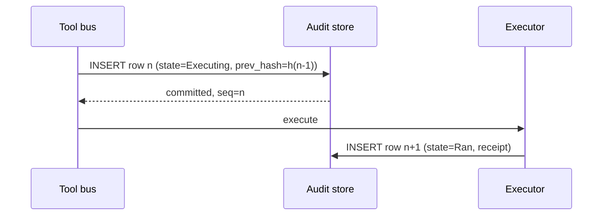
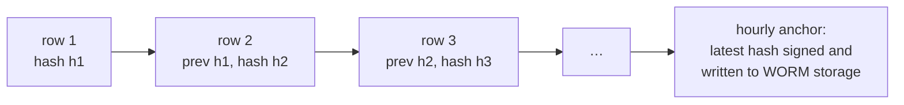

# 10 Audit log

**Job:** record every tool call, decision, approval, kill and config change **before** it takes effect, in a form nobody can edit without detection.

## Write-ahead



If the audit insert fails, the tool call doesn't run (LAW-04).

## Row format

```json
{
  "seq": 1234,
  "id": "aud_000000001234",
  "at": "2027-03-02T10:41:07.512Z",
  "tenant": "acme-logistics",
  "actor": "usr_01JD3Q8Z…",
  "kind": "tool_call",
  "subject": "tc_01JD3QC7…",
  "state": "Executing",
  "approval": "apr_01JD3QD9…",
  "payload_sha256": "5d1f…",
  "release": "rel_2027-03-02_9b1c4e",
  "reason": "policy:workflow-ticket-update permit",
  "prev": "a3c9…",
  "hash": "SHA-256(prev || canonical(row without hash))"
}
```

Payloads are referenced by hash, never stored inline, so the log carries no content or secrets (LAW-07). The full schema is in [`sb-audit(5)`](../../manual/sb-audit.5.md).

## Tamper evidence



- The cell's DB role for the audit schema has `INSERT` and `SELECT` only. `UPDATE`, `DELETE` and `TRUNCATE` are revoked.
- `sb audit verify` recomputes the chain and checks it against the signed hourly anchors (LAW-11).
- Anchors are signed with a **per-cell** key, not a factory-wide one, so the chain stays verifiable after a hand-off moves the cell (ADR-0015).
- Custody changes (hand-off planned, approved, cut over, detached) are audited with `kind: custody`.
- Exports are NDJSON, signed, encrypted with the cell key, and copied 3-2-1 (SB-412).

## What is audited

| Kind | Examples |
|---|---|
| `tool_call` | Every state transition of every tool call |
| `decision` | Every policy decision on a tool call; every refusal on reads; a sample of read allows |
| `approval` | Request, approve, reject, expire, void |
| `kill` | Kill and unkill, with reason |
| `config` | Manifest applies, console changes, policy loads |
| `release` | Deploy, rollback, attestation results |
| `access` | Break-glass access by anyone outside the tenant |

## Laws

[LAW-04](../../manual/sb-laws.7.md#law-04) · [LAW-07](../../manual/sb-laws.7.md#law-07) · [LAW-11](../../manual/sb-laws.7.md#law-11).

## Tickets

SB-401, SB-402, SB-412. Manual: [`sb-audit(7)`](../../manual/sb-audit.7.md), [`sb-audit(1)`](../../manual/sb-audit.1.md), [`sb-audit(5)`](../../manual/sb-audit.5.md).
