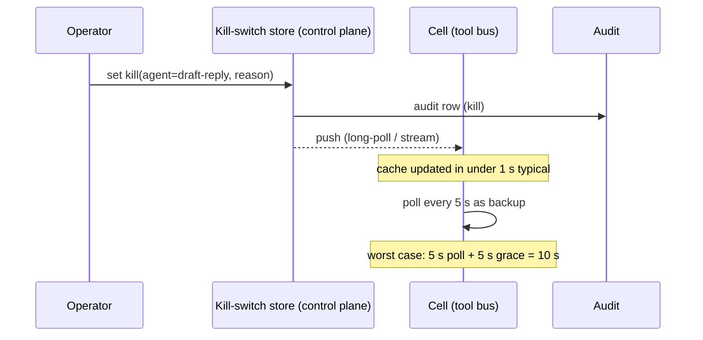

# 11 Kill switches

**Job:** let an operator stop an agent, a connector or a whole tenant within 10 seconds, without a deploy, and record why.

## Scopes

| Scope | Effect | Example |
|---|---|---|
| `agent NAME` | That agent refuses new runs and new tool calls | `sb kill agent draft-reply --tenant acme-logistics` |
| `connector KIND` | No `fetch`, `changes`, `acl` or `act` on that connector; its chunks become `Unknown` (so they're dropped) | `sb kill connector chat --tenant acme-logistics` |
| `tenant` | The cell refuses all requests except admin and audit read | `sb kill tenant --tenant acme-logistics` |
| `agent NAME --all-tenants` | Platform-wide stop of one agent (maintainers only) | During an eval-escaping incident |

## Propagation

The tool bus checks the flag before authorising, and again just before executing an approved action. A call that has already passed the second check finishes. Nothing new starts once the flag is seen (LAW-10).

## Fail-safe direction

If a cell can't reach the kill-switch store for more than 30 seconds, it **stops consequential tool calls** and keeps serving reads. Losing the ability to be stopped is treated as being stopped.

## Kill is runtime; permanence is a manifest diff

Kill switches act instantly and are not manifest changes, because a manifest apply is too slow for an incident. The console then offers **"make permanent"**, which opens a manifest diff removing the agent or connector (LAW-16).

## Drills

The release pipeline fires every kill scope in staging and asserts the effect within 10 seconds (SB-404). The result goes in the release notes.

## Laws

[LAW-10](../../manual/sb-laws.7.md#law-10). Modelled in [`Approvals.tla`](../../proofs/tla/Approvals.tla) (`KillWins`).

## Tickets

SB-403, SB-404, SB-602. Manual: [`sb-kill(1)`](../../manual/sb-kill.1.md), [`sb-kill-switches(7)`](../../manual/sb-kill-switches.7.md).
