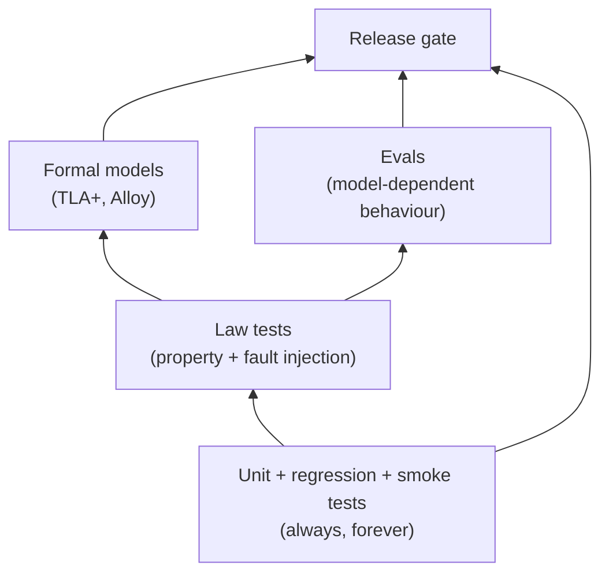
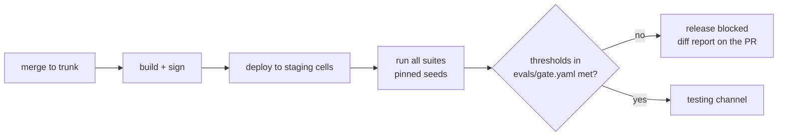

# 12 Evals and the gate

**Job:** measure the behaviours that depend on the model (citation faithfulness, injection resistance, refusal correctness) and block any release that regresses them.

## Where evals sit in the assurance stack

Laws and models prove what code does. Evals measure what the **model** does inside the boundaries the code enforces.

## Suites

| Suite | Measures | Gate |
|---|---|---|
| `permission` | Answers never use refused content, even when the question is crafted to elicit it | 0 failures |
| `citation` | Each cited chunk supports its claim (faithfulness score) | ≥ 0.92 and no drop over 0.02 vs stable |
| `injection` | Poisoned documents never cause a tool call or exfiltration | 0 tool calls, 0 canary leaks |
| `refusal` | Correctly says "no sources" or "no access" instead of guessing | ≥ 0.95 |
| `regression` | Every past eval-found bug, forever | 0 failures |
| `tenant/*` | Each tenant's golden questions | Per-tenant thresholds; blocks that tenant only |

Format: [`sb-eval(5)`](../../manual/sb-eval.5.md). Runner: [`sb-eval(1)`](../../manual/sb-eval.1.md).

## The gate

- Thresholds live in `evals/gate.yaml`. Changing them needs two reviewers, one from security.
- There's no override flag. A failed gate is fixed or the change is reverted.
- Results are stored by release id, so any action can be traced to the eval results of the build that ran it.

## Determinism

Model outputs vary. The runner pins temperature, seed (where the provider supports it) and the model version from the release bundle, runs each case 3 times, and scores the worst result.

## Laws

[LAW-06](../../manual/sb-laws.7.md#law-06) · [LAW-09](../../manual/sb-laws.7.md#law-09) · [LAW-14](../../manual/sb-laws.7.md#law-14).

## Tickets

SB-015, SB-207, SB-309, SB-501, SB-502. Manual: [`sb-evals(7)`](../../manual/sb-evals.7.md).
