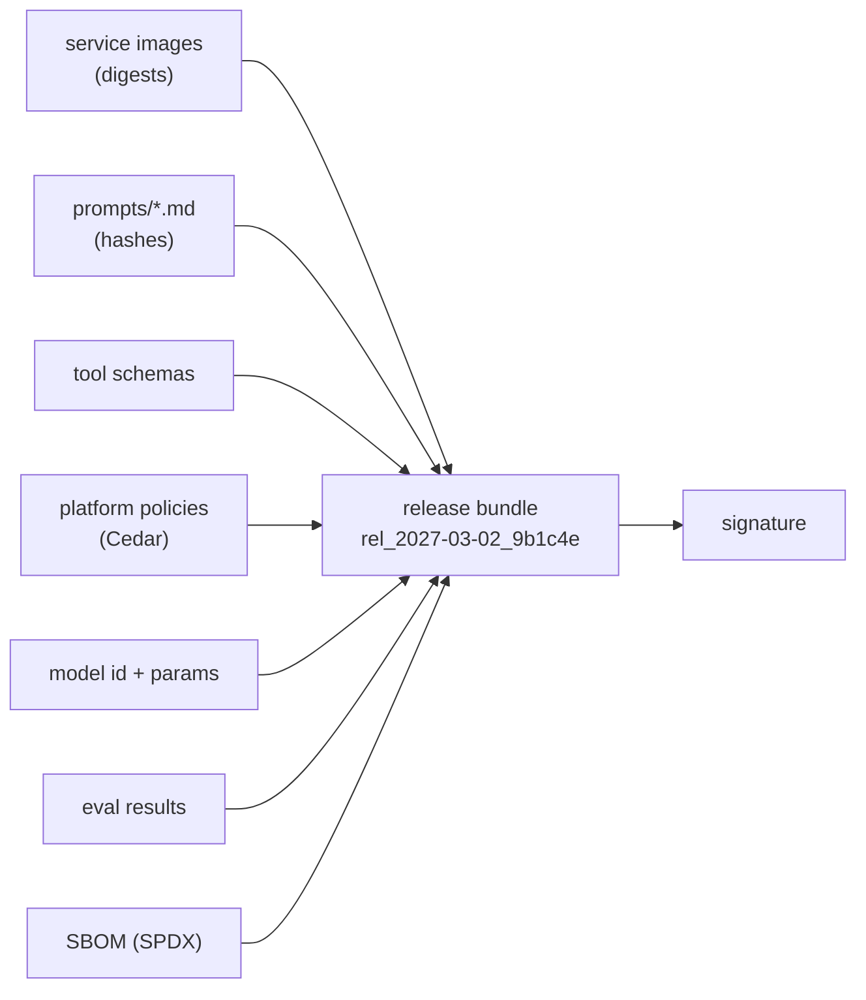
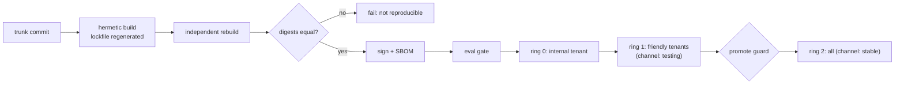
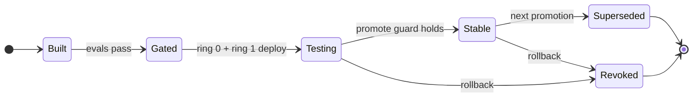

# 13 Release and supply chain

**Job:** get a change from trunk to every tenant safely, prove what is running everywhere, and roll back in one step.

## The release bundle

A release is more than code. Everything that changes behaviour is in the bundle and hashed into the release id (SB-503).

## Pipeline

## Channels and the promote guard

Tenants pick `channel: stable` or `channel: testing`, never a version (ADR-0004).

The **promote guard**: a release can become the new stable only when every stable-channel tenant is already running the current stable. So after promotion, nobody is more than one release behind (LAW-08). Without the guard, a slow tenant could fall two behind; [`Rollout.tla`](../../proofs/tla/Rollout.tla) finds that counterexample.

## Rollback

`sb release rollback` makes the previous stable current and marks the bad release `Revoked` at once. Cells still running it are **draining**: they start no new consequential tool calls (through the kill-switch path) until they've been redeployed, one by one. Target: every cell redeployed in under 10 minutes (SB-508). Revoked releases can never be redeployed. Modelled in `Rollout.tla` (BUG-0001).

## Pull, not push

Cells **pull** signed bundles from the release train and **push** attestations back. The factory never needs inbound access to a cell. That makes deploys simpler to secure, and it means a cell in a company's own cloud account (`custody: tenant`, ADR-0015) stays on the train with no new mechanism.

## Proving what runs

| Check | When | Law |
|---|---|---|
| Signature + SBOM verified before a container starts | Every deploy | LAW-06 |
| Running digests reported by each cell | Hourly and on deploy | LAW-06 |
| Release lag per tenant | Every promotion and hourly | LAW-08 |
| Running config equals applied manifest | Hourly | LAW-16 |

## CVEs

Lockfiles are regenerated every release. A CVE advisory against a dependency triggers a patch release on `testing` within 24 hours, then the normal path. Because nobody is more than one behind, every tenant has the fix within one promotion (SB-505).

## Laws

[LAW-06](../../manual/sb-laws.7.md#law-06) · [LAW-08](../../manual/sb-laws.7.md#law-08) · [LAW-16](../../manual/sb-laws.7.md#law-16).

## Tickets

SB-503 to SB-510. Manual: [`sb-release(7)`](../../manual/sb-release.7.md), [`sb-release(1)`](../../manual/sb-release.1.md).
