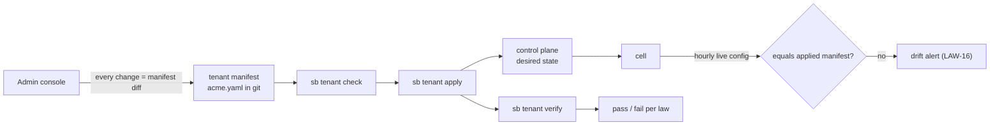
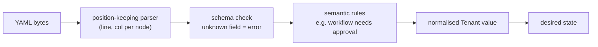

# 14 Manifest, CLI and console

**Job:** give operators one file that fully describes their tenant, three commands to make it real, and a console that edits the same file.

## One source of truth



## The manifest

```yaml
tenant: acme-logistics
channel: stable
idp: oidc://login.acme.example
region: eu
connectors: { docs: sharepoint, chat: slack }
agents: [ask, draft-reply]
workflows: [ticket-update]
approval: { ticket-update: group:it-leads }
retention_days: 365
budget_usd_month: 1500
```

No secrets, no versions, no per-company code. Full reference: [`sb-tenant(5)`](../../manual/sb-tenant.5.md).

## Parser design



Errors look like compiler errors, so humans, editors and LLMs can all act on them:

```text
acme.yaml:7:3: workflows[0]: "ticket-update" needs an approval rule; add approval: { ticket-update: group:<name> }
acme.yaml:2:1: version: field not allowed; pick a channel (stable|testing) instead (ADR-0004)
```

## The CLI

| Command | Does | Exit codes |
|---|---|---|
| `sb tenant check FILE` | Parse and validate, no network | 0 ok, 1 invalid |
| `sb tenant apply FILE [--plan]` | Make the cell match the manifest, idempotent | 0 applied or no change, 1 failed |
| `sb tenant verify FILE` | Run LAW-01, 02, 03 and 14 on real data | 0 all pass, 1 any fail or unknown |
| `sb kill …` / `sb unkill …` | Kill switches | 0 effective |
| `sb audit verify`, `tail`, `export` | Audit tools | 0 chain ok, 1 broken |
| `sb release status`, `promote`, `rollback` | Release controller (maintainers) | 0 done |
| `sb eval run SUITE` | Run eval suites | 0 pass, 1 fail |

Every command takes `--json` for machine output and `--tenant` where relevant. See [`sb(1)`](../../manual/sb.1.md).

## The console

The console is for operators who prefer forms. It has no hidden powers:

| Console action | Effect |
|---|---|
| Enable a connector, agent or workflow | Opens a manifest diff (as a PR to the tenant repo or a signed apply) |
| Edit an approval rule | Manifest diff |
| Pull a kill switch | Immediate runtime kill + audit row; offers "make permanent" as a manifest diff |
| View audit, usage, refusals | Read-only |

## Laws

[LAW-16](../../manual/sb-laws.7.md#law-16).

## Tickets

SB-101, SB-102, SB-104, SB-510, SB-601, SB-602, SB-603. Manual: [`sb-tenant(1)`](../../manual/sb-tenant.1.md), [`sb-admin(3)`](../../manual/sb-admin.3.md).
