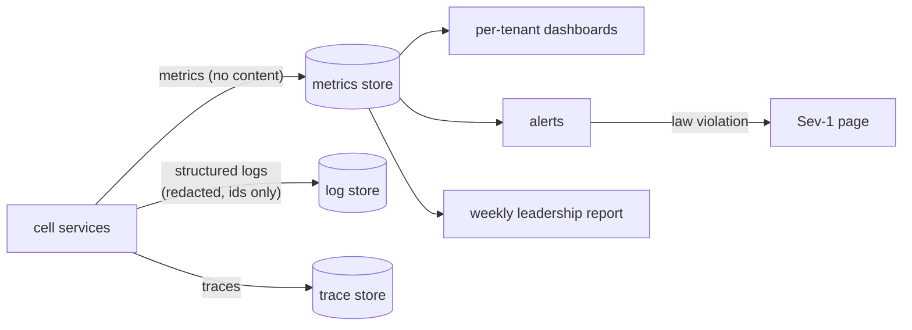

# 15 Observability, backup and DR

**Job:** give operators health, cost, freshness and law signals per tenant, with no document content in telemetry, and make sure records can be restored within the targets.

## Signals

| Signal | Example metric | Alert |
|---|---|---|
| Latency | `ask_latency_seconds` p95 | > 6 s for 15 min |
| Errors | `requests_total{code}` | 5xx > 1% for 10 min |
| Freshness | `ingest_lag_seconds` p95 | > 900 s |
| Unknown rate | `acl_unknown_ratio{connector}` | > 1% for 30 min |
| Cost | `model_cost_usd` per tenant per day | > 120% of budget pace |
| Laws | `law_violation_total{law}` | **any → Sev-1** |

## Telemetry rules

- Logs carry ids (`tr_`, `tc_`, `chk_`, `docs:…@v`), never content, prompts or answers.
- The secret scanner runs on all log streams (LAW-07).
- A redaction test in CI fails if any log line in the test suite contains a canary string or chunk text (SB-607).

## Backup

| Data | Method | RPO | Copies |
|---|---|---|---|
| Cell DB records | Continuous WAL archive + daily snapshot | 15 min | 3-2-1 |
| Audit log | Same, plus hourly signed anchor in WORM storage | 15 min | 3-2-1 |
| Index | Not backed up: rebuilt from sources | n/a | n/a |
| Manifests | Git | per commit | git remotes |

## Disaster recovery

| Scenario | Target | Drill |
|---|---|---|
| Lose a cell's database | RTO 4 h, RPO 15 min, same region | Quarterly game day (SB-613) |
| Lose the index | Rebuild within 24 h; answers degrade to `refused` until then | Scheduled rebuild drill (SB-210) |
| Lose the control plane | Cells keep serving reads; consequential tools stop (fail-safe kill) | Annual |
| Bad release | One-step rollback under 10 min | Every release |

Restores never leave the cell's pinned region.

## Laws

[LAW-07](../../manual/sb-laws.7.md#law-07) · [LAW-11](../../manual/sb-laws.7.md#law-11) · [LAW-13](../../manual/sb-laws.7.md#law-13).

## Tickets

SB-412, SB-606, SB-607, SB-608, SB-609, SB-613. Manual: [`sb-observability(7)`](../../manual/sb-observability.7.md).
