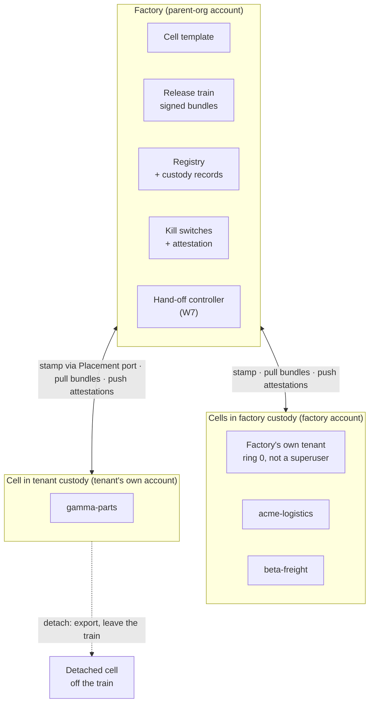
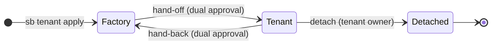
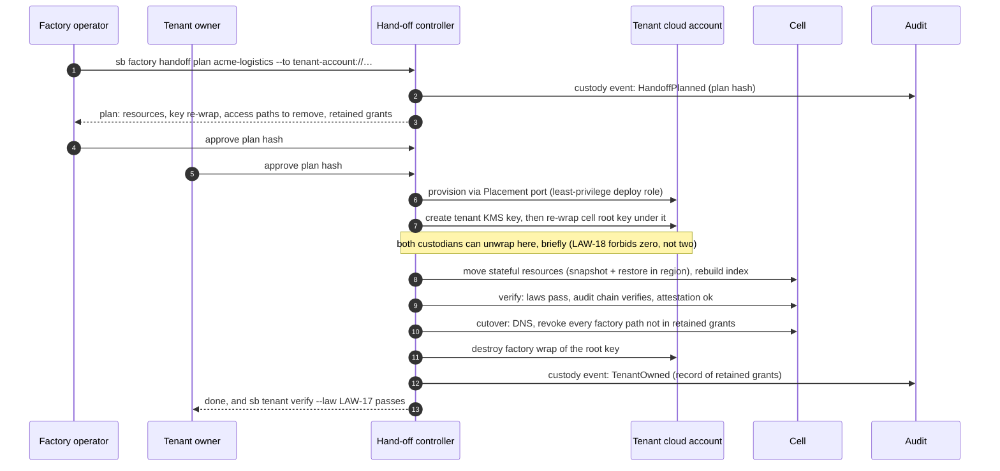

# 16 Factory and hand-off

**Job:** produce an isolated Second Brain for each tenant from one template, run many of them under one release train, and, when a company asks, transfer custody of its Second Brain to it without losing data, audit continuity or the laws.

**Status:** design accepted (ADR-0015). v1 builds the seams; the hand-off itself ships in W7 (epic E08).

## The factory

"Multi-tenant" here means many isolated cells run by one factory, never one shared store (ADR-0001). The factory itself is tenant ring 0, which keeps it honest: it uses the product exactly as companies do.

## Custody levels

| | `factory` | `tenant` | `detached` |
|---|---|---|---|
| Cloud account | Factory | Tenant | Tenant |
| Root key custodian | Factory KMS | Tenant KMS | Tenant KMS |
| Releases | Pulled from the factory train | Pulled from the factory train | None |
| Laws in force | All | All, LAW-06 and LAW-08 included | The factory guarantees none; the tenant has the code and runbooks |
| Factory access | Operate, release, audited break-glass | Publish releases; anything else only as granted by the tenant, listed in the hand-off record | None |
| Kill switches | Factory and tenant operators | Tenant operators; factory only for platform-wide agent kills, if granted | Tenant |

## The hand-off workflow

Before cutover, the workflow can be aborted, and the factory cell keeps serving throughout. After cutover there is no automatic rollback: going back is a hand-back, with its own dual approval.

## Detach

A `tenant`-custody cell can leave the train, for example after a divestiture. Detach produces an **export package**:

| Item | Form |
|---|---|
| Manifest and tenant policies | Files from the tenant repo |
| Audit log | Signed export ([sb-audit(5)](../../manual/sb-audit.5.md)) plus the cell's anchor public key |
| Eval suites and results | Files |
| Running release bundle and SBOM | Signed artefacts |
| Runbooks | The manual at that release |

The index isn't exported, because it rebuilds from sources (LAW-13). The factory then removes the release-publish grant and deletes its registry entry, keeping only the custody history.

## Laws

| Law | Statement |
|---|---|
| [LAW-17](../../manual/sb-laws.7.md#law-17) | After hand-off, the factory holds no access path to the cell except those listed in the hand-off record |
| [LAW-18](../../manual/sb-laws.7.md#law-18) | A cell's root key always has at least one custodian; data is never orphaned by a hand-off |

Both are modelled in [`proofs/tla/Handoff.tla`](../../proofs/tla/Handoff.tla), along with dual approval and abort-before-cutover.

## Threats specific to hand-off

| Threat | Mitigation |
|---|---|
| Factory insider keeps a hidden access path | Access paths are enumerated from IaC state, IAM and the registry, not from memory; LAW-17 check after cutover and monthly |
| Hand-off hijacked to an attacker's account | Dual approval of a plan hash that includes the target account id; tenant owner approves from their own IdP with step-up |
| Key orphaned mid-transfer | Re-wrap under the tenant key **before** destroying the factory wrap (LAW-18) |
| Audit chain broken by the move | Per-cell anchor key travels with the cell; `sb audit verify` must pass before cutover |
| Detached cell keeps running a vulnerable build | Out of factory scope by definition; the export package includes the SBOM, and detach requires the tenant owner to accept this |

## Tickets

v1 seams: SB-103, SB-105, SB-114, SB-401, SB-506, SB-509. Hand-off: epic E08, wave W7. Manual: [`sb-factory(7)`](../../manual/sb-factory.7.md). Decision: [ADR-0015](../adr/ADR-0015-factory-and-handoff.md).
