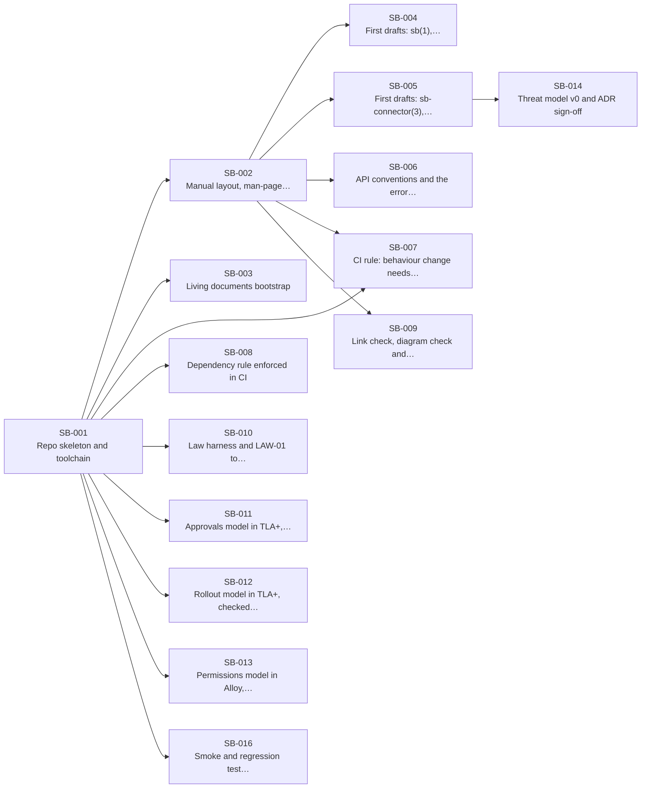

# E00: Manual, Laws and Proofs

> The spec, the laws and the first formal models exist before features, and CI enforces the process.

**Waves:** W0 · **Tickets:** 15 · **Stories:** 5

## User stories

- **US-00.1**: As a *maintainer*, I want to read the man page for any feature before code exists, so that I know exactly what to build. Delivered by [SB-004](SB-004-first-drafts-sb-1-sb-tenant-1-sb-tenant-5.md), [SB-005](SB-005-first-drafts-sb-connector-3-sb-permissions-7.md), [SB-006](SB-006-api-conventions-and-the-error-registry.md).
- **US-00.2**: As a *reviewer*, I want CI to reject behaviour changes that do not change the manual, so that the manual never drifts from the code. Delivered by [SB-007](SB-007-ci-rule-behaviour-change-needs-a-manual-diff.md).
- **US-00.3**: As a *maintainer*, I want the law tests to exist and fail red before features land, so that every feature is born against its laws. Delivered by [SB-010](SB-010-law-harness-and-law-01-to-law-05-as-failing.md).
- **US-00.4**: As a *security reviewer*, I want the approval, rollout and permission designs model-checked, so that design flaws are found before code. Delivered by [SB-011](SB-011-approvals-model-in-tla-checked-in-ci.md), [SB-012](SB-012-rollout-model-in-tla-checked-in-ci.md), [SB-013](SB-013-permissions-model-in-alloy-checked-in-ci.md).
- **US-00.5**: As a *new contributor*, I want one command that builds, tests and renders the docs, so that I am productive on day one. Delivered by [SB-001](SB-001-repo-skeleton-and-toolchain.md), [SB-002](SB-002-manual-layout-man-page-template-and-docs.md), [SB-009](SB-009-link-check-diagram-check-and-manual-example.md), [SB-016](SB-016-smoke-and-regression-test-conventions.md).

## Ticket graph

## Tickets

| Ticket | Wave / slice | Title | Laws |
|---|---|---|---|
| [SB-001](SB-001-repo-skeleton-and-toolchain.md) | W0 / S0.1 | Repo skeleton and toolchain | — |
| [SB-002](SB-002-manual-layout-man-page-template-and-docs.md) | W0 / S0.1 | Manual layout, man-page template and docs site in CI | — |
| [SB-003](SB-003-living-documents-bootstrap.md) | W0 / S0.1 | Living documents bootstrap | — |
| [SB-004](SB-004-first-drafts-sb-1-sb-tenant-1-sb-tenant-5.md) | W0 / S0.2 | First drafts: sb(1), sb-tenant(1), sb-tenant(5) | — |
| [SB-005](SB-005-first-drafts-sb-connector-3-sb-permissions-7.md) | W0 / S0.2 | First drafts: sb-connector(3), sb-permissions(7), sb-laws(7) | LAW-01, LAW-02, LAW-03 |
| [SB-006](SB-006-api-conventions-and-the-error-registry.md) | W0 / S0.2 | API conventions and the error registry | LAW-03 |
| [SB-007](SB-007-ci-rule-behaviour-change-needs-a-manual-diff.md) | W0 / S0.3 | CI rule: behaviour change needs a manual diff | — |
| [SB-008](SB-008-dependency-rule-enforced-in-ci.md) | W0 / S0.3 | Dependency rule enforced in CI | — |
| [SB-009](SB-009-link-check-diagram-check-and-manual-example.md) | W0 / S0.3 | Link check, diagram check and manual example extraction | — |
| [SB-010](SB-010-law-harness-and-law-01-to-law-05-as-failing.md) | W0 / S0.4 | Law harness and LAW-01 to LAW-05 as failing tests | LAW-01, LAW-02, LAW-03, LAW-04, LAW-05 |
| [SB-011](SB-011-approvals-model-in-tla-checked-in-ci.md) | W0 / S0.4 | Approvals model in TLA+, checked in CI | LAW-04, LAW-05, LAW-10, LAW-15 |
| [SB-012](SB-012-rollout-model-in-tla-checked-in-ci.md) | W0 / S0.4 | Rollout model in TLA+, checked in CI | LAW-06, LAW-08 |
| [SB-013](SB-013-permissions-model-in-alloy-checked-in-ci.md) | W0 / S0.4 | Permissions model in Alloy, checked in CI | LAW-01, LAW-02, LAW-03 |
| [SB-014](SB-014-threat-model-v0-and-adr-sign-off.md) | W0 / S0.4 | Threat model v0 and ADR sign-off | LAW-07, LAW-09 |
| [SB-016](SB-016-smoke-and-regression-test-conventions.md) | W0 / S0.1 | Smoke and regression test conventions | — |
