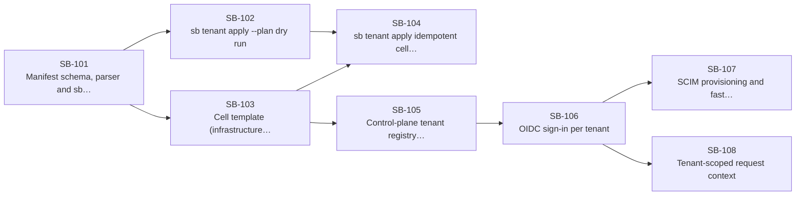

# E01: Tenancy and Identity

> One manifest and one command make an isolated cell; users sign in with their own SSO and see only their tenant.

**Waves:** W1 · **Tickets:** 8 · **Stories:** 3

## User stories

- **US-01.1**: As a *parent-org platform engineer*, I want to add a company with one manifest and one pipeline run, so that onboarding is repeatable and boring. Delivered by [SB-101](SB-101-manifest-schema-parser-and-sb-tenant-check.md), [SB-102](SB-102-sb-tenant-apply-plan-dry-run.md), [SB-103](SB-103-cell-template-infrastructure-as-code.md), [SB-104](SB-104-sb-tenant-apply-idempotent-cell-creation.md), [SB-105](SB-105-control-plane-tenant-registry-and-cell.md).
- **US-01.2**: As a *company staff member*, I want to sign in with my company's SSO and see only my company, so that I trust what I see. Delivered by [SB-106](SB-106-oidc-sign-in-per-tenant.md), [SB-108](SB-108-tenant-scoped-request-context.md).
- **US-01.3**: As a *company IT operator*, I want deprovisioning in our IdP to remove access within minutes, so that leavers lose access without a ticket to anyone. Delivered by [SB-107](SB-107-scim-provisioning-and-fast-deprovisioning.md).

## Ticket graph

## Tickets

| Ticket | Wave / slice | Title | Laws |
|---|---|---|---|
| [SB-101](SB-101-manifest-schema-parser-and-sb-tenant-check.md) | W1 / S1.1 | Manifest schema, parser and `sb tenant check` | LAW-16 |
| [SB-102](SB-102-sb-tenant-apply-plan-dry-run.md) | W1 / S1.1 | `sb tenant apply --plan` dry run | LAW-16 |
| [SB-103](SB-103-cell-template-infrastructure-as-code.md) | W1 / S1.2 | Cell template (infrastructure as code) | LAW-02 |
| [SB-104](SB-104-sb-tenant-apply-idempotent-cell-creation.md) | W1 / S1.2 | `sb tenant apply` idempotent cell creation | LAW-16 |
| [SB-105](SB-105-control-plane-tenant-registry-and-cell.md) | W1 / S1.2 | Control-plane tenant registry and cell routing | LAW-02 |
| [SB-106](SB-106-oidc-sign-in-per-tenant.md) | W1 / S1.3 | OIDC sign-in per tenant | LAW-02 |
| [SB-107](SB-107-scim-provisioning-and-fast-deprovisioning.md) | W1 / S1.3 | SCIM provisioning and fast deprovisioning | LAW-12 |
| [SB-108](SB-108-tenant-scoped-request-context.md) | W1 / S1.3 | Tenant-scoped request context | LAW-02 |
