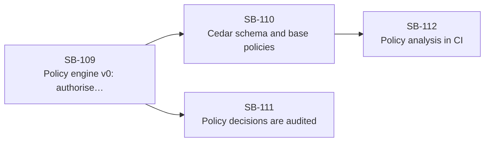

# E02: Policy Kernel

> Every decision about who may see or do what goes through one small, analysable policy engine that treats unknown as deny.

**Waves:** W1 · **Tickets:** 4 · **Stories:** 3

## User stories

- **US-02.1**: As a *security reviewer*, I want one `authorise` call that every path goes through, so that there is one place to audit and prove. Delivered by [SB-109](SB-109-policy-engine-v0-authorise-returns-allow.md).
- **US-02.2**: As a *company IT operator*, I want policies written in a small, readable language with a schema, so that I can review rules without reading code. Delivered by [SB-110](SB-110-cedar-schema-and-base-policies.md), [SB-112](SB-112-policy-analysis-in-ci.md).
- **US-02.3**: As an *auditor*, I want every policy decision recorded with its reason, so that I can explain any allow or deny later. Delivered by [SB-111](SB-111-policy-decisions-are-audited.md).

## Ticket graph

## Tickets

| Ticket | Wave / slice | Title | Laws |
|---|---|---|---|
| [SB-109](SB-109-policy-engine-v0-authorise-returns-allow.md) | W1 / S1.4 | Policy engine v0: `authorise` returns allow, deny or unknown | LAW-03 |
| [SB-110](SB-110-cedar-schema-and-base-policies.md) | W1 / S1.4 | Cedar schema and base policies | LAW-02, LAW-03 |
| [SB-111](SB-111-policy-decisions-are-audited.md) | W1 / S1.4 | Policy decisions are audited | LAW-04 |
| [SB-112](SB-112-policy-analysis-in-ci.md) | W1 / S1.4 | Policy analysis in CI | LAW-02 |
