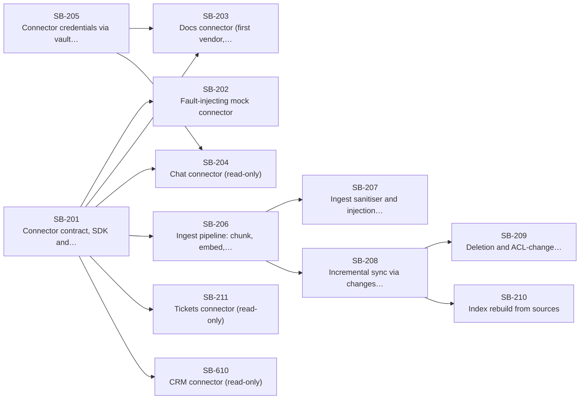

# E03: Connectors and Ingestion

> Sources flow in read-only through a four-call contract, with ACLs, provenance and freshness, and ingested text is treated as untrusted data.

**Waves:** W2, W6 · **Tickets:** 12 · **Stories:** 5

## User stories

- **US-03.1**: As a *company IT operator*, I want to connect docs and chat read-only from the manifest, so that setup is one line per source. Delivered by [SB-201](SB-201-connector-contract-sdk-and-contract-kit.md), [SB-203](SB-203-docs-connector-first-vendor-read-only.md), [SB-204](SB-204-chat-connector-read-only.md), [SB-205](SB-205-connector-credentials-via-vault-references.md).
- **US-03.2**: As a *company staff member*, I want new and changed documents to show up within the freshness SLA, so that answers reflect today's truth. Delivered by [SB-206](SB-206-ingest-pipeline-chunk-embed-tag-provenance.md), [SB-208](SB-208-incremental-sync-via-changes-with-freshness.md), [SB-209](SB-209-deletion-and-acl-change-propagation.md).
- **US-03.3**: As a *security reviewer*, I want ingested text treated as data, never as instructions, so that a poisoned document cannot drive an agent. Delivered by [SB-207](SB-207-ingest-sanitiser-and-injection-flags.md).
- **US-03.4**: As a *platform engineer*, I want the index to be rebuildable from sources at any time, so that the index is never a system of record. Delivered by [SB-210](SB-210-index-rebuild-from-sources.md).
- **US-03.5**: As a *connector author*, I want a contract kit and a fault-injecting mock, so that a new connector is correct by test, not by review. Delivered by [SB-201](SB-201-connector-contract-sdk-and-contract-kit.md), [SB-202](SB-202-fault-injecting-mock-connector.md), [SB-211](SB-211-tickets-connector-read-only.md), [SB-610](SB-610-crm-connector-read-only.md).

## Ticket graph

## Tickets

| Ticket | Wave / slice | Title | Laws |
|---|---|---|---|
| [SB-201](SB-201-connector-contract-sdk-and-contract-kit.md) | W2 / S2.1 | Connector contract, SDK and contract kit | LAW-01, LAW-03, LAW-05 |
| [SB-202](SB-202-fault-injecting-mock-connector.md) | W2 / S2.1 | Fault-injecting mock connector | LAW-03, LAW-05 |
| [SB-203](SB-203-docs-connector-first-vendor-read-only.md) | W2 / S2.2 | Docs connector (first vendor, read-only) | LAW-01, LAW-13 |
| [SB-204](SB-204-chat-connector-read-only.md) | W2 / S2.2 | Chat connector (read-only) | LAW-01 |
| [SB-205](SB-205-connector-credentials-via-vault-references.md) | W2 / S2.2 | Connector credentials via vault references | LAW-07 |
| [SB-206](SB-206-ingest-pipeline-chunk-embed-tag-provenance.md) | W2 / S2.3 | Ingest pipeline: chunk, embed, tag provenance | LAW-13 |
| [SB-207](SB-207-ingest-sanitiser-and-injection-flags.md) | W2 / S2.3 | Ingest sanitiser and injection flags | LAW-09 |
| [SB-208](SB-208-incremental-sync-via-changes-with-freshness.md) | W2 / S2.3 | Incremental sync via `changes` with freshness SLA | — |
| [SB-209](SB-209-deletion-and-acl-change-propagation.md) | W2 / S2.3 | Deletion and ACL-change propagation | LAW-01 |
| [SB-210](SB-210-index-rebuild-from-sources.md) | W2 / S2.3 | Index rebuild from sources | LAW-13 |
| [SB-211](SB-211-tickets-connector-read-only.md) | W2 / S2.4 | Tickets connector (read-only) | LAW-01 |
| [SB-610](SB-610-crm-connector-read-only.md) | W6 / S6.3 | CRM connector (read-only) | LAW-01 |
