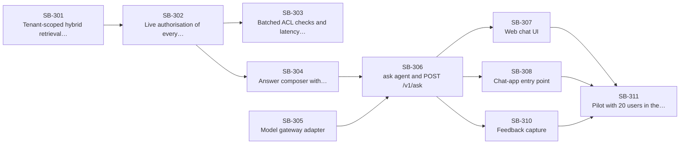

# E04: Retrieval and Cited Answers

> Users ask in plain language and get answers citing document versions they can open, or a clear `uncited` label.

**Waves:** W3 · **Tickets:** 10 · **Stories:** 5

## User stories

- **US-04.1**: As a *company staff member*, I want an answer with citations to specific document versions I can open, so that I can check the answer myself. Delivered by [SB-301](SB-301-tenant-scoped-hybrid-retrieval-with-acl.md), [SB-304](SB-304-answer-composer-with-doc-version-citations.md), [SB-306](SB-306-ask-agent-and-post-v1-ask.md).
- **US-04.2**: As a *company staff member*, I want answers with nothing to cite clearly labelled `uncited`, so that I know when to be sceptical. Delivered by [SB-304](SB-304-answer-composer-with-doc-version-citations.md).
- **US-04.3**: As a *security reviewer*, I want nothing the asker cannot open to ever reach the model's context, so that permissions hold even if the model misbehaves. Delivered by [SB-302](SB-302-live-authorisation-of-every-chunk-before.md), [SB-303](SB-303-batched-acl-checks-and-latency-budget.md).
- **US-04.4**: As a *company staff member*, I want to ask from the web or from our chat app, so that I don't change tools to get help. Delivered by [SB-307](SB-307-web-chat-ui.md), [SB-308](SB-308-chat-app-entry-point.md).
- **US-04.5**: As a *product owner*, I want pilot feedback captured against each answer, so that we improve on evidence. Delivered by [SB-305](SB-305-model-gateway-adapter.md), [SB-310](SB-310-feedback-capture.md), [SB-311](SB-311-pilot-with-20-users-in-the-internal-tenant.md).

## Ticket graph

## Tickets

| Ticket | Wave / slice | Title | Laws |
|---|---|---|---|
| [SB-301](SB-301-tenant-scoped-hybrid-retrieval-with-acl.md) | W3 / S3.1 | Tenant-scoped hybrid retrieval with ACL prefilter | LAW-02 |
| [SB-302](SB-302-live-authorisation-of-every-chunk-before.md) | W3 / S3.1 | Live authorisation of every chunk before context | LAW-01, LAW-03 |
| [SB-303](SB-303-batched-acl-checks-and-latency-budget.md) | W3 / S3.1 | Batched ACL checks and latency budget | LAW-01 |
| [SB-304](SB-304-answer-composer-with-doc-version-citations.md) | W3 / S3.2 | Answer composer with `doc@version` citations and `uncited` in code | LAW-01, LAW-14 |
| [SB-305](SB-305-model-gateway-adapter.md) | W3 / S3.2 | Model gateway adapter | LAW-07 |
| [SB-306](SB-306-ask-agent-and-post-v1-ask.md) | W3 / S3.2 | `ask` agent and `POST /v1/ask` | LAW-01, LAW-14 |
| [SB-307](SB-307-web-chat-ui.md) | W3 / S3.2 | Web chat UI | LAW-14 |
| [SB-308](SB-308-chat-app-entry-point.md) | W3 / S3.2 | Chat-app entry point | LAW-01 |
| [SB-310](SB-310-feedback-capture.md) | W3 / S3.3 | Feedback capture | — |
| [SB-311](SB-311-pilot-with-20-users-in-the-internal-tenant.md) | W3 / S3.3 | Pilot with 20 users in the internal tenant | LAW-01, LAW-02, LAW-03 |
