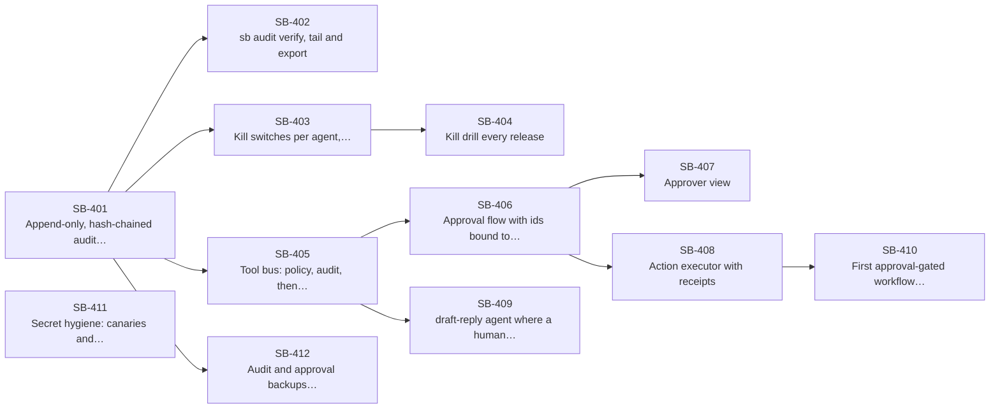

# E05: Actions, Approvals, Audit and Kill Switches

> Agents draft and propose; humans send and approve; every tool call is audited before it runs; anything can be switched off in seconds.

**Waves:** W4 · **Tickets:** 12 · **Stories:** 6

## User stories

- **US-05.1**: As a *company staff member*, I want the agent to draft a reply or a ticket update that I send, so that I save time without losing control. Delivered by [SB-409](SB-409-draft-reply-agent-where-a-human-always-sends.md).
- **US-05.2**: As an *approver*, I want to see exactly what will run, against which system, before I approve, so that approval means something. Delivered by [SB-405](SB-405-tool-bus-policy-audit-then-execute.md), [SB-406](SB-406-approval-flow-with-ids-bound-to-content.md), [SB-407](SB-407-approver-view.md), [SB-410](SB-410-first-approval-gated-workflow-template.md).
- **US-05.3**: As a *company IT operator*, I want to switch off any agent, connector or tenant instantly, so that I can stop harm first and investigate second. Delivered by [SB-403](SB-403-kill-switches-per-agent-connector-and-tenant.md), [SB-404](SB-404-kill-drill-every-release.md).
- **US-05.4**: As an *auditor*, I want an append-only, tamper-evident record of every tool call, so that I can prove who did what. Delivered by [SB-401](SB-401-append-only-hash-chained-audit-log-written.md), [SB-402](SB-402-sb-audit-verify-tail-and-export.md), [SB-412](SB-412-audit-and-approval-backups-3-2-1-and-restore.md).
- **US-05.5**: As a *company staff member*, I want to be told plainly when an action did not run, so that I never act on a false 'done'. Delivered by [SB-408](SB-408-action-executor-with-receipts.md).
- **US-05.6**: As a *security reviewer*, I want secrets never to appear in prompts, logs or audit payloads, so that a log leak is not a credential leak. Delivered by [SB-411](SB-411-secret-hygiene-canaries-and-scanner.md).

## Ticket graph

## Tickets

| Ticket | Wave / slice | Title | Laws |
|---|---|---|---|
| [SB-401](SB-401-append-only-hash-chained-audit-log-written.md) | W4 / S4.1 | Append-only, hash-chained audit log written before execution | LAW-04, LAW-11 |
| [SB-402](SB-402-sb-audit-verify-tail-and-export.md) | W4 / S4.1 | `sb audit` verify, tail and export | LAW-11 |
| [SB-403](SB-403-kill-switches-per-agent-connector-and-tenant.md) | W4 / S4.1 | Kill switches per agent, connector and tenant | LAW-10 |
| [SB-404](SB-404-kill-drill-every-release.md) | W4 / S4.1 | Kill drill every release | LAW-10 |
| [SB-405](SB-405-tool-bus-policy-audit-then-execute.md) | W4 / S4.2 | Tool bus: policy, audit, then execute | LAW-04, LAW-10 |
| [SB-406](SB-406-approval-flow-with-ids-bound-to-content.md) | W4 / S4.2 | Approval flow with ids bound to content hashes | LAW-04, LAW-15 |
| [SB-407](SB-407-approver-view.md) | W4 / S4.2 | Approver view | LAW-15 |
| [SB-408](SB-408-action-executor-with-receipts.md) | W4 / S4.3 | Action executor with receipts | LAW-05 |
| [SB-409](SB-409-draft-reply-agent-where-a-human-always-sends.md) | W4 / S4.3 | `draft-reply` agent where a human always sends | LAW-04, LAW-14 |
| [SB-410](SB-410-first-approval-gated-workflow-template.md) | W4 / S4.3 | First approval-gated workflow template | LAW-04, LAW-05, LAW-15 |
| [SB-411](SB-411-secret-hygiene-canaries-and-scanner.md) | W4 / S4.4 | Secret hygiene: canaries and scanner | LAW-07 |
| [SB-412](SB-412-audit-and-approval-backups-3-2-1-and-restore.md) | W4 / S4.4 | Audit and approval backups (3-2-1) and restore drill | LAW-11 |
