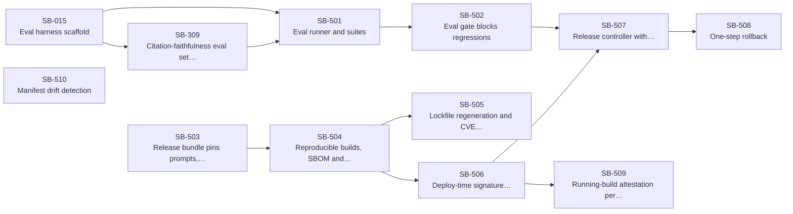

# E06: Evals, Release and Supply Chain

> No agent, prompt, policy or model change reaches a tenant without passing evals, and every running build is a signed build that passed the gate.

**Waves:** W0, W3, W5 · **Tickets:** 12 · **Stories:** 4

## User stories

- **US-06.1**: As a *parent-org platform lead*, I want no agent, prompt or model change to reach a tenant without passing evals, so that quality never regresses silently. Delivered by [SB-015](SB-015-eval-harness-scaffold.md), [SB-309](SB-309-citation-faithfulness-eval-set-per-tenant.md), [SB-501](SB-501-eval-runner-and-suites.md), [SB-502](SB-502-eval-gate-blocks-regressions.md).
- **US-06.2**: As a *security reviewer*, I want to prove which build, prompts and model ran for any action, so that every incident is reconstructable. Delivered by [SB-503](SB-503-release-bundle-pins-prompts-tools-policies.md), [SB-504](SB-504-reproducible-builds-sbom-and-signing.md), [SB-506](SB-506-deploy-time-signature-verification.md), [SB-509](SB-509-running-build-attestation-per-cell.md).
- **US-06.3**: As a *company IT operator*, I want a bad release to roll back in one step, so that a bad day stays short. Delivered by [SB-507](SB-507-release-controller-with-channels-and-rings.md), [SB-508](SB-508-one-step-rollback.md).
- **US-06.4**: As a *security reviewer*, I want a CVE fix to be a rebuild that every tenant takes, so that no tenant is left on a vulnerable build. Delivered by [SB-505](SB-505-lockfile-regeneration-and-cve-rebuild-path.md), [SB-507](SB-507-release-controller-with-channels-and-rings.md), [SB-510](SB-510-manifest-drift-detection.md).

## Ticket graph

## Tickets

| Ticket | Wave / slice | Title | Laws |
|---|---|---|---|
| [SB-015](SB-015-eval-harness-scaffold.md) | W0 / S0.4 | Eval harness scaffold | — |
| [SB-309](SB-309-citation-faithfulness-eval-set-per-tenant.md) | W3 / S3.3 | Citation-faithfulness eval set per tenant | LAW-14 |
| [SB-501](SB-501-eval-runner-and-suites.md) | W5 / S5.1 | Eval runner and suites | LAW-01, LAW-09, LAW-14 |
| [SB-502](SB-502-eval-gate-blocks-regressions.md) | W5 / S5.1 | Eval gate blocks regressions | LAW-06 |
| [SB-503](SB-503-release-bundle-pins-prompts-tools-policies.md) | W5 / S5.1 | Release bundle pins prompts, tools, policies and model | LAW-06 |
| [SB-504](SB-504-reproducible-builds-sbom-and-signing.md) | W5 / S5.2 | Reproducible builds, SBOM and signing | LAW-06 |
| [SB-505](SB-505-lockfile-regeneration-and-cve-rebuild-path.md) | W5 / S5.2 | Lockfile regeneration and CVE rebuild path | LAW-08 |
| [SB-506](SB-506-deploy-time-signature-verification.md) | W5 / S5.2 | Deploy-time signature verification | LAW-06 |
| [SB-507](SB-507-release-controller-with-channels-and-rings.md) | W5 / S5.3 | Release controller with channels and rings | LAW-06, LAW-08 |
| [SB-508](SB-508-one-step-rollback.md) | W5 / S5.3 | One-step rollback | LAW-08 |
| [SB-509](SB-509-running-build-attestation-per-cell.md) | W5 / S5.3 | Running-build attestation per cell | LAW-06 |
| [SB-510](SB-510-manifest-drift-detection.md) | W5 / S5.3 | Manifest drift detection | LAW-16 |
