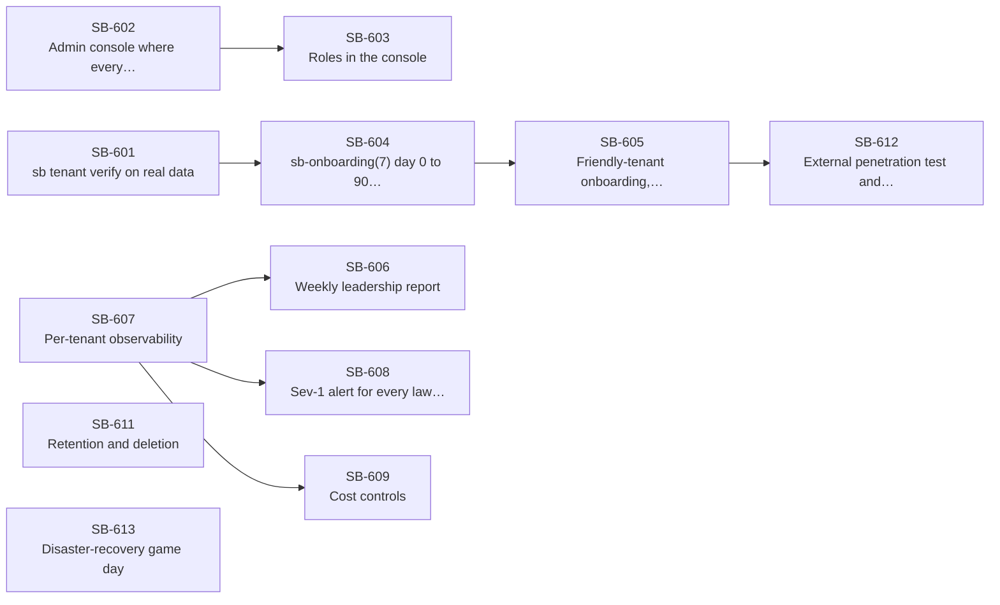

# E07: Roll-out, Admin and Operations

> A company onboards itself with one file and three commands, and operators can see and control every tenant.

**Waves:** W6 · **Tickets:** 12 · **Stories:** 6

## User stories

- **US-07.1**: As a *company IT operator*, I want to onboard my company with one file and three commands, without calling the platform team, so that we go live in days. Delivered by [SB-601](SB-601-sb-tenant-verify-on-real-data.md), [SB-604](SB-604-sb-onboarding-7-day-0-to-90-runbook.md), [SB-605](SB-605-friendly-tenant-onboarding-unaided.md).
- **US-07.2**: As a *company IT operator*, I want a console for connectors, agents, approval rules and kill switches, so that I don't need to learn YAML to operate. Delivered by [SB-602](SB-602-admin-console-where-every-action-is-a.md), [SB-603](SB-603-roles-in-the-console.md).
- **US-07.3**: As a *company leader*, I want a weekly report on usage, citations and approvals, so that I know if this is working. Delivered by [SB-606](SB-606-weekly-leadership-report.md).
- **US-07.4**: As an *on-call operator*, I want health, cost, freshness and law violations per tenant, so that I see problems before users do. Delivered by [SB-607](SB-607-per-tenant-observability.md), [SB-608](SB-608-sev-1-alert-for-every-law-violation.md), [SB-609](SB-609-cost-controls.md).
- **US-07.5**: As a *data protection officer*, I want retention and deletion to follow the manifest, so that we meet our obligations by configuration. Delivered by [SB-611](SB-611-retention-and-deletion.md).
- **US-07.6**: As a *parent-org security lead*, I want independent testing and a disaster-recovery game day, so that we trust the platform before scaling it. Delivered by [SB-612](SB-612-external-penetration-test-and-threat-model.md), [SB-613](SB-613-disaster-recovery-game-day.md).

## Ticket graph

## Tickets

| Ticket | Wave / slice | Title | Laws |
|---|---|---|---|
| [SB-601](SB-601-sb-tenant-verify-on-real-data.md) | W6 / S6.1 | `sb tenant verify` on real data | LAW-01, LAW-02, LAW-03, LAW-14 |
| [SB-602](SB-602-admin-console-where-every-action-is-a.md) | W6 / S6.1 | Admin console where every action is a manifest diff | LAW-16 |
| [SB-603](SB-603-roles-in-the-console.md) | W6 / S6.1 | Roles in the console | LAW-02 |
| [SB-604](SB-604-sb-onboarding-7-day-0-to-90-runbook.md) | W6 / S6.2 | `sb-onboarding(7)` day 0 to 90 runbook | — |
| [SB-605](SB-605-friendly-tenant-onboarding-unaided.md) | W6 / S6.2 | Friendly-tenant onboarding, unaided | LAW-01, LAW-02, LAW-03 |
| [SB-606](SB-606-weekly-leadership-report.md) | W6 / S6.2 | Weekly leadership report | — |
| [SB-607](SB-607-per-tenant-observability.md) | W6 / S6.3 | Per-tenant observability | — |
| [SB-608](SB-608-sev-1-alert-for-every-law-violation.md) | W6 / S6.3 | Sev-1 alert for every law violation | LAW-01, LAW-02, LAW-06, LAW-07, LAW-11, LAW-16 |
| [SB-609](SB-609-cost-controls.md) | W6 / S6.3 | Cost controls | — |
| [SB-611](SB-611-retention-and-deletion.md) | W6 / S6.3 | Retention and deletion | LAW-13 |
| [SB-612](SB-612-external-penetration-test-and-threat-model.md) | W6 / S6.4 | External penetration test and threat model refresh | LAW-02, LAW-07, LAW-09 |
| [SB-613](SB-613-disaster-recovery-game-day.md) | W6 / S6.4 | Disaster-recovery game day | LAW-11, LAW-13 |
