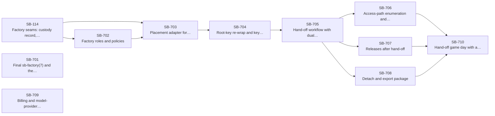

# E08: Factory and Hand-off

> One factory produces and runs every tenant's Second Brain, and can hand custody of one to its company without a rebuild.

**Waves:** W1, W7 · **Tickets:** 11 · **Stories:** 5

## User stories

- **US-08.1**: As a *parent-org platform lead*, I want every cell to carry a custody record and a placement from day one, so that hand-off later is a workflow, not a migration. Delivered by [SB-114](SB-114-factory-seams-custody-record-placement-port.md), [SB-701](SB-701-final-sb-factory-7-and-the-hand-off-runbook.md), [SB-702](SB-702-factory-roles-and-policies.md).
- **US-08.2**: As a *company owner*, I want our Second Brain moved into our own cloud account under our own key, so that we hold custody of our data. Delivered by [SB-703](SB-703-placement-adapter-for-tenant-owned-cloud.md), [SB-704](SB-704-root-key-re-wrap-and-key-custody-transfer.md), [SB-705](SB-705-hand-off-workflow-with-dual-approval.md).
- **US-08.3**: As a *company security lead*, I want proof that the factory keeps no access we didn't agree to, so that custody means what it says. Delivered by [SB-706](SB-706-access-path-enumeration-and-law-17-check.md).
- **US-08.4**: As a *company IT operator*, I want to keep receiving signed releases after hand-off, so that we stay patched without a support contract per release. Delivered by [SB-707](SB-707-releases-after-hand-off.md).
- **US-08.5**: As a *company owner after divestiture*, I want a complete export so we can leave the factory, so that a sale doesn't strand our knowledge. Delivered by [SB-708](SB-708-detach-and-export-package.md), [SB-709](SB-709-billing-and-model-provider-hand-off.md), [SB-710](SB-710-hand-off-game-day-with-a-friendly-tenant.md).

## Ticket graph

## Tickets

| Ticket | Wave / slice | Title | Laws |
|---|---|---|---|
| [SB-114](SB-114-factory-seams-custody-record-placement-port.md) | W1 / S1.2 | Factory seams: custody record, placement port, key hierarchy | LAW-18 |
| [SB-701](SB-701-final-sb-factory-7-and-the-hand-off-runbook.md) | W7 / S7.1 | Final `sb-factory(7)` and the hand-off runbook | LAW-17, LAW-18 |
| [SB-702](SB-702-factory-roles-and-policies.md) | W7 / S7.1 | Factory roles and policies | LAW-02, LAW-17 |
| [SB-703](SB-703-placement-adapter-for-tenant-owned-cloud.md) | W7 / S7.1 | Placement adapter for tenant-owned cloud accounts | LAW-02 |
| [SB-704](SB-704-root-key-re-wrap-and-key-custody-transfer.md) | W7 / S7.2 | Root-key re-wrap and key custody transfer | LAW-18 |
| [SB-705](SB-705-hand-off-workflow-with-dual-approval.md) | W7 / S7.2 | Hand-off workflow with dual approval | LAW-17, LAW-18 |
| [SB-706](SB-706-access-path-enumeration-and-law-17-check.md) | W7 / S7.2 | Access-path enumeration and LAW-17 check | LAW-17 |
| [SB-707](SB-707-releases-after-hand-off.md) | W7 / S7.2 | Releases after hand-off | LAW-06, LAW-08 |
| [SB-708](SB-708-detach-and-export-package.md) | W7 / S7.3 | Detach and export package | LAW-11, LAW-17 |
| [SB-709](SB-709-billing-and-model-provider-hand-off.md) | W7 / S7.3 | Billing and model-provider hand-off | — |
| [SB-710](SB-710-hand-off-game-day-with-a-friendly-tenant.md) | W7 / S7.3 | Hand-off game day with a friendly tenant | LAW-17, LAW-18 |
