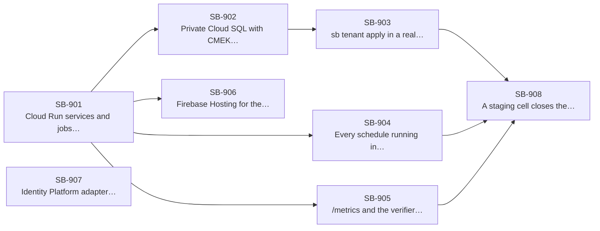

# E09: Cells on GCP

> A real cell runs on Google Cloud in its own project, with its schedules, metrics and verifier, and nothing in the core knows it's GCP.

**Waves:** W9 · **Tickets:** 8 · **Stories:** 4

## User stories

- **US-09.1**: As a *factory operator*, I want a cell to run on Cloud Run and Cloud SQL in its own project, so that companies get a real Second Brain, not a local one. Delivered by [SB-901](SB-901-cloud-run-services-per-cell.md), [SB-902](SB-902-private-cloud-sql-with-cmek-and-a-perimeter.md), [SB-903](SB-903-sb-tenant-apply-in-a-real-gcp-project.md).
- **US-09.2**: As a *company IT operator*, I want every schedule, metric and check to run inside the cell, so that sync, retention, reports and checks happen without anyone remembering. Delivered by [SB-904](SB-904-schedules-in-the-cell.md), [SB-905](SB-905-metrics-and-the-verifier-endpoint.md).
- **US-09.3**: As a *asker*, I want to reach my company's brain at its own address and sign in even if we have no corporate IdP, so that every acquired company can use it from day one. Delivered by [SB-906](SB-906-firebase-hosting-for-the-web-ui.md), [SB-907](SB-907-identity-platform-adapter-for-companies-without-an-idp.md).
- **US-09.4**: As a *maintainer*, I want the W1 to W7 items that waited for a real cloud closed on a staging cell, so that v1 is finished, not just built. Delivered by [SB-908](SB-908-staging-cell-closes-the-real-cloud-items.md).

## Ticket graph

## Tickets

| Ticket | Wave / slice | Title | Laws |
|---|---|---|---|
| [SB-901](SB-901-cloud-run-services-per-cell.md) | W9 / S9.1 | Cloud Run services and jobs per cell | LAW-02, LAW-06 |
| [SB-902](SB-902-private-cloud-sql-with-cmek-and-a-perimeter.md) | W9 / S9.1 | Private Cloud SQL with CMEK and a VPC Service Controls perimeter | LAW-02, LAW-18 |
| [SB-903](SB-903-sb-tenant-apply-in-a-real-gcp-project.md) | W9 / S9.1 | `sb tenant apply` in a real GCP project in under 30 minutes | LAW-02, LAW-16 |
| [SB-904](SB-904-schedules-in-the-cell.md) | W9 / S9.2 | Every schedule running in the cell | LAW-11, LAW-13, LAW-17 |
| [SB-905](SB-905-metrics-and-the-verifier-endpoint.md) | W9 / S9.2 | `/metrics` and the verifier endpoint | LAW-06, LAW-17 |
| [SB-906](SB-906-firebase-hosting-for-the-web-ui.md) | W9 / S9.3 | Firebase Hosting for the web UI | LAW-02 |
| [SB-907](SB-907-identity-platform-adapter-for-companies-without-an-idp.md) | W9 / S9.3 | Identity Platform adapter for companies without an OIDC IdP | LAW-02, LAW-12 |
| [SB-908](SB-908-staging-cell-closes-the-real-cloud-items.md) | W9 / S9.4 | A staging cell closes the W1 to W7 items waiting for a real cloud | LAW-06, LAW-08, LAW-17, LAW-18 |
