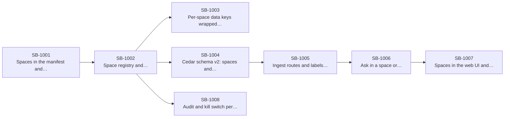

# E10: Department Spaces

> A company's brain holds all its knowledge, split into department spaces that can only narrow what each source allows.

**Waves:** W10 · **Tickets:** 8 · **Stories:** 4

## User stories

- **US-10.1**: As a *company IT operator*, I want to declare our departments as spaces in the manifest, so that our brain mirrors how we're organised. Delivered by [SB-1001](SB-1001-spaces-in-the-manifest-and-sb-tenant-check.md), [SB-1002](SB-1002-space-registry-and-space-scoped-request-context.md), [SB-1003](SB-1003-per-space-data-keys.md).
- **US-10.2**: As a *company security lead*, I want space policy that can only narrow what each source allows, so that adding a space can never leak anything. Delivered by [SB-1004](SB-1004-cedar-schema-v2-spaces-labels-narrowing.md), [SB-1005](SB-1005-ingest-routes-and-labels-every-document.md).
- **US-10.3**: As a *asker*, I want to ask my department's brain or the whole company and see where each citation came from, so that I get the right answer from the right place. Delivered by [SB-1006](SB-1006-ask-in-a-space-or-company-wide.md), [SB-1007](SB-1007-spaces-in-the-web-ui-and-chat-app.md).
- **US-10.4**: As a *company IT operator*, I want to audit and stop one space on its own, so that a problem in one department doesn't stop the company. Delivered by [SB-1008](SB-1008-audit-and-kill-switch-per-space.md).

## Ticket graph

## Tickets

| Ticket | Wave / slice | Title | Laws |
|---|---|---|---|
| [SB-1001](SB-1001-spaces-in-the-manifest-and-sb-tenant-check.md) | W10 / S10.1 | Spaces in the manifest and `sb tenant check` | LAW-16 |
| [SB-1002](SB-1002-space-registry-and-space-scoped-request-context.md) | W10 / S10.1 | Space registry and space-scoped request context | LAW-02, LAW-19 |
| [SB-1003](SB-1003-per-space-data-keys.md) | W10 / S10.1 | Per-space data keys wrapped by the cell root | LAW-18 |
| [SB-1004](SB-1004-cedar-schema-v2-spaces-labels-narrowing.md) | W10 / S10.2 | Cedar schema v2: spaces and labels, narrowing only | LAW-03, LAW-19 |
| [SB-1005](SB-1005-ingest-routes-and-labels-every-document.md) | W10 / S10.2 | Ingest routes and labels every document | LAW-13, LAW-20 |
| [SB-1006](SB-1006-ask-in-a-space-or-company-wide.md) | W10 / S10.3 | Ask in a space or company-wide | LAW-01, LAW-19, LAW-20 |
| [SB-1007](SB-1007-spaces-in-the-web-ui-and-chat-app.md) | W10 / S10.3 | Spaces in the web UI and the chat app | LAW-14, LAW-20 |
| [SB-1008](SB-1008-audit-and-kill-switch-per-space.md) | W10 / S10.3 | Audit and kill switch per space | LAW-10, LAW-11 |
