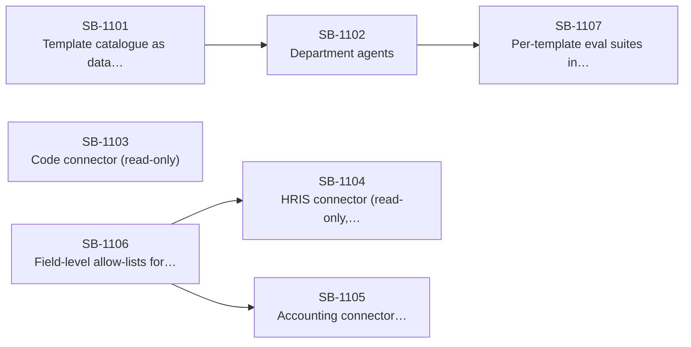

# E11: Department Templates and Connectors

> Every common department starts from a template with its sources, labels, agents and evals, including code, HR and accounting systems.

**Waves:** W11 · **Tickets:** 7 · **Stories:** 4

## User stories

- **US-11.1**: As a *company IT operator*, I want ready templates for common departments, so that we pick departments instead of designing them. Delivered by [SB-1101](SB-1101-template-catalogue-as-data-and-sb-space-init.md), [SB-1102](SB-1102-department-agents.md).
- **US-11.2**: As a *engineer*, I want our repositories, issues and pull requests in the Engineering brain, so that I can ask how our systems work. Delivered by [SB-1103](SB-1103-code-connector-read-only.md).
- **US-11.3**: As a *people or finance lead*, I want our HR and accounting systems in our spaces with sensitive fields never ingested, so that we get answers without exposing pay, cases or bank details. Delivered by [SB-1104](SB-1104-hris-connector-read-only.md), [SB-1105](SB-1105-accounting-connector-read-only.md), [SB-1106](SB-1106-field-level-allow-lists-for-restricted-sources.md).
- **US-11.4**: As a *maintainer*, I want every template to pass its own suites, leak suites included, before it reaches a tenant, so that a template change can't quietly open a department. Delivered by [SB-1107](SB-1107-per-template-eval-suites-in-the-gate.md).

## Ticket graph

## Tickets

| Ticket | Wave / slice | Title | Laws |
|---|---|---|---|
| [SB-1101](SB-1101-template-catalogue-as-data-and-sb-space-init.md) | W11 / S11.1 | Template catalogue as data and `sb space init` | LAW-16 |
| [SB-1102](SB-1102-department-agents.md) | W11 / S11.1 | Department agents | LAW-09, LAW-14 |
| [SB-1103](SB-1103-code-connector-read-only.md) | W11 / S11.2 | Code connector (read-only) | LAW-01, LAW-03, LAW-07 |
| [SB-1104](SB-1104-hris-connector-read-only.md) | W11 / S11.3 | HRIS connector (read-only, restricted) | LAW-01, LAW-07, LAW-20 |
| [SB-1105](SB-1105-accounting-connector-read-only.md) | W11 / S11.3 | Accounting connector (read-only, restricted) | LAW-01, LAW-07, LAW-20 |
| [SB-1106](SB-1106-field-level-allow-lists-for-restricted-sources.md) | W11 / S11.3 | Field-level allow-lists for restricted sources | LAW-07, LAW-20 |
| [SB-1107](SB-1107-per-template-eval-suites-in-the-gate.md) | W11 / S11.4 | Per-template eval suites in the gate | LAW-06, LAW-20, LAW-22 |
