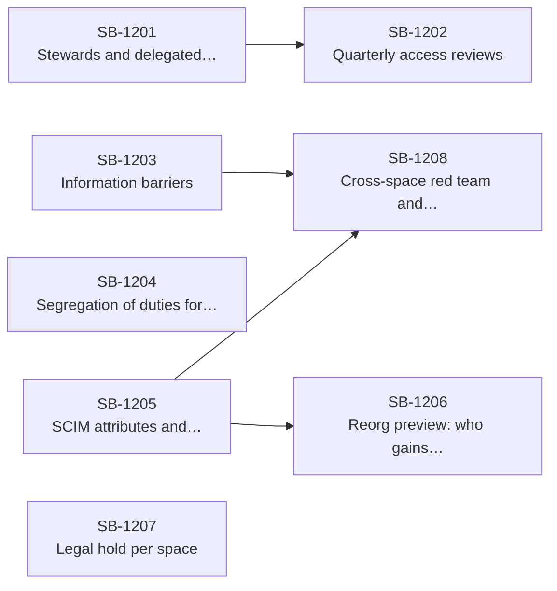

# E12: Space Governance

> Department leads run their own spaces; barriers, segregation of duties, access reviews and reorgs work the way a real organisation needs.

**Waves:** W12 · **Tickets:** 8 · **Stories:** 5

## User stories

- **US-12.1**: As a *department steward*, I want to run my space and re-certify its members without IT doing every change, so that my department's brain stays right and stays ours. Delivered by [SB-1201](SB-1201-stewards-and-delegated-space-changes.md), [SB-1202](SB-1202-quarterly-access-reviews.md).
- **US-12.2**: As a *compliance officer*, I want information barriers and segregation of duties, so that deal teams, investigations and finance controls work as our policies say. Delivered by [SB-1203](SB-1203-information-barriers.md), [SB-1204](SB-1204-segregation-of-duties.md).
- **US-12.3**: As a *people operations lead*, I want reorgs to change access within 5 minutes, and to preview them first, so that a move never leaves someone with yesterday's access. Delivered by [SB-1205](SB-1205-scim-attributes-and-five-minute-moves.md), [SB-1206](SB-1206-reorg-preview.md).
- **US-12.4**: As a *legal lead*, I want to put a space or scope on legal hold, so that nothing under a matter is deleted. Delivered by [SB-1207](SB-1207-legal-hold-per-space.md).
- **US-12.5**: As a *company security lead*, I want the spaces red-teamed before we rely on them, so that we trust the People and Finance brains. Delivered by [SB-1208](SB-1208-cross-space-red-team-and-game-day.md).

## Ticket graph

## Tickets

| Ticket | Wave / slice | Title | Laws |
|---|---|---|---|
| [SB-1201](SB-1201-stewards-and-delegated-space-changes.md) | W12 / S12.1 | Stewards and delegated space changes | LAW-15, LAW-16, LAW-19 |
| [SB-1202](SB-1202-quarterly-access-reviews.md) | W12 / S12.1 | Quarterly access reviews | LAW-16 |
| [SB-1203](SB-1203-information-barriers.md) | W12 / S12.2 | Information barriers | LAW-22 |
| [SB-1204](SB-1204-segregation-of-duties.md) | W12 / S12.2 | Segregation of duties for workflows | LAW-15 |
| [SB-1205](SB-1205-scim-attributes-and-five-minute-moves.md) | W12 / S12.3 | SCIM attributes and five-minute moves | LAW-12, LAW-21 |
| [SB-1206](SB-1206-reorg-preview.md) | W12 / S12.3 | Reorg preview: who gains and loses before it happens | LAW-16 |
| [SB-1207](SB-1207-legal-hold-per-space.md) | W12 / S12.4 | Legal hold per space | LAW-11, LAW-13 |
| [SB-1208](SB-1208-cross-space-red-team-and-game-day.md) | W12 / S12.4 | Cross-space red team and game day | LAW-19, LAW-20, LAW-21, LAW-22 |
