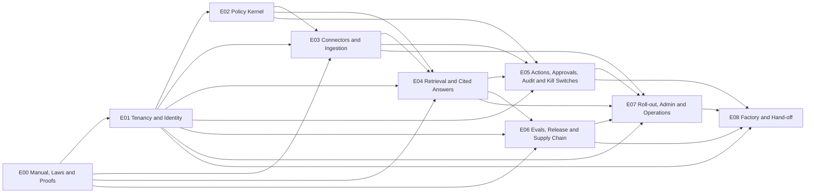

# Plan: epics and tickets

9 epics, 42 user stories and 96 tickets across 8 waves. The narrative, wave exit gates and slices are in the [PRD](../docs/03-prd.md#waves).

**How to pick up work:** take the lowest open wave and slice, check its dependencies are done, then follow the ticket's subtasks top to bottom. The first subtask is always the manual.

## Progress

| Wave | Done | In review | Open | Notes |
|---|---|---|---|---|
| W0 Manual and Laws | 10 | 6 | 0 | Left: human reviews (SB-004, SB-005, SB-014) and, for SB-011 to SB-013, two reviewers (models and mutations green locally and in CI, 2026-11-19) |
| W1 First Cell | 8 | 5 | 0 | Done: SB-101 to SB-103, SB-105 to SB-108, SB-114. In review: SB-104 (needs a cloud adapter), SB-109 to SB-112 (second reviewer for policy and audit) |
| W2 to W7 | 12 | 53 | 2 | W2 built (4 done, 7 in review); W3 S3.1 to S3.6: SB-301, SB-302, SB-304, SB-305 done; SB-303 (staging p95), SB-306 (audit chain), SB-307 (WCAG audit, connector links), SB-308 (real Slack workspace), SB-309 (tenant verify, staging model) SB-310 (weekly schedule) and SB-311 (the pilot itself, human) in review; W4 S4.1 to S4.3: SB-409 done; SB-401 to SB-408 and SB-410 to SB-412 in review (W4 built); W5 built: SB-501 to SB-510 in review; W6 S6.1 and S6.2: SB-603 done; SB-601, SB-602, SB-604 to SB-609 in review; S6.3b: SB-610 (HubSpot, real sandbox) in review; S6.3c: SB-611 (nightly schedule in a running cell) in review; S6.4a: SB-613 (the game day itself, human) in review; S6.4b: SB-612 (the external pen test, human) in review; **W6 built**; W7 S7.1a: SB-701 (security and tenant review, human) in review; S7.1b: SB-702 done; S7.1c: SB-703 (real GCP project) in review; S7.2a: SB-704 done; S7.2b: SB-705 (CLI and a cloud Target) in review; LAW-17 and LAW-18 hand-off tests green; S7.2c: SB-706 (verify on a deployed cell, monthly schedule) in review; S7.2d: SB-707 (a cell in a real tenant account) in review; S7.3a: SB-708 (detach on a running cell) in review |

Ticket files are now the source of truth; they're edited by hand, and the plan generator isn't re-run over them.

## Epic dependencies

## Epics

| Epic | Goal | Waves | Tickets |
|---|---|---|---|
| [E00 Manual, Laws and Proofs](E00-foundations/README.md) | The spec, the laws and the first formal models exist before features, and CI enforces the process. | W0 | 15 |
| [E01 Tenancy and Identity](E01-tenancy-identity/README.md) | One manifest and one command make an isolated cell; users sign in with their own SSO and see only their tenant. | W1 | 8 |
| [E02 Policy Kernel](E02-policy/README.md) | Every decision about who may see or do what goes through one small, analysable policy engine that treats unknown as deny. | W1 | 4 |
| [E03 Connectors and Ingestion](E03-connectors-ingestion/README.md) | Sources flow in read-only through a four-call contract, with ACLs, provenance and freshness, and ingested text is treated as untrusted data. | W2, W6 | 12 |
| [E04 Retrieval and Cited Answers](E04-retrieval-answers/README.md) | Users ask in plain language and get answers citing document versions they can open, or a clear `uncited` label. | W3 | 10 |
| [E05 Actions, Approvals, Audit and Kill Switches](E05-actions-approvals-audit/README.md) | Agents draft and propose; humans send and approve; every tool call is audited before it runs; anything can be switched off in seconds. | W4 | 12 |
| [E06 Evals, Release and Supply Chain](E06-evals-release/README.md) | No agent, prompt, policy or model change reaches a tenant without passing evals, and every running build is a signed build that passed the gate. | W0, W3, W5 | 12 |
| [E07 Roll-out, Admin and Operations](E07-rollout-ops/README.md) | A company onboards itself with one file and three commands, and operators can see and control every tenant. | W6 | 12 |
| [E08 Factory and Hand-off](E08-factory-handoff/README.md) | One factory produces and runs every tenant's Second Brain, and can hand custody of one to its company without a rebuild. | W1, W7 | 11 |

## All tickets by wave

### W0 Manual and Laws

| Ticket | Slice | Epic | Title | Status |
|---|---|---|---|---|
| [SB-001](E00-foundations/SB-001-repo-skeleton-and-toolchain.md) | S0.1 | E00 | Repo skeleton and toolchain | Done |
| [SB-002](E00-foundations/SB-002-manual-layout-man-page-template-and-docs.md) | S0.1 | E00 | Manual layout, man-page template and docs site in CI | Done |
| [SB-003](E00-foundations/SB-003-living-documents-bootstrap.md) | S0.1 | E00 | Living documents bootstrap | Done |
| [SB-004](E00-foundations/SB-004-first-drafts-sb-1-sb-tenant-1-sb-tenant-5.md) | S0.2 | E00 | First drafts: sb(1), sb-tenant(1), sb-tenant(5) | In review |
| [SB-005](E00-foundations/SB-005-first-drafts-sb-connector-3-sb-permissions-7.md) | S0.2 | E00 | First drafts: sb-connector(3), sb-permissions(7), sb-laws(7) | In review |
| [SB-006](E00-foundations/SB-006-api-conventions-and-the-error-registry.md) | S0.2 | E00 | API conventions and the error registry | Done |
| [SB-007](E00-foundations/SB-007-ci-rule-behaviour-change-needs-a-manual-diff.md) | S0.3 | E00 | CI rule: behaviour change needs a manual diff | Done |
| [SB-008](E00-foundations/SB-008-dependency-rule-enforced-in-ci.md) | S0.3 | E00 | Dependency rule enforced in CI | Done |
| [SB-009](E00-foundations/SB-009-link-check-diagram-check-and-manual-example.md) | S0.3 | E00 | Link check, diagram check and manual example extraction | Done |
| [SB-010](E00-foundations/SB-010-law-harness-and-law-01-to-law-05-as-failing.md) | S0.4 | E00 | Law harness and LAW-01 to LAW-05 as failing tests | Done |
| [SB-011](E00-foundations/SB-011-approvals-model-in-tla-checked-in-ci.md) | S0.4 | E00 | Approvals model in TLA+, checked in CI | In review |
| [SB-012](E00-foundations/SB-012-rollout-model-in-tla-checked-in-ci.md) | S0.4 | E00 | Rollout model in TLA+, checked in CI | In review |
| [SB-013](E00-foundations/SB-013-permissions-model-in-alloy-checked-in-ci.md) | S0.4 | E00 | Permissions model in Alloy, checked in CI | In review |
| [SB-014](E00-foundations/SB-014-threat-model-v0-and-adr-sign-off.md) | S0.4 | E00 | Threat model v0 and ADR sign-off | In review |
| [SB-015](E06-evals-release/SB-015-eval-harness-scaffold.md) | S0.4 | E06 | Eval harness scaffold | Done |
| [SB-016](E00-foundations/SB-016-smoke-and-regression-test-conventions.md) | S0.1 | E00 | Smoke and regression test conventions | Done |

### W1 First Cell

| Ticket | Slice | Epic | Title |
|---|---|---|---|
| [SB-101](E01-tenancy-identity/SB-101-manifest-schema-parser-and-sb-tenant-check.md) | S1.1 | E01 | Manifest schema, parser and `sb tenant check` |
| [SB-102](E01-tenancy-identity/SB-102-sb-tenant-apply-plan-dry-run.md) | S1.1 | E01 | `sb tenant apply --plan` dry run |
| [SB-103](E01-tenancy-identity/SB-103-cell-template-infrastructure-as-code.md) | S1.2 | E01 | Cell template (infrastructure as code) |
| [SB-104](E01-tenancy-identity/SB-104-sb-tenant-apply-idempotent-cell-creation.md) | S1.2 | E01 | `sb tenant apply` idempotent cell creation |
| [SB-105](E01-tenancy-identity/SB-105-control-plane-tenant-registry-and-cell.md) | S1.2 | E01 | Control-plane tenant registry and cell routing |
| [SB-106](E01-tenancy-identity/SB-106-oidc-sign-in-per-tenant.md) | S1.3 | E01 | OIDC sign-in per tenant |
| [SB-107](E01-tenancy-identity/SB-107-scim-provisioning-and-fast-deprovisioning.md) | S1.3 | E01 | SCIM provisioning and fast deprovisioning |
| [SB-108](E01-tenancy-identity/SB-108-tenant-scoped-request-context.md) | S1.3 | E01 | Tenant-scoped request context |
| [SB-109](E02-policy/SB-109-policy-engine-v0-authorise-returns-allow.md) | S1.4 | E02 | Policy engine v0: `authorise` returns allow, deny or unknown |
| [SB-110](E02-policy/SB-110-cedar-schema-and-base-policies.md) | S1.4 | E02 | Cedar schema and base policies |
| [SB-111](E02-policy/SB-111-policy-decisions-are-audited.md) | S1.4 | E02 | Policy decisions are audited |
| [SB-112](E02-policy/SB-112-policy-analysis-in-ci.md) | S1.4 | E02 | Policy analysis in CI |
| [SB-114](E08-factory-handoff/SB-114-factory-seams-custody-record-placement-port.md) | S1.2 | E08 | Factory seams: custody record, placement port, key hierarchy |

### W2 Ingestion

| Ticket | Slice | Epic | Title |
|---|---|---|---|
| [SB-201](E03-connectors-ingestion/SB-201-connector-contract-sdk-and-contract-kit.md) | S2.1 | E03 | Connector contract, SDK and contract kit |
| [SB-202](E03-connectors-ingestion/SB-202-fault-injecting-mock-connector.md) | S2.1 | E03 | Fault-injecting mock connector |
| [SB-203](E03-connectors-ingestion/SB-203-docs-connector-first-vendor-read-only.md) | S2.2 | E03 | Docs connector (first vendor, read-only) |
| [SB-204](E03-connectors-ingestion/SB-204-chat-connector-read-only.md) | S2.2 | E03 | Chat connector (read-only) |
| [SB-205](E03-connectors-ingestion/SB-205-connector-credentials-via-vault-references.md) | S2.2 | E03 | Connector credentials via vault references |
| [SB-206](E03-connectors-ingestion/SB-206-ingest-pipeline-chunk-embed-tag-provenance.md) | S2.3 | E03 | Ingest pipeline: chunk, embed, tag provenance |
| [SB-207](E03-connectors-ingestion/SB-207-ingest-sanitiser-and-injection-flags.md) | S2.3 | E03 | Ingest sanitiser and injection flags |
| [SB-208](E03-connectors-ingestion/SB-208-incremental-sync-via-changes-with-freshness.md) | S2.3 | E03 | Incremental sync via `changes` with freshness SLA |
| [SB-209](E03-connectors-ingestion/SB-209-deletion-and-acl-change-propagation.md) | S2.3 | E03 | Deletion and ACL-change propagation |
| [SB-210](E03-connectors-ingestion/SB-210-index-rebuild-from-sources.md) | S2.3 | E03 | Index rebuild from sources |
| [SB-211](E03-connectors-ingestion/SB-211-tickets-connector-read-only.md) | S2.4 | E03 | Tickets connector (read-only) |

### W3 Cited Answers

| Ticket | Slice | Epic | Title |
|---|---|---|---|
| [SB-301](E04-retrieval-answers/SB-301-tenant-scoped-hybrid-retrieval-with-acl.md) | S3.1 | E04 | Tenant-scoped hybrid retrieval with ACL prefilter |
| [SB-302](E04-retrieval-answers/SB-302-live-authorisation-of-every-chunk-before.md) | S3.1 | E04 | Live authorisation of every chunk before context |
| [SB-303](E04-retrieval-answers/SB-303-batched-acl-checks-and-latency-budget.md) | S3.1 | E04 | Batched ACL checks and latency budget |
| [SB-304](E04-retrieval-answers/SB-304-answer-composer-with-doc-version-citations.md) | S3.2 | E04 | Answer composer with `doc@version` citations and `uncited` in code |
| [SB-305](E04-retrieval-answers/SB-305-model-gateway-adapter.md) | S3.2 | E04 | Model gateway adapter |
| [SB-306](E04-retrieval-answers/SB-306-ask-agent-and-post-v1-ask.md) | S3.2 | E04 | `ask` agent and `POST /v1/ask` |
| [SB-307](E04-retrieval-answers/SB-307-web-chat-ui.md) | S3.2 | E04 | Web chat UI |
| [SB-308](E04-retrieval-answers/SB-308-chat-app-entry-point.md) | S3.2 | E04 | Chat-app entry point |
| [SB-309](E06-evals-release/SB-309-citation-faithfulness-eval-set-per-tenant.md) | S3.3 | E06 | Citation-faithfulness eval set per tenant |
| [SB-310](E04-retrieval-answers/SB-310-feedback-capture.md) | S3.3 | E04 | Feedback capture |
| [SB-311](E04-retrieval-answers/SB-311-pilot-with-20-users-in-the-internal-tenant.md) | S3.3 | E04 | Pilot with 20 users in the internal tenant |

### W4 Safe Actions

| Ticket | Slice | Epic | Title |
|---|---|---|---|
| [SB-401](E05-actions-approvals-audit/SB-401-append-only-hash-chained-audit-log-written.md) | S4.1 | E05 | Append-only, hash-chained audit log written before execution |
| [SB-402](E05-actions-approvals-audit/SB-402-sb-audit-verify-tail-and-export.md) | S4.1 | E05 | `sb audit` verify, tail and export |
| [SB-403](E05-actions-approvals-audit/SB-403-kill-switches-per-agent-connector-and-tenant.md) | S4.1 | E05 | Kill switches per agent, connector and tenant |
| [SB-404](E05-actions-approvals-audit/SB-404-kill-drill-every-release.md) | S4.1 | E05 | Kill drill every release |
| [SB-405](E05-actions-approvals-audit/SB-405-tool-bus-policy-audit-then-execute.md) | S4.2 | E05 | Tool bus: policy, audit, then execute |
| [SB-406](E05-actions-approvals-audit/SB-406-approval-flow-with-ids-bound-to-content.md) | S4.2 | E05 | Approval flow with ids bound to content hashes |
| [SB-407](E05-actions-approvals-audit/SB-407-approver-view.md) | S4.2 | E05 | Approver view |
| [SB-408](E05-actions-approvals-audit/SB-408-action-executor-with-receipts.md) | S4.3 | E05 | Action executor with receipts |
| [SB-409](E05-actions-approvals-audit/SB-409-draft-reply-agent-where-a-human-always-sends.md) | S4.3 | E05 | `draft-reply` agent where a human always sends |
| [SB-410](E05-actions-approvals-audit/SB-410-first-approval-gated-workflow-template.md) | S4.3 | E05 | First approval-gated workflow template |
| [SB-411](E05-actions-approvals-audit/SB-411-secret-hygiene-canaries-and-scanner.md) | S4.4 | E05 | Secret hygiene: canaries and scanner |
| [SB-412](E05-actions-approvals-audit/SB-412-audit-and-approval-backups-3-2-1-and-restore.md) | S4.4 | E05 | Audit and approval backups (3-2-1) and restore drill |

### W5 Gated Releases

| Ticket | Slice | Epic | Title |
|---|---|---|---|
| [SB-501](E06-evals-release/SB-501-eval-runner-and-suites.md) | S5.1 | E06 | Eval runner and suites |
| [SB-502](E06-evals-release/SB-502-eval-gate-blocks-regressions.md) | S5.1 | E06 | Eval gate blocks regressions |
| [SB-503](E06-evals-release/SB-503-release-bundle-pins-prompts-tools-policies.md) | S5.1 | E06 | Release bundle pins prompts, tools, policies and model |
| [SB-504](E06-evals-release/SB-504-reproducible-builds-sbom-and-signing.md) | S5.2 | E06 | Reproducible builds, SBOM and signing |
| [SB-505](E06-evals-release/SB-505-lockfile-regeneration-and-cve-rebuild-path.md) | S5.2 | E06 | Lockfile regeneration and CVE rebuild path |
| [SB-506](E06-evals-release/SB-506-deploy-time-signature-verification.md) | S5.2 | E06 | Deploy-time signature verification |
| [SB-507](E06-evals-release/SB-507-release-controller-with-channels-and-rings.md) | S5.3 | E06 | Release controller with channels and rings |
| [SB-508](E06-evals-release/SB-508-one-step-rollback.md) | S5.3 | E06 | One-step rollback |
| [SB-509](E06-evals-release/SB-509-running-build-attestation-per-cell.md) | S5.3 | E06 | Running-build attestation per cell |
| [SB-510](E06-evals-release/SB-510-manifest-drift-detection.md) | S5.3 | E06 | Manifest drift detection |

### W6 Portfolio Roll-out

| Ticket | Slice | Epic | Title |
|---|---|---|---|
| [SB-601](E07-rollout-ops/SB-601-sb-tenant-verify-on-real-data.md) | S6.1 | E07 | `sb tenant verify` on real data |
| [SB-602](E07-rollout-ops/SB-602-admin-console-where-every-action-is-a.md) | S6.1 | E07 | Admin console where every action is a manifest diff |
| [SB-603](E07-rollout-ops/SB-603-roles-in-the-console.md) | S6.1 | E07 | Roles in the console |
| [SB-604](E07-rollout-ops/SB-604-sb-onboarding-7-day-0-to-90-runbook.md) | S6.2 | E07 | `sb-onboarding(7)` day 0 to 90 runbook |
| [SB-605](E07-rollout-ops/SB-605-friendly-tenant-onboarding-unaided.md) | S6.2 | E07 | Friendly-tenant onboarding, unaided |
| [SB-606](E07-rollout-ops/SB-606-weekly-leadership-report.md) | S6.2 | E07 | Weekly leadership report |
| [SB-607](E07-rollout-ops/SB-607-per-tenant-observability.md) | S6.3 | E07 | Per-tenant observability |
| [SB-608](E07-rollout-ops/SB-608-sev-1-alert-for-every-law-violation.md) | S6.3 | E07 | Sev-1 alert for every law violation |
| [SB-609](E07-rollout-ops/SB-609-cost-controls.md) | S6.3 | E07 | Cost controls |
| [SB-610](E03-connectors-ingestion/SB-610-crm-connector-read-only.md) | S6.3 | E03 | CRM connector (read-only) |
| [SB-611](E07-rollout-ops/SB-611-retention-and-deletion.md) | S6.3 | E07 | Retention and deletion |
| [SB-612](E07-rollout-ops/SB-612-external-penetration-test-and-threat-model.md) | S6.4 | E07 | External penetration test and threat model refresh |
| [SB-613](E07-rollout-ops/SB-613-disaster-recovery-game-day.md) | S6.4 | E07 | Disaster-recovery game day |

### W7 Factory Hand-off

| Ticket | Slice | Epic | Title |
|---|---|---|---|
| [SB-701](E08-factory-handoff/SB-701-final-sb-factory-7-and-the-hand-off-runbook.md) | S7.1 | E08 | Final `sb-factory(7)` and the hand-off runbook |
| [SB-702](E08-factory-handoff/SB-702-factory-roles-and-policies.md) | S7.1 | E08 | Factory roles and policies |
| [SB-703](E08-factory-handoff/SB-703-placement-adapter-for-tenant-owned-cloud.md) | S7.1 | E08 | Placement adapter for tenant-owned cloud accounts |
| [SB-704](E08-factory-handoff/SB-704-root-key-re-wrap-and-key-custody-transfer.md) | S7.2 | E08 | Root-key re-wrap and key custody transfer |
| [SB-705](E08-factory-handoff/SB-705-hand-off-workflow-with-dual-approval.md) | S7.2 | E08 | Hand-off workflow with dual approval |
| [SB-706](E08-factory-handoff/SB-706-access-path-enumeration-and-law-17-check.md) | S7.2 | E08 | Access-path enumeration and LAW-17 check |
| [SB-707](E08-factory-handoff/SB-707-releases-after-hand-off.md) | S7.2 | E08 | Releases after hand-off |
| [SB-708](E08-factory-handoff/SB-708-detach-and-export-package.md) | S7.3 | E08 | Detach and export package |
| [SB-709](E08-factory-handoff/SB-709-billing-and-model-provider-hand-off.md) | S7.3 | E08 | Billing and model-provider hand-off |
| [SB-710](E08-factory-handoff/SB-710-hand-off-game-day-with-a-friendly-tenant.md) | S7.3 | E08 | Hand-off game day with a friendly tenant |
