# Plan: epics and tickets

39 epics, 121 user stories and 311 tickets across 38 waves. W8 to W12 add department brains, and W13 hardens everything ([08-department-brains.md](../docs/08-department-brains.md)). The narrative, wave exit gates and slices are in the [PRD](../docs/03-prd.md#waves).

**How to pick up work:** take the lowest open wave and slice, check its dependencies are done, then follow the ticket's subtasks top to bottom. The first subtask is always the manual.

## Progress

| Wave | Done | In review | Open | Notes |
|---|---|---|---|---|
| W0 Manual and Laws | 10 | 6 | 0 | Left: human reviews (SB-004, SB-005, SB-014) and, for SB-011 to SB-013, two reviewers (models and mutations green locally and in CI, 2026-11-19) |
| W1 First Cell | 8 | 5 | 0 | Done: SB-101 to SB-103, SB-105 to SB-108, SB-114. In review: SB-104 (needs a cloud adapter), SB-109 to SB-112 (second reviewer for policy and audit) |
| W2 to W7 | 12 | 55 | 0 | W2 built (4 done, 7 in review); W3 S3.1 to S3.6: SB-301, SB-302, SB-304, SB-305 done; SB-303 (staging p95), SB-306 (audit chain), SB-307 (WCAG audit, connector links), SB-308 (real Slack workspace), SB-309 (tenant verify, staging model) SB-310 (weekly schedule) and SB-311 (the pilot itself, human) in review; W4 S4.1 to S4.3: SB-409 done; SB-401 to SB-408 and SB-410 to SB-412 in review (W4 built); W5 built: SB-501 to SB-510 in review; W6 S6.1 and S6.2: SB-603 done; SB-601, SB-602, SB-604 to SB-609 in review; S6.3b: SB-610 (HubSpot, real sandbox) in review; S6.3c: SB-611 (nightly schedule in a running cell) in review; S6.4a: SB-613 (the game day itself, human) in review; S6.4b: SB-612 (the external pen test, human) in review; **W6 built**; W7 S7.1a: SB-701 (security and tenant review, human) in review; S7.1b: SB-702 done; S7.1c: SB-703 (real GCP project) in review; S7.2a: SB-704 done; S7.2b: SB-705 (CLI and a cloud Target) in review; LAW-17 and LAW-18 hand-off tests green; S7.2c: SB-706 (verify on a deployed cell, monthly schedule) in review; S7.2d: SB-707 (a cell in a real tenant account) in review; S7.3a: SB-708 (detach on a running cell) in review; S7.3b: SB-709 (usage meter in a running cell) in review; S7.3c: SB-710 (the game day with a friendly tenant, human) in review; **W7 built** |
| W8 to W12 | 19 | 17 | 2 | Planned 2026-11-19 (ADR-0020, ADR-0021): department spaces and the GCP runtime. **W12 built.** Open: SB-903, SB-908 (a real GCP project) |
| W13 Hardening | 5 | 0 | 0 | Planned 2026-11-20 with the user (E14): review, fuzz, tidy, manual and code agree, coverage |
| W14 Cell Runtime | 8 | 1 | 0 | Planned 2026-11-20 with the user (E15): the cell's services, apply against a running cell, and a whole cell end to end |
| W15 Self-hosted Cell | 8 | 1 | 0 | Planned 2026-11-21 with the user (E16): a self-hosted cell in containers that mirror GCP, a folder connector, and four easy wins. **W15 built.** Open: SB-1605 (a run on a real VM) |
| W16 Team Knowledge | 10 | 0 | 0 | Planned 2026-11-22 with the user (E17): find, ask a person, capture, onboard, hand over, keep current, a local model ([09-team-knowledge.md](../docs/09-team-knowledge.md)). **W16 built**, SB-1710 run with real weights 2026-11-22 |
| W17 Easy to Run | 8 | 0 | 0 | Planned 2026-11-22 with the user (E18): doctor, host health, restore, offline upgrade, rollback, proxy, external Postgres, support bundle ([10-run-protect-close.md](../docs/10-run-protect-close.md)). **W17 built.** |
| W18 Protect the Data | 7 | 0 | 0 | Planned 2026-11-22 with the user (E19): sealed off-box copies, recovery kit, subject export, personal data flags, retention preview, sign out everywhere, retire |
| W19 Close the Loops | 5 | 0 | 0 | Planned 2026-11-22 with the user (E20): notes with barriers, handover UI, office documents, notes stay narrow, Mattermost |
| W20 Keep People in the Loop | 6 | 0 | 0 | Planned 2026-11-23 with the user (E21): stewards and askers notified, weekly digest, watched questions, Share in Mattermost, handover by name ([11-loop-own-fit.md](../docs/11-loop-own-fit.md)) |
| W21 Keep Knowledge Owned | 7 | 0 | 0 | Planned 2026-11-23 with the user (E22): orphaned documents, duplicates, glossary, citation evals, ask for access, spreadsheets, national IDs |
| W22 Fit the Site | 7 | 0 | 0 | Planned 2026-11-23 with the user (E23): en, de and fr, SIEM stream, S3 off-box copies, sources first, asks per minute, read-only tokens, email |
| W23 Easier to Ask | 6 | 0 | 0 | Planned 2026-11-23 with the user (E24): copy and print answers, keyboard first, search filters, recent questions, no dead ends ([12-ask-steward-operate.md](../docs/12-ask-steward-operate.md)) |
| W24 Easier to Steward | 7 | 0 | 0 | Planned 2026-11-23 with the user (E25): reviewed marks, claims, reply templates, tab counts, review CSV, pause, stewards' digest line |
| W25 Easier to Operate | 5 | 2 | 0 | Planned 2026-11-23 with the user (E26): email in the installer, send me a test, check the chat bot, check the config, doctor fixes, token expiry, notifications in health |
| W26 Fresh Answers | 6 | 0 | 0 | Planned 2026-11-23 with the user (E27): old-source warning, reviewed on the cite, report as outdated, sync lag notice, review-by dates, newer wins a tie ([13-fresh-tidy-focused.md](../docs/13-fresh-tidy-focused.md)) |
| W27 A Tidy Corpus | 7 | 0 | 0 | Planned 2026-11-23 with the user (E28): retire from answers, same name different text, never cited, notes whose sources moved, unused terms, owners' monthly note, freshness in the report |
| W28 A Focused Context | 7 | 0 | 0 | Planned 2026-11-23 with the user (E29): short conversations, a per-document cap, scope report, stale eval cases, index leftovers, prompt growth, stale start here |
| W29 Show the Evidence | 6 | 0 | 0 | Planned 2026-11-24 with the user (E30): show the passage, section on the cite, answers in the asker's language, ask about this document, one-source warning, open at the cited lines ([14-evidence-gaps-surprises.md](../docs/14-evidence-gaps-surprises.md)) |
| W30 Fill the Gaps | 7 | 0 | 0 | Planned 2026-11-24 with the user (E31): questions that found nothing, spaces with no steward, review several at once, feedback for stewards, coming due, owners mark their own, suggest a term |
| W31 Run Without Surprises | 7 | 0 | 0 | Planned 2026-11-24 with the user (E32): why a sync fails, refresh one document, health in Prometheus, audit by person and date, answer time, disk runway, notice to everyone |
| W32 Ask Better | 7 | 0 | 0 | Planned 2026-11-24 with the user (E33): see also, glossary where it's used, short or full answer, sources disagree, download the conversation, their other documents, suggested questions ([15-ask-capture-trust.md](../docs/15-ask-capture-trust.md)) |
| W33 Capture Knowledge | 7 | 0 | 0 | Planned 2026-11-24 with the user (E34): reply to note, spot a repeat, notes come due, nudge old questions, take over a document, your documents helped, terms the documents define |
| W34 Trust and Control | 6 | 0 | 0 | Planned 2026-11-24 with the user (E35): what the brain keeps about me, forget my questions, where I'm signed in, access review, month-end forecast, usage by space |
| W35 Trust Each Answer | 7 | 0 | 0 | Planned 2026-11-24 with the user (E36): verified answers, verified only, review every N days, unhelpful clears the mark, conflicts, report this answer, how sure the answer is ([16-trust-capture-reach.md](../docs/16-trust-capture-reach.md)) |
| W36 Capture Conversations | 7 | 0 | 0 | Planned 2026-11-24 with the user (E37): meeting transcripts, decisions, save a chat thread, question trends, write the missing document, ask the owner, already written? |
| W37 Work Where People Are | 0 | 0 | 6 | Planned 2026-11-24 with the user (E38): use the brain from other AI tools, ask about a file, every token in one place, adoption, daily brief, search from the address bar |
| Parked | 0 | 0 | 4 | E13 portfolio grants (SB-1301 to SB-1304): Q-01 stays no (2026-11-20) |

Ticket files are now the source of truth; they're edited by hand, and the plan generator isn't re-run over them.

## Epic dependencies

```mermaid
flowchart LR
  E00["E00 Manual, Laws and Proofs"]
  E01["E01 Tenancy and Identity"]
  E02["E02 Policy Kernel"]
  E03["E03 Connectors and Ingestion"]
  E04["E04 Retrieval and Cited Answers"]
  E05["E05 Actions, Approvals, Audit and Kill Switches"]
  E06["E06 Evals, Release and Supply Chain"]
  E07["E07 Roll-out, Admin and Operations"]
  E08["E08 Factory and Hand-off"]
  E00 --> E01
  E00 --> E03
  E00 --> E04
  E00 --> E06
  E01 --> E02
  E01 --> E03
  E01 --> E04
  E01 --> E05
  E01 --> E06
  E01 --> E07
  E01 --> E08
  E02 --> E03
  E02 --> E04
  E02 --> E05
  E03 --> E04
  E03 --> E05
  E03 --> E07
  E04 --> E05
  E04 --> E06
  E04 --> E07
  E05 --> E07
  E05 --> E08
  E06 --> E07
  E06 --> E08
  E07 --> E08
  E09["E09 Cells on GCP"]
  E10["E10 Department Spaces"]
  E11["E11 Department Templates and Connectors"]
  E12["E12 Space Governance"]
  E13["E13 Portfolio Department Grants (parked)"]
  E14["E14 Hardening"]
  E15["E15 Cell Runtime"]
  E16["E16 Self-hosted Cell"]
  E17["E17 Team Knowledge"]
  E01 --> E09
  E08 --> E09
  E02 --> E10
  E04 --> E10
  E09 --> E10
  E03 --> E11
  E10 --> E11
  E05 --> E12
  E10 --> E12
  E10 --> E13
  E12 --> E13
  E12 --> E14
  E14 --> E15
  E15 --> E16
  E09 --> E15
  E16 --> E17
  E18["E18 Easy to Run"]
  E19["E19 Protect the Data"]
  E20["E20 Close the Loops"]
  E16 --> E18
  E18 --> E19
  E17 --> E20
  E21["E21 Keep People in the Loop"]
  E22["E22 Keep Knowledge Owned"]
  E23["E23 Fit the Site"]
  E20 --> E21
  E21 --> E22
  E19 --> E23
  E24["E24 Easier to Ask"]
  E25["E25 Easier to Steward"]
  E26["E26 Easier to Operate"]
  E23 --> E24
  E21 --> E25
  E23 --> E26
  E27["E27 Fresh Answers"]
  E28["E28 A Tidy Corpus"]
  E29["E29 A Focused Context"]
  E25 --> E27
  E25 --> E28
  E26 --> E29
  E30["E30 Show the Evidence"]
  E31["E31 Fill the Gaps"]
  E32["E32 Run Without Surprises"]
  E27 --> E30
  E28 --> E31
  E29 --> E32
  E33["E33 Ask Better"]
  E34["E34 Capture Knowledge"]
  E35["E35 Trust and Control"]
  E30 --> E33
  E31 --> E34
  E32 --> E35
  E36["E36 Trust Each Answer"]
  E37["E37 Capture Conversations"]
  E38["E38 Work Where People Are"]
  E33 --> E36
  E34 --> E37
  E35 --> E38
```

## Epics

| Epic | Goal | Waves | Tickets |
|---|---|---|---|
| [E00 Manual, Laws and Proofs](E00-foundations/README.md) | The spec, the laws and the first formal models exist before features, and CI enforces the process. | W0, W8 | 22 |
| [E01 Tenancy and Identity](E01-tenancy-identity/README.md) | One manifest and one command make an isolated cell; users sign in with their own SSO and see only their tenant. | W1 | 8 |
| [E02 Policy Kernel](E02-policy/README.md) | Every decision about who may see or do what goes through one small, analysable policy engine that treats unknown as deny. | W1 | 4 |
| [E03 Connectors and Ingestion](E03-connectors-ingestion/README.md) | Sources flow in read-only through a four-call contract, with ACLs, provenance and freshness, and ingested text is treated as untrusted data. | W2, W6 | 12 |
| [E04 Retrieval and Cited Answers](E04-retrieval-answers/README.md) | Users ask in plain language and get answers citing document versions they can open, or a clear `uncited` label. | W3 | 10 |
| [E05 Actions, Approvals, Audit and Kill Switches](E05-actions-approvals-audit/README.md) | Agents draft and propose; humans send and approve; every tool call is audited before it runs; anything can be switched off in seconds. | W4 | 12 |
| [E06 Evals, Release and Supply Chain](E06-evals-release/README.md) | No agent, prompt, policy or model change reaches a tenant without passing evals, and every running build is a signed build that passed the gate. | W0, W3, W5 | 12 |
| [E07 Roll-out, Admin and Operations](E07-rollout-ops/README.md) | A company onboards itself with one file and three commands, and operators can see and control every tenant. | W6 | 12 |
| [E08 Factory and Hand-off](E08-factory-handoff/README.md) | One factory produces and runs every tenant's Second Brain, and can hand custody of one to its company without a rebuild. | W1, W7 | 11 |
| [E09 Cells on GCP](E09-gcp-runtime/README.md) | A real cell runs on Google Cloud in its own project, with its schedules, metrics and verifier, and nothing in the core knows it's GCP. | W9 | 8 |
| [E10 Department Spaces](E10-department-spaces/README.md) | A company's brain holds all its knowledge, split into department spaces that can only narrow what each source allows. | W10 | 8 |
| [E11 Department Templates and Connectors](E11-department-templates/README.md) | Every common department starts from a template with its sources, labels, agents and evals, including code, HR and accounting systems. | W11 | 7 |
| [E12 Space Governance](E12-space-governance/README.md) | Department leads run their own spaces; barriers, segregation of duties, access reviews and reorgs work the way a real organisation needs. | W12 | 8 |
| [E13 Portfolio Department Grants](E13-portfolio-grants/README.md) | If the parent reads company data at all, it gets consented, aggregate-only, revocable grants on named spaces, never a superuser. **Parked: Q-01 stays no (2026-11-20).** | parked | 4 |
| [E14 Hardening](E14-hardening/README.md) | Before calling it feature complete: review, fuzz, tidy, reconcile the manual with the code, and close coverage gaps. | W13 | 5 |
| [E15 Cell Runtime](E15-cell-runtime/README.md) | Every part of a cell runs together as real services, from one configuration to a whole cell end to end. | W14 | 9 |
| [E16 Self-hosted Cell](E16-self-hosted-cell/README.md) | A whole cell on one machine the company owns, in containers that mirror GCP, plus four easy wins. | W15 | 9 |
| [E17 Team Knowledge](E17-team-knowledge/README.md) | Ten small features that let a team hand knowledge to each other and keep it current, on one sovereign machine. | W16 | 10 |
| [E18 Easy to Run](E18-easy-to-run/README.md) | IT runs, upgrades, restores and gets help for a cell with one command each, on one machine or two VMs. | W17 | 8 |
| [E19 Protect the Data](E19-protect-the-data/README.md) | Nothing readable leaves the box, the keys survive the box, and data-protection duties are met from the console. | W18 | 7 |
| [E20 Close the Loops](E20-close-the-loops/README.md) | W16's features work everywhere, and the brain reads Word files and answers in Mattermost. | W19 | 5 |
| [E21 Keep People in the Loop](E21-keep-people-in-the-loop/README.md) | People hear when a question, a reply or a source needs them, and nothing they hear says more than they could open. | W20 | 6 |
| [E22 Keep Knowledge Owned](E22-keep-knowledge-owned/README.md) | Documents keep an owner, copies cite once, the brain learns from wrong citations, and a hidden source can be asked for. | W21 | 7 |
| [E23 Fit the Site](E23-fit-the-site/README.md) | The UI in English, German and French, audit to the SIEM, off-box copies to S3, fair on small boxes, tokens and email. | W22 | 7 |
| [E24 Easier to Ask](E24-easier-to-ask/README.md) | An answer is easy to take away, and no screen leaves the asker without a next step. | W23 | 6 |
| [E25 Easier to Steward](E25-easier-to-steward/README.md) | A steward clears their list in minutes and doesn't repeat work, and nobody is pinged while they are away. | W24 | 7 |
| [E26 Easier to Operate](E26-easier-to-operate/README.md) | Whoever runs the box sets everything from one file, checks each channel first, and is told how to fix what is wrong. | W25 | 7 |
| [E27 Fresh Answers](E27-fresh-answers/README.md) | An asker can tell at a glance when an answer rests on old sources, and the brain prefers the newer of two equal ones. | W26 | 6 |
| [E28 A Tidy Corpus](E28-tidy-corpus/README.md) | Stewards and owners can see what has gone stale or unused, and take it out of answers without waiting on the source. | W27 | 7 |
| [E29 A Focused Context](E29-focused-context/README.md) | What the model reads stays short and on topic, and the operator can see when the index, the scopes, the eval cases or the prompts start to creep. | W28 | 7 |
| [E30 Show the Evidence](E30-show-the-evidence/README.md) | An asker can check an answer without leaving it, and the answer reads in their language. | W29 | 6 |
| [E31 Fill the Gaps](E31-fill-the-gaps/README.md) | Stewards see what people couldn't find, and the upkeep is spread across stewards and owners. | W30 | 7 |
| [E32 Run Without Surprises](E32-run-without-surprises/README.md) | The operator learns about trouble from the cell before users do, and can fix the small things in one command. | W31 | 7 |
| [E33 Ask Better](E33-ask-better/README.md) | An asker gets more out of each answer and knows what to ask. | W32 | 7 |
| [E34 Capture Knowledge](E34-capture-knowledge/README.md) | A good answer, once given, is kept for the next person, and every document keeps someone looking after it. | W33 | 7 |
| [E35 Trust and Control](E35-trust-and-control/README.md) | People can see and remove what the brain keeps about them, and admins see access and spending coming. | W34 | 6 |
| [E36 Trust Each Answer](E36-trust-each-answer/README.md) | An asker knows how far to trust an answer, and a steward can fix one that was wrong. | W35 | 7 |
| [E37 Capture Conversations](E37-capture-conversations/README.md) | What people decide in meetings and chat reaches the brain, after a steward's click. | W36 | 7 |
| [E38 Work Where People Are](E38-work-where-people-are/README.md) | The brain is in reach from wherever people work, and admins see how it's used. | W37 | 6 |

## All tickets by wave

### W0 Manual and Laws

| Ticket | Slice | Epic | Title | Status |
|---|---|---|---|---|
| [SB-001](E00-foundations/SB-001-repo-skeleton-and-toolchain.md) | S0.1 | E00 | Repo skeleton and toolchain | Done |
| [SB-002](E00-foundations/SB-002-manual-layout-man-page-template-and-docs.md) | S0.1 | E00 | Manual layout, man-page template and docs site in CI | Done |
| [SB-003](E00-foundations/SB-003-living-documents-bootstrap.md) | S0.1 | E00 | Living documents bootstrap | Done |
| [SB-004](E00-foundations/SB-004-first-drafts-sb-1-sb-tenant-1-sb-tenant-5.md) | S0.2 | E00 | First drafts: sb(1), sb-tenant(1), sb-tenant(5) | In review |
| [SB-005](E00-foundations/SB-005-first-drafts-sb-connector-3-sb-permissions-7.md) | S0.2 | E00 | First drafts: sb-connector(3), sb-permissions(7), sb-laws(7) | In review |
| [SB-006](E00-foundations/SB-006-api-conventions-and-the-error-registry.md) | S0.2 | E00 | API conventions and the error registry | Done |
| [SB-007](E00-foundations/SB-007-ci-rule-behaviour-change-needs-a-manual-diff.md) | S0.3 | E00 | CI rule: behaviour change needs a manual diff | Done |
| [SB-008](E00-foundations/SB-008-dependency-rule-enforced-in-ci.md) | S0.3 | E00 | Dependency rule enforced in CI | Done |
| [SB-009](E00-foundations/SB-009-link-check-diagram-check-and-manual-example.md) | S0.3 | E00 | Link check, diagram check and manual example extraction | Done |
| [SB-010](E00-foundations/SB-010-law-harness-and-law-01-to-law-05-as-failing.md) | S0.4 | E00 | Law harness and LAW-01 to LAW-05 as failing tests | Done |
| [SB-011](E00-foundations/SB-011-approvals-model-in-tla-checked-in-ci.md) | S0.4 | E00 | Approvals model in TLA+, checked in CI | In review |
| [SB-012](E00-foundations/SB-012-rollout-model-in-tla-checked-in-ci.md) | S0.4 | E00 | Rollout model in TLA+, checked in CI | In review |
| [SB-013](E00-foundations/SB-013-permissions-model-in-alloy-checked-in-ci.md) | S0.4 | E00 | Permissions model in Alloy, checked in CI | In review |
| [SB-014](E00-foundations/SB-014-threat-model-v0-and-adr-sign-off.md) | S0.4 | E00 | Threat model v0 and ADR sign-off | In review |
| [SB-015](E06-evals-release/SB-015-eval-harness-scaffold.md) | S0.4 | E06 | Eval harness scaffold | Done |
| [SB-016](E00-foundations/SB-016-smoke-and-regression-test-conventions.md) | S0.1 | E00 | Smoke and regression test conventions | Done |

### W1 First Cell

| Ticket | Slice | Epic | Title |
|---|---|---|---|
| [SB-101](E01-tenancy-identity/SB-101-manifest-schema-parser-and-sb-tenant-check.md) | S1.1 | E01 | Manifest schema, parser and `sb tenant check` |
| [SB-102](E01-tenancy-identity/SB-102-sb-tenant-apply-plan-dry-run.md) | S1.1 | E01 | `sb tenant apply --plan` dry run |
| [SB-103](E01-tenancy-identity/SB-103-cell-template-infrastructure-as-code.md) | S1.2 | E01 | Cell template (infrastructure as code) |
| [SB-104](E01-tenancy-identity/SB-104-sb-tenant-apply-idempotent-cell-creation.md) | S1.2 | E01 | `sb tenant apply` idempotent cell creation |
| [SB-105](E01-tenancy-identity/SB-105-control-plane-tenant-registry-and-cell.md) | S1.2 | E01 | Control-plane tenant registry and cell routing |
| [SB-106](E01-tenancy-identity/SB-106-oidc-sign-in-per-tenant.md) | S1.3 | E01 | OIDC sign-in per tenant |
| [SB-107](E01-tenancy-identity/SB-107-scim-provisioning-and-fast-deprovisioning.md) | S1.3 | E01 | SCIM provisioning and fast deprovisioning |
| [SB-108](E01-tenancy-identity/SB-108-tenant-scoped-request-context.md) | S1.3 | E01 | Tenant-scoped request context |
| [SB-109](E02-policy/SB-109-policy-engine-v0-authorise-returns-allow.md) | S1.4 | E02 | Policy engine v0: `authorise` returns allow, deny or unknown |
| [SB-110](E02-policy/SB-110-cedar-schema-and-base-policies.md) | S1.4 | E02 | Cedar schema and base policies |
| [SB-111](E02-policy/SB-111-policy-decisions-are-audited.md) | S1.4 | E02 | Policy decisions are audited |
| [SB-112](E02-policy/SB-112-policy-analysis-in-ci.md) | S1.4 | E02 | Policy analysis in CI |
| [SB-114](E08-factory-handoff/SB-114-factory-seams-custody-record-placement-port.md) | S1.2 | E08 | Factory seams: custody record, placement port, key hierarchy |

### W2 Ingestion

| Ticket | Slice | Epic | Title |
|---|---|---|---|
| [SB-201](E03-connectors-ingestion/SB-201-connector-contract-sdk-and-contract-kit.md) | S2.1 | E03 | Connector contract, SDK and contract kit |
| [SB-202](E03-connectors-ingestion/SB-202-fault-injecting-mock-connector.md) | S2.1 | E03 | Fault-injecting mock connector |
| [SB-203](E03-connectors-ingestion/SB-203-docs-connector-first-vendor-read-only.md) | S2.2 | E03 | Docs connector (first vendor, read-only) |
| [SB-204](E03-connectors-ingestion/SB-204-chat-connector-read-only.md) | S2.2 | E03 | Chat connector (read-only) |
| [SB-205](E03-connectors-ingestion/SB-205-connector-credentials-via-vault-references.md) | S2.2 | E03 | Connector credentials via vault references |
| [SB-206](E03-connectors-ingestion/SB-206-ingest-pipeline-chunk-embed-tag-provenance.md) | S2.3 | E03 | Ingest pipeline: chunk, embed, tag provenance |
| [SB-207](E03-connectors-ingestion/SB-207-ingest-sanitiser-and-injection-flags.md) | S2.3 | E03 | Ingest sanitiser and injection flags |
| [SB-208](E03-connectors-ingestion/SB-208-incremental-sync-via-changes-with-freshness.md) | S2.3 | E03 | Incremental sync via `changes` with freshness SLA |
| [SB-209](E03-connectors-ingestion/SB-209-deletion-and-acl-change-propagation.md) | S2.3 | E03 | Deletion and ACL-change propagation |
| [SB-210](E03-connectors-ingestion/SB-210-index-rebuild-from-sources.md) | S2.3 | E03 | Index rebuild from sources |
| [SB-211](E03-connectors-ingestion/SB-211-tickets-connector-read-only.md) | S2.4 | E03 | Tickets connector (read-only) |

### W3 Cited Answers

| Ticket | Slice | Epic | Title |
|---|---|---|---|
| [SB-301](E04-retrieval-answers/SB-301-tenant-scoped-hybrid-retrieval-with-acl.md) | S3.1 | E04 | Tenant-scoped hybrid retrieval with ACL prefilter |
| [SB-302](E04-retrieval-answers/SB-302-live-authorisation-of-every-chunk-before.md) | S3.1 | E04 | Live authorisation of every chunk before context |
| [SB-303](E04-retrieval-answers/SB-303-batched-acl-checks-and-latency-budget.md) | S3.1 | E04 | Batched ACL checks and latency budget |
| [SB-304](E04-retrieval-answers/SB-304-answer-composer-with-doc-version-citations.md) | S3.2 | E04 | Answer composer with `doc@version` citations and `uncited` in code |
| [SB-305](E04-retrieval-answers/SB-305-model-gateway-adapter.md) | S3.2 | E04 | Model gateway adapter |
| [SB-306](E04-retrieval-answers/SB-306-ask-agent-and-post-v1-ask.md) | S3.2 | E04 | `ask` agent and `POST /v1/ask` |
| [SB-307](E04-retrieval-answers/SB-307-web-chat-ui.md) | S3.2 | E04 | Web chat UI |
| [SB-308](E04-retrieval-answers/SB-308-chat-app-entry-point.md) | S3.2 | E04 | Chat-app entry point |
| [SB-309](E06-evals-release/SB-309-citation-faithfulness-eval-set-per-tenant.md) | S3.3 | E06 | Citation-faithfulness eval set per tenant |
| [SB-310](E04-retrieval-answers/SB-310-feedback-capture.md) | S3.3 | E04 | Feedback capture |
| [SB-311](E04-retrieval-answers/SB-311-pilot-with-20-users-in-the-internal-tenant.md) | S3.3 | E04 | Pilot with 20 users in the internal tenant |

### W4 Safe Actions

| Ticket | Slice | Epic | Title |
|---|---|---|---|
| [SB-401](E05-actions-approvals-audit/SB-401-append-only-hash-chained-audit-log-written.md) | S4.1 | E05 | Append-only, hash-chained audit log written before execution |
| [SB-402](E05-actions-approvals-audit/SB-402-sb-audit-verify-tail-and-export.md) | S4.1 | E05 | `sb audit` verify, tail and export |
| [SB-403](E05-actions-approvals-audit/SB-403-kill-switches-per-agent-connector-and-tenant.md) | S4.1 | E05 | Kill switches per agent, connector and tenant |
| [SB-404](E05-actions-approvals-audit/SB-404-kill-drill-every-release.md) | S4.1 | E05 | Kill drill every release |
| [SB-405](E05-actions-approvals-audit/SB-405-tool-bus-policy-audit-then-execute.md) | S4.2 | E05 | Tool bus: policy, audit, then execute |
| [SB-406](E05-actions-approvals-audit/SB-406-approval-flow-with-ids-bound-to-content.md) | S4.2 | E05 | Approval flow with ids bound to content hashes |
| [SB-407](E05-actions-approvals-audit/SB-407-approver-view.md) | S4.2 | E05 | Approver view |
| [SB-408](E05-actions-approvals-audit/SB-408-action-executor-with-receipts.md) | S4.3 | E05 | Action executor with receipts |
| [SB-409](E05-actions-approvals-audit/SB-409-draft-reply-agent-where-a-human-always-sends.md) | S4.3 | E05 | `draft-reply` agent where a human always sends |
| [SB-410](E05-actions-approvals-audit/SB-410-first-approval-gated-workflow-template.md) | S4.3 | E05 | First approval-gated workflow template |
| [SB-411](E05-actions-approvals-audit/SB-411-secret-hygiene-canaries-and-scanner.md) | S4.4 | E05 | Secret hygiene: canaries and scanner |
| [SB-412](E05-actions-approvals-audit/SB-412-audit-and-approval-backups-3-2-1-and-restore.md) | S4.4 | E05 | Audit and approval backups (3-2-1) and restore drill |

### W5 Gated Releases

| Ticket | Slice | Epic | Title |
|---|---|---|---|
| [SB-501](E06-evals-release/SB-501-eval-runner-and-suites.md) | S5.1 | E06 | Eval runner and suites |
| [SB-502](E06-evals-release/SB-502-eval-gate-blocks-regressions.md) | S5.1 | E06 | Eval gate blocks regressions |
| [SB-503](E06-evals-release/SB-503-release-bundle-pins-prompts-tools-policies.md) | S5.1 | E06 | Release bundle pins prompts, tools, policies and model |
| [SB-504](E06-evals-release/SB-504-reproducible-builds-sbom-and-signing.md) | S5.2 | E06 | Reproducible builds, SBOM and signing |
| [SB-505](E06-evals-release/SB-505-lockfile-regeneration-and-cve-rebuild-path.md) | S5.2 | E06 | Lockfile regeneration and CVE rebuild path |
| [SB-506](E06-evals-release/SB-506-deploy-time-signature-verification.md) | S5.2 | E06 | Deploy-time signature verification |
| [SB-507](E06-evals-release/SB-507-release-controller-with-channels-and-rings.md) | S5.3 | E06 | Release controller with channels and rings |
| [SB-508](E06-evals-release/SB-508-one-step-rollback.md) | S5.3 | E06 | One-step rollback |
| [SB-509](E06-evals-release/SB-509-running-build-attestation-per-cell.md) | S5.3 | E06 | Running-build attestation per cell |
| [SB-510](E06-evals-release/SB-510-manifest-drift-detection.md) | S5.3 | E06 | Manifest drift detection |

### W6 Portfolio Roll-out

| Ticket | Slice | Epic | Title |
|---|---|---|---|
| [SB-601](E07-rollout-ops/SB-601-sb-tenant-verify-on-real-data.md) | S6.1 | E07 | `sb tenant verify` on real data |
| [SB-602](E07-rollout-ops/SB-602-admin-console-where-every-action-is-a.md) | S6.1 | E07 | Admin console where every action is a manifest diff |
| [SB-603](E07-rollout-ops/SB-603-roles-in-the-console.md) | S6.1 | E07 | Roles in the console |
| [SB-604](E07-rollout-ops/SB-604-sb-onboarding-7-day-0-to-90-runbook.md) | S6.2 | E07 | `sb-onboarding(7)` day 0 to 90 runbook |
| [SB-605](E07-rollout-ops/SB-605-friendly-tenant-onboarding-unaided.md) | S6.2 | E07 | Friendly-tenant onboarding, unaided |
| [SB-606](E07-rollout-ops/SB-606-weekly-leadership-report.md) | S6.2 | E07 | Weekly leadership report |
| [SB-607](E07-rollout-ops/SB-607-per-tenant-observability.md) | S6.3 | E07 | Per-tenant observability |
| [SB-608](E07-rollout-ops/SB-608-sev-1-alert-for-every-law-violation.md) | S6.3 | E07 | Sev-1 alert for every law violation |
| [SB-609](E07-rollout-ops/SB-609-cost-controls.md) | S6.3 | E07 | Cost controls |
| [SB-610](E03-connectors-ingestion/SB-610-crm-connector-read-only.md) | S6.3 | E03 | CRM connector (read-only) |
| [SB-611](E07-rollout-ops/SB-611-retention-and-deletion.md) | S6.3 | E07 | Retention and deletion |
| [SB-612](E07-rollout-ops/SB-612-external-penetration-test-and-threat-model.md) | S6.4 | E07 | External penetration test and threat model refresh |
| [SB-613](E07-rollout-ops/SB-613-disaster-recovery-game-day.md) | S6.4 | E07 | Disaster-recovery game day |

### W7 Factory Hand-off

| Ticket | Slice | Epic | Title |
|---|---|---|---|
| [SB-701](E08-factory-handoff/SB-701-final-sb-factory-7-and-the-hand-off-runbook.md) | S7.1 | E08 | Final `sb-factory(7)` and the hand-off runbook |
| [SB-702](E08-factory-handoff/SB-702-factory-roles-and-policies.md) | S7.1 | E08 | Factory roles and policies |
| [SB-703](E08-factory-handoff/SB-703-placement-adapter-for-tenant-owned-cloud.md) | S7.1 | E08 | Placement adapter for tenant-owned cloud accounts |
| [SB-704](E08-factory-handoff/SB-704-root-key-re-wrap-and-key-custody-transfer.md) | S7.2 | E08 | Root-key re-wrap and key custody transfer |
| [SB-705](E08-factory-handoff/SB-705-hand-off-workflow-with-dual-approval.md) | S7.2 | E08 | Hand-off workflow with dual approval |
| [SB-706](E08-factory-handoff/SB-706-access-path-enumeration-and-law-17-check.md) | S7.2 | E08 | Access-path enumeration and LAW-17 check |
| [SB-707](E08-factory-handoff/SB-707-releases-after-hand-off.md) | S7.2 | E08 | Releases after hand-off |
| [SB-708](E08-factory-handoff/SB-708-detach-and-export-package.md) | S7.3 | E08 | Detach and export package |
| [SB-709](E08-factory-handoff/SB-709-billing-and-model-provider-hand-off.md) | S7.3 | E08 | Billing and model-provider hand-off |
| [SB-710](E08-factory-handoff/SB-710-hand-off-game-day-with-a-friendly-tenant.md) | S7.3 | E08 | Hand-off game day with a friendly tenant |

### W8 Space Manual and Laws

| Ticket | Slice | Epic | Title | Status |
|---|---|---|---|---|
| [SB-801](E00-foundations/SB-801-sb-spaces-7-and-sb-space-5-first-drafts.md) | S8.1 | E00 | First drafts: `sb-spaces(7)` and `sb-space(5)` | Done |
| [SB-802](E00-foundations/SB-802-permissions-and-policy-pages-for-spaces.md) | S8.1 | E00 | `sb-permissions(7)` and `sb-policy(5)` for spaces, labels and barriers | Done |
| [SB-803](E00-foundations/SB-803-department-catalogue-sb-departments-7.md) | S8.1 | E00 | Department catalogue: `sb-departments(7)` | Done |
| [SB-804](E00-foundations/SB-804-law-19-to-law-23-as-failing-tests.md) | S8.2 | E00 | LAW-19 to LAW-23 as failing tests | Done |
| [SB-805](E00-foundations/SB-805-spaces-model-in-alloy-checked-in-ci.md) | S8.2 | E00 | Spaces model in Alloy, checked in CI | Done |
| [SB-806](E00-foundations/SB-806-threat-model-v1-for-spaces-and-adr-sign-off.md) | S8.2 | E00 | Threat model v1 for spaces and ADR-0020, ADR-0021 sign-off | In review |
| [SB-807](E00-foundations/SB-807-space-leak-eval-scaffold.md) | S8.2 | E00 | Space leak eval scaffold | Done |

### W9 Cells on GCP

| Ticket | Slice | Epic | Title | Status |
|---|---|---|---|---|
| [SB-901](E09-gcp-runtime/SB-901-cloud-run-services-per-cell.md) | S9.1 | E09 | Cloud Run services and jobs per cell | In review |
| [SB-902](E09-gcp-runtime/SB-902-private-cloud-sql-with-cmek-and-a-perimeter.md) | S9.1 | E09 | Private Cloud SQL with CMEK and a VPC Service Controls perimeter | In review |
| [SB-903](E09-gcp-runtime/SB-903-sb-tenant-apply-in-a-real-gcp-project.md) | S9.1 | E09 | `sb tenant apply` in a real GCP project in under 30 minutes | Open |
| [SB-904](E09-gcp-runtime/SB-904-schedules-in-the-cell.md) | S9.2 | E09 | Every schedule running in the cell | In review |
| [SB-905](E09-gcp-runtime/SB-905-metrics-and-the-verifier-endpoint.md) | S9.2 | E09 | `/metrics` and the verifier endpoint | In review |
| [SB-906](E09-gcp-runtime/SB-906-firebase-hosting-for-the-web-ui.md) | S9.3 | E09 | Firebase Hosting for the web UI | In review |
| [SB-907](E09-gcp-runtime/SB-907-identity-platform-adapter-for-companies-without-an-idp.md) | S9.3 | E09 | Identity Platform adapter for companies without an OIDC IdP | In review |
| [SB-908](E09-gcp-runtime/SB-908-staging-cell-closes-the-real-cloud-items.md) | S9.4 | E09 | A staging cell closes the W1 to W7 items waiting for a real cloud | Open |

### W10 Spaces in a Cell

| Ticket | Slice | Epic | Title | Status |
|---|---|---|---|---|
| [SB-1001](E10-department-spaces/SB-1001-spaces-in-the-manifest-and-sb-tenant-check.md) | S10.1 | E10 | Spaces in the manifest and `sb tenant check` | Done |
| [SB-1002](E10-department-spaces/SB-1002-space-registry-and-space-scoped-request-context.md) | S10.1 | E10 | Space registry and space-scoped request context | Done |
| [SB-1003](E10-department-spaces/SB-1003-per-space-data-keys.md) | S10.1 | E10 | Per-space data keys wrapped by the cell root | In review |
| [SB-1004](E10-department-spaces/SB-1004-cedar-schema-v2-spaces-labels-narrowing.md) | S10.2 | E10 | Cedar schema v2: spaces and labels, narrowing only | Done |
| [SB-1005](E10-department-spaces/SB-1005-ingest-routes-and-labels-every-document.md) | S10.2 | E10 | Ingest routes and labels every document | In review |
| [SB-1006](E10-department-spaces/SB-1006-ask-in-a-space-or-company-wide.md) | S10.3 | E10 | Ask in a space or company-wide | Done |
| [SB-1007](E10-department-spaces/SB-1007-spaces-in-the-web-ui-and-chat-app.md) | S10.3 | E10 | Spaces in the web UI and the chat app | In review |
| [SB-1008](E10-department-spaces/SB-1008-audit-and-kill-switch-per-space.md) | S10.3 | E10 | Audit and kill switch per space | Done |

### W11 Department Templates

| Ticket | Slice | Epic | Title | Status |
|---|---|---|---|---|
| [SB-1101](E11-department-templates/SB-1101-template-catalogue-as-data-and-sb-space-init.md) | S11.1 | E11 | Template catalogue as data and `sb space init` | Done |
| [SB-1102](E11-department-templates/SB-1102-department-agents.md) | S11.1 | E11 | Department agents | Done |
| [SB-1103](E11-department-templates/SB-1103-code-connector-read-only.md) | S11.2 | E11 | Code connector (read-only) | In review |
| [SB-1104](E11-department-templates/SB-1104-hris-connector-read-only.md) | S11.3 | E11 | HRIS connector (read-only, restricted) | In review |
| [SB-1105](E11-department-templates/SB-1105-accounting-connector-read-only.md) | S11.3 | E11 | Accounting connector (read-only, restricted) | In review |
| [SB-1106](E11-department-templates/SB-1106-field-level-allow-lists-for-restricted-sources.md) | S11.3 | E11 | Field-level allow-lists for restricted sources | Done |
| [SB-1107](E11-department-templates/SB-1107-per-template-eval-suites-in-the-gate.md) | S11.4 | E11 | Per-template eval suites in the gate | In review |

### W12 Space Governance

| Ticket | Slice | Epic | Title | Status |
|---|---|---|---|---|
| [SB-1201](E12-space-governance/SB-1201-stewards-and-delegated-space-changes.md) | S12.1 | E12 | Stewards and delegated space changes | In review |
| [SB-1202](E12-space-governance/SB-1202-quarterly-access-reviews.md) | S12.1 | E12 | Quarterly access reviews | In review |
| [SB-1203](E12-space-governance/SB-1203-information-barriers.md) | S12.2 | E12 | Information barriers | Done |
| [SB-1204](E12-space-governance/SB-1204-segregation-of-duties.md) | S12.2 | E12 | Segregation of duties for workflows | Done |
| [SB-1205](E12-space-governance/SB-1205-scim-attributes-and-five-minute-moves.md) | S12.3 | E12 | SCIM attributes and five-minute moves | Done |
| [SB-1206](E12-space-governance/SB-1206-reorg-preview.md) | S12.3 | E12 | Reorg preview: who gains and loses before it happens | Done |
| [SB-1207](E12-space-governance/SB-1207-legal-hold-per-space.md) | S12.4 | E12 | Legal hold per space | Done |
| [SB-1208](E12-space-governance/SB-1208-cross-space-red-team-and-game-day.md) | S12.4 | E12 | Cross-space red team and game day | In review |

### Parked: Portfolio Department Grants (Q-01 stays no)

| Ticket | Slice | Epic | Title | Status |
|---|---|---|---|---|
| [SB-1301](E13-portfolio-grants/SB-1301-space-grant-model-and-consent.md) | S13.1 | E13 | Space grant model and consent | Open |
| [SB-1302](E13-portfolio-grants/SB-1302-aggregate-only-grant-delivery.md) | S13.1 | E13 | Aggregate-only grant delivery | Open |
| [SB-1303](E13-portfolio-grants/SB-1303-grant-revocation-and-expiry.md) | S13.1 | E13 | Grant revocation and expiry | Open |
| [SB-1304](E13-portfolio-grants/SB-1304-finance-roll-up-pilot.md) | S13.2 | E13 | Finance roll-up pilot with friendly tenants | Open |

### W13 Hardening

| Ticket | Slice | Epic | Title | Status |
|---|---|---|---|---|
| [SB-1401](E14-hardening/SB-1401-fresh-eyes-review.md) | S13.1 | E14 | Fresh-eyes review of W8 to W12 | Done |
| [SB-1402](E14-hardening/SB-1402-fuzzing-and-races.md) | S13.2 | E14 | Fuzz the parsers and run every test under the race detector | Done |
| [SB-1403](E14-hardening/SB-1403-clean-and-concise.md) | S13.3 | E14 | Clean and concise: stricter lint and tidier big files | Done |
| [SB-1404](E14-hardening/SB-1404-manual-matches-code.md) | S13.4 | E14 | The manual and the code agree | Done |
| [SB-1405](E14-hardening/SB-1405-coverage-gaps.md) | S13.5 | E14 | Close the coverage gaps in the core | Done |

### W14 Cell Runtime

| Ticket | Slice | Epic | Title | Status |
|---|---|---|---|---|
| [SB-1501](E15-cell-runtime/SB-1501-cell-configuration-and-wiring.md) | S14.1 | E15 | Cell configuration and one composition root | Done |
| [SB-1502](E15-cell-runtime/SB-1502-api-service.md) | S14.1 | E15 | The `api` service: every endpoint, mounted | Done |
| [SB-1503](E15-cell-runtime/SB-1503-ingest-service.md) | S14.2 | E15 | The `ingest` service: syncs that run | Done |
| [SB-1504](E15-cell-runtime/SB-1504-jobs-service.md) | S14.2 | E15 | The `jobs` service: every schedule, run | Done |
| [SB-1505](E15-cell-runtime/SB-1505-updater-service.md) | S14.3 | E15 | The `updater` job: releases pulled and admitted | Done |
| [SB-1506](E15-cell-runtime/SB-1506-apply-to-a-running-cell.md) | S14.3 | E15 | `sb tenant apply` against a running cell | Done |
| [SB-1507](E15-cell-runtime/SB-1507-cli-against-running-cells.md) | S14.4 | E15 | The CLI commands that need a running cell | Done |
| [SB-1508](E15-cell-runtime/SB-1508-local-cell-end-to-end.md) | S14.4 | E15 | A whole cell running locally, end to end | In review |
| [SB-1509](E15-cell-runtime/SB-1509-console-screens.md) | S14.5 | E15 | Console screens for stewards and access reviews | Done |

### W15 Self-hosted Cell

| Ticket | Slice | Epic | Title | Status |
|---|---|---|---|---|
| [SB-1601](E16-self-hosted-cell/SB-1601-container-images.md) | S15.1 | E16 | Container images for every service | Done |
| [SB-1602](E16-self-hosted-cell/SB-1602-compose-layout.md) | S15.1 | E16 | A self-hosted cell in containers that mirror GCP | Done |
| [SB-1603](E16-self-hosted-cell/SB-1603-object-locked-worm.md) | S15.2 | E16 | Write-once audit storage on the box | Done |
| [SB-1604](E16-self-hosted-cell/SB-1604-upgrades-without-the-socket.md) | S15.2 | E16 | Upgrades without giving the cell the Docker socket | Done |
| [SB-1605](E16-self-hosted-cell/SB-1605-sovereign-install.md) | S15.3 | E16 | A sovereign install on a VM or an on-prem server | In review |
| [SB-1606](E16-self-hosted-cell/SB-1606-folder-connector.md) | S15.3 | E16 | A folder connector for file shares and demos | Done |
| [SB-1607](E16-self-hosted-cell/SB-1607-health-panel.md) | S15.4 | E16 | Cell health in the console | Done |
| [SB-1608](E16-self-hosted-cell/SB-1608-budget-warning-and-report-delivery.md) | S15.4 | E16 | Budget warning at 80% and the weekly report delivered | Done |
| [SB-1609](E16-self-hosted-cell/SB-1609-unhelpful-answer-queue.md) | S15.4 | E16 | A queue of answers people marked unhelpful | Done |

### W16 Team Knowledge

| Ticket | Slice | Epic | Title | Status |
|---|---|---|---|---|
| [SB-1701](E17-team-knowledge/SB-1701-search-without-the-model.md) | S16.1 | E17 | Search without the model | Done |
| [SB-1702](E17-team-knowledge/SB-1702-who-to-ask.md) | S16.1 | E17 | Who to ask: owners on citations | Done |
| [SB-1703](E17-team-knowledge/SB-1703-save-and-share-a-question.md) | S16.1 | E17 | Save and share a question | Done |
| [SB-1704](E17-team-knowledge/SB-1704-ask-the-stewards.md) | S16.2 | E17 | Ask the stewards when nothing answers | Done |
| [SB-1705](E17-team-knowledge/SB-1705-replies-become-notes.md) | S16.2 | E17 | Answer once: replies become notes | Done |
| [SB-1706](E17-team-knowledge/SB-1706-start-here.md) | S16.3 | E17 | Start here: a reading list per space | Done |
| [SB-1707](E17-team-knowledge/SB-1707-handover-brief.md) | S16.3 | E17 | Handover brief for a successor | Done |
| [SB-1708](E17-team-knowledge/SB-1708-what-changed.md) | S16.4 | E17 | What changed in my spaces | Done |
| [SB-1709](E17-team-knowledge/SB-1709-documents-to-review.md) | S16.4 | E17 | Documents to review for stewards | Done |
| [SB-1710](E17-team-knowledge/SB-1710-local-model-on-the-box.md) | S16.5 | E17 | A local model on the box | Done |

### W17 Easy to Run

| Ticket | Slice | Epic | Title | Status |
|---|---|---|---|---|
| [SB-1801](E18-easy-to-run/SB-1801-doctor.md) | S17.1 | E18 | `install.sh --doctor`: check the running box | Done |
| [SB-1802](E18-easy-to-run/SB-1802-host-health.md) | S17.1 | E18 | Host health in the console | Done |
| [SB-1803](E18-easy-to-run/SB-1803-restore.md) | S17.2 | E18 | One-command restore and a monthly restore drill | Done |
| [SB-1804](E18-easy-to-run/SB-1804-offline-upgrade.md) | S17.2 | E18 | Offline upgrade, verified before it's loaded | Done |
| [SB-1805](E18-easy-to-run/SB-1805-rollback.md) | S17.2 | E18 | Roll back the box in one command | Done |
| [SB-1806](E18-easy-to-run/SB-1806-proxy.md) | S17.3 | E18 | Outbound proxy | Done |
| [SB-1807](E18-easy-to-run/SB-1807-external-postgres.md) | S17.3 | E18 | Use the company's Postgres: two VMs | Done |
| [SB-1808](E18-easy-to-run/SB-1808-support-bundle.md) | S17.3 | E18 | A support bundle with no content | Done |

### W18 Protect the Data

| Ticket | Slice | Epic | Title | Status |
|---|---|---|---|---|
| [SB-1901](E19-protect-the-data/SB-1901-sealed-offsite.md) | S18.1 | E19 | Off-box copies sealed | Done |
| [SB-1902](E19-protect-the-data/SB-1902-recovery-kit.md) | S18.1 | E19 | Recovery kit in shares | Done |
| [SB-1903](E19-protect-the-data/SB-1903-subject-export.md) | S18.2 | E19 | Give a person their data | Done |
| [SB-1904](E19-protect-the-data/SB-1904-pii-flags.md) | S18.2 | E19 | Personal data flags at ingest | Done |
| [SB-1905](E19-protect-the-data/SB-1905-retention-preview.md) | S18.2 | E19 | Retention preview | Done |
| [SB-1906](E19-protect-the-data/SB-1906-sign-out-everywhere.md) | S18.2 | E19 | Sign out everywhere | Done |
| [SB-1907](E19-protect-the-data/SB-1907-retire.md) | S18.3 | E19 | Retire a box with proof | Done |

### W19 Close the Loops

| Ticket | Slice | Epic | Title | Status |
|---|---|---|---|---|
| [SB-2001](E20-close-the-loops/SB-2001-notes-with-barriers.md) | S19.1 | E20 | Notes in cells with information barriers | Done |
| [SB-2002](E20-close-the-loops/SB-2002-handover-ui.md) | S19.1 | E20 | Handover brief in the UI | Done |
| [SB-2003](E20-close-the-loops/SB-2003-office-documents.md) | S19.2 | E20 | Word, OpenDocument and HTML on file shares | Done |
| [SB-2004](E20-close-the-loops/SB-2004-notes-stay-narrow.md) | S19.2 | E20 | Notes stay narrow | Done |
| [SB-2005](E20-close-the-loops/SB-2005-mattermost.md) | S19.3 | E20 | Mattermost entry point | Done |

### W20 Keep People in the Loop

| Ticket | Slice | Epic | Title | Status |
|---|---|---|---|---|
| [SB-2101](E21-keep-people-in-the-loop/SB-2101-stewards-notified.md) | S20.1 | E21 | Stewards hear about new questions | Done |
| [SB-2102](E21-keep-people-in-the-loop/SB-2102-askers-notified.md) | S20.1 | E21 | Askers hear about replies | Done |
| [SB-2103](E21-keep-people-in-the-loop/SB-2103-weekly-digest.md) | S20.2 | E21 | Weekly "what changed" digest | Done |
| [SB-2104](E21-keep-people-in-the-loop/SB-2104-watch-saved.md) | S20.2 | E21 | Watch a saved question | Done |
| [SB-2105](E21-keep-people-in-the-loop/SB-2105-mattermost-share.md) | S20.3 | E21 | Share in Mattermost | Done |
| [SB-2106](E21-keep-people-in-the-loop/SB-2106-handover-by-name.md) | S20.3 | E21 | Handover by name | Done |

### W21 Keep Knowledge Owned

| Ticket | Slice | Epic | Title | Status |
|---|---|---|---|---|
| [SB-2201](E22-keep-knowledge-owned/SB-2201-orphaned-documents.md) | S21.1 | E22 | Orphaned documents | Done |
| [SB-2202](E22-keep-knowledge-owned/SB-2202-duplicates.md) | S21.1 | E22 | Duplicate documents | Done |
| [SB-2203](E22-keep-knowledge-owned/SB-2203-glossary.md) | S21.2 | E22 | Space glossary | Done |
| [SB-2204](E22-keep-knowledge-owned/SB-2204-citation-evals.md) | S21.2 | E22 | Wrong citations become eval cases | Done |
| [SB-2205](E22-keep-knowledge-owned/SB-2205-ask-for-access.md) | S21.3 | E22 | Ask for access | Done |
| [SB-2206](E22-keep-knowledge-owned/SB-2206-spreadsheets.md) | S21.4 | E22 | Spreadsheets and CSV on file shares | Done |
| [SB-2207](E22-keep-knowledge-owned/SB-2207-national-ids.md) | S21.4 | E22 | National ID numbers as personal data | Done |

### W22 Fit the Site

| Ticket | Slice | Epic | Title | Status |
|---|---|---|---|---|
| [SB-2301](E23-fit-the-site/SB-2301-i18n.md) | S22.1 | E23 | The UI in the company's language | Done |
| [SB-2302](E23-fit-the-site/SB-2302-siem-stream.md) | S22.1 | E23 | Audit stream to the SIEM | Done |
| [SB-2303](E23-fit-the-site/SB-2303-offsite-s3.md) | S22.1 | E23 | Off-box copies to S3 | Done |
| [SB-2304](E23-fit-the-site/SB-2304-sources-first.md) | S22.2 | E23 | Search results while the answer is written | Done |
| [SB-2305](E23-fit-the-site/SB-2305-fair-share.md) | S22.2 | E23 | Fair share on a small box | Done |
| [SB-2306](E23-fit-the-site/SB-2306-api-tokens.md) | S22.3 | E23 | Read-only API tokens | Done |
| [SB-2307](E23-fit-the-site/SB-2307-smtp.md) | S22.3 | E23 | Notifications by email | Done |

### W23 Easier to Ask

| Ticket | Slice | Epic | Title | Status |
|---|---|---|---|---|
| [SB-2401](E24-easier-to-ask/SB-2401-copy-answer.md) | S23.1 | E24 | Copy an answer with its cites | Done |
| [SB-2402](E24-easier-to-ask/SB-2402-print-answer.md) | S23.1 | E24 | Print an answer | Done |
| [SB-2403](E24-easier-to-ask/SB-2403-keyboard-first.md) | S23.1 | E24 | Keyboard first | Done |
| [SB-2404](E24-easier-to-ask/SB-2404-search-filters.md) | S23.2 | E24 | Search filters | Done |
| [SB-2405](E24-easier-to-ask/SB-2405-recent-questions.md) | S23.2 | E24 | Recent questions | Done |
| [SB-2406](E24-easier-to-ask/SB-2406-no-dead-ends.md) | S23.2 | E24 | No dead ends | Done |

### W24 Easier to Steward

| Ticket | Slice | Epic | Title | Status |
|---|---|---|---|---|
| [SB-2501](E25-easier-to-steward/SB-2501-reviewed-mark.md) | S24.1 | E25 | Reviewed, still right | Done |
| [SB-2502](E25-easier-to-steward/SB-2502-claim-question.md) | S24.1 | E25 | Claim a question | Done |
| [SB-2503](E25-easier-to-steward/SB-2503-reply-templates.md) | S24.1 | E25 | Reply templates | Done |
| [SB-2504](E25-easier-to-steward/SB-2504-tab-counts.md) | S24.2 | E25 | Counts on the tabs | Done |
| [SB-2505](E25-easier-to-steward/SB-2505-review-csv.md) | S24.2 | E25 | Review list as CSV | Done |
| [SB-2506](E25-easier-to-steward/SB-2506-pause-notifications.md) | S24.2 | E25 | Pause notifications | Done |
| [SB-2507](E25-easier-to-steward/SB-2507-steward-digest.md) | S24.2 | E25 | Stewards' line in the digest | Done |

### W25 Easier to Operate

| Ticket | Slice | Epic | Title | Status |
|---|---|---|---|---|
| [SB-2601](E26-easier-to-operate/SB-2601-install-email.md) | S25.1 | E26 | Email in the installer | In review |
| [SB-2602](E26-easier-to-operate/SB-2602-test-notification.md) | S25.1 | E26 | Send me a test | Done |
| [SB-2603](E26-easier-to-operate/SB-2603-check-chat.md) | S25.1 | E26 | Check the chat bot | In review |
| [SB-2604](E26-easier-to-operate/SB-2604-check-config.md) | S25.1 | E26 | Check the config first | Done |
| [SB-2605](E26-easier-to-operate/SB-2605-doctor-fix.md) | S25.2 | E26 | Doctor says how to fix it | Done |
| [SB-2606](E26-easier-to-operate/SB-2606-token-expiry.md) | S25.2 | E26 | Token expiry warning | Done |
| [SB-2607](E26-easier-to-operate/SB-2607-notify-health.md) | S25.2 | E26 | Notifications in health | Done |

### W26 Fresh Answers

| Ticket | Slice | Epic | Title | Status |
|---|---|---|---|---|
| [SB-2701](E27-fresh-answers/SB-2701-old-source-warning.md) | S26.1 | E27 | Old-source warning | Done |
| [SB-2702](E27-fresh-answers/SB-2702-reviewed-on-cite.md) | S26.1 | E27 | Reviewed shows on the cite | Done |
| [SB-2703](E27-fresh-answers/SB-2703-report-outdated.md) | S26.1 | E27 | Report as outdated | Done |
| [SB-2704](E27-fresh-answers/SB-2704-sync-lag-notice.md) | S26.1 | E27 | Sync lag notice | Done |
| [SB-2705](E27-fresh-answers/SB-2705-review-by-dates.md) | S26.2 | E27 | Review-by dates in the document | Done |
| [SB-2706](E27-fresh-answers/SB-2706-newer-wins-tie.md) | S26.2 | E27 | Newer wins a tie | Done |

### W27 A Tidy Corpus

| Ticket | Slice | Epic | Title | Status |
|---|---|---|---|---|
| [SB-2801](E28-tidy-corpus/SB-2801-retire-from-answers.md) | S27.1 | E28 | Retire from answers | Done |
| [SB-2802](E28-tidy-corpus/SB-2802-same-name-different-text.md) | S27.1 | E28 | Same name, different text | Done |
| [SB-2803](E28-tidy-corpus/SB-2803-never-cited.md) | S27.1 | E28 | Never cited | Done |
| [SB-2804](E28-tidy-corpus/SB-2804-notes-sources-moved.md) | S27.1 | E28 | Notes whose sources moved | Done |
| [SB-2805](E28-tidy-corpus/SB-2805-unused-terms.md) | S27.2 | E28 | Unused glossary terms | Done |
| [SB-2806](E28-tidy-corpus/SB-2806-owner-nudges.md) | S27.2 | E28 | Owners hear about their own old documents | Done |
| [SB-2807](E28-tidy-corpus/SB-2807-freshness-report.md) | S27.2 | E28 | Freshness in the report | Done |

### W28 A Focused Context

| Ticket | Slice | Epic | Title | Status |
|---|---|---|---|---|
| [SB-2901](E29-focused-context/SB-2901-short-conversations.md) | S28.1 | E29 | Conversations stay short | Done |
| [SB-2902](E29-focused-context/SB-2902-per-document-cap.md) | S28.1 | E29 | One document can't crowd out the rest | Done |
| [SB-2903](E29-focused-context/SB-2903-scope-report.md) | S28.1 | E29 | Scope report | Done |
| [SB-2904](E29-focused-context/SB-2904-stale-eval-cases.md) | S28.2 | E29 | Eval cases that went stale | Done |
| [SB-2905](E29-focused-context/SB-2905-index-leftovers.md) | S28.2 | E29 | Index leftovers | Done |
| [SB-2906](E29-focused-context/SB-2906-prompt-growth.md) | S28.2 | E29 | Prompt growth watch | Done |
| [SB-2907](E29-focused-context/SB-2907-start-here-stale.md) | S28.2 | E29 | Start here goes stale | Done |

### W29 Show the Evidence

| Ticket | Slice | Epic | Title | Status |
|---|---|---|---|---|
| [SB-3001](E30-show-the-evidence/SB-3001-show-passage.md) | S29.1 | E30 | Show the passage | Done |
| [SB-3002](E30-show-the-evidence/SB-3002-section-on-cite.md) | S29.1 | E30 | Section on the cite | Done |
| [SB-3003](E30-show-the-evidence/SB-3003-answer-language.md) | S29.1 | E30 | Answers in the asker's language | Done |
| [SB-3004](E30-show-the-evidence/SB-3004-ask-about-document.md) | S29.2 | E30 | Ask about this document | Done |
| [SB-3005](E30-show-the-evidence/SB-3005-one-source-warning.md) | S29.2 | E30 | One-source warning | Done |
| [SB-3006](E30-show-the-evidence/SB-3006-cited-lines.md) | S29.2 | E30 | Open at the cited lines | Done |

### W30 Fill the Gaps

| Ticket | Slice | Epic | Title | Status |
|---|---|---|---|---|
| [SB-3101](E31-fill-the-gaps/SB-3101-found-nothing.md) | S30.1 | E31 | Questions that found nothing | Done |
| [SB-3102](E31-fill-the-gaps/SB-3102-no-steward-left.md) | S30.1 | E31 | Spaces with no steward left | Done |
| [SB-3103](E31-fill-the-gaps/SB-3103-bulk-review.md) | S30.1 | E31 | Review several at once | Done |
| [SB-3104](E31-fill-the-gaps/SB-3104-steward-feedback.md) | S30.1 | E31 | Feedback for the stewards | Done |
| [SB-3105](E31-fill-the-gaps/SB-3105-coming-due.md) | S30.2 | E31 | Coming due | Done |
| [SB-3106](E31-fill-the-gaps/SB-3106-owner-marks.md) | S30.2 | E31 | Owners mark their own reviewed | Done |
| [SB-3107](E31-fill-the-gaps/SB-3107-suggest-term.md) | S30.2 | E31 | Suggest a glossary term | Done |

### W31 Run Without Surprises

| Ticket | Slice | Epic | Title | Status |
|---|---|---|---|---|
| [SB-3201](E32-run-without-surprises/SB-3201-sync-reason.md) | S31.1 | E32 | Why a sync fails | Done |
| [SB-3202](E32-run-without-surprises/SB-3202-refresh-document.md) | S31.1 | E32 | Refresh one document | Done |
| [SB-3203](E32-run-without-surprises/SB-3203-health-metrics.md) | S31.1 | E32 | Health in Prometheus | Done |
| [SB-3204](E32-run-without-surprises/SB-3204-audit-filters.md) | S31.1 | E32 | Audit by person and date | Done |
| [SB-3205](E32-run-without-surprises/SB-3205-answer-time.md) | S31.2 | E32 | Answer time watch | Done |
| [SB-3206](E32-run-without-surprises/SB-3206-disk-runway.md) | S31.2 | E32 | Disk runway | Done |
| [SB-3207](E32-run-without-surprises/SB-3207-notice-to-everyone.md) | S31.2 | E32 | Notice to everyone | Done |

### W32 Ask Better

| Ticket | Slice | Epic | Title | Status |
|---|---|---|---|---|
| [SB-3301](E33-ask-better/SB-3301-see-also.md) | S32.1 | E33 | See also | Done |
| [SB-3302](E33-ask-better/SB-3302-glossary-in-place.md) | S32.1 | E33 | Glossary where it's used | Done |
| [SB-3303](E33-ask-better/SB-3303-short-answer.md) | S32.1 | E33 | Short or full answer | Done |
| [SB-3304](E33-ask-better/SB-3304-sources-disagree.md) | S32.1 | E33 | Sources disagree | Done |
| [SB-3305](E33-ask-better/SB-3305-download-conversation.md) | S32.2 | E33 | Download the conversation | Done |
| [SB-3306](E33-ask-better/SB-3306-owner-documents.md) | S32.2 | E33 | Their other documents | Done |
| [SB-3307](E33-ask-better/SB-3307-suggested-questions.md) | S32.2 | E33 | Suggested questions | Done |

### W33 Capture Knowledge

| Ticket | Slice | Epic | Title | Status |
|---|---|---|---|---|
| [SB-3401](E34-capture-knowledge/SB-3401-reply-to-note.md) | S33.1 | E34 | Reply to note | Done |
| [SB-3402](E34-capture-knowledge/SB-3402-spot-repeat.md) | S33.1 | E34 | Spot a repeat | Done |
| [SB-3403](E34-capture-knowledge/SB-3403-notes-due.md) | S33.1 | E34 | Notes come due | Done |
| [SB-3404](E34-capture-knowledge/SB-3404-nudge-old-questions.md) | S33.1 | E34 | Nudge old questions | Done |
| [SB-3405](E34-capture-knowledge/SB-3405-caretaker.md) | S33.2 | E34 | Take over a document | Done |
| [SB-3406](E34-capture-knowledge/SB-3406-documents-helped.md) | S33.2 | E34 | Your documents helped | Done |
| [SB-3407](E34-capture-knowledge/SB-3407-defined-terms.md) | S33.2 | E34 | Terms the documents define | Done |

### W34 Trust and Control

| Ticket | Slice | Epic | Title | Status |
|---|---|---|---|---|
| [SB-3501](E35-trust-and-control/SB-3501-my-data.md) | S34.1 | E35 | What the brain keeps about me | Done |
| [SB-3502](E35-trust-and-control/SB-3502-forget-my-questions.md) | S34.1 | E35 | Forget my questions | Done |
| [SB-3503](E35-trust-and-control/SB-3503-my-sessions.md) | S34.1 | E35 | Where I'm signed in | Done |
| [SB-3504](E35-trust-and-control/SB-3504-access-review.md) | S34.2 | E35 | Access review | Done |
| [SB-3505](E35-trust-and-control/SB-3505-cost-forecast.md) | S34.2 | E35 | Month-end forecast | Done |
| [SB-3506](E35-trust-and-control/SB-3506-usage-by-space.md) | S34.2 | E35 | Usage by space | Done |

### W35 Trust Each Answer

| Ticket | Slice | Epic | Title | Status |
|---|---|---|---|---|
| [SB-3601](E36-trust-each-answer/SB-3601-verified-answers.md) | S35.1 | E36 | Verified answers | Done |
| [SB-3602](E36-trust-each-answer/SB-3602-verified-only.md) | S35.1 | E36 | Verified only | Done |
| [SB-3603](E36-trust-each-answer/SB-3603-review-interval.md) | S35.1 | E36 | Review every N days | Done |
| [SB-3604](E36-trust-each-answer/SB-3604-unhelpful-clears-mark.md) | S35.1 | E36 | Unhelpful clears the mark | Done |
| [SB-3605](E36-trust-each-answer/SB-3605-conflicts.md) | S35.2 | E36 | Conflicts | Done |
| [SB-3606](E36-trust-each-answer/SB-3606-report-answer.md) | S35.2 | E36 | Report this answer | Done |
| [SB-3607](E36-trust-each-answer/SB-3607-verified-count.md) | S35.2 | E36 | How sure the answer is | Done |

### W36 Capture Conversations

| Ticket | Slice | Epic | Title | Status |
|---|---|---|---|---|
| [SB-3701](E37-capture-conversations/SB-3701-meeting-transcripts.md) | S36.1 | E37 | Meeting transcripts | Done |
| [SB-3702](E37-capture-conversations/SB-3702-decisions.md) | S36.1 | E37 | Decisions | Done |
| [SB-3703](E37-capture-conversations/SB-3703-save-chat-thread.md) | S36.1 | E37 | Save a chat thread | Done |
| [SB-3704](E37-capture-conversations/SB-3704-question-trends.md) | S36.1 | E37 | Question trends | Done |
| [SB-3705](E37-capture-conversations/SB-3705-draft-missing.md) | S36.2 | E37 | Write the missing document | Done |
| [SB-3706](E37-capture-conversations/SB-3706-ask-the-owner.md) | S36.2 | E37 | Ask the owner | Done |
| [SB-3707](E37-capture-conversations/SB-3707-already-written.md) | S36.2 | E37 | Already written? | Done |

### W37 Work Where People Are

| Ticket | Slice | Epic | Title | Status |
|---|---|---|---|---|
| [SB-3801](E38-work-where-people-are/SB-3801-mcp.md) | S37.1 | E38 | Use the brain from other AI tools | Open |
| [SB-3802](E38-work-where-people-are/SB-3802-ask-about-file.md) | S37.1 | E38 | Ask about a file | Open |
| [SB-3803](E38-work-where-people-are/SB-3803-admin-tokens.md) | S37.1 | E38 | Every token in one place | Open |
| [SB-3804](E38-work-where-people-are/SB-3804-adoption.md) | S37.2 | E38 | Adoption | Open |
| [SB-3805](E38-work-where-people-are/SB-3805-daily-brief.md) | S37.2 | E38 | Daily brief | Open |
| [SB-3806](E38-work-where-people-are/SB-3806-opensearch.md) | S37.2 | E38 | Search from the address bar | Open |
