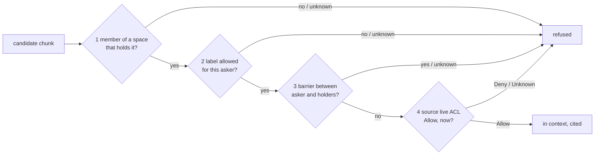

# sb-permissions(7)

## NAME

sb-permissions — how the platform decides who may see and do what

## SYNOPSIS

```text
may (principal, action, resource, context)?  →  Allow | Deny | Unknown
Unknown  ≡  Deny
read(source content)  ⇒  Cedar permits  ∧  source.ACL(user, doc) = Allow, asked now
```

## DESCRIPTION

### Three answers

Every authorisation returns `Allow`, `Deny` or `Unknown`. `Unknown` covers every way of not knowing: timeouts, errors, missing documents, permission models the connector can't map. **Callers treat `Unknown` exactly as `Deny`** (LAW-03). There is no flag to change this.

### The policy kernel

Code asks one question: `policy.Authorise(scope, action, resource)`. It returns `Allow`, `Deny` or `Unknown`, always with a reason for the audit trail.

- The principal is built from the request's `tenancy.Scope` (user, tenant, directory groups), never from request input.
- A resource that belongs to another tenant is `Deny` before any policy runs.
- `Unknown` is returned when the scope is missing, the engine returns an error, a policy fails to evaluate, the engine takes longer than 50 ms, the engine panics, or the engine returns anything that isn't exactly `Allow` or `Deny`.
- `policy.Require` returns no error only for `Allow`. Callers use it or switch on all three values. CI refuses a `switch` on a `Decision` without an explicit `Unknown` case (the `exhaustive` linter), a `default:` case in such a switch, and any `!= policy.Deny` test, which would let `Unknown` through.

### Two layers

1. **Policy** ([sb-policy(5)](sb-policy.5.md)) decides agent, tool, workflow and approval rights, and always scopes to the principal's tenant.
2. **The source** decides who can read its documents, live, when the answer is built.

For source content, both must allow.

### Prefilter versus live check

When documents are ingested, their ACL is copied into the index as a **prefilter**. Retrieval uses it to skip documents the user obviously can't see, which keeps search fast. The prefilter can be stale, so it never grants access.

Before any chunk enters the model's context, its document is checked **live** with the connector's `ACL` call, batched, with an 800 ms deadline. Only `Allow` gets through.

```text
candidates ── prefilter (fast, maybe stale) ──▶ live ACL (authoritative) ──▶ context
```

Allows are never reused across requests. Denies may be cached for 60 seconds.

### Retrieval and the live check, exactly

1. **Retrieve** (`retrieve.Retriever`): hybrid search over the asker's own tenant index only (the index is bound to one tenant, and any other scope is refused with `ETENANT`). Vector similarity and keyword match each rank up to 50 candidates; the two lists are fused by reciprocal rank (k = 60), and of two candidates with the same fused score the newer version (the one the index saw last) comes first (SB-2706); the order never changes what passes the checks below. The prefilter is part of the query: a chunk is a candidate only if its prefilter shares a token with the asker's. The asker's tokens are their user id, emails, directory groups (as `NAME` and `group:NAME`), `domain:` of each email, and the broad tokens `anyone`, `slack:members`, `linear:members` and `hubspot:users`. Over-including is safe because the prefilter never grants.
2. **Authorise** (`retrieve.Authorise`): candidates are grouped by source document, and documents by connector. Each connector gets one batched `ACL` call per request (up to 200 documents), all connectors in parallel, each with the 800 ms deadline. A document is kept only if the source answered `Allow` **and** the policy kernel allows `read` on its chunks. `Deny`, `Unknown`, a timeout, an error, a missing connector and a missing answer all drop it. A chunk inherits its document's verdict.
3. **Budget**: of the kept chunks, the 12 best-ranked enter the context.

Nothing from the live check is cached between requests. `refused` counts the documents dropped in step 2.

### Spaces, labels and barriers, exactly (SB-802)

From W10, a cell may have department spaces ([sb-spaces(7)](sb-spaces.7.md)). The permission triple then carries the ask's space context: the space asked in (or `company` for a company-wide ask), the chunk's label, the spaces that hold its document, and the barriers between the asker's groups and theirs. Three checks join the decision, and **all three run before the source's live ACL, which stays last and stays the authority**:



1. **Membership (`ESPACE`).** For an ask in space S, the chunk must be in S's scope and the asker a member of S. Otherwise the whole ask is refused with `ESPACE` before retrieval, if the asker isn't a member of S at all. For a company-wide ask, the holders are every space whose scope covers the document. The chunk passes if the asker is a member of any holder, or if its label is `public` or `internal`.
2. **Label (`ELABEL`).** `public` and `internal` pass for any asker who passed step 1. `confidential` and `restricted` pass only for members of a holding space (LAW-20). A missing or unknown label is `restricted`.
3. **Barrier (`EBARRIER`).** A chunk is refused if any barrier separates a group of the asker from a member group of any space that holds it, or from a group of the person who **owns its document at the source** (LAW-22, SB-1203). Ownership is the source's: a document owned by someone in a barred group stays invisible across the barrier even company-wide, even in no space, and even if the owner shared it with the whole company. Barriers are checked in both directions. An owner whose groups can't be read now refuses, like any `Unknown`.
4. **Source ACL.** Exactly as above (Retrieval and the live check). An `Allow` from steps 1 to 3 never skips it.

Steps 1 to 3 are the forbids in `policy/platform/spaces.cedar`, decided by the same kernel as every other permission, with the facts sb-policy(5) lists (SB-1004). A space policy can only **forbid**. Nothing in steps 1 to 3 can make a chunk usable that step 4 refuses (LAW-19): `make policy` proves it over a matrix of spaces, labels and barriers, and the law test checks it for random companies. Any `Unknown` in any step refuses (LAW-03). A cell with no spaces skips steps 1 to 3, as today.

Like `EPERM`, the new codes are reasons, not messages: a refused chunk is never named to the user. `ESPACE` is returned to the asker only for an ask in a space they aren't a member of, which names the space and nothing in it. `ELABEL` and `EBARRIER` appear in the decision list of the trace and in the operators' refusal counts (sb-admin(3)).

### Who the asker is, now (SB-1205)

Every decision is made with the asker as the directory says they are at that request: their groups (so a move between teams changes a space at the next request, LAW-21) and their attributes `department`, `division`, `cost_center`, `title` and `manager` (sb-identity(7), Attributes and moves). Nothing about the asker is taken from the sign-in token or cached between requests.

### Barriers beyond reads, exactly (SB-1203)

A barrier holds for everything the brain does, not only for what an answer reads (LAW-22). The same facts, from the manifest's `barriers:` and the directory now, decide each of these in the policy kernel (sb-policy(5)):

- **Drafts.** The ticket or thread a draft replies to passes steps 1 to 4 like a retrieved chunk: it is routed to its spaces and labelled as ingest would, with its source owner, before it is used. Every chunk the draft retrieves takes the read path above. An item across a barrier is refused with the same answer as one that doesn't exist (`EPERM`, sb-actions(3)).
- **Actions.** A tool call or proposal is refused (`EPERM`, `EBARRIER` in the audit reason) if its target item is held by a space across a barrier from the requester or owned at the source by someone in a barred group. A target the cell can't place now refuses.
- **Approvals.** Nobody approves or rejects an action whose requester is across a barrier from them, and nobody across it can read the action (`GET /v1/actions/ID` is `EPERM`, as if it didn't exist): the approver would see the other side's payload (SB-1401).
- **Owners are found by email.** A document's owner at the source is matched to the directory by any of a user's emails, ignoring case, never by their sign-in name; an email several users share counts all their groups (SB-1401).

In a cell without barriers none of these facts is set, and nothing changes.

### Shared too widely (SB-5401, SB-5402)

A source's sharing is trusted exactly, including its mistakes, so Second Brain watches for one kind: a document **shared too widely** whose content is sensitive. Its ACL copy opens it to `anyone` with the link, to a whole `domain:`, or to a group with more members than the cell's `wide_group_size` (sb-cell(5), default 500); and it holds personal data or national ids (`personal_data`, sb-ingest(7)), had a secret removed (`secret_removed`), carries a `confidential` or `restricted` label, or sits in a restricted space. Each such document is listed on its space's review list (`section=wide`) with its widest grant and the reasons, never its text, and in its owner's inbox (kind `wide`) with a link to the source.

Until its owner acts, the document is **held**: left out of answers, searches, drafts, briefs, routines and MCP results for everyone but its owner and the stewards of the spaces that hold it. Holding only narrows (LAW-19), and every exempt person is still checked live (LAW-01). The owner either narrows the sharing at the source, and the next sync clears the hold, or confirms **Shared on purpose** with a reason (`POST /v1/documents/sharing/confirm`), which is audited and lasts until the document's version or its ACL copy changes. A confirmation that can't be read releases nothing. A space may set `wide_sensitive: warn` (sb-space(5)) to use the document with a warning instead (the answer's `wide_warned`); company-wide, a document is used with a warning only when every space that holds it warns. An answer counts what it held (`held`), never which.

SharePoint and OneDrive (SB-5901): an `anonymous` sharing link counts as `anyone` and an `organization` link as `domain:`, so both make a document wide; a group grant is wide when its nested membership in Entra passes `wide_group_size`.

### Who can see this (SB-5404)

`GET /v1/documents/{id}/audience`, or `GET /v1/audience?doc=KIND:ID` repeated for a shared answer's cites, says how many active people can open the document (or every document) now: the source is asked as each of them, and a person it can't answer for is counted as `unknown`, never as able. Its groups are named only when they are the caller's own or the space's they ask in; any other group is counted (`other_groups`). It answers only for documents the caller can open now and that aren't held from them; any other id is `EPERM`, the same as one that doesn't exist.

### What users see

- Refused documents are never named. The answer says how many were refused and, if all were, "I found sources but you don't have access to them."
- `EPERM` is used for both deny and unknown, so users can't probe for a document's existence.

### What operators see

The console's refusals view breaks refusals down by connector and reason. A connector whose unknown rate exceeds 1% is a defect to fix in the connector.

## LAWS

[LAW-01](sb-laws.7.md#law-01), [LAW-02](sb-laws.7.md#law-02), [LAW-03](sb-laws.7.md#law-03), and for spaces LAW-19, LAW-20 and LAW-22 ([sb-spaces(7)](sb-spaces.7.md)).

## EXAMPLES

Carol was removed from the finance group at 09:00. At 09:04 the prefilter still lists her. She asks about bonuses:

```text
retrieve:   docs:fin-bonus@3 (prefilter match, stale)
live ACL:   docs → Deny for usr_carol
context:    fin-bonus excluded
answer:     "I found sources but you don't have access to them." refused: 1
```

## SEE ALSO

[sb-policy(5)](sb-policy.5.md), [sb-spaces(7)](sb-spaces.7.md), [sb-connector(3)](sb-connector.3.md), [06 Retrieval and authorisation](../docs/architecture/06-retrieval-and-authorisation.md), [ADR-0002](../docs/adr/ADR-0002-source-acl-is-authority.md)
